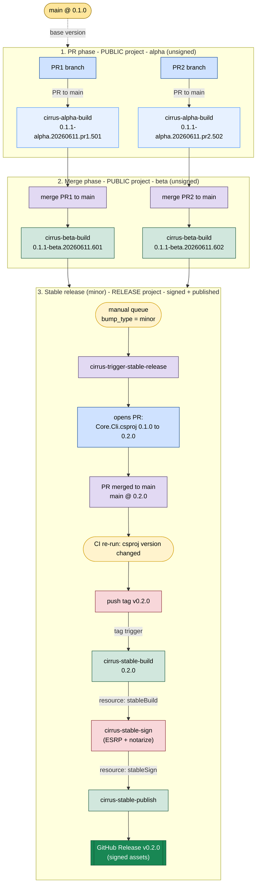

# Cirrus Pipelines: Project Boundaries, Triggers & Release Walkthrough

A focused companion to [pipelines-overview.md](pipelines-overview.md). This doc answers
two questions visually:

1. **Where** does each pipeline run (public vs release project) and **when** is it triggered?
2. **What does a real release look like** end to end, with versions, starting from `main @ 0.1.0`?

---

## 1. The three channels at a glance

| Channel | Built by | Project | Trigger | Signed? | Published? | Version shape |
| --- | --- | --- | --- | --- | --- | --- |
| **alpha** | `cirrus-alpha-build` | public | PR to `main` | No | No | `0.1.1-alpha.20260611.pr270.123456` |
| **beta** | `cirrus-beta-build` (→ `cirrus-beta-sign`) | public build, release sign | commit on `main` (batched); sign via `sign-beta` tag | Yes (opt-in) | No | `0.1.1-beta.20260611.123456` |
| **stable** | `cirrus-stable-build` → `cirrus-stable-sign` → `cirrus-stable-publish` | release | stable tag `vX.Y.Z` | Yes | Yes (GitHub release) | `0.1.1` |

Beta signing is **opt-in**: a beta build only flows into `cirrus-beta-sign` when it
carries a `sign-beta` tag. Beta is **never published** to a GitHub release (no beta
publish pipeline exists).

---

## 2. Project boundaries & triggers

### Trigger / boundary reference

| Pipeline | Project | Trigger type | Trigger condition | Produces |
| --- | --- | --- | --- | --- |
| `cirrus-alpha-build` | public | PR | PR to `main` (autoCancel) | unsigned `Distribution_Final` |
| `cirrus-beta-build` | public | CI | commit on `main` (batched) | unsigned `Distribution_Final` |
| `cirrus-beta-sign` | release | pipeline resource | `cirrus-beta-build` completes **with `sign-beta` tag** | `Distribution_Signed` (beta, unpublished) |
| `cirrus-trigger-stable-release` | release | manual **+** CI | manual queue; or `Core.Cli.csproj` changed on `main` | opens PR → pushes tag |
| `cirrus-stable-build` | release | tag | stable tag `v*` pushed | unsigned `Distribution_Final` |
| `cirrus-stable-sign` | release | pipeline resource | `cirrus-stable-build` completes | `Distribution_Signed` |
| `cirrus-stable-publish` | release | pipeline resource | `cirrus-stable-sign` completes | GitHub Release `vX.Y.Z` |

### Boundary rules

- **public = unsigned only, no secrets.** Alpha/beta builds never cross into signing
  on their own.
- **release = all signing/publishing + secrets.** Every release pipeline has a
  Preflight stage that hard-fails if `System.TeamProject != release`.
- **Only crossing point** is public beta build → release beta sign, explicitly gated
  by the `sign-beta` tag.

---

## 3. Worked example: two PRs to a minor stable release

A concrete scenario starting from `main` at `0.1.0`: two PRs each produce alpha
builds, their merges produce beta builds, then a manual **minor** stable release tags
and ships `0.2.0`.

### Version story

| Step | Event | Pipeline | Version produced | Project |
| --- | --- | --- | --- | --- |
| start | `main` base | — | `0.1.0` | — |
| 1 | PR1 opened | alpha-build | `0.1.1-alpha.<date>.pr1.501` | public |
| 1 | PR2 opened | alpha-build | `0.1.1-alpha.<date>.pr2.502` | public |
| 2 | PR1 merged to main | beta-build | `0.1.1-beta.<date>.601` | public |
| 2 | PR2 merged to main | beta-build | `0.1.1-beta.<date>.602` | public |
| 3 | manual stable (minor) | trigger-stable-release | opens PR `0.1.0 → 0.2.0` | release |
| 3 | bump PR merged | trigger (CI) | tags `v0.2.0` | release |
| 3 | tag `v0.2.0` | stable-build → sign → publish | `0.2.0` (signed) | release |

### Two things to note

1. **Alpha/beta show `0.1.1-*`, not `0.1.0-*`.** With default `bump_type=patch`,
   pre-release builds advance the base to the *next* patch (`0.1.0` → `0.1.1-alpha`/
   `0.1.1-beta`), so these in-flight builds preview a patch.
2. **The minor stable jumps to `0.2.0`, past those `0.1.1-beta` builds.** Choosing
   `minor` at stable time bumps `0.1.0 → 0.2.0` directly; the `0.1.1-beta` artifacts
   are never promoted to a `0.1.1` stable — they were validation snapshots. The
   stable version is decided fresh at release time by `bump_type`, independent of
   the pre-release labels. **Beta labels do not pre-commit the next stable number.**
