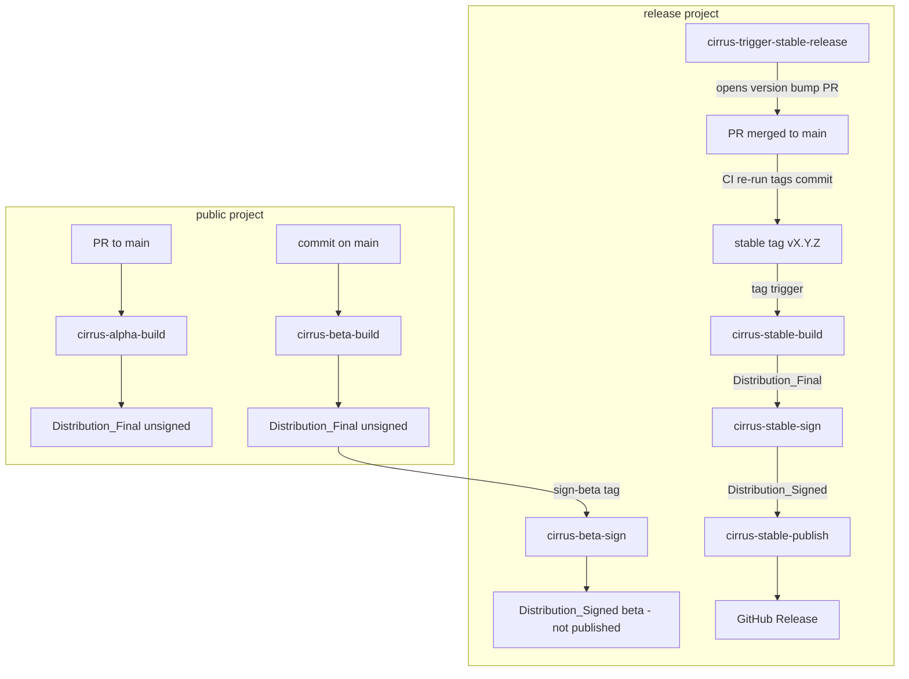
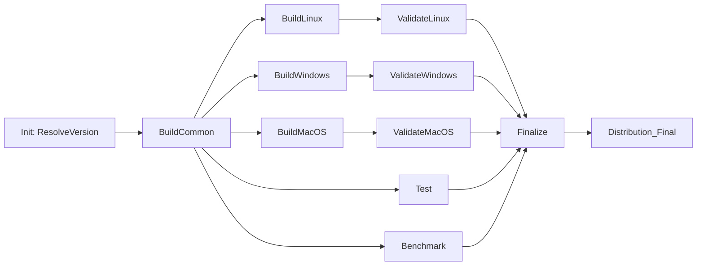
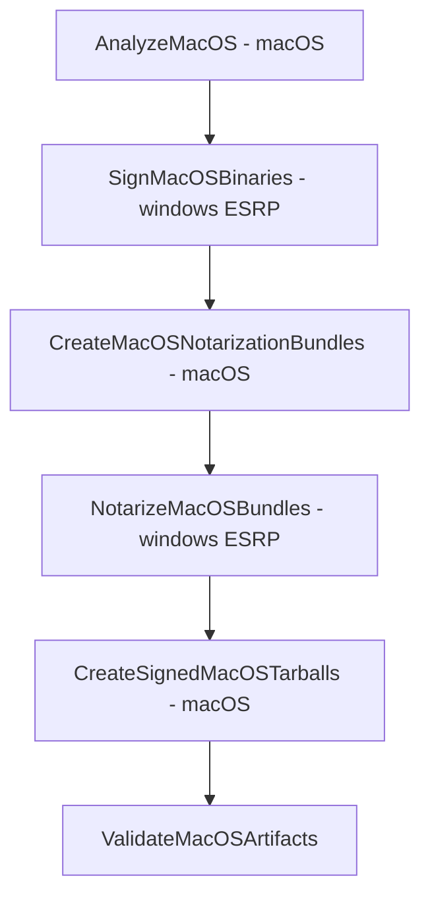
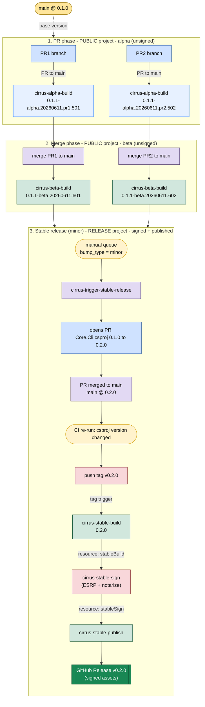

# Cirrus DevOps Pipelines Overview (Alpha / Beta / Stable)

This document explains the full Azure DevOps pipeline system for Cirrus distribution
builds, signing, and publishing. It describes how the **alpha**, **beta**, and
**stable** release channels work, how the pipelines chain together, the shared
template layout, the versioning scheme, and the trust/security boundaries.

For the original design rationale see [release-pipeline-design.md](release-pipeline-design.md).
For the validation matrix see [release-pipeline-test-plan.md](release-pipeline-test-plan.md).

---

## 1. Core principle: separation by trust boundary

The system is split across two Azure DevOps projects:

| Project | Owns | Has secrets? |
| --- | --- | --- |
| **public** | PR alpha validation builds, main beta builds. Unsigned artifacts only. | No ESRP / publish secrets. |
| **release** | Stable orchestration, stable builds, all signing/notarization, all publishing. | ESRP variable group, GitHub publish connection. |

Signing and publishing **never rebuild source**. They consume an already-built,
immutable artifact identified by a pipeline run id, so the bytes that ship are
exactly the bytes that were validated.

---

## 2. The three channels at a glance

| Channel | Built by | Project | Trigger | Signed? | Published? | Version shape |
| --- | --- | --- | --- | --- | --- | --- |
| **alpha** | `cirrus-alpha-build` | public | PR to `main` | No | No | `0.1.1-alpha.20260611.pr270.123456` |
| **beta** | `cirrus-beta-build` (→ `cirrus-beta-sign`) | public build, release sign | commit on `main` (batched); sign via `sign-beta` tag | Yes (opt-in) | No | `0.1.1-beta.20260611.123456` |
| **stable** | `cirrus-stable-build` → `cirrus-stable-sign` → `cirrus-stable-publish` | release | stable tag `vX.Y.Z` | Yes | Yes (GitHub release) | `0.1.1` |

Beta signing is **opt-in**: a beta build only flows into `cirrus-beta-sign` when it
carries a `sign-beta` tag. Beta is **never published** to a GitHub release (no beta
publish pipeline exists).

---

## 3. Entry pipelines

All entry pipelines live in `.azure-pipelines/` and are intentionally **thin** —
they set channel intent and delegate all real work to shared templates.

| File | Role |
| --- | --- |
| [cirrus-alpha-build.yml](cirrus-alpha-build.yml) | PR validation + unsigned alpha artifacts (public). |
| [cirrus-beta-build.yml](cirrus-beta-build.yml) | Unsigned beta artifacts for each trusted `main` tip (public). |
| [cirrus-beta-sign.yml](cirrus-beta-sign.yml) | ESRP sign + notarize a `sign-beta`-tagged beta build (release). No publish. |
| [cirrus-trigger-stable-release.yml](cirrus-trigger-stable-release.yml) | Opens the stable version-bump PR, then tags the merged commit (release). |
| [cirrus-stable-build.yml](cirrus-stable-build.yml) | Unsigned stable artifacts from an approved tag (release). |
| [cirrus-stable-sign.yml](cirrus-stable-sign.yml) | ESRP sign + notarize the stable build (release). |
| [cirrus-stable-publish.yml](cirrus-stable-publish.yml) | Publish signed stable artifacts to a GitHub release (release). |

> Legacy ad-hoc pipelines (`cirrus-adhoc-build/sign/publish`) are retired under
> [_archive/](_archive/) and are not part of the active flow.

---

## 4. End-to-end flow



The signing/publishing chains are wired with **Azure DevOps pipeline resources**
(not hand-copied build ids):

```text
cirrus-beta-sign      resources.pipeline.betaBuild    -> source_build_id   (sign-beta tag trigger)
cirrus-stable-sign    resources.pipeline.stableBuild  -> source_build_id
cirrus-stable-publish resources.pipeline.stableSign   -> signed_build_id
```

Each downstream pipeline auto-triggers (`trigger: true`) when its upstream resource
completes.

---

## 5. The build stage (shared by all three channels)

Every build channel calls [templates/dist/stages/build-unsigned-distribution.yml](templates/dist/stages/build-unsigned-distribution.yml),
which produces an identical `Distribution_Final` contract regardless of channel.



Stages and their jobs:

| Stage | Job template | Output |
| --- | --- | --- |
| Init (ResolveVersion) | [init-resolve-version.yml](templates/dist/stages/init-resolve-version.yml) | `ArtifactVersion` for all stages |
| BuildCommon | [build-common.yml](templates/dist/jobs/build-common.yml) | `Distribution_Common` (CLI + extension nupkgs) |
| BuildLinux | [build-linux.yml](templates/dist/jobs/build-linux.yml) | lean/full × x64/arm64 tarballs |
| BuildWindows | [build-windows.yml](templates/dist/jobs/build-windows.yml) | lean/full × x64/arm64 zips |
| BuildMacOS | [build-macos.yml](templates/dist/jobs/build-macos.yml) | lean/full × arm64/x64 tarballs |
| Test | [test-suite.yml](templates/dist/jobs/test-suite.yml) | unit test results |
| Benchmark | [benchmark-suite.yml](templates/dist/jobs/benchmark-suite.yml) | benchmark (placeholder) |
| ValidateLinux/Windows/MacOS | [validate-*.yml](templates/dist/jobs/) | bundled+extension functional checks |
| Finalize | [finalize-summary.yml](templates/dist/jobs/finalize-summary.yml) | **`Distribution_Final`** |

### `Distribution_Final` layout

The finalize job consolidates every per-platform artifact into one canonical layout
that all downstream signing/publishing consumes:

```text
Distribution_Final/
  archives/      all *.tar.gz and *.zip distribution archives
  extensions/    Microsoft.Azure.Cirrus.Extensions.*.nupkg (from extensions-pack/)
  manifest.txt   build id, branch, commit, file listing
```

---

## 6. The sign stage (beta opt-in, stable)

Both [cirrus-beta-sign.yml](cirrus-beta-sign.yml) and [cirrus-stable-sign.yml](cirrus-stable-sign.yml)
run the same [templates/dist/stages/sign-with-esrp.yml](templates/dist/stages/sign-with-esrp.yml)
template. They download the upstream build's `Distribution_Final`, sign each artifact
class via ESRP, and republish `Distribution_Signed`. The difference is only the
source: beta consumes the public `cirrus-beta-build` (gated on a `sign-beta` tag and
restricted to `main`/the signing branch), while stable consumes the release-project
`cirrus-stable-build`. Both signing pipelines run in the **release** project.

| Artifact class | ESRP operation | Notes |
| --- | --- | --- |
| NuGet (`Microsoft.Azure.Cirrus*.nupkg`) | `NuGetSign` (+ optional `NuGetVerify`) | |
| Windows (`*win-*.zip` contents) | `SigntoolSign` + `SigntoolVerify` | RFC3161 timestamp optional |
| macOS (Mach-O in tarballs) | `MacAppDeveloperSign` → `MacAppNotarize` | Developer ID; hardened runtime |
| Linux | collected only | not code-signed |

### macOS sign/notarize sub-flow

macOS is the most involved because signing runs on Windows ESRP agents while
analysis/packaging run on macOS agents:



Key facts:

- Loose Mach-O binaries (`.dylib`, `.so`, executables) **cannot be stapled**; the
  notarization ticket lives on Apple's servers and is verified online via
  Gatekeeper/OCSP. The `macos-notarized-bundles-*` artifact therefore records the
  *exact bundles that passed notarization*, not stapled bytes.
- The final tarball is assembled from the **notarized bundle payload** (direct
  provenance chain), gated on `NotarizeMacOSBundles` succeeding.
- Verification asserts `codesign --verify --deep --strict` and a Developer ID /
  `TeamIdentifier=UBF8T346G9` check on every Mach-O binary.
- An SBOM (`ManifestGeneratorTask`) is generated for the signed macOS drop.

The signing stages assemble everything into a single `Distribution_Signed`
artifact plus `signing-manifest.json` and `signing-provenance.json`.

---

## 7. The publish stage (stable only)

[cirrus-stable-publish.yml](cirrus-stable-publish.yml) consumes the signed artifact from
its `stableSign` resource and runs [templates/dist/stages/publish-to-github-release.yml](templates/dist/stages/publish-to-github-release.yml).

- **Tag mode `stableVersion`**: the GitHub tag is `v<version>` (e.g. `v0.1.1`),
  derived from the signed archive version. Requires a stable SemVer version.
- **`GitHubReleaseAllowOverwrite: false`**: refuses to overwrite an existing
  release/tag (immutable releases).
- **`GitHubReleaseIsPrerelease: false`** for stable.
- Publishes all archives + extension nupkgs as release assets, plus a
  `package-versions.csv` provenance file.

---

## 8. Versioning

Version resolution happens once, in the Init stage
([init-resolve-version.yml](templates/dist/stages/init-resolve-version.yml)). The base
version is read from `src/CLI/Core.Cli.csproj` (`<Version>`/`<VersionPrefix>`).

| Channel | Computed version | Pipeline flow |
| --- | --- | --- |
| `pr-alpha` | `X.Y.Z-alpha.<yyyyMMdd>.pr<N>.<seq>` | build |
| `beta` | `X.Y.Z-beta.<yyyyMMdd>.<seq>` | build → sign |
| `stable` | `X.Y.Z` (from the tag, after validation) | build → sign → publish |

`auto` resolution:

- **release_channel**: PR ⇒ `pr-alpha`; `main` ⇒ `beta`; SemVer tag ⇒ `stable`.
- **release_date**: current UTC `yyyyMMdd`.
- **pr_number**: ADO PR variable (alpha falls back to `0` for manual runs).
- **sequence**: `$(Build.BuildId)`.

For `pr-alpha`/`beta`, `bump_type=patch` bumps the base to the *next* patch
(so a `0.1.0` base produces `0.1.1-*` pre-releases). For `stable`, the validated
tag version wins outright — **no double bump**. Stable also enforces:

- tag is a stable SemVer tag (`vX.Y.Z`),
- tag version == CLI version in the tagged source,
- tagged commit is contained in `origin/main`.

### Stable release trigger (`cirrus-trigger-stable-release`)

Two modes in one pipeline:

1. **Manual run** → opens a PR bumping `src/CLI/Core.Cli.csproj` to the next
   `patch`/`minor`/`major` version (`<Version>`, `<InformationalVersion>`,
   `<FileVersion>` as `X.Y.Z.0`; `<AssemblyVersion>` untouched).
2. **Post-merge CI run** → if the triggering `main` commit changed *only* the
   stable version metadata line, it tags the merge commit `vX.Y.Z` after validating
   the new version is an allowed next step (patch/minor/major) from the latest
   stable tag. Existing tags (local or remote) are never overwritten.

The stable tag is the immutable release decision and triggers `cirrus-stable-build`.

---

## 9. Shared template layout

```text
.azure-pipelines/
  templates/
    variables.yml                         # agent pools (ubuntu/windows/macOS)
    dist/
      variables/
        common.yml                        # DOTNET_* env
        packaging.yml                     # Packaging*OutRoot, RIDs
        security-suppressions.yml         # SDL/scanner toggles (see Gaps)
      steps/
        validate-release-project.yml      # reusable "must run in release" guard
      stages/
        init-resolve-version.yml          # version resolution
        build-unsigned-distribution.yml   # full build graph -> Distribution_Final
        sign-with-esrp.yml                # ESRP sign + notarize -> Distribution_Signed
        publish-to-github-release.yml     # GitHub release publish
      jobs/
        build-common.yml, build-linux.yml, build-windows.yml, build-macos.yml
        test-suite.yml, benchmark-suite.yml
        validate-linux.yml, validate-windows.yml, validate-macos.yml
        finalize-summary.yml
    versioning/
      stages/resolve-version.yml          # standalone demo, NOT used by the flow
```

All entry pipelines compose the same building blocks:
`variables.yml` + `dist/variables/*` for config, `dist/steps/validate-release-project.yml`
for the release-only guard, and the `dist/stages/*` templates for the actual work.

---

## 10. Security & guardrails

- Public build pipelines do **not** import the ESRP variable group or publish
  credentials.
- Every release-project pipeline starts with a **Preflight** stage that fails unless
  `System.TeamProject == release` (via the shared `validate-release-project.yml`
  step), and validates that the upstream resource run id is present and numeric.
- Signing consumes artifacts from an explicit source project/pipeline/build id, so
  released bytes are traceable to a specific validated build.
- Stable publish uses signed artifacts only, immutable tags, and SemVer tag mode.

---

## 11. Known gaps / open decisions

These are tracked items, not blockers for the alpha/stable happy path:

1. **Extension package versioning is static.** Extension `.csproj` files hardcode
   `<Version>0.1.0</Version>` and `build_common.sh` packs without version injection,
   while only `Core.Cli.csproj` is bumped. A stable `0.1.1` therefore ships
   `…Extensions.*.0.1.0.nupkg`. Decide between injecting `ArtifactVersion` into the
   packs or an explicit independent extension-version cadence.
2. **Beta is signed but never published.** `cirrus-beta-sign` produces a signed
   `Distribution_Signed` beta artifact, but no pipeline publishes it to a GitHub
   release. Confirm this is intentional (signed beta for internal validation only).
3. **SDL scanners are disabled** (`security-suppressions.yml`) on all pipelines,
   including release ones. Confirm they are re-enabled in the production AME
   definitions.
4. **Doc drift.** `release-pipeline-design.md` still references the retired
   `cirrus-build/signing/publish` worker names and a `cirrus-beta-signing` pipeline.

---

## 12. Quick reference: how to cut a stable release

```text
1. Land changes on main via normal PRs (each produces a beta build).
2. Queue cirrus-trigger-stable-release (manual) with patch/minor/major.
3. Review + merge the generated "Bump CLI version to X.Y.Z" PR.
4. The post-merge CI run tags the commit vX.Y.Z.
5. The tag triggers cirrus-stable-build (release project).
6. cirrus-stable-sign auto-runs from the stableBuild resource.
7. cirrus-stable-publish auto-runs from the stableSign resource.
8. A GitHub release vX.Y.Z is published with signed assets.
```

---

## 13. Worked example: two PRs to a minor stable release

This walks a concrete scenario starting from `main` at `0.1.0`: two PRs each produce
alpha builds, their merges produce beta builds, then a manual **minor** stable
release tags and ships `0.2.0`.



### Version story

| Step | Event | Pipeline | Version produced | Project |
| --- | --- | --- | --- | --- |
| start | `main` base | — | `0.1.0` | — |
| 1 | PR1 opened | alpha-build | `0.1.1-alpha.<date>.pr1.501` | public |
| 1 | PR2 opened | alpha-build | `0.1.1-alpha.<date>.pr2.502` | public |
| 2 | PR1 merged to main | beta-build | `0.1.1-beta.<date>.601` | public |
| 2 | PR2 merged to main | beta-build | `0.1.1-beta.<date>.602` | public |
| 3 | manual stable (minor) | trigger-stable-release | opens PR `0.1.0 → 0.2.0` | release |
| 3 | bump PR merged | trigger (CI) | tags `v0.2.0` | release |
| 3 | tag `v0.2.0` | stable-build → sign → publish | `0.2.0` (signed) | release |

### Two things to note

1. **Alpha/beta show `0.1.1-*`, not `0.1.0-*`.** With default `bump_type=patch`,
   pre-release builds advance the base to the *next* patch (`0.1.0` → `0.1.1-alpha`/
   `0.1.1-beta`), so these in-flight builds preview a patch.
2. **The minor stable jumps to `0.2.0`, past those `0.1.1-beta` builds.** Choosing
   `minor` at stable time bumps `0.1.0 → 0.2.0` directly; the `0.1.1-beta` artifacts
   are never promoted to a `0.1.1` stable — they were validation snapshots. The
   stable version is decided fresh at release time by `bump_type`, independent of
   the pre-release labels. **Beta labels do not pre-commit the next stable number.**
