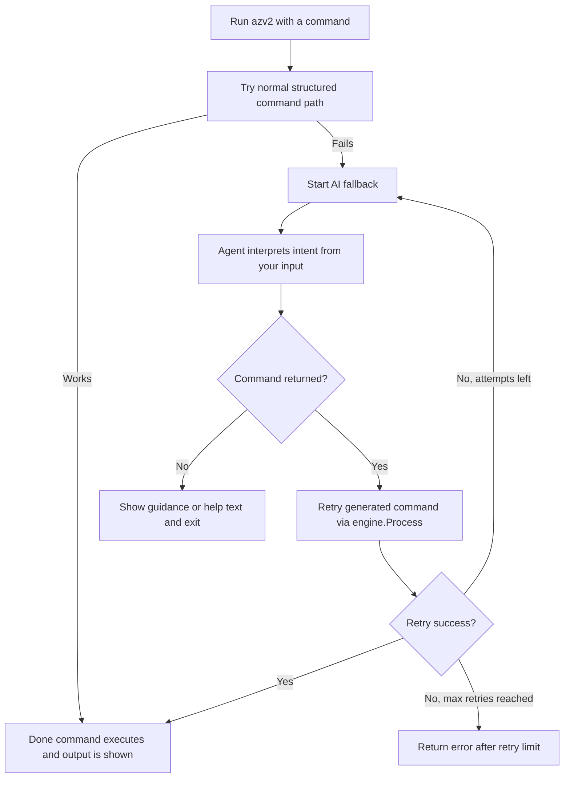

# Fallback Agent Recovery

Date: 2026-04-27

## Summary

This change restores reliable CLI fallback behavior when structured command parsing or execution fails.
The fallback now both invokes the agent and executes retried commands correctly.

## What Was Broken

1. The fallback path parsed agent-generated retry commands but did not execute them.
2. Agent failures were swallowed silently, which made fallback look inactive.

## Changes Made

### 1) Execute retried command in fallback path

File: src/CLI/Program.cs

- Added resolution of IEngine inside TryAgentFallbackAsync.
- After parsing retryArgs into CommandInvocation, call engine.Process(...).
- This makes the retry path actually execute.

### 2) Surface agent errors instead of silent swallow

File: src/Core/Core.Engine/AgentEngine.cs

- Replaced catch-all silent failure behavior with explicit exception propagation.
- Keep _extractedCommand = null and throw InvalidOperationException("Agent execution failed.", ex).

## Outcome

- Fallback flow now behaves as intended:
  1. structured parse or execute fails
  2. agent is invoked
  3. agent-produced command is retried and executed
- Agent startup and runtime failures are now visible to caller logs.

## Validation

- Solution build completed successfully after the changes.
- CLI tests passed, excluding intentionally skipped interactive AI tests.

## Diagram

