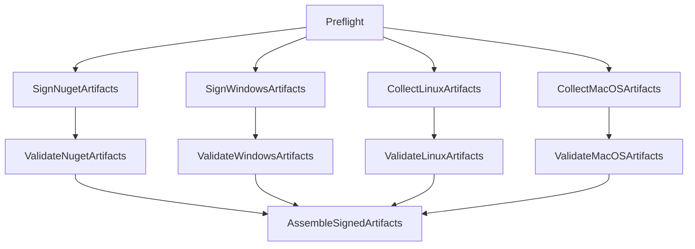

# Cirrus Fork Signing Implementation (Comprehensive)

This document describes the full signing implementation currently used in `cirrus_fork`, including pipeline architecture, ESRP integration, script behavior, artifact contracts, and operational troubleshooting.

Scope covered:
- Entry signing pipeline and stage template orchestration
- ESRP-based NuGet and Windows signing
- Linux/macOS artifact collection behavior
- Validation and final assembly flow
- Supporting PowerShell scripts used by signing jobs
- Known failure modes and the exact mitigations in the current implementation

## 1. Source-of-Truth Files

Primary implementation files:
- `.azure-pipelines/cirrus-signing.yml`
- `.azure-pipelines/templates/dist/stages/sign-with-esrp.yml`
- `devops/scripts/packaging/signing/prepare_signing_inputs.ps1`
- `devops/scripts/packaging/signing/verify_signed_outputs.ps1`
- `devops/scripts/packaging/signing/repack_signed_outputs.ps1`

Related downstream consumer:
- `.azure-pipelines/cirrus-publish.yml` (defaults to consuming `cirrus-signing` output)

## 2. High-Level Architecture

The signing flow is stage-fanout + validation + fanin assembly:

Key intent:
- Windows and NuGet are signed in ESRP.
- Linux/macOS are collected as release artifacts (no ESRP signing in this pipeline).
- Final stage assembles all validated artifacts into one publishable output.

## 3. Entry Pipeline: `.azure-pipelines/cirrus-signing.yml`

### 3.1 Trigger/Parameters
- Manual run (`trigger: none`, `pr: none`).
- Inputs:
  - `source_pipeline_name` (default `cirrus-build`)
  - `source_build_id` (specific source run to sign)
  - `signed_artifact_name` (default `Distribution_Signed`)
  - `ESRPServiceConnection` (default `ame_esrp_connection`)
  - `enable_esrp_nuget_verify` (default `false`)
  - `enable_esrp_windows_verify` (default `false`)
  - `enable_windows_timestamp` (default `false`)
  - `windows_timestamp_rfc3161` (default `/tr "http://timestamp.acs.microsoft.com" /td SHA256`)
  - `require_windows_strong_name` (default `false`)

### 3.2 Security and Project Guardrail
- Includes ESRP variable group only when `System.TeamProject == release`.
- Hard preflight gate (`EnsureReleaseProject`) fails fast if pipeline runs outside `release` project.
- Preflight also validates provenance input (`source_build_id`) is present and numeric.
- Preflight enforces SDK regression guardrails by failing if signing template reintroduces `UseDotNet useGlobalJson: true`.
- This ensures signing credentials and service connection are only used in release context.

### 3.3 Template Wiring
- Delegates all signing logic to `.azure-pipelines/templates/dist/stages/sign-with-esrp.yml`.
- Sets `dependency_stage: Preflight` so signing/collection stages fan out only after preflight succeeds.

## 4. Stage Template: `.azure-pipelines/templates/dist/stages/sign-with-esrp.yml`

## 4.1 Parameters
- Agent pools: `windows_pool`, `ubuntu_pool`
- Upstream dependency: `dependency_stage`
- Source selection: `SourceProject`, `source_pipeline_name`, `source_build_id`
- Output naming: `signed_artifact_name`
- ESRP controls:
  - `esrp_service_connection`
  - `esrp_nuget_keycode` (default `CP-401405`)
  - `esrp_authenticode_keycode` (default `CP-230012`)
  - `esrp_enable_nuget_verify` (optional ESRP-side NuGet verify pass)
  - `esrp_enable_windows_verify` (optional ESRP-side Signtool verify pass)
  - `esrp_enable_windows_timestamp` (optional timestamp parameter injection)
  - `esrp_windows_timestamp_rfc3161` (timestamp parameter payload)
  - `esrp_require_windows_strong_name` (enforces managed DLL strong-name validation)

## 4.2 Stage Breakdown

### A) `SignNugetArtifacts`
Purpose: ESRP-sign NuGet packages and publish `signed-nuget` artifact.

Flow:
1. Download source artifacts from specified pipeline/build.
2. Filter NuGets to only `Microsoft.Azure.Cirrus*.nupkg` (exclude `.snupkg` and unrelated nupkgs).
3. Prepare signing inputs via `prepare_signing_inputs.ps1`.
4. Log exactly which NuGets will be signed.
5. ESRP task (`EsrpCodeSigning@5`) with:
   - `UseMinimatch: true`
   - `Pattern: Microsoft.Azure.Cirrus*.nupkg`
   - Inline op: `NuGetSign` only (no ESRP-side NuGetVerify)
  - `batchSignPolicyFile: ''` and `ciPolicyFile: ''` explicitly set empty
  - Optional ESRP `NuGetVerify` task when policy toggle is enabled
6. Local verification via `verify_signed_outputs.ps1`.
7. Repack via `repack_signed_outputs.ps1`.
8. Publish `signed-nuget` pipeline artifact.

Nuance:
- ESRP-side `NuGetVerify` was intentionally removed. Verification is done locally using `dotnet nuget verify` for faster and more deterministic behavior.

### B) `SignWindowsArtifacts`
Purpose: ESRP-sign Windows binaries extracted from win zip payloads and publish `signed-windows`.

Flow:
1. Download source artifacts.
2. Filter to `*win-*.zip` only.
3. Prepare signing inputs via `prepare_signing_inputs.ps1` (extract zips).
4. Log exact Windows binaries targeted for signing.
5. Run 3 separate ESRP tasks (all conditioned on `HasWindowsPayload == true`):
   - `Sign Windows Payload [azv2.exe]`
   - `Sign Windows Payload [Cirrus DLLs]`
   - `Sign Windows Payload [Cirrus EXEs]`
6. Verify local Authenticode signatures via `verify_signed_outputs.ps1`.
7. Repack modified zip payloads via `repack_signed_outputs.ps1`.
8. Publish `signed-windows`.

Current Windows ESRP settings (important):
- `UseMinimatch: true`
- Recursive patterns:
  - `**/azv2.exe`
  - `**/Microsoft.Azure.Cirrus*.dll`
  - `**/Microsoft.Azure.Cirrus*.exe`
- Inline operation contains `SigntoolSign` and can optionally include `TimeStamp` when enabled.
- Optional ESRP-side `SigntoolVerify` pass is available per binary class.
- `batchSignPolicyFile: ''` and `ciPolicyFile: ''` are explicitly set empty to avoid malformed path injection.

### C) `CollectLinuxArtifacts`
Purpose: collect Linux release payloads and publish `collected-linux`.

Selection patterns:
- `*linux*.tar.gz`
- `*linux*.zip`

### D) `CollectMacOSArtifacts`
Purpose: collect macOS release payloads and publish `collected-macos`.

Selection patterns include:
- `*mac*.tar.gz`, `*macos*.tar.gz`, `*osx*.tar.gz`, `*darwin*.tar.gz`
- `*mac*.zip`, `*macos*.zip`

### E) Validation stages
Each stage validates output from one producer stage:
- `ValidateNugetArtifacts`
- `ValidateWindowsArtifacts`
- `ValidateLinuxArtifacts`
- `ValidateMacOSArtifacts`

Validation specifics:
- NuGet validate: downloads `signed-nuget`, runs `dotnet nuget verify --all` on all `.nupkg`.
- Windows validate: downloads `signed-windows`, expands zips, checks Authenticode status for expected binaries, and optionally enforces managed DLL strong-name token presence.
- Linux/mac validate: verifies at least one expected artifact exists.

Verification matrix policy:
- NuGet signing stage requires at least one `.nupkg` and verifies all selected NuGets.
- Windows signing stage requires at least one expected PE and verifies all expected binaries.
- Optional strong-name policy requires at least one managed Cirrus DLL and a non-empty public key token for each discovered DLL.

### F) `AssembleSignedArtifacts`
Depends on all 4 validation stages.

Flow:
1. Download `signed-windows`, `signed-nuget`, `collected-linux`, `collected-macos`.
2. Copy files into one `signed-release` folder.
3. Generate `signing-manifest.json` (file, sha256, size).
4. Generate `signing-provenance.json` (source build identity, signing run metadata, policy toggles, verification matrix).
5. Publish final artifact using `signed_artifact_name` parameter.

## 5. Script-Level Implementation Details

## 5.1 `prepare_signing_inputs.ps1`
Responsibilities:
- Reset working and release folders.
- Copy candidate release assets (`.tar.gz`, `.zip`, `.nupkg`) to release root.
- Copy nupkgs to `WorkingRoot/nupkg`.
- Extract Windows zips (`*win-*.zip`) into `WorkingRoot/windows-extracted`.
- Create `windows-zip-map.json` for deterministic re-pack.
- Emit pipeline variables:
  - `HasNupkg` = true/false
  - `HasWindowsPayload` = true/false

Nuance:
- `HasNupkg`/`HasWindowsPayload` are used as conditions for ESRP tasks.

## 5.2 `verify_signed_outputs.ps1`
Responsibilities:
- Verify all nupkgs under `WorkingRoot/nupkg` via `dotnet nuget verify --all`.
- Verify Authenticode for expected Windows files under `WorkingRoot/windows-extracted`.
- Enforce verification matrix expectations when requested by the caller.
- Optionally verify strong-name token presence for managed Cirrus DLLs.

Important nuance:
- Script now `Push-Location` to `WorkingRoot` before `dotnet nuget verify`.
- This avoids accidental `global.json` SDK pinning from source repo root during signing-job verification.

## 5.3 `repack_signed_outputs.ps1`
Responsibilities:
- Read `windows-zip-map.json`.
- Rebuild each Windows zip from modified extracted contents.
- Copy signed nupkgs back to release root.
- Build `signing-manifest.json` with per-file SHA256 and size.

## 6. Artifact Contracts

Producer artifacts:
- `signed-nuget`
- `signed-windows`
- `collected-linux`
- `collected-macos`

Final assembled artifact:
- Name = `${{ parameters.signed_artifact_name }}`
- Default in entry pipeline: `Distribution_Signed`

Manifest generated in final output:
- `signing-manifest.json` with fields:
  - `file` / `fileName` (source depends on stage script)
  - `sha256`
  - `size`

## 7. Security and Credential Model

ESRP task inputs reference variables from release variable group:
- `ESRPAppClientId`
- `ESRPAppTenantId`
- `ESRPKVName`
- `ESRPAuthCertName`
- `ESRPSignCertName`

Controls in place:
- Preflight hard gate enforces `release` project execution.
- ESRP service connection injected as template parameter.
- Signing only happens when expected payload flags are true.

Security boundary and least-privilege expectations:
- Only release project runs should include ESRP variable group values and service-connection usage.
- ESRP credentials (`ESRPAppClientId`, `ESRPAppTenantId`, `ESRPKVName`, `ESRPAuthCertName`, `ESRPSignCertName`) must not be duplicated into non-release projects or pipeline variable groups.
- Service connection permissions should remain scoped to the signing pipeline and approved release maintainers.
- Certificate rotation should preserve variable names while updating backing Key Vault cert versions to avoid YAML churn.
- Any policy toggle change (ESRP verify/timestamp/strong-name requirement) should be tracked in PR description and release notes because it changes trust posture and/or runtime profile.

## 8. Operational Nuances and Hardening History

These are important because they explain why current settings look the way they do.

### 8.1 Windows `Illegal characters in path`
Symptoms:
- ESRP crash in `Directory.EnumerateFiles`, often with newline pattern payload.

Mitigations now in template:
- Split Windows signing into 3 separate ESRP tasks.
- Recursive pattern per type (`**/...`).
- `UseMinimatch: true`.

### 8.2 ESRP Windows long-running/stalls
Symptoms:
- Sign step takes very long with scan/verify tail.

Mitigations now:
- Removed ESRP-side `SigntoolVerify`.
- Kept local post-sign Authenticode verification in scripts.

### 8.3 ESRP Windows parameter rejection (`TimeStamp`)
Symptoms:
- `NeoSigningServiceFailedError` with invalid/unauthorized parameter set.

Mitigation:
- Removed custom `TimeStamp` from inline SignTool parameters.
- Keep minimal, accepted parameters (`OpusName`, `OpusInfo`, `FileDigest`, `PageHash`).

### 8.4 NuGet ESRP instability / over-broad selection
Symptoms:
- ESRP failures when broad nupkg patterns include unrelated packages.

Mitigations now:
- Filter and sign only `Microsoft.Azure.Cirrus*.nupkg`.
- Log excluded nupkgs explicitly.
- Use `CP-401405` keycode default.
- Removed ESRP-side `NuGetVerify`; local verify retained.

### 8.5 Validate job `.NET SDK not found` with checkout disabled
Symptoms:
- `UseDotNet useGlobalJson: true` fails in validate jobs using `checkout: none`.

Mitigations now:
- Validate NuGet uses explicit SDK `version: 8.0.x`.
- Signing verify script executes NuGet verify from `WorkingRoot` to avoid source-root `global.json` pinning.

### 8.6 Malformed BatchSign/CI policy paths in ESRP logs
Symptoms:
- ESRP logs showed concatenated invalid-looking policy paths.

Mitigation now:
- Explicitly set `batchSignPolicyFile: ''` and `ciPolicyFile: ''` in Windows ESRP tasks.
- Same empty-policy hygiene is now applied to NuGet ESRP tasks as well.

## 9. Downstream Publishing Relationship

`cirrus-publish` defaults:
- `source_pipeline_name: cirrus-signing`
- consumes a specific signing build id

This means publish behavior is coupled to successful signing + assembly artifact output, but publish logic itself is separate from signing implementation.

## 10. How To Run and What To Check

### 10.1 Recommended run inputs for signing
- `source_pipeline_name`: upstream build pipeline producing release artifacts
- `source_build_id`: exact build to sign
- `ESRPServiceConnection`: release ESRP connection

### 10.2 Fast log checklist per stage
- Preflight: confirms `System.TeamProject == release`
- NuGet sign stage:
  - selected Cirrus nupkg count
  - excluded nupkg list (if any)
  - ESRP NuGet sign success
  - `Signed output verification completed successfully.`
- Windows sign stage:
  - binary inventory list printed
  - each of 3 ESRP tasks completes
  - verify script reports valid Authenticode
- Validation stages:
  - each artifact set downloaded and validated
- Assemble:
  - final contents listed
  - final artifact published

## 11. Maintenance Guidelines

When editing signing implementation:
- Keep producer artifact names stable unless all consumers are updated.
- Preserve stage fanout/fanin dependency model.
- Keep local verification steps even if ESRP verify is changed.
- Prefer narrow explicit patterns over broad wildcard signing patterns.
- Re-check `checkout: none` jobs for hidden source-root assumptions.

When adding new signable files:
- Add file selection to filter/inventory where appropriate.
- Ensure verify script includes validation rules for new file type.
- Ensure repack script preserves final artifact structure.

## 12. Known Gaps / Future Enhancements

Potential improvements not yet implemented:
- Add explicit telemetry summary step after each ESRP task (matched count, duration, retries).
- Add optional strict manifest schema (consistent `file` vs `fileName` field naming across scripts/stages).
- Add configurable signing profile presets (e.g., fast vs strict verify).

---

If you change any signing-related behavior, update this doc in the same PR so runtime behavior and troubleshooting guidance stay aligned.
