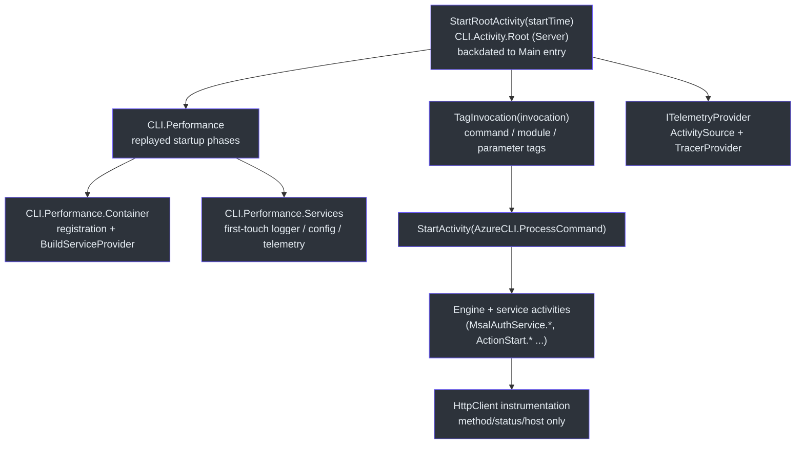

# CLI Startup Performance Telemetry Implementation Plan

> **For agentic workers:** REQUIRED SUB-SKILL: Use superpowers:subagent-driven-development (recommended) or superpowers:executing-plans to implement this plan task-by-task. Steps use checkbox (`- [ ]`) syntax for tracking.

**Goal:** Capture the CLI's startup phases — DI container construction and first-touch service resolution — as spans in the existing trace hierarchy, so `az` telemetry describes the whole invocation instead of starting after the expensive part.

**Architecture:** Startup work runs before the `ActivitySource` and its listener exist (both are created while DI resolves `ITelemetryProvider`), so spans cannot be created live. A new `PerformanceTimeline` notes `DateTime.UtcNow` at each phase boundary and replays the recorded phases as spans once telemetry is available, using OpenTelemetry's `startTime` parameter for work that has already happened. The root activity is backdated to the first line of `Main` so the recorded phases nest beneath it.

**Tech Stack:** C# / .NET 10, `System.Diagnostics.Activity`, OpenTelemetry 1.15.3, xunit 2.9.3.

**Design spec:** `docs/superpowers/specs/2026-08-10-cli-startup-performance-telemetry-design.md`

## Global Constraints

- Use the .NET SDK pinned in `global.json` (`10.0.203`, `rollForward: latestMinor`).
- Build the solution with `dotnet build azclips.slnx`.
- `src/**` builds with `TreatWarningsAsErrors=true`, `Nullable=enable`, `ImplicitUsings=enable`, `EnableNETAnalyzers=true`, `AnalysisLevel=latest`. Production code must be analyzer-clean.
- `System.Diagnostics` is **not** an implicit using — add it explicitly in production files that use `Activity`.
- Test projects have `Xunit` as an implicit using; `TreatWarningsAsErrors=false`.
- Every new file starts with the two-line copyright header used throughout the repo:
  `// Copyright (c) Microsoft Corporation.` / `// Licensed under the MIT License.`
- Do not change behaviour of `--upload-telemetry`, `--print-probe`, `--completions`, or `--completion-candidates`. They must continue to emit no telemetry.
- Both new `startTime` parameters are optional (`= default`), so no existing call site changes. There are 8 `StartRootActivity()` call sites in `src/PS/**` that must keep compiling untouched.

## File Structure

| File | Responsibility |
| --- | --- |
| `src/CLI/Telemetry/PerformanceTimeline.cs` | **New.** Records startup phases and replays them as spans. Only knows `ITelemetryService`. |
| `src/Core/Core.Abstractions/ITelemetryService.cs` | Adds optional `startTime` to two methods. |
| `src/Core/Core.Telemetry/TelemetryService.cs` | Forwards `startTime` to `ActivitySource.StartActivity`. |
| `src/Core/Core.Telemetry/DefaultTelemetryActivityNameFilter.cs` | Allows the new span names past the privacy filter. |
| `tests/Common/Stubs/StubTelemetryService.cs` | Keeps the shared stub matching the interface. |
| `src/CLI/Program.cs` | Wires the timeline into `Main`; then splits the dispatch body into a private `RunCommandAsync` so `Main` reduces to a try/finally. |
| `wiki/02-deep-dive/telemetry.md` | Documents the startup subtree and the replay mechanism. |

---

### Task 1: Optional `startTime` on the telemetry API

Without this, a span can only be stamped "now". Every later task depends on it.

**Files:**
- Modify: `src/Core/Core.Abstractions/ITelemetryService.cs:20-21`
- Modify: `src/Core/Core.Telemetry/TelemetryService.cs:37-55`
- Modify: `tests/Common/Stubs/StubTelemetryService.cs:16-20`
- Test: `tests/Core.Telemetry.Tests/TelemetryServiceStartTimeTests.cs` (create)

**Interfaces:**
- Consumes: nothing.
- Produces:
  - `Activity? ITelemetryService.StartActivity(string name, ActivityKind kind = ActivityKind.Internal, DateTimeOffset startTime = default)`
  - `Activity? ITelemetryService.StartRootActivity(DateTimeOffset startTime = default)`
  - When `startTime` is `default`, `ActivitySource` stamps the current time — behaviour is identical to today.

- [ ] **Step 1: Write the failing test**

Create `tests/Core.Telemetry.Tests/TelemetryServiceStartTimeTests.cs`:

```csharp
// Copyright (c) Microsoft Corporation.
// Licensed under the MIT License.

using System.Diagnostics;
using Core.Abstractions;
using OpenTelemetry;
using OpenTelemetry.Trace;

namespace Core.Telemetry.Tests;

/// <summary>
/// Coverage for the explicit start-time overloads. Startup work finishes before the
/// telemetry stack exists, so those phases are replayed afterwards as spans carrying
/// their original timestamps. These tests pin that the timestamps survive.
/// </summary>
public class TelemetryServiceStartTimeTests : IDisposable
{
    private readonly ActivitySource _source;
    private readonly ActivityListener _listener;
    private readonly StubTelemetryProvider _provider;
    private readonly EnabledConfigurationService _config;
    private readonly TelemetryService _telemetryService;

    public TelemetryServiceStartTimeTests()
    {
        _source = new ActivitySource("azclips-starttime-test-" + Guid.NewGuid().ToString("N"));
        _listener = new ActivityListener
        {
            ShouldListenTo = src => src == _source,
            Sample = (ref ActivityCreationOptions<ActivityContext> _) => ActivitySamplingResult.AllData,
            SampleUsingParentId = (ref ActivityCreationOptions<string> _) => ActivitySamplingResult.AllData,
        };
        ActivitySource.AddActivityListener(_listener);

        _provider = new StubTelemetryProvider(_source);
        _config = new EnabledConfigurationService();
        _telemetryService = new TelemetryService(_provider, _config, ClientType.CLI);
    }

    public void Dispose()
    {
        _telemetryService.Dispose();
        _listener.Dispose();
        _source.Dispose();
        GC.SuppressFinalize(this);
    }

    [Fact]
    public void StartActivity_WithPastStartTime_UsesThatStartTime()
    {
        var past = DateTimeOffset.UtcNow.AddMilliseconds(-500);

        using var activity = _telemetryService.StartActivity("test.op", ActivityKind.Internal, past);

        Assert.NotNull(activity);
        Assert.Equal(past.UtcDateTime, activity.StartTimeUtc);
    }

    [Fact]
    public void StartActivity_WithoutStartTime_StampsCurrentTime()
    {
        var before = DateTime.UtcNow;

        using var activity = _telemetryService.StartActivity("test.op");

        Assert.NotNull(activity);
        Assert.InRange(activity.StartTimeUtc, before, DateTime.UtcNow);
    }

    [Fact]
    public void StartActivity_PastStartTimePlusExplicitEnd_ProducesRecordedDuration()
    {
        var start = DateTimeOffset.UtcNow.AddMilliseconds(-500);
        var end = start.AddMilliseconds(300);

        using var activity = _telemetryService.StartActivity("test.op", ActivityKind.Internal, start);
        activity!.SetEndTime(end.UtcDateTime);

        Assert.Equal(TimeSpan.FromMilliseconds(300), activity.Duration);
    }

    [Fact]
    public void StartRootActivity_WithPastStartTime_BackdatesAndKeepsInvariantTags()
    {
        var past = DateTimeOffset.UtcNow.AddMilliseconds(-500);

        using var activity = _telemetryService.StartRootActivity(past);

        Assert.NotNull(activity);
        Assert.Equal(past.UtcDateTime, activity.StartTimeUtc);
        Assert.Equal("CLI", activity.GetTagItem(TelemetryTags.ClientType));
        Assert.NotNull(activity.GetTagItem(TelemetryTags.ProductVersion));
    }

    /// <summary>Minimal ITelemetryProvider exposing a caller-supplied ActivitySource.</summary>
    private sealed class StubTelemetryProvider : ITelemetryProvider
    {
        public StubTelemetryProvider(ActivitySource source)
        {
            ActivitySource = source;
            // Dedicated TracerProvider so TelemetryService.Dispose() does not dispose
            // the shared TracerProvider.Default used by other tests in this process.
            TracerProvider = Sdk.CreateTracerProviderBuilder().Build()!;
        }

        public ActivitySource ActivitySource { get; }
        public TracerProvider TracerProvider { get; }
    }

    /// <summary>IConfigurationService stub that always reports telemetry as enabled.</summary>
    private sealed class EnabledConfigurationService : IConfigurationService
    {
        public T GetConfiguration<T>(string? key = null, T? defaultValue = null) where T : class, new()
        {
            if (typeof(T) == typeof(TelemetryOptions))
            {
                return (T)(object)new TelemetryOptions { Enabled = true };
            }
            return defaultValue ?? new T();
        }

        public Task SetConfigurationAsync(string key, object? value, bool force = false, CancellationToken cancellationToken = default) => throw new NotSupportedException();
        public Task DeleteConfigurationAsync(string key, bool force = false, CancellationToken cancellationToken = default) => throw new NotSupportedException();
        public Task<Dictionary<string, object?>> ListConfigurationAsync(bool includeDefaults = false, CancellationToken cancellationToken = default) => throw new NotSupportedException();
        public Task<object?> ResolveDefaultParameterAsync(string name, CancellationToken cancellationToken = default) => throw new NotSupportedException();
        public string GetConfigFilePath() => throw new NotSupportedException();
        public IConfigurationSchema GetSchema() => throw new NotSupportedException();
    }
}
```

- [ ] **Step 2: Run the test to verify it fails**

```bash
dotnet test tests/Core.Telemetry.Tests/Core.Telemetry.Tests.csproj --filter "FullyQualifiedName~TelemetryServiceStartTimeTests"
```

Expected: compile error — `StartActivity` takes 2 arguments, not 3; `StartRootActivity` takes 0.

- [ ] **Step 3: Add the parameters to the interface**

In `src/Core/Core.Abstractions/ITelemetryService.cs`, replace the two declarations:

```csharp
    /// <summary>
    /// Starts a new activity with the given <paramref name="name"/> and <paramref name="kind"/>.
    /// Returns <c>null</c> if no listener (TracerProvider) is attached to the underlying source.
    /// </summary>
    /// <param name="startTime">
    /// Start timestamp for work that has already happened. Leave unset for live spans —
    /// per the OpenTelemetry spec this "SHOULD only be set when span creation time has
    /// already passed", e.g. replaying startup phases that ran before telemetry existed.
    /// </param>
    Activity? StartActivity(string name, ActivityKind kind = ActivityKind.Internal, DateTimeOffset startTime = default);

    /// <param name="startTime">See <see cref="StartActivity"/>.</param>
    Activity? StartRootActivity(DateTimeOffset startTime = default);
```

- [ ] **Step 4: Forward the parameter in TelemetryService**

In `src/Core/Core.Telemetry/TelemetryService.cs`, replace `StartActivity` and `StartRootActivity`:

```csharp
    public Activity? StartActivity(string name, ActivityKind kind = ActivityKind.Internal, DateTimeOffset startTime = default)
    {
        if (!IsTelemetryEnabled()) return null;

        // parentContext: default keeps the ambient Activity.Current parenting the
        // two-argument overload gives us; only the start timestamp is being added.
        return _telemetryProvider.ActivitySource
            .StartActivity(name, kind, parentContext: default, tags: null, links: null, startTime: startTime)
            ?.SetTag(TelemetryTags.EventName, name);
    }

    public Activity? StartRootActivity(DateTimeOffset startTime = default)
    {
        // No redundant IsTelemetryEnabled() here — StartActivity below is the single gate.
        var activity = StartActivity($"{_clientType.ToString()}.Activity.Root", ActivityKind.Server, startTime);
        if (activity is null) return null;
        activity.SetTag(TelemetryTags.InstallationId, TelemetryPropertyResolver.InstallationId);
        activity.SetTag(TelemetryTags.ProductName, TelemetryPropertyResolver.ProductName);
        activity.SetTag(TelemetryTags.ProductVersion, TelemetryPropertyResolver.ProductVersion);
        activity.SetTag(TelemetryTags.SchemaVersion, TelemetryTags.Version);
        activity.SetTag(TelemetryTags.TelemetryVersion, TelemetryPropertyResolver.TelemetryVersion);
        activity.SetTag(TelemetryTags.ClientType, _clientType.ToString());
        return activity;
    }
```

- [ ] **Step 5: Update the shared test stub**

In `tests/Common/Stubs/StubTelemetryService.cs`, replace the two methods:

```csharp
    public Activity? StartActivity(string name, ActivityKind kind = ActivityKind.Internal, DateTimeOffset startTime = default) =>
        ActivitySource.StartActivity(name, kind, parentContext: default, tags: null, links: null, startTime: startTime);

    public Activity? StartRootActivity(DateTimeOffset startTime = default) =>
        ActivitySource.StartActivity("Stub.Activity.Root", ActivityKind.Server, parentContext: default, tags: null, links: null, startTime: startTime);
```

- [ ] **Step 6: Run the tests to verify they pass**

```bash
dotnet test tests/Core.Telemetry.Tests/Core.Telemetry.Tests.csproj --filter "FullyQualifiedName~TelemetryServiceStartTimeTests"
```

Expected: 4 passed.

- [ ] **Step 7: Verify nothing else broke**

```bash
dotnet build azclips.slnx
dotnet test tests/Core.Telemetry.Tests/Core.Telemetry.Tests.csproj
```

Expected: build succeeds (the 8 `StartRootActivity()` call sites under `src/PS/**` still compile because the parameter is optional), all telemetry tests pass.

- [ ] **Step 8: Commit**

```bash
git add src/Core/Core.Abstractions/ITelemetryService.cs src/Core/Core.Telemetry/TelemetryService.cs tests/Common/Stubs/StubTelemetryService.cs tests/Core.Telemetry.Tests/TelemetryServiceStartTimeTests.cs
git commit -m "{Telemetry} Allow activities to be started with an explicit past timestamp"
```

---

### Task 2: `PerformanceTimeline` and its allowlist entries

The recorder itself, plus the privacy-filter entries its span names need. Both are required for a single span to reach disk, so they ship together.

**Files:**
- Create: `src/CLI/Telemetry/PerformanceTimeline.cs`
- Modify: `src/Core/Core.Telemetry/DefaultTelemetryActivityNameFilter.cs:20-22`
- Test: `tests/Cli.Tests/Telemetry/PerformanceTimelineTests.cs` (create)
- Test: `tests/Core.Telemetry.Tests/ActivityNameFilterTests.cs:15-47`

**Interfaces:**
- Consumes: `ITelemetryService.StartActivity(string, ActivityKind, DateTimeOffset)` from Task 1.
- Produces, in namespace `Core.Cli.Telemetry`:
  - `internal sealed class PerformanceTimeline`
  - `DateTime PerformanceTimeline.StartedAt { get; }` — set at construction
  - `IDisposable PerformanceTimeline.Measure(string name)`
  - `void PerformanceTimeline.Replay(ITelemetryService telemetry)`
  - Emitted span names: `CLI.Performance` (the enclosing span, created by `Replay`) and whatever names callers pass to `Measure`.

- [ ] **Step 1: Write the failing tests**

Create `tests/Cli.Tests/Telemetry/PerformanceTimelineTests.cs`:

```csharp
// Copyright (c) Microsoft Corporation.
// Licensed under the MIT License.

using System.Diagnostics;
using Core.Abstractions;
using Core.Cli.Telemetry;

namespace Cli.Tests.Telemetry;

/// <summary>
/// PerformanceTimeline records startup phases before the telemetry stack exists and
/// replays them afterwards. These tests pin the two properties that make the replay
/// trustworthy: recorded durations survive, and recorded nesting survives.
/// </summary>
public class PerformanceTimelineTests
{
    [Fact]
    public void Replay_EmitsMeasuredPhaseWithItsRecordedDuration()
    {
        using var telemetry = new RecordingTelemetryService();
        var timeline = new PerformanceTimeline();

        using (timeline.Measure("CLI.Performance.Container"))
        {
            Thread.Sleep(20);
        }

        timeline.Replay(telemetry);

        var container = Assert.Single(telemetry.Stopped, a => a.OperationName == "CLI.Performance.Container");
        // Sleep(20) can overshoot on Windows' ~15.6ms timer, so assert a floor, not equality.
        Assert.InRange(container.Duration.TotalMilliseconds, 15d, 5000d);
    }

    [Fact]
    public void Replay_WrapsPhasesInAnEnclosingPerformanceSpan()
    {
        using var telemetry = new RecordingTelemetryService();
        var timeline = new PerformanceTimeline();

        using (timeline.Measure("CLI.Performance.Container"))
        {
        }

        timeline.Replay(telemetry);

        var container = Assert.Single(telemetry.Stopped, a => a.OperationName == "CLI.Performance.Container");
        Assert.Equal("CLI.Performance", container.Parent?.OperationName);
    }

    [Fact]
    public void Replay_SequentialMeasures_BecomeSiblings()
    {
        using var telemetry = new RecordingTelemetryService();
        var timeline = new PerformanceTimeline();

        using (timeline.Measure("first"))
        {
        }

        using (timeline.Measure("second"))
        {
        }

        timeline.Replay(telemetry);

        var first = Assert.Single(telemetry.Stopped, a => a.OperationName == "first");
        var second = Assert.Single(telemetry.Stopped, a => a.OperationName == "second");
        Assert.Equal("CLI.Performance", first.Parent?.OperationName);
        Assert.Equal("CLI.Performance", second.Parent?.OperationName);
    }

    [Fact]
    public void Replay_NestedMeasures_BecomeNestedSpans()
    {
        using var telemetry = new RecordingTelemetryService();
        var timeline = new PerformanceTimeline();

        using (timeline.Measure("outer"))
        using (timeline.Measure("inner"))
        {
        }

        timeline.Replay(telemetry);

        var outer = Assert.Single(telemetry.Stopped, a => a.OperationName == "outer");
        var inner = Assert.Single(telemetry.Stopped, a => a.OperationName == "inner");
        Assert.Equal("CLI.Performance", outer.Parent?.OperationName);
        Assert.Equal("outer", inner.Parent?.OperationName);
    }

    [Fact]
    public void Replay_WithNothingMeasured_EmitsNothing()
    {
        using var telemetry = new RecordingTelemetryService();

        new PerformanceTimeline().Replay(telemetry);

        Assert.Empty(telemetry.Stopped);
    }

    [Fact]
    public void Replay_WhenTelemetryIsDisabled_DoesNotThrow()
    {
        // With telemetry.enabled=false every StartActivity returns null. Replay must
        // tolerate that rather than NullReferenceException on the way out of az.
        var timeline = new PerformanceTimeline();

        using (timeline.Measure("CLI.Performance.Container"))
        {
        }

        timeline.Replay(new NullTelemetryService());
    }

    [Fact]
    public void StartedAt_IsCapturedAtConstruction()
    {
        var beforeConstruction = DateTime.UtcNow;
        var timeline = new PerformanceTimeline();
        var afterConstruction = DateTime.UtcNow;

        Assert.InRange(timeline.StartedAt, beforeConstruction, afterConstruction);
    }

    /// <summary>ITelemetryService backed by a real ActivitySource plus a listener, so
    /// spans are actually created and their stop events can be inspected.</summary>
    private sealed class RecordingTelemetryService : ITelemetryService
    {
        private readonly ActivitySource _source;
        private readonly ActivityListener _listener;

        public RecordingTelemetryService()
        {
            _source = new ActivitySource("perf-timeline-test-" + Guid.NewGuid().ToString("N"));
            _listener = new ActivityListener
            {
                ShouldListenTo = src => src == _source,
                Sample = (ref ActivityCreationOptions<ActivityContext> _) => ActivitySamplingResult.AllData,
                SampleUsingParentId = (ref ActivityCreationOptions<string> _) => ActivitySamplingResult.AllData,
                ActivityStopped = Stopped.Add,
            };
            ActivitySource.AddActivityListener(_listener);
        }

        public List<Activity> Stopped { get; } = new();

        public Activity? StartActivity(string name, ActivityKind kind = ActivityKind.Internal, DateTimeOffset startTime = default) =>
            _source.StartActivity(name, kind, parentContext: default, tags: null, links: null, startTime: startTime);

        public Activity? StartRootActivity(DateTimeOffset startTime = default) =>
            StartActivity("Test.Activity.Root", ActivityKind.Server, startTime);

        public Activity? TagInvocation(CommandInvocation commandInvocation) => Activity.Current;

        public Activity? AddTag(string propertyName, object? value, Activity? activity = null) => activity;

        public void Dispose()
        {
            _listener.Dispose();
            _source.Dispose();
        }
    }

    /// <summary>Stands in for a telemetry service with telemetry.enabled=false.</summary>
    private sealed class NullTelemetryService : ITelemetryService
    {
        public Activity? StartActivity(string name, ActivityKind kind = ActivityKind.Internal, DateTimeOffset startTime = default) => null;
        public Activity? StartRootActivity(DateTimeOffset startTime = default) => null;
        public Activity? TagInvocation(CommandInvocation commandInvocation) => null;
        public Activity? AddTag(string propertyName, object? value, Activity? activity = null) => null;
        public void Dispose() { }
    }
}
```

Add the new names to the two existing theories in `tests/Core.Telemetry.Tests/ActivityNameFilterTests.cs` — one line into the exact-name theory (after the `"AzureCLI.ProcessCommand"` line):

```csharp
    [InlineData("CLI.Performance")]
```

and one line into the prefix theory (after the `"ActionStart.MyClass.MyMethod"` line):

```csharp
    [InlineData("CLI.Performance.Container")]
```

- [ ] **Step 2: Run the tests to verify they fail**

```bash
dotnet test tests/Cli.Tests/Cli.Tests.csproj --filter "FullyQualifiedName~PerformanceTimelineTests"
```

Expected: compile error — `PerformanceTimeline` does not exist.

```bash
dotnet test tests/Core.Telemetry.Tests/Core.Telemetry.Tests.csproj --filter "FullyQualifiedName~ActivityNameFilterTests"
```

Expected: 2 failures — `CLI.Performance` and `CLI.Performance.Container` are not allowed.

- [ ] **Step 3: Create PerformanceTimeline**

Create `src/CLI/Telemetry/PerformanceTimeline.cs`:

```csharp
// Copyright (c) Microsoft Corporation.
// Licensed under the MIT License.

using System.Diagnostics;
using Core.Abstractions;

namespace Core.Cli.Telemetry;

/// <summary>
/// Times startup phases that run before the telemetry stack exists.
///
/// The <see cref="ActivitySource"/> and the listener that exports it are both created
/// while DI resolves <c>ITelemetryProvider</c>, so <c>StartActivity</c> returns
/// <see langword="null"/> until then — startup cannot be traced live. This type notes
/// <see cref="DateTime.UtcNow"/>, the same clock <c>Activity.Start()</c> uses, and
/// <see cref="Replay"/> materialises the recorded phases as spans once telemetry is
/// available. Same clock, read early and used late.
/// </summary>
internal sealed class PerformanceTimeline
{
    /// <summary>Name of the span that encloses every recorded phase.</summary>
    private const string EnclosingSpanName = "CLI.Performance";

    private readonly List<Phase> _roots = new();
    private readonly Stack<Phase> _open = new();

    /// <summary>
    /// When the timeline began. Used to backdate the root activity so the replayed
    /// phases nest beneath it rather than starting before it.
    /// </summary>
    public DateTime StartedAt { get; } = DateTime.UtcNow;

    /// <summary>
    /// Times the enclosing block. Nested calls produce nested spans; sequential calls
    /// produce siblings.
    /// </summary>
    public IDisposable Measure(string name)
    {
        var phase = new Phase(name, this);
        (_open.Count > 0 ? _open.Peek().Children : _roots).Add(phase);
        _open.Push(phase);
        return phase;
    }

    /// <summary>
    /// Replays the recorded phases as spans beneath the current activity. Call once the
    /// root activity has started. No-op when nothing was measured, and safe when
    /// telemetry is disabled — every <c>StartActivity</c> then returns null.
    /// </summary>
    public void Replay(ITelemetryService telemetry)
    {
        if (_roots.Count == 0) return;

        using var enclosing = telemetry.StartActivity(EnclosingSpanName, ActivityKind.Internal, StartedAt);
        foreach (var root in _roots)
        {
            Emit(telemetry, root);
        }

        // The last top-level phase to be recorded is the last one to finish.
        enclosing?.SetEndTime(_roots[^1].End);
    }

    private static void Emit(ITelemetryService telemetry, Phase phase)
    {
        // The span stays current while its children are created, so the ambient
        // Activity.Current parenting reproduces the recorded nesting.
        using var span = telemetry.StartActivity(phase.Name, ActivityKind.Internal, phase.Start);
        foreach (var child in phase.Children)
        {
            Emit(telemetry, child);
        }

        span?.SetEndTime(phase.End);
    }

    private sealed class Phase : IDisposable
    {
        private readonly PerformanceTimeline _timeline;
        private bool _disposed;

        public Phase(string name, PerformanceTimeline timeline)
        {
            Name = name;
            _timeline = timeline;
        }

        public string Name { get; }

        public DateTime Start { get; } = DateTime.UtcNow;

        public DateTime End { get; private set; }

        public List<Phase> Children { get; } = new();

        public void Dispose()
        {
            if (_disposed) return;
            _disposed = true;
            End = DateTime.UtcNow;
            _timeline._open.Pop();
        }
    }
}
```

- [ ] **Step 4: Allow the new names past the privacy filter**

In `src/Core/Core.Telemetry/DefaultTelemetryActivityNameFilter.cs`, add to `AllowedExactNames` immediately after the `"AzureCLI.ProcessCommand"` entry:

```csharp
        // Startup phases, replayed by the CLI's PerformanceTimeline once telemetry
        // is available. Encloses the CLI.Performance.* phase spans below.
        "CLI.Performance",
```

and add to `AllowedNamePrefixes`, after the `"ActionStart."` entry:

```csharp
        // Individual startup phases: CLI.Performance.Container, CLI.Performance.Services.
        "CLI.Performance.",
```

- [ ] **Step 5: Run the tests to verify they pass**

```bash
dotnet test tests/Cli.Tests/Cli.Tests.csproj --filter "FullyQualifiedName~PerformanceTimelineTests"
dotnet test tests/Core.Telemetry.Tests/Core.Telemetry.Tests.csproj --filter "FullyQualifiedName~ActivityNameFilterTests"
```

Expected: 7 passed in `PerformanceTimelineTests`, all `ActivityNameFilterTests` pass.

- [ ] **Step 6: Commit**

```bash
git add src/CLI/Telemetry/PerformanceTimeline.cs src/Core/Core.Telemetry/DefaultTelemetryActivityNameFilter.cs tests/Cli.Tests/Telemetry/PerformanceTimelineTests.cs tests/Core.Telemetry.Tests/ActivityNameFilterTests.cs
git commit -m "{Telemetry} Add PerformanceTimeline for replaying CLI startup phases"
```

---

### Task 3: Measure startup in `Program.Main`

Wires the timeline in. Structure of `Main` is otherwise untouched — the flattening is Task 4, so a reviewer can judge the measurement and the restructuring separately.

**Files:**
- Modify: `src/CLI/Program.cs:37-90`

**Interfaces:**
- Consumes: `PerformanceTimeline` (`StartedAt`, `Measure`, `Replay`) from Task 2; `StartRootActivity(DateTimeOffset)` from Task 1.
- Produces: a trace shaped `CLI.Activity.Root` → `CLI.Performance` → { `CLI.Performance.Container`, `CLI.Performance.Services` }, plus the existing `AzureCLI.ProcessCommand`.

- [ ] **Step 1: Add the using directive**

In `src/CLI/Program.cs`, the `using Core.Cli.Telemetry;` directive is already present (line 11) for `CLITelemetryProvider`. No change needed — confirm it is there before continuing.

- [ ] **Step 2: Start the timeline at the top of Main**

Replace the first line of `Main`:

```csharp
    public static async Task<int> Main(string[] args)
    {
        // Starts the clock for startup measurement. Nothing is emitted until telemetry
        // exists; see PerformanceTimeline.
        var performance = new PerformanceTimeline();
        bool isBareInvocation = args.Length == 0;
```

- [ ] **Step 3: Wrap container construction**

Replace the registration + initialize block (currently `AzclipsServiceProvider.PrependRegistration(...)` through `AzclipsServiceProvider.Initialize(_clientType);`) with:

```csharp
        using (performance.Measure("CLI.Performance.Container"))
        {
            AzclipsServiceProvider.PrependRegistration(services =>
            {
                services.AddSingleton<IExtensionLoader, BundledExtensionLoader>();
                services.AddSingleton<IExtensionLoader, InstalledExtensionLoader>();
                services.AddSingleton<PropertyParser>();
                services.AddCliExtensionDispatch();
            });
            AzclipsServiceProvider.OverrideRegistration(services =>
            {
                services.AddSingleton<IAssemblyLoadingProvider, CLIAssemblyLoadingProvider>();
                services.AddSingleton<IArgumentParsingProvider, CLIArgumentParsingProvider>();
                services.AddSingleton<ITelemetryProvider, CLITelemetryProvider>();
                services.AddSingleton<IUserAgentHandler, CLIUserAgentHandler>();
            });
            AzclipsServiceProvider.Initialize(_clientType);
        }
```

- [ ] **Step 4: Wrap service resolution**

Replace the three `GetRequiredService` lines (currently `_logger = ...` through `var telemetryService = ...`) with:

```csharp
        // BuildServiceProvider only builds the container graph; these singletons are
        // constructed on first touch — including CLITelemetryProvider, which builds the
        // whole OpenTelemetry pipeline. Measured separately from the container for that reason.
        IConfigurationService configurationService;
        ITelemetryService telemetryService;
        using (performance.Measure("CLI.Performance.Services"))
        {
            _logger = AzclipsServiceProvider.GetRequiredService<ILoggingService>();
            configurationService = AzclipsServiceProvider.GetRequiredService<IConfigurationService>();
            telemetryService = AzclipsServiceProvider.GetRequiredService<ITelemetryService>();
        }
```

- [ ] **Step 5: Backdate the root and replay the phases**

Replace the `using var activity = telemetryService.StartRootActivity();` line inside the `try` with:

```csharp
            using var activity = telemetryService.StartRootActivity(performance.StartedAt);
            performance.Replay(telemetryService);
```

- [ ] **Step 6: Build and run the CLI test suite**

```bash
dotnet build azclips.slnx
dotnet test tests/Cli.Tests/Cli.Tests.csproj
```

Expected: build succeeds, all tests pass — including `ProgramFallbackTests.Fallback_ShouldNotBeInvoked_ForHelpFlags`, which calls `Program.Main` directly.

- [ ] **Step 7: Verify the trace by hand**

```bash
dotnet build azclips.slnx
./artifacts/Debug/Core.Cli/az --version
```

Then inspect the newest trace file under `%LocalAppData%/Azclips/traces`:

```powershell
Get-ChildItem "$env:LocalAppData/Azclips/traces/traces-*.log" |
  Sort-Object LastWriteTime -Descending |
  Select-Object -First 1 |
  Get-Content |
  Select-String -Pattern "OperationName|Duration"
```

Expected: `CLI.Performance`, `CLI.Performance.Container`, and `CLI.Performance.Services` all present with non-zero durations, alongside `CLI.Activity.Root`.

- [ ] **Step 8: Verify the exempt paths still emit nothing**

```bash
./artifacts/Debug/Core.Cli/az --completions > $null
./artifacts/Debug/Core.Cli/az --print-probe --list > $null
```

Expected: no new `traces-*.log` file is created by either command — both return before the root activity starts.

- [ ] **Step 9: Commit**

```bash
git add src/CLI/Program.cs
git commit -m "{CLI} Measure DI container and service resolution in startup telemetry"
```

---

### Task 4: Flatten `Main` into `RunCommandAsync` and update the docs

**Files:**
- Modify: `src/CLI/Program.cs` — `Main`'s `try` / `catch` / `finally`, extracting the dispatch body into a new private `RunCommandAsync` in the same file (line numbers shift after Task 3; locate by content)
- Modify: `wiki/02-deep-dive/telemetry.md:19-39`

**Interfaces:**
- Consumes: everything from Task 3.
- Produces: no public API change. `Main` keeps its signature; `RunCommandAsync` is private. Exit
  codes and emitted spans are unchanged, with one deliberate behaviour change called out in
  Step 1 below.

- [ ] **Step 1: Collapse the nested try into one level**

`Main` currently nests a `try`/`catch` inside an outer `try`/`finally`. That nesting is **load-bearing**, and naively flattening it breaks telemetry — verified against the real OpenTelemetry SDK:

| Question | Result |
| --- | --- |
| `using var` declared inside the `try` (today's code) | disposes **before** the enclosing `finally` |
| `using var` hoisted to method scope | disposes **after** the `finally` — too late |
| `TracerProvider.Dispose()` with the root span still running | span is **never exported**, even if stopped later |
| Root span stopped before `TracerProvider.Dispose()` | exported correctly |

A processor only receives a span when the activity *stops*; a still-running activity was never handed to it, so provider disposal has nothing to flush. The inner `try` exists so the `catch` blocks can see `activity` while its `using` scope still closes before `AzclipsServiceProvider.Dispose()`.

So keep `using` — and get the flattening by moving the dispatch body into a private `RunCommandAsync`. The root span then disposes when that method returns, which is before `Main`'s `finally` disposes the container. `Main` drops to a try/finally with a single statement in it.

One deliberate behaviour change: `GetRequiredService<ExtensionDispatcher>()` currently sits between the two `try` blocks, so a container failure there escapes `Main` as an unhandled exception. It moves inside the `try`, where the existing `catch (Exception)` routes it to `TryAgentFallbackAsync` and returns an exit code instead of crashing.

Replace the whole outer `try { ... } finally { ... }` block in `Main` with:

```csharp
        try
        {
            return await RunCommandAsync(args, isBareInvocation, performance, configurationService, telemetryService);
        }
        finally
        {
            // Route through streams.WriteDebug (level-gated) so the aggregate table stays
            // silent under warn/error and only surfaces under --debug. Routing through
            // _logger would fall back to ConsoleLoggingService here (session's UseScope
            // was already disposed) and leak the table regardless of level.
            ExtensionLoadTracker.EmitSummary(msg => streams.WriteDebug(msg, default).GetAwaiter().GetResult());
            AzclipsServiceProvider.Dispose();
            SpawnTelemetryUploader();
        }
    }

    /// <summary>
    /// Parses the invocation and runs it, owning the root telemetry activity for its lifetime.
    /// </summary>
    /// <remarks>
    /// Separate from <see cref="Main"/> for span ordering, not just readability: the root
    /// activity must stop while the exporter is still alive, and disposing the DI container
    /// disposes the TracerProvider. Because this method's <c>using</c> runs to completion
    /// before the awaiting caller resumes, the span is always stopped before Main's
    /// <c>finally</c> disposes the container.
    /// </remarks>
    private static async Task<int> RunCommandAsync(
        string[] args,
        bool isBareInvocation,
        PerformanceTimeline performance,
        IConfigurationService configurationService,
        ITelemetryService telemetryService)
    {
        using var activity = telemetryService.StartRootActivity(performance.StartedAt);
        performance.Replay(telemetryService);

        // Safe defaults in case GlobalArgParser.Parse throws (invalid --output).
        var outputJson = false;
        var positional = args;

        try
        {
            // Moved inside the try by the flattening — see the behaviour note above.
            var dispatcher = AzclipsServiceProvider.GetRequiredService<ExtensionDispatcher>();

            var globalArgs = GlobalArgParser.Parse(args);
            if (globalArgs.NoCache)
            {
                // AssemblyLoadingOptions.BypassExtensionCache reads this via IConfigurationService.
                Environment.SetEnvironmentVariable("AZCLIPS_NO_EXTENSION_CACHE", "true");
            }

            var coreOptions = configurationService.GetConfiguration<CoreOptions>();
            var effectiveLogLevel = CliLoggingPolicy.ResolveEffectiveLevel(coreOptions, globalArgs.Debug);
            ColorPolicy.Initialize(ColorPolicy.Parse(coreOptions.Output.Color));
            streams = BuildStreams(effectiveLogLevel);
            outputJson = globalArgs.Output == OutputFormat.Json;
            positional = globalArgs.Positional as string[] ?? globalArgs.Positional.ToArray();

            if (globalArgs.Version is not null)
            {
                return DispatchVersion(globalArgs.Version, configurationService, activity);
            }

            if (globalArgs.Help is not null)
            {
                return DispatchHelp(globalArgs.Help, isBareInvocation, streams, activity);
            }

            CommandInvocation invocation = dispatcher.Parse(positional);
            telemetryService.TagInvocation(invocation);

            using var commandActivity =
                telemetryService.StartActivity("AzureCLI.ProcessCommand", ActivityKind.Internal);

            var engine = AzclipsServiceProvider.GetRequiredService<IEngine>() ??
                         throw new InvalidOperationException("Engine service not found.");
            using ISession session =
                engine.OpenExecutionSession(invocation, streams, _cancellationTokenSource.Token);
            await session.RunAsync();

            activity?.SetStatus(ActivityStatusCode.Ok);
            return 0;
        }
        catch (HttpRequestException ex)
        {
            activity?.SetStatus(ActivityStatusCode.Error, ex.Message);
            activity?.AddException(ex);

            return await TryAgentFallbackAsync(positional, ex.Message);
        }
        catch (AzclipsErrorException ex)
        {
            // Structured AzClips error: render per --output mode and return the symbolic exit code.
            // No AI fallback — the failure is well-known and the user's intent is unambiguous.
            EmitStructuredError(ex, outputJson);
            activity?.SetStatus(ActivityStatusCode.Error, ex.Message);
            return ex.ExitCode;
        }
        catch (Exception ex)
        {
            _logger?.Error(ex.Message);

            activity?.SetStatus(ActivityStatusCode.Error, ex.Message);
            activity?.AddException(ex);

            return await TryAgentFallbackAsync(positional, ex.Message);
        }
```

Note `_logger`, `streams`, and `_cancellationTokenSource` are `static` fields on `Program`, so the extracted method reaches them unchanged.

- [ ] **Step 2: Group the early-exit handlers**

Add a comment above each early-exit cluster so the two groups read as units. Above the `--upload-telemetry` block:

```csharp
        // Pre-DI utility modes. Both return before the container is built, so neither
        // emits telemetry and neither appears in a trace.
```

and above the `CompletionGenerator.TryHandleAsync` call:

```csharp
        // Post-DI utility modes: completion generation needs the container to resolve
        // IEngine, but still returns before the root activity starts — no telemetry.
```

- [ ] **Step 3: Build and test**

```bash
dotnet build azclips.slnx
dotnet test tests/Cli.Tests/Cli.Tests.csproj
```

Expected: build succeeds, all tests pass.

- [ ] **Step 4: Re-verify the trace still exports after the restructure**

```bash
./artifacts/Debug/Core.Cli/az --version
```

```powershell
Get-ChildItem "$env:LocalAppData/Azclips/traces/traces-*.log" |
  Sort-Object LastWriteTime -Descending |
  Select-Object -First 1 |
  Get-Content |
  Select-String -Pattern "CLI.Activity.Root|CLI.Performance"
```

Expected: `CLI.Activity.Root` is still present. This is the regression the `RunCommandAsync` split exists to prevent — if the root span is missing, the `using` scope is closing after the container is disposed rather than before.

- [ ] **Step 5: Update the telemetry wiki**

In `wiki/02-deep-dive/telemetry.md`, in the "Activity capture" section, replace the mermaid diagram with one that shows the startup subtree:

````markdown

````

Then add a subsection immediately after that diagram:

```markdown
### Startup phases

`CLITelemetryProvider` creates both the `ActivitySource` and the `TracerProvider` that
listens to it, so until DI has resolved it there is no listener and `StartActivity`
returns `null` — the container build cannot be traced live. `PerformanceTimeline`
(`src/CLI/Telemetry/PerformanceTimeline.cs`) closes that gap: it notes `DateTime.UtcNow`
(the same clock `Activity.Start()` uses) at each phase boundary, and `Replay` materialises
the phases as spans once telemetry exists, passing the recorded times through the
`startTime` parameter OpenTelemetry provides for work that has already happened. The root
activity is backdated to the first line of `Main` so the replayed phases nest beneath it.

`Container` covers the registration callbacks and `BuildServiceProvider()`; `Services`
covers the first-touch construction of `ILoggingService`, `IConfigurationService`, and
`ITelemetryService` — the last of which builds the entire OpenTelemetry pipeline. They are
measured separately because `BuildServiceProvider()` only builds the container's metadata
graph: singletons are constructed lazily on first `GetRequiredService`.

`--upload-telemetry`, `--print-probe`, `--completions`, and `--completion-candidates` all
return before the root activity starts and emit nothing.
```

- [ ] **Step 6: Commit**

```bash
git add src/CLI/Program.cs wiki/02-deep-dive/telemetry.md
git commit -m "{CLI} Extract RunCommandAsync and document startup telemetry"
```

---

## Verification

After all four tasks:

```bash
dotnet build azclips.slnx
dotnet test tests/Cli.Tests/Cli.Tests.csproj
dotnet test tests/Core.Telemetry.Tests/Core.Telemetry.Tests.csproj
dotnet test tests/Cmdlets.Tests/Cmdlets.Tests.csproj
```

`Cmdlets.Tests` is included because the PowerShell cmdlets are the other consumers of `StartRootActivity` — they exercise the optional-parameter change from Task 1.
