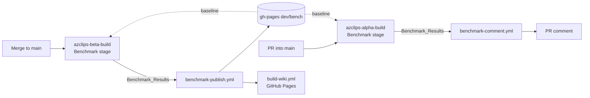

# Benchmarks on Azure DevOps Implementation Plan

> **For agentic workers:** REQUIRED SUB-SKILL: Use superpowers:subagent-driven-development (recommended) or superpowers:executing-plans to implement this plan task-by-task. Steps use checkbox (`- [ ]`) syntax for tracking.

**Goal:** Move the performance benchmarks from GitHub Actions into the Azure DevOps alpha (pull request) and beta (`main`) builds while keeping today's flow: build once, benchmark only what changed on fixed hardware, compare with `main`, comment on same-repo and fork PRs, and publish `main`'s results to the gh-pages dashboards.

**Architecture:** The placeholder `Benchmark` stage in `build-unsigned-distribution.yml` becomes Detect → Build → CLI, PS and startup legs on `pool-ubuntu-gh` → Collect, driven by standard-library Python scripts in `devops/scripts/benchmark/`. Azure DevOps never writes to GitHub. Two GitHub Actions workflows run from the default branch when the Azure Pipelines check suite completes (`check_suite: completed`). They verify the run through the Azure DevOps API, download its `Benchmark_Results` artifact anonymously, and use `GITHUB_TOKEN` to post the PR comment or update gh-pages.

**Tech Stack:** Azure Pipelines YAML templates, GitHub Actions, Python 3.10+ standard library and `unittest`, Bash with GNU `timeout`, BenchmarkDotNet JSON reports, github-action-benchmark's `data.js` format.

**Spec:** [`docs/superpowers/specs/2026-11-23-benchmarks-ado-migration-design.md`](../specs/2026-11-23-benchmarks-ado-migration-design.md)

## Global Constraints

- Python scripts use only the standard library, start with `#!/usr/bin/env python3`, import siblings directly (`from benchmark_results import warn`), and resolve repository paths from `__file__`.
- Tests use `unittest`, make no network calls, and capture `warn()` output (`benchmark_fixtures.captured_warnings()` or `redirect_stdout`) so no `##vso[` command reaches a CI log.
- Bash scripts start with `#!/usr/bin/env bash` and `set -euo pipefail`, and use LF line endings (`.gitattributes` sets `*.sh eol=lf`).
- Benchmark legs run on `pool-ubuntu-gh` (`benchmark_pool`); detect, build and collect run on `ubuntu_pool` (`pool-ubuntu-2404`).
- Regression threshold: 15%. A benchmark is flagged when its displayed change, rounded to one decimal, is above `+15.0%`. Cold startup is informational. Regressions never fail a build.
- `Finalize` keeps requiring `eq(dependencies.Benchmark.result, 'Succeeded')`. Do not change `Finalize`, and do not use `continueOnError` in the Benchmark stage: a `SucceededWithIssues` stage would block `Finalize`.
- `run_benchmarks: true` in `azclips-alpha-build.yml` and `azclips-beta-build.yml`; `run_benchmarks: false` in `azclips-stable-release.yml` and `azclips-stable-release-test.yml`.
- Pipeline artifacts published after failures, or before other steps in their job, go through `templates/dist/steps/publish-artifact.yml`.
- Inline Azure Pipelines Bash receives build values through `env:` and quotes them; never interpolate `$(...)` macros of PR-controlled values into script text.
- Artifact names: `Benchmark_Build_Outputs`, `Benchmark_CLI_<ext>`, `Benchmark_PS_<ext>`, `Benchmark_STARTUP`, `Benchmark_Results`. Reruns add `_attempt<N>`; consumers take the highest attempt.
- Dashboard files and series stay exactly as github-action-benchmark wrote them: `Azclips <Ext> <CLI|PS> Benchmarks` in `dev/bench/<cli|ps>/data.js` (`<Ext>` is the extension lowercased with its first letter uppercased) and `Azclips <CLI|PS> Startup (<warm|cold>)` in `dev/bench/startup-<cli|ps>/data.js`; trace sidecars in `dev/bench/traces/<EXT>/<PRODUCT>/`.
- The PR comment carries the marker `<!-- benchmark-results -->`; only comments by `github-actions[bot]` are edited.
- GitHub workflows pin `step-security/harden-runner@e14015d583714f6e62063499dc959a02595150a1 # v2.21.1` and `actions/checkout@11d5960a326750d5838078e36cf38b85af677262 # v4`, declare least-privilege `permissions`, and never check out PR code.
- Azure DevOps: organization `https://dev.azure.com/azclitools`, project `public`, pipelines `azclips-alpha-build` (PRs, definition 1311) and `azclips-beta-build` (`main`, definition 1312).
- One commit per task, with a `{Benchmark}` subject prefix and the trailer `Co-authored-by: Copilot <223556219+Copilot@users.noreply.github.com>`.
- Commands are PowerShell, run from the repository root `C:\Users\jaysontai\Code\copilot-worktrees\cirrus\jaysontaimicrosoft-solid-train`. Bash-only tests skip on Windows and run under WSL (Ubuntu is installed). PyYAML is installed for the YAML checks.

---

## File Structure

| Path | Change | Responsibility |
| --- | --- | --- |
| `devops/scripts/benchmark/benchmark_results.py` | Create | Shared helpers: load BenchmarkDotNet reports, labels, dashboard series, `data.js` I/O, newest-attempt selection, CI-aware warnings |
| `devops/scripts/benchmark/benchmark_fixtures.py` | Create | Test support: write reports and `data.js` files, capture warnings |
| `devops/scripts/benchmark/detect_benchmark_changes.py` | Create | Select the extensions and startup leg for a build; set ADO output variables |
| `devops/scripts/benchmark/run_benchmark.sh` | Create | Per-attempt timeout and retry for one leg |
| `devops/scripts/benchmark/collect_benchmark_results.py` | Create | Merge the newest attempt of each leg; write reports and `metadata.json` |
| `devops/scripts/benchmark/compare_benchmarks.py` | Create | Render the comparison as a build summary or PR comment |
| `devops/scripts/benchmark/aggregate_benchmark_traces.py` | Move from `.github/scripts/aggregate-benchmark-traces.py` | Trace span trees, with CI-neutral warnings |
| `devops/scripts/benchmark/fetch_ado_benchmark_results.py` | Create | Verify an ADO run and safely download its `Benchmark_Results` (GitHub side) |
| `devops/scripts/benchmark/publish_benchmark_dashboard.py` | Create | Append one commit's results to gh-pages (GitHub side) |
| `devops/scripts/benchmark/test_*.py` | Create | Unit tests, one module per script |
| `.azure-pipelines/templates/dist/jobs/benchmark-suite.yml` | Rewrite | Benchmark stage jobs |
| `.azure-pipelines/templates/dist/steps/run-benchmark-leg.yml` | Create | Steps of one benchmark leg |
| `.azure-pipelines/templates/dist/stages/build-unsigned-distribution.yml` | Modify | `run_benchmarks` and `benchmark_pool` parameters |
| `.azure-pipelines/templates/variables.yml` | Modify | `benchmark_pool: 'pool-ubuntu-gh'` |
| `.azure-pipelines/azclips-alpha-build.yml`, `azclips-beta-build.yml`, `azclips-stable-release.yml`, `azclips-stable-release-test.yml` | Modify | Turn benchmarks on or off |
| `.azure-pipelines/templates/dist/jobs/test-suite.yml` | Modify | Run the benchmark script tests in `UnitTestsLinux` |
| `.github/workflows/benchmark-comment.yml` | Rewrite | PR comment from the alpha run |
| `.github/workflows/benchmark-publish.yml` | Create | gh-pages dashboards from the beta run |
| `.github/workflows/build-wiki.yml` | Modify | Stop listening for "Performance Benchmarks" |
| `.github/workflows/benchmark.yml`, `.github/scripts/detect-benchmark-changes.sh` | Delete | Replaced by the above |
| `.azure-pipelines/AGENTS.md`, `devops/scripts/AGENTS.md`, `tests/Benchmark/README.md`, `eng-docs/spec/benchmark-workflows.md` | Modify | Documentation |

---

### Task 1: Shared benchmark results library

**Files:**
- Create: `devops/scripts/benchmark/benchmark_results.py`
- Create: `devops/scripts/benchmark/benchmark_fixtures.py`
- Test: `devops/scripts/benchmark/test_benchmark_results.py`

**Interfaces:**
- Consumes: nothing.
- Produces (`benchmark_results`): `PRODUCTS = ("CLI", "PS", "STARTUP")`; `REPORT_SUFFIX = "-report-full-compressed.json"`; `EXTENSION_SEGMENT` (regex `^[A-Z0-9]+$`); frozen dataclass `BenchmarkResult(extension: str, product: str, full_name: str, mean_ns: float, stddev_ns: float)`; `warn(message: object) -> None`; `is_finite_number(value: object) -> bool`; `latest_attempts(names: Iterable[str]) -> dict[str, str]` (base name → newest artifact name); `load_results(root: str | Path) -> list[BenchmarkResult]` (reads `<root>/<EXT>/<PRODUCT>/results/*-report-full-compressed.json`); `benchmark_type(full_name: str) -> str`; `display_label(full_name: str) -> str`; `series_for(result: BenchmarkResult) -> tuple[str, str] | None` (data directory, series name); `is_informational(result: BenchmarkResult) -> bool`; `parse_data_js(text: str) -> dict`; `format_data_js(data: dict) -> str`.
- Produces (`benchmark_fixtures`, tests only): `write_report(root, extension, product, type_name, benchmarks: dict[str, tuple[float, float] | None]) -> Path`; `data_js_entry(commit_id, date, benches: dict[str, float], timestamp="2026-11-01T00:00:00Z") -> dict`; `write_data_js(path, entries: dict) -> None`; `captured_warnings()`, a context manager yielding an `io.StringIO`.

- [ ] **Step 1: Write the test support module and the failing tests**

Create `devops/scripts/benchmark/benchmark_fixtures.py`:

```python
"""Test helpers that write benchmark files in the shapes the pipeline produces."""

from __future__ import annotations

import io
import json
import os
from contextlib import contextmanager, redirect_stderr
from pathlib import Path
from unittest import mock

from benchmark_results import REPORT_SUFFIX, format_data_js


def write_report(root, extension, product, type_name, benchmarks):
    """Write <root>/<EXT>/<PRODUCT>/results/<Namespace.Type>-report-full-compressed.json.

    benchmarks maps a method name to (mean_ns, stddev_ns), or to None for a benchmark
    that failed and so has no statistics.
    """
    namespace = "Benchmark.Startup" if product == "STARTUP" else f"Benchmark.{product}"
    items = [
        {
            "FullName": f"{namespace}.{type_name}.{method}",
            "Statistics": None if stats is None else {"Mean": stats[0], "StandardDeviation": stats[1]},
        }
        for method, stats in benchmarks.items()
    ]
    directory = Path(root) / extension / product / "results"
    directory.mkdir(parents=True, exist_ok=True)
    path = directory / f"{namespace}.{type_name}{REPORT_SUFFIX}"
    path.write_text(json.dumps({"Benchmarks": items}), encoding="utf-8")
    return path


def data_js_entry(commit_id, date, benches, timestamp="2026-11-01T00:00:00Z"):
    """One data.js entry; benches maps a benchmark FullName to its value in ns."""
    return {
        "commit": {"id": commit_id, "timestamp": timestamp},
        "date": date,
        "tool": "benchmarkdotnet",
        "benches": [{"name": name, "value": value, "unit": "ns", "range": "± 1"} for name, value in benches.items()],
    }


def write_data_js(path, entries):
    """Write a data.js holding entries ({series: [entry, ...]})."""
    path = Path(path)
    path.parent.mkdir(parents=True, exist_ok=True)
    data = {"lastUpdate": 1, "repoUrl": "https://github.com/Azure/azclips", "entries": entries}
    path.write_text(format_data_js(data), encoding="utf-8")


@contextmanager
def captured_warnings():
    """Capture warn() output as plain text, even when the tests run inside a CI job."""
    stream = io.StringIO()
    with mock.patch.dict(os.environ):
        os.environ.pop("TF_BUILD", None)
        os.environ.pop("GITHUB_ACTIONS", None)
        with redirect_stderr(stream):
            yield stream
```

Create `devops/scripts/benchmark/test_benchmark_results.py`:

```python
import io
import json
import os
import tempfile
import unittest
from contextlib import redirect_stdout
from pathlib import Path
from unittest import mock

import benchmark_results as br
from benchmark_fixtures import captured_warnings, write_report


class LoadResultsTests(unittest.TestCase):
    def setUp(self):
        temp = tempfile.TemporaryDirectory()
        self.addCleanup(temp.cleanup)
        self.root = Path(temp.name)

    def test_reads_the_ci_layout_in_report_order(self):
        write_report(self.root, "COMPUTE", "CLI", "VirtualMachineBenchmarks",
                     {"ListVirtualMachines": (12.5, 0.5), "CreateVirtualMachine": (20.0, 1.0)})
        write_report(self.root, "COMPUTE", "PS", "VirtualMachineBenchmarks", {"ListVirtualMachines": (8.0, 0.1)})
        write_report(self.root, "ALL", "STARTUP", "CliWarmStartupBenchmarks", {"Config": (2.4e8, 3e6)})
        write_report(self.root, "lowercase", "CLI", "IgnoredBenchmarks", {"Ignored": (1.0, 0.0)})

        results = br.load_results(self.root)

        self.assertEqual(
            [(r.extension, r.product, r.full_name, r.mean_ns, r.stddev_ns) for r in results],
            [
                ("ALL", "STARTUP", "Benchmark.Startup.CliWarmStartupBenchmarks.Config", 2.4e8, 3e6),
                ("COMPUTE", "CLI", "Benchmark.CLI.VirtualMachineBenchmarks.ListVirtualMachines", 12.5, 0.5),
                ("COMPUTE", "CLI", "Benchmark.CLI.VirtualMachineBenchmarks.CreateVirtualMachine", 20.0, 1.0),
                ("COMPUTE", "PS", "Benchmark.PS.VirtualMachineBenchmarks.ListVirtualMachines", 8.0, 0.1),
            ],
        )

    def test_skips_failed_unsafe_and_malformed_benchmarks_with_warnings(self):
        report = write_report(self.root, "KEYVAULT", "CLI", "KeyVaultBenchmarks",
                              {"SetSecret": (5.0, 0.2), "GetSecret": None})
        data = json.loads(report.read_text(encoding="utf-8"))
        data["Benchmarks"] += [
            {"FullName": "Benchmark.CLI.KeyVaultBenchmarks.`|Injected",
             "Statistics": {"Mean": 1, "StandardDeviation": 0}},
            {"FullName": "Benchmark.CLI.KeyVaultBenchmarks.NotANumber",
             "Statistics": {"Mean": float("nan"), "StandardDeviation": 0}},
        ]
        report.write_text(json.dumps(data), encoding="utf-8")
        broken = self.root / "KEYVAULT" / "PS" / "results" / ("Broken" + br.REPORT_SUFFIX)
        broken.parent.mkdir(parents=True)
        broken.write_text("{", encoding="utf-8")

        with captured_warnings() as warnings:
            results = br.load_results(self.root)

        self.assertEqual([r.full_name for r in results], ["Benchmark.CLI.KeyVaultBenchmarks.SetSecret"])
        log = warnings.getvalue()
        self.assertIn("GetSecret: it has no usable statistics", log)
        self.assertIn("unsupported name", log)
        self.assertIn("NotANumber: it has no usable statistics", log)
        self.assertIn("Skipping benchmark report Broken", log)

    def test_a_missing_directory_has_no_results(self):
        self.assertEqual(br.load_results(self.root / "missing"), [])


class NamingTests(unittest.TestCase):
    @staticmethod
    def result(extension, product, name):
        return br.BenchmarkResult(extension, product, name, 1.0, 0.0)

    def test_labels_drop_the_namespace_and_benchmarks_suffix(self):
        self.assertEqual(br.display_label("Benchmark.CLI.VirtualMachineBenchmarks.ListVirtualMachines"),
                         "VirtualMachine.ListVirtualMachines")
        self.assertEqual(br.display_label("Benchmark.Startup.CliColdStartupBenchmarks.Config"),
                         "CliColdStartup.Config")
        self.assertEqual(br.display_label("Lonely"), "Lonely")

    def test_series_match_the_existing_dashboards(self):
        cases = {
            ("MANAGEDSERVICEIDENTITY", "CLI", "Benchmark.CLI.UserAssignedIdentityBenchmarks.Get"):
                ("dev/bench/cli", "Azclips Managedserviceidentity CLI Benchmarks"),
            ("KEYVAULT", "PS", "Benchmark.PS.KeyVaultBenchmarks.Get"):
                ("dev/bench/ps", "Azclips Keyvault PS Benchmarks"),
            ("ALL", "STARTUP", "Benchmark.Startup.CliWarmStartupBenchmarks.Config"):
                ("dev/bench/startup-cli", "Azclips CLI Startup (warm)"),
            ("ALL", "STARTUP", "Benchmark.Startup.PsColdStartupBenchmarks.Login"):
                ("dev/bench/startup-ps", "Azclips PS Startup (cold)"),
            ("ALL", "STARTUP", "Benchmark.Startup.NewStartupBenchmarks.Config"): None,
        }
        for key, expected in cases.items():
            with self.subTest(key=key):
                self.assertEqual(br.series_for(self.result(*key)), expected)

    def test_only_cold_startup_is_informational(self):
        self.assertTrue(br.is_informational(
            self.result("ALL", "STARTUP", "Benchmark.Startup.CliColdStartupBenchmarks.Config")))
        self.assertFalse(br.is_informational(
            self.result("ALL", "STARTUP", "Benchmark.Startup.CliWarmStartupBenchmarks.Config")))
        self.assertFalse(br.is_informational(
            self.result("COMPUTE", "CLI", "Benchmark.CLI.CliColdStartupBenchmarks.Run")))


class AttemptTests(unittest.TestCase):
    def test_the_newest_attempt_wins(self):
        self.assertEqual(
            br.latest_attempts(["Benchmark_CLI_compute", "Benchmark_CLI_compute_attempt3",
                                "Benchmark_CLI_compute_attempt2", "Benchmark_STARTUP"]),
            {"Benchmark_CLI_compute": "Benchmark_CLI_compute_attempt3", "Benchmark_STARTUP": "Benchmark_STARTUP"},
        )


class DataJsTests(unittest.TestCase):
    def test_round_trip_matches_github_action_benchmark(self):
        data = {"lastUpdate": 1, "repoUrl": "https://github.com/Azure/azclips",
                "entries": {"Azclips Compute CLI Benchmarks": [{"benches": [{"range": "± 1.5"}]}]}}

        text = br.format_data_js(data)

        self.assertTrue(text.startswith('window.BENCHMARK_DATA = {\n  "lastUpdate": 1,'))
        self.assertFalse(text.endswith("\n"))
        self.assertIn('"range": "± 1.5"', text)
        self.assertEqual(br.parse_data_js(text), data)

    def test_rejects_other_files(self):
        for text in ("console.log(1)", "window.BENCHMARK_DATA = []", 'window.BENCHMARK_DATA = {"entries": []}'):
            with self.subTest(text=text), self.assertRaises(ValueError):
                br.parse_data_js(text)


class WarnTests(unittest.TestCase):
    def capture(self, environ):
        stdout = io.StringIO()
        with mock.patch.dict(os.environ, environ, clear=True), redirect_stdout(stdout):
            br.warn("first line\n##vso[task.complete result=Failed]second")
        return stdout.getvalue()

    def test_azure_pipelines_format(self):
        self.assertEqual(self.capture({"TF_BUILD": "True"}),
                         "##vso[task.logissue type=warning]first line ##vso_[task.complete result=Failed]second\n")

    def test_github_actions_format(self):
        self.assertEqual(self.capture({"GITHUB_ACTIONS": "true"}),
                         "::warning::first line ##vso_[task.complete result=Failed]second\n")


if __name__ == "__main__":
    unittest.main()
```

- [ ] **Step 2: Run the tests to verify they fail**

Run: `python -m unittest discover -s devops/scripts/benchmark -p test_benchmark_results.py -v`
Expected: FAIL. `ImportError: Failed to import test module: test_benchmark_results`, caused by `ModuleNotFoundError: No module named 'benchmark_results'`.

- [ ] **Step 3: Write the implementation**

Create `devops/scripts/benchmark/benchmark_results.py`:

```python
#!/usr/bin/env python3
"""Shared helpers for the benchmark pipeline scripts.

Benchmark results use the layout the runner writes with --ci:
<root>/<EXTENSION>/<PRODUCT>/results/<Namespace.Class>-report-full-compressed.json

Standard library only, so the scripts run on bare CI agents.
"""

from __future__ import annotations

import json
import math
import os
import re
import sys
from dataclasses import dataclass
from pathlib import Path

PRODUCTS = ("CLI", "PS", "STARTUP")
REPORT_SUFFIX = "-report-full-compressed.json"
MAX_REPORT_BYTES = 64 * 1024 * 1024
DATA_JS_PREFIX = "window.BENCHMARK_DATA = "

EXTENSION_SEGMENT = re.compile(r"^[A-Z0-9]+$")
BENCHMARK_NAME = re.compile(r"^[A-Za-z0-9_.]{1,300}$")
ATTEMPT_SUFFIX = re.compile(r"^(?P<base>.+)_attempt(?P<attempt>[0-9]+)$")
DATA_JS = re.compile(r"window\.BENCHMARK_DATA\s*=\s*(\{.*\})\s*;?\s*$", re.DOTALL)

# Startup class -> (gh-pages data directory, dashboard series, informational only).
# Cold startup is tracked for information and never flagged as a regression.
STARTUP_SERIES = {
    "CliWarmStartupBenchmarks": ("dev/bench/startup-cli", "Azclips CLI Startup (warm)", False),
    "CliColdStartupBenchmarks": ("dev/bench/startup-cli", "Azclips CLI Startup (cold)", True),
    "PsWarmStartupBenchmarks": ("dev/bench/startup-ps", "Azclips PS Startup (warm)", False),
    "PsColdStartupBenchmarks": ("dev/bench/startup-ps", "Azclips PS Startup (cold)", True),
}


@dataclass(frozen=True)
class BenchmarkResult:
    extension: str  # leg extension segment, e.g. COMPUTE; ALL for startup
    product: str  # CLI, PS or STARTUP
    full_name: str  # BenchmarkDotNet FullName
    mean_ns: float
    stddev_ns: float


def warn(message: object) -> None:
    """Report a non-fatal problem in the log format of the CI system running the script."""
    text = " ".join(str(message).split()).replace("##vso[", "##vso_[")
    if os.environ.get("TF_BUILD"):
        print(f"##vso[task.logissue type=warning]{text}", flush=True)
    elif os.environ.get("GITHUB_ACTIONS"):
        print(f"::warning::{text}", flush=True)
    else:
        print(f"warning: {text}", file=sys.stderr, flush=True)


def is_finite_number(value: object) -> bool:
    return isinstance(value, (int, float)) and not isinstance(value, bool) and math.isfinite(value)


def latest_attempts(names) -> dict[str, str]:
    """Map each artifact base name to the artifact of its newest attempt.

    templates/dist/steps/publish-artifact.yml publishes a job's first attempt as <name>
    and a rerun's attempt N as <name>_attempt<N>.
    """
    chosen: dict[str, tuple[int, str]] = {}
    for name in names:
        match = ATTEMPT_SUFFIX.match(name)
        base, attempt = (match["base"], int(match["attempt"])) if match else (name, 1)
        if base not in chosen or attempt > chosen[base][0]:
            chosen[base] = (attempt, name)
    return {base: name for base, (_, name) in chosen.items()}


def load_results(root) -> list[BenchmarkResult]:
    """Load every benchmark under root, in report-file order.

    A malformed report, or a benchmark without usable statistics (one that failed), is
    skipped with a warning so the remaining results still count.
    """
    root = Path(root)
    results: list[BenchmarkResult] = []
    if not root.is_dir():
        return results
    for extension_dir in sorted(path for path in root.iterdir() if path.is_dir()):
        if not EXTENSION_SEGMENT.match(extension_dir.name):
            continue
        for product in PRODUCTS:
            for report in sorted((extension_dir / product / "results").glob("*" + REPORT_SUFFIX)):
                results.extend(_load_report(report, extension_dir.name, product))
    return results


def _load_report(path: Path, extension: str, product: str) -> list[BenchmarkResult]:
    try:
        if path.stat().st_size > MAX_REPORT_BYTES:
            raise ValueError("the report is too large")
        data = json.loads(path.read_text(encoding="utf-8"))
        benchmarks = data.get("Benchmarks") if isinstance(data, dict) else None
        if not isinstance(benchmarks, list):
            raise ValueError("the report has no Benchmarks array")
    except (OSError, ValueError, RecursionError) as exc:
        warn(f"Skipping benchmark report {path.name}: {exc}")
        return []

    results = []
    for benchmark in benchmarks:
        name = benchmark.get("FullName") if isinstance(benchmark, dict) else None
        if not isinstance(name, str) or not BENCHMARK_NAME.match(name):
            warn(f"Skipping a benchmark with an unsupported name in {path.name}")
            continue
        statistics = benchmark.get("Statistics")
        if not isinstance(statistics, dict):
            statistics = {}
        mean, stddev = statistics.get("Mean"), statistics.get("StandardDeviation")
        if not (is_finite_number(mean) and is_finite_number(stddev) and mean >= 0 and stddev >= 0):
            warn(f"Skipping {name}: it has no usable statistics, so it probably failed")
            continue
        results.append(BenchmarkResult(extension, product, name, float(mean), float(stddev)))
    return results


def benchmark_type(full_name: str) -> str:
    """The class of a FullName, e.g. VirtualMachineBenchmarks."""
    parts = full_name.split(".")
    return parts[-2] if len(parts) >= 2 else ""


def display_label(full_name: str) -> str:
    """'Benchmark.CLI.VirtualMachineBenchmarks.ListVirtualMachines' -> 'VirtualMachine.ListVirtualMachines'."""
    parts = full_name.split(".")
    if len(parts) < 2:
        return full_name
    type_name = parts[-2]
    if type_name.endswith("Benchmarks") and type_name != "Benchmarks":
        type_name = type_name[: -len("Benchmarks")]
    return f"{type_name}.{parts[-1]}"


def series_for(result: BenchmarkResult) -> tuple[str, str] | None:
    """The gh-pages data directory and dashboard series of a result.

    These are the names github-action-benchmark published under, so history continues.
    Returns None for a startup class that has no dashboard.
    """
    if result.product == "STARTUP":
        series = STARTUP_SERIES.get(benchmark_type(result.full_name))
        return (series[0], series[1]) if series else None
    title = result.extension.lower().capitalize()
    return f"dev/bench/{result.product.lower()}", f"Azclips {title} {result.product} Benchmarks"


def is_informational(result: BenchmarkResult) -> bool:
    """Whether a result is reported without regression flagging (cold startup)."""
    series = STARTUP_SERIES.get(benchmark_type(result.full_name)) if result.product == "STARTUP" else None
    return bool(series and series[2])


def parse_data_js(text: str) -> dict:
    """Parse a github-action-benchmark data.js file."""
    match = DATA_JS.search(text)
    if not match:
        raise ValueError("not a benchmark data.js file")
    data = json.loads(match.group(1))
    if not isinstance(data, dict) or not isinstance(data.get("entries"), dict):
        raise ValueError("data.js has no entries object")
    return data


def format_data_js(data: dict) -> str:
    """Serialize data.js byte for byte as github-action-benchmark writes it."""
    return DATA_JS_PREFIX + json.dumps(data, indent=2, ensure_ascii=False)
```

- [ ] **Step 4: Run the tests to verify they pass**

Run: `python -m unittest discover -s devops/scripts/benchmark -p test_benchmark_results.py -v`
Expected: `Ran 11 tests` and `OK`.

- [ ] **Step 5: Check compatibility with the live dashboard file**

`format_data_js` must reproduce gh-pages `data.js` byte for byte, so later publishes only add lines:

```powershell
$env:PYTHONPATH = 'devops/scripts/benchmark'
@'
import urllib.request
from benchmark_results import format_data_js, parse_data_js
url = "https://raw.githubusercontent.com/Azure/azclips/gh-pages/dev/bench/cli/data.js"
text = urllib.request.urlopen(url, timeout=60).read().decode("utf-8")
print("identical:", format_data_js(parse_data_js(text)) == text)
'@ | python -
Remove-Item Env:\PYTHONPATH
```

Expected: `identical: True`.

- [ ] **Step 6: Commit**

```powershell
git add devops/scripts/benchmark/benchmark_results.py devops/scripts/benchmark/benchmark_fixtures.py devops/scripts/benchmark/test_benchmark_results.py
git commit -m "{Benchmark} Add shared benchmark result helpers" -m "Co-authored-by: Copilot <223556219+Copilot@users.noreply.github.com>"
```

---

### Task 2: Change detection

**Files:**
- Create: `devops/scripts/benchmark/detect_benchmark_changes.py`
- Test: `devops/scripts/benchmark/test_detect_benchmark_changes.py`

**Interfaces:**
- Consumes: `benchmark_results.warn`; `benchmark_fixtures.captured_warnings` (tests).
- Produces: the CLI `python3 devops/scripts/benchmark/detect_benchmark_changes.py` (no arguments). It reads `BUILD_REASON`, `BUILD_SOURCEBRANCH`, `SYSTEM_PULLREQUEST_TARGETBRANCH`, `SYSTEM_COLLECTIONURI`, `SYSTEM_TEAMPROJECT`, `SYSTEM_DEFINITIONID` and `SYSTEM_ACCESSTOKEN`, and prints `##vso[task.setvariable variable=<name>;isOutput=true]<value>` for `hasExtensionWork` (`true`/`false`), `runStartup` (`true`/`false`), `extensionMatrix` (`{"<ext>":{"Extension":"<ext>"}}`, or `{"none":{"Extension":"none"}}` when no extension runs), `extensions` (comma-separated) and `changeBase` (text).
- Produces (Python API): `Selection(extensions: tuple[str, ...], startup: bool)`; `NOTHING`; `is_shared(path: str) -> bool`; `discover_extensions(repo_root: Path) -> dict[str, str]`; `select(changed, files) -> Selection`; `select_all(files) -> Selection`; `plan_mode(reason, source_branch, target_branch) -> str`; `decide(environ, repo_root, find_base=last_succeeded_commit) -> tuple[Selection, str]`; `output_lines(selection, change_base) -> list[str]`; `main() -> int`.

Behavior, per the spec: a PR into `main` diffs its merge commit against `HEAD^1`; a PR into another branch runs nothing; `IndividualCI` or `BatchedCI` on `refs/heads/main` diffs against the last succeeded run of the same definition on `main` (everything when that is unknown or not an ancestor); `Manual` runs everything; any other reason runs nothing. The path rules port the `dorny/paths-filter` filters of `.github/workflows/benchmark.yml`, with the new pipeline template and script paths added to the shared set.

- [ ] **Step 1: Write the failing tests**

Create `devops/scripts/benchmark/test_detect_benchmark_changes.py`:

```python
import io
import os
import subprocess
import tempfile
import unittest
from contextlib import redirect_stdout
from pathlib import Path
from unittest import mock

import detect_benchmark_changes as detect
from benchmark_fixtures import captured_warnings

BENCHMARK_FILES = {
    "tests/Benchmark/CLI/VirtualMachineBenchmarks.cs":
        '[BenchmarkExtension("Compute")]\npublic class VirtualMachineBenchmarks {}\n',
    "tests/Benchmark/PS/KeyVaultBenchmarks.cs":
        '    [BenchmarkExtension("KeyVault")]\npublic class KeyVaultBenchmarks {}\n',
    "tests/Benchmark/BenchmarkBase.cs": '/// <c>[BenchmarkExtension("Name")]</c> marks a benchmark class.\n',
}
FILES = {
    "tests/Benchmark/CLI/VirtualMachineBenchmarks.cs": "compute",
    "tests/Benchmark/PS/KeyVaultBenchmarks.cs": "keyvault",
}
EVERYTHING = detect.Selection(("compute", "keyvault"), True)


class PathRuleTests(unittest.TestCase):
    def test_shared_paths_run_everything(self):
        for path in ("src/Core/Engine/Runner.cs", "src/Extensions/ExtensionRuntime/Loader.cs",
                     "src/CLI/Program.cs", "src/CLI/Commands/Group.cs", "src/CLI/Help/HelpPrinter.cs",
                     "src/CLI/Help/Rendering/Table.cs", "tests/Benchmark/Program.cs",
                     "tests/Benchmark/Benchmark.csproj", "tests/Benchmark/Telemetry/TraceSampler.cs",
                     "tests/Benchmark/PS/PSBenchmarkBase.cs", "tests/Common/Stubs/StubResponseMappings.cs",
                     "global.json", "azclips.slnx", "Shared.props",
                     ".azure-pipelines/templates/dist/jobs/benchmark-suite.yml",
                     ".azure-pipelines/templates/dist/steps/run-benchmark-leg.yml",
                     "devops/scripts/benchmark/compare_benchmarks.py"):
            with self.subTest(path=path):
                self.assertEqual(detect.select([path], FILES), EVERYTHING)

    def test_help_docs_and_unrelated_paths_run_nothing(self):
        for path in ("src/CLI/Help/Docs/az_vm.md", "tests/Benchmark/README.md", "docs/README.md",
                     "src/Extensions/Storage/Commands.cs", ".github/workflows/build-and-test.yml"):
            with self.subTest(path=path):
                self.assertEqual(detect.select([path], FILES), detect.NOTHING)

    def test_extension_changes_run_only_that_extension(self):
        for path, extension in (("src/Extensions/Compute/VmCommands.cs", "compute"),
                                ("src/PS/KeyVault/Cmdlets.cs", "keyvault"),
                                ("tests/Benchmark/PS/KeyVaultBenchmarks.cs", "keyvault")):
            with self.subTest(path=path):
                self.assertEqual(detect.select([path], FILES), detect.Selection((extension,), False))

    def test_startup_changes_run_only_startup(self):
        self.assertEqual(detect.select(["tests/Benchmark/Startup/CliWarmStartupBenchmarks.cs"], FILES),
                         detect.Selection((), True))

    def test_build_reasons(self):
        cases = [
            (("PullRequest", "refs/pull/7/merge", "main"), "pull-request"),
            (("PullRequest", "refs/pull/7/merge", "refs/heads/main"), "pull-request"),
            (("PullRequest", "refs/pull/7/merge", "release/1.0"), "none"),
            (("BatchedCI", "refs/heads/main", ""), "main"),
            (("IndividualCI", "refs/heads/main", ""), "main"),
            (("IndividualCI", "refs/heads/feature", ""), "none"),
            (("Manual", "refs/heads/feature", ""), "all"),
            (("Schedule", "refs/heads/main", ""), "none"),
        ]
        for arguments, expected in cases:
            with self.subTest(arguments=arguments):
                self.assertEqual(detect.plan_mode(*arguments), expected)

    def test_outputs_keep_a_placeholder_matrix_leg(self):
        self.assertEqual(detect.output_lines(detect.NOTHING, "the pull request target"), [
            "##vso[task.setvariable variable=hasExtensionWork;isOutput=true]false",
            "##vso[task.setvariable variable=runStartup;isOutput=true]false",
            '##vso[task.setvariable variable=extensionMatrix;isOutput=true]{"none":{"Extension":"none"}}',
            "##vso[task.setvariable variable=extensions;isOutput=true]",
            "##vso[task.setvariable variable=changeBase;isOutput=true]the pull request target",
        ])
        self.assertIn('{"compute":{"Extension":"compute"},"keyvault":{"Extension":"keyvault"}}',
                      detect.output_lines(EVERYTHING, "x")[2])


class RepositoryTests(unittest.TestCase):
    def setUp(self):
        temp = tempfile.TemporaryDirectory()
        self.addCleanup(temp.cleanup)
        self.repo = Path(temp.name)
        environment = mock.patch.dict(os.environ, {
            "GIT_CONFIG_GLOBAL": os.devnull, "GIT_CONFIG_NOSYSTEM": "1",
            "GIT_AUTHOR_NAME": "Test", "GIT_AUTHOR_EMAIL": "test@example.com",
            "GIT_COMMITTER_NAME": "Test", "GIT_COMMITTER_EMAIL": "test@example.com",
        })
        environment.start()
        self.addCleanup(environment.stop)
        self.git("init", "--quiet", "--initial-branch=main")
        self.commit("base", BENCHMARK_FILES)

    def git(self, *args):
        return subprocess.run(["git", "-C", str(self.repo), *args],
                              check=True, capture_output=True, text=True).stdout.strip()

    def commit(self, message, files):
        for path, content in files.items():
            target = self.repo / path
            target.parent.mkdir(parents=True, exist_ok=True)
            target.write_text(content, encoding="utf-8")
        self.git("add", "--all")
        self.git("commit", "--quiet", "-m", message)
        return self.git("rev-parse", "HEAD")

    def test_discovers_extensions_from_the_attribute(self):
        self.assertEqual(detect.discover_extensions(self.repo), FILES)

    def test_rejects_extension_names_that_cannot_be_matrix_legs(self):
        self.commit("bad", {"tests/Benchmark/CLI/BadBenchmarks.cs": '[BenchmarkExtension("Key-Vault")]\n'})
        with self.assertRaisesRegex(ValueError, "letters and digits"):
            detect.discover_extensions(self.repo)

    def test_pull_requests_compare_the_merge_commit_with_its_target(self):
        self.git("checkout", "--quiet", "-b", "feature")
        self.commit("compute change", {"src/Extensions/Compute/VmCommands.cs": "// change\n"})
        self.git("checkout", "--quiet", "main")
        self.commit("main moves on", {"src/PS/KeyVault/Cmdlets.cs": "// main\n"})
        self.git("merge", "--quiet", "--no-ff", "-m", "merge", "feature")
        environ = {"BUILD_REASON": "PullRequest", "SYSTEM_PULLREQUEST_TARGETBRANCH": "main"}

        selection, base = detect.decide(environ, self.repo)

        self.assertEqual(selection, detect.Selection(("compute",), False))
        self.assertEqual(base, "the pull request target")

    def test_a_pull_request_without_a_merge_commit_runs_everything(self):
        self.commit("change", {"src/Extensions/Compute/VmCommands.cs": "// change\n"})
        environ = {"BUILD_REASON": "PullRequest", "SYSTEM_PULLREQUEST_TARGETBRANCH": "main"}

        with captured_warnings() as warnings:
            selection, _ = detect.decide(environ, self.repo)

        self.assertEqual(selection, EVERYTHING)
        self.assertIn("not a merge commit", warnings.getvalue())

    def test_main_compares_with_the_last_successful_run(self):
        base = self.git("rev-parse", "HEAD")
        self.commit("keyvault", {"src/PS/KeyVault/Cmdlets.cs": "// change\n"})
        self.commit("startup", {"tests/Benchmark/Startup/CliWarmStartupBenchmarks.cs": "// change\n"})
        environ = {"BUILD_REASON": "BatchedCI", "BUILD_SOURCEBRANCH": "refs/heads/main"}

        selection, description = detect.decide(environ, self.repo, find_base=lambda _: base)

        self.assertEqual(selection, detect.Selection(("keyvault",), True))
        self.assertEqual(description, f"the last successful main run ({base[:7]})")

    def test_main_runs_everything_without_a_usable_base(self):
        self.git("checkout", "--quiet", "--orphan", "unrelated")
        unrelated = self.commit("unrelated history", {"other.txt": "x\n"})
        self.git("checkout", "--quiet", "main")
        environ = {"BUILD_REASON": "IndividualCI", "BUILD_SOURCEBRANCH": "refs/heads/main"}

        def unreachable(_):
            raise OSError("network down")

        for label, find_base in (("no run", lambda _: None), ("not an ancestor", lambda _: unrelated),
                                 ("API failure", unreachable)):
            with self.subTest(label), captured_warnings() as warnings:
                self.assertEqual(detect.decide(environ, self.repo, find_base=find_base)[0], EVERYTHING)
                self.assertIn("every benchmark runs", warnings.getvalue())

    def test_main_prints_the_output_variables(self):
        stdout = io.StringIO()
        with mock.patch.dict(os.environ, {"BUILD_REASON": "Manual"}), \
                mock.patch.object(detect, "REPO_ROOT", self.repo), redirect_stdout(stdout):
            self.assertEqual(detect.main(), 0)

        self.assertIn("##vso[task.setvariable variable=runStartup;isOutput=true]true", stdout.getvalue())
        self.assertIn("Benchmarks: extensions=compute,keyvault, startup=yes", stdout.getvalue())


if __name__ == "__main__":
    unittest.main()
```

- [ ] **Step 2: Run the tests to verify they fail**

Run: `python -m unittest discover -s devops/scripts/benchmark -p test_detect_benchmark_changes.py -v`
Expected: FAIL with `ModuleNotFoundError: No module named 'detect_benchmark_changes'`.

- [ ] **Step 3: Write the implementation**

Create `devops/scripts/benchmark/detect_benchmark_changes.py`:

```python
#!/usr/bin/env python3
"""Select the benchmark legs an Azure Pipelines run executes.

Runs in the Benchmark stage's DetectBenchmarks job and sets these output variables on
its step (name: detect):
  hasExtensionWork  'true' when at least one extension is benchmarked
  runStartup        'true' when the startup family runs
  extensionMatrix   matrix for the CLI and PS legs: {"<ext>": {"Extension": "<ext>"}}
  extensions        comma-separated extensions, for logs and metadata
  changeBase        what the changed files were compared with

The path rules are the former GitHub workflow's dorny/paths-filter rules. The extension
universe comes from the [BenchmarkExtension("<Name>")] attribute, so adding a
benchmarked extension needs no pipeline edits.
"""

from __future__ import annotations

import json
import os
import re
import subprocess
import sys
import urllib.parse
import urllib.request
from dataclasses import dataclass
from pathlib import Path

from benchmark_results import warn

REPO_ROOT = Path(__file__).resolve().parents[3]
ATTRIBUTE = re.compile(r'^\s*\[BenchmarkExtension\("([^"]*)"\)', re.MULTILINE)
EXTENSION_NAME = re.compile(r"^[A-Za-z][A-Za-z0-9]*$")
SOURCE_DIRECTORY = re.compile(r"^src/(?:Extensions|PS)/([^/]+)/")
COMMIT = re.compile(r"^[0-9a-f]{40}$")
PLACEHOLDER_MATRIX = {"none": {"Extension": "none"}}

# A change under any of these runs every extension and the startup family.
SHARED_PREFIXES = (
    "src/Core/",
    "src/Extensions/ExtensionRuntime/",
    "tests/Benchmark/Auth/",
    "tests/Benchmark/Fixtures/",
    "tests/Benchmark/Telemetry/",
    "tests/Common/",
    "devops/scripts/benchmark/",
)
SHARED_FILES = frozenset({
    "tests/Benchmark/CLI/CLIBenchmarkBase.cs",
    "tests/Benchmark/CLI/BenchmarkAssemblyConfigurationService.cs",
    "tests/Benchmark/PS/PSBenchmarkBase.cs",
    "tests/Benchmark/PS/PSManifestStager.cs",
    "global.json",
    "azclips.slnx",
    "Shared.props",
    ".azure-pipelines/templates/dist/jobs/benchmark-suite.yml",
    ".azure-pipelines/templates/dist/steps/run-benchmark-leg.yml",
})
STARTUP_PREFIX = "tests/Benchmark/Startup/"


@dataclass(frozen=True)
class Selection:
    extensions: tuple[str, ...]
    startup: bool


NOTHING = Selection((), False)


def is_shared(path: str) -> bool:
    """Whether a changed path affects every benchmark."""
    if path in SHARED_FILES or path.startswith(SHARED_PREFIXES):
        return True
    parts = path.split("/")
    if parts[:2] == ["src", "CLI"] and len(parts) >= 3:
        # src/CLI/* and src/CLI/!(Help)/**, then src/CLI/Help/* and src/CLI/Help/!(Docs)/**.
        if len(parts) == 3 or parts[2] != "Help":
            return True
        return len(parts) == 4 or parts[3] != "Docs"
    if parts[:2] == ["tests", "Benchmark"] and len(parts) == 3:
        return parts[2].endswith((".cs", ".csproj"))
    return False


def discover_extensions(repo_root: Path) -> dict[str, str]:
    """Map each benchmark class file (repository-relative, '/'-separated) to its extension, lowercased."""
    files = {}
    for path in sorted((repo_root / "tests" / "Benchmark").rglob("*.cs")):
        match = ATTRIBUTE.search(path.read_text(encoding="utf-8", errors="replace"))
        if not match:
            continue
        name = match.group(1)
        if not EXTENSION_NAME.match(name):
            raise ValueError(f'{path.name}: [BenchmarkExtension("{name}")] must contain only letters and digits')
        files[path.relative_to(repo_root).as_posix()] = name.lower()
    return files


def select_all(files: dict[str, str]) -> Selection:
    return Selection(tuple(sorted(set(files.values()))), True)


def select(changed, files: dict[str, str]) -> Selection:
    """Apply the path rules to the changed files."""
    changed = [path for path in changed if path]
    if any(is_shared(path) for path in changed):
        return select_all(files)
    universe = set(files.values())
    hits = set()
    for path in changed:
        if path in files:
            hits.add(files[path])
        match = SOURCE_DIRECTORY.match(path)
        if match and match.group(1).lower() in universe:
            hits.add(match.group(1).lower())
    return Selection(tuple(sorted(hits)), any(path.startswith(STARTUP_PREFIX) for path in changed))


def plan_mode(reason: str, source_branch: str, target_branch: str) -> str:
    """'pull-request', 'main', 'all' or 'none' for an Azure Pipelines build."""
    reason = reason.lower()
    if reason == "pullrequest":
        return "pull-request" if target_branch.removeprefix("refs/heads/") == "main" else "none"
    if reason in ("individualci", "batchedci"):
        return "main" if source_branch == "refs/heads/main" else "none"
    if reason == "manual":
        return "all"
    return "none"


def git(repo_root: Path, *args: str) -> subprocess.CompletedProcess:
    return subprocess.run(["git", "-C", str(repo_root), *args], capture_output=True, text=True)


def changed_files(repo_root: Path, base: str) -> list[str]:
    result = git(repo_root, "diff", "--name-only", "--no-renames", "-z", base, "HEAD")
    if result.returncode != 0:
        raise RuntimeError(f"git diff failed: {result.stderr.strip()}")
    return [path for path in result.stdout.split("\0") if path]


def last_succeeded_commit(environ) -> str | None:
    """The commit of the newest successful run of this pipeline on main, from the build API."""
    query = urllib.parse.urlencode({
        "definitions": environ["SYSTEM_DEFINITIONID"],
        "branchName": "refs/heads/main",
        "resultFilter": "succeeded",
        "statusFilter": "completed",
        "queryOrder": "finishTimeDescending",
        "$top": "1",
        "api-version": "7.1",
    })
    collection = environ["SYSTEM_COLLECTIONURI"].rstrip("/")
    project = urllib.parse.quote(environ["SYSTEM_TEAMPROJECT"])
    request = urllib.request.Request(f"{collection}/{project}/_apis/build/builds?{query}",
                                     headers={"Accept": "application/json"})
    if environ.get("SYSTEM_ACCESSTOKEN"):
        request.add_header("Authorization", f"Bearer {environ['SYSTEM_ACCESSTOKEN']}")
    with urllib.request.urlopen(request, timeout=30) as response:
        builds = json.load(response).get("value") or []
    commit = builds[0].get("sourceVersion") if builds else None
    return commit if isinstance(commit, str) and COMMIT.match(commit) else None


def decide(environ, repo_root: Path, find_base=last_succeeded_commit) -> tuple[Selection, str]:
    """The selection for this build, and a description of what it was compared with."""
    files = discover_extensions(repo_root)
    mode = plan_mode(environ.get("BUILD_REASON", ""), environ.get("BUILD_SOURCEBRANCH", ""),
                     environ.get("SYSTEM_PULLREQUEST_TARGETBRANCH", ""))
    if mode == "none":
        return NOTHING, "nothing, because this trigger and branch are not benchmarked"
    if mode == "all":
        return select_all(files), "nothing, because manual runs benchmark everything"
    if mode == "pull-request":
        if git(repo_root, "rev-parse", "--verify", "--quiet", "HEAD^2").returncode != 0:
            warn("The pull request checkout is not a merge commit, so every benchmark runs.")
            return select_all(files), "an unknown base, so everything runs"
        return select(changed_files(repo_root, "HEAD^1"), files), "the pull request target"
    try:
        base = find_base(environ)
    except (KeyError, OSError, ValueError) as exc:
        warn(f"Could not find the last successful main run ({exc}), so every benchmark runs.")
        return select_all(files), "an unknown base, so everything runs"
    if not base or git(repo_root, "merge-base", "--is-ancestor", base, "HEAD").returncode != 0:
        warn("The last successful main run is missing or not an ancestor of this commit, so every benchmark runs.")
        return select_all(files), "an unknown base, so everything runs"
    return select(changed_files(repo_root, base), files), f"the last successful main run ({base[:7]})"


def output_lines(selection: Selection, change_base: str) -> list[str]:
    """Azure Pipelines logging commands that set the job's output variables."""
    matrix = {name: {"Extension": name} for name in selection.extensions} or PLACEHOLDER_MATRIX
    outputs = {
        "hasExtensionWork": "true" if selection.extensions else "false",
        "runStartup": "true" if selection.startup else "false",
        "extensionMatrix": json.dumps(matrix, separators=(",", ":")),
        "extensions": ",".join(selection.extensions),
        "changeBase": change_base,
    }
    return [f"##vso[task.setvariable variable={name};isOutput=true]{value}" for name, value in outputs.items()]


def main() -> int:
    selection, change_base = decide(os.environ, REPO_ROOT)
    for line in output_lines(selection, change_base):
        print(line)
    print(f"Benchmarks: extensions={','.join(selection.extensions) or 'none'}, "
          f"startup={'yes' if selection.startup else 'no'}; compared with {change_base}.")
    return 0


if __name__ == "__main__":
    sys.exit(main())
```

- [ ] **Step 4: Run the tests to verify they pass**

Run: `python -m unittest discover -s devops/scripts/benchmark -p test_detect_benchmark_changes.py -v`
Expected: `Ran 13 tests` and `OK`.

- [ ] **Step 5: Check the real repository and the live build API**

```powershell
$env:PYTHONPATH = 'devops/scripts/benchmark'
@'
from pathlib import Path
import detect_benchmark_changes as detect
print(sorted(set(detect.discover_extensions(Path(".").resolve()).values())))
print(detect.last_succeeded_commit({"SYSTEM_DEFINITIONID": "1312",
                                    "SYSTEM_COLLECTIONURI": "https://dev.azure.com/azclitools/",
                                    "SYSTEM_TEAMPROJECT": "public"}))
'@ | python -
Remove-Item Env:\PYTHONPATH
```

Expected: `['compute', 'keyvault', 'managedserviceidentity', 'resources']`, the universe the Bash script derived, then a 40-character commit SHA.

- [ ] **Step 6: Commit**

```powershell
git add devops/scripts/benchmark/detect_benchmark_changes.py devops/scripts/benchmark/test_detect_benchmark_changes.py
git commit -m "{Benchmark} Detect benchmark changes for Azure Pipelines builds" -m "Co-authored-by: Copilot <223556219+Copilot@users.noreply.github.com>"
```

---

### Task 3: Benchmark retry wrapper

**Files:**
- Create: `devops/scripts/benchmark/run_benchmark.sh`
- Test: `devops/scripts/benchmark/test_run_benchmark.py`

**Interfaces:**
- Consumes: nothing.
- Produces: `bash devops/scripts/benchmark/run_benchmark.sh <command> [arguments...]`, configured by `BENCHMARK_ATTEMPT_TIMEOUT` (required; a GNU `timeout` duration such as `60m`), `BENCHMARK_MAX_ATTEMPTS` (default `2`) and `BENCHMARK_RETRY_WAIT` (seconds, default `30`). It exits `0` on success, otherwise with the last attempt's exit code (`124` for a timeout).

Why a wrapper: Azure Pipelines' `retryCountOnTaskFailure` does not retry a step that hits its timeout, while `nick-fields/retry` did. GNU `timeout` also stops the whole process group, including the child processes BenchmarkDotNet starts.

- [ ] **Step 1: Write the failing tests**

Create `devops/scripts/benchmark/test_run_benchmark.py`:

```python
import os
import subprocess
import tempfile
import unittest
from pathlib import Path

SCRIPT = Path(__file__).with_name("run_benchmark.sh")


@unittest.skipIf(os.name == "nt", "run_benchmark.sh needs Bash and GNU timeout")
class RunBenchmarkTests(unittest.TestCase):
    def run_script(self, command, timeout="5s"):
        temp = tempfile.TemporaryDirectory()
        self.addCleanup(temp.cleanup)
        environment = {**os.environ, "BENCHMARK_ATTEMPT_TIMEOUT": timeout,
                       "BENCHMARK_MAX_ATTEMPTS": "2", "BENCHMARK_RETRY_WAIT": "0"}
        return subprocess.run(["bash", str(SCRIPT), "bash", "-c", command], cwd=temp.name,
                              env=environment, capture_output=True, text=True, timeout=60)

    def test_a_success_needs_one_attempt(self):
        result = self.run_script("exit 0")

        self.assertEqual(result.returncode, 0)
        self.assertEqual(result.stdout.count("Benchmark attempt"), 1)

    def test_a_failed_attempt_is_retried(self):
        result = self.run_script("if [[ -f tried ]]; then exit 0; fi; touch tried; exit 3")

        self.assertEqual(result.returncode, 0, result.stdout)
        self.assertIn("Attempt 1 failed with exit code 3.", result.stdout)
        self.assertEqual(result.stdout.count("Benchmark attempt"), 2)

    def test_the_last_failure_is_returned(self):
        result = self.run_script("exit 3")

        self.assertEqual(result.returncode, 3)
        self.assertEqual(result.stdout.count("Benchmark attempt"), 2)

    def test_timeouts_are_retried(self):
        result = self.run_script("sleep 10", timeout="0.2s")

        self.assertEqual(result.returncode, 124)
        self.assertIn("Attempt 1 timed out after 0.2s.", result.stdout)
        self.assertIn("Attempt 2 timed out after 0.2s.", result.stdout)


if __name__ == "__main__":
    unittest.main()
```

- [ ] **Step 2: Run the tests in WSL to verify they fail**

```powershell
$repo = wsl wslpath -a 'C:/Users/jaysontai/Code/copilot-worktrees/cirrus/jaysontaimicrosoft-solid-train'
wsl -e bash -c "cd '$repo' && python3 -m unittest discover -s devops/scripts/benchmark -p test_run_benchmark.py -v"
```

Expected: FAIL. All 4 tests fail because Bash cannot open the missing script (exit code 127). On Windows, the same module reports `skipped=4`.

- [ ] **Step 3: Write the script with LF line endings**

Create `devops/scripts/benchmark/run_benchmark.sh`:

```bash
#!/usr/bin/env bash
# Runs a benchmark command with a per-attempt timeout and retries, like the
# nick-fields/retry step of the former GitHub workflow. Azure Pipelines'
# retryCountOnTaskFailure does not retry a step that hits its timeout, so the
# timeout and retry live here. GNU timeout stops the whole process group, which
# includes the child processes BenchmarkDotNet starts.
#
# Usage: run_benchmark.sh <command> [arguments...]
# Environment:
#   BENCHMARK_ATTEMPT_TIMEOUT  per-attempt timeout for GNU timeout, e.g. 60m (required)
#   BENCHMARK_MAX_ATTEMPTS     attempts before giving up (default 2)
#   BENCHMARK_RETRY_WAIT       seconds to wait between attempts (default 30)
set -euo pipefail

attempt_timeout="${BENCHMARK_ATTEMPT_TIMEOUT:?BENCHMARK_ATTEMPT_TIMEOUT is required}"
max_attempts="${BENCHMARK_MAX_ATTEMPTS:-2}"
retry_wait="${BENCHMARK_RETRY_WAIT:-30}"

if [[ $# -eq 0 ]]; then
  echo "usage: run_benchmark.sh <command> [arguments...]" >&2
  exit 2
fi

status=1
for ((attempt = 1; attempt <= max_attempts; attempt++)); do
  echo "Benchmark attempt ${attempt} of ${max_attempts} (timeout ${attempt_timeout})"
  status=0
  timeout --kill-after=60 "$attempt_timeout" "$@" || status=$?
  if [[ "$status" -eq 0 ]]; then
    exit 0
  fi
  if [[ "$status" -eq 124 ]]; then
    echo "Attempt ${attempt} timed out after ${attempt_timeout}."
  else
    echo "Attempt ${attempt} failed with exit code ${status}."
  fi
  if ((attempt < max_attempts)); then
    sleep "$retry_wait"
  fi
done
exit "$status"
```

Windows editors may save it with CRLF, which Bash rejects. `.gitattributes` normalizes it on commit; convert the working copy now so WSL can run it:

```powershell
$path = (Resolve-Path devops/scripts/benchmark/run_benchmark.sh).Path
[IO.File]::WriteAllText($path, ([IO.File]::ReadAllText($path) -replace "`r`n", "`n"))
```

- [ ] **Step 4: Run the tests in WSL to verify they pass**

```powershell
$repo = wsl wslpath -a 'C:/Users/jaysontai/Code/copilot-worktrees/cirrus/jaysontaimicrosoft-solid-train'
wsl -e bash -c "cd '$repo' && bash -n devops/scripts/benchmark/run_benchmark.sh && python3 -m unittest discover -s devops/scripts/benchmark -p test_run_benchmark.py -v"
```

Expected: `Ran 4 tests` and `OK`.

- [ ] **Step 5: Commit**

```powershell
git add devops/scripts/benchmark/run_benchmark.sh devops/scripts/benchmark/test_run_benchmark.py
git commit -m "{Benchmark} Retry timed-out benchmark legs" -m "Co-authored-by: Copilot <223556219+Copilot@users.noreply.github.com>"
```

---

### Task 4: Leg collector

**Files:**
- Create: `devops/scripts/benchmark/collect_benchmark_results.py`
- Test: `devops/scripts/benchmark/test_collect_benchmark_results.py`

**Interfaces:**
- Consumes: `benchmark_results.EXTENSION_SEGMENT`, `PRODUCTS`, `REPORT_SUFFIX`, `latest_attempts`; `benchmark_fixtures.write_report` (tests).
- Produces: `python3 devops/scripts/benchmark/collect_benchmark_results.py --legs DIR --merged DIR --out DIR`. `--legs` holds one directory per downloaded leg artifact, each in the runner's CI layout `<EXT>/<PRODUCT>/{results,telemetry}/`. It writes `<merged>/<EXT>/<PRODUCT>/telemetry/`, `<out>/reports/<EXT>/<PRODUCT>/results/*-report-full-compressed.json` and `<out>/metadata.json` with keys `schema`, `buildId`, `buildUrl`, `reason`, `sourceBranch`, `commit` (the PR head for PR builds), `pullRequest`, `extensions`, `startup`, `stageResult` (`null`) and `failedJobs` (`[]`). It reads `BUILD_BUILDID`, `BUILD_REASON`, `BUILD_SOURCEBRANCH`, `BUILD_SOURCEVERSION`, `SYSTEM_PULLREQUEST_SOURCECOMMITID`, `SYSTEM_PULLREQUEST_PULLREQUESTNUMBER`, `SYSTEM_COLLECTIONURI`, `SYSTEM_TEAMPROJECT`, `BENCHMARK_EXTENSIONS` and `BENCHMARK_STARTUP`.
- Produces (Python API): `collect(legs: Path, merged: Path, out: Path) -> list[str]`; `build_metadata(environ) -> dict`; `main(argv=None) -> int`.

- [ ] **Step 1: Write the failing tests**

Create `devops/scripts/benchmark/test_collect_benchmark_results.py`:

```python
import io
import json
import os
import tempfile
import unittest
from contextlib import redirect_stdout
from pathlib import Path
from unittest import mock

import collect_benchmark_results as collect
from benchmark_fixtures import write_report

PULL_REQUEST_RUN = {
    "BUILD_BUILDID": "378289",
    "BUILD_REASON": "PullRequest",
    "BUILD_SOURCEBRANCH": "refs/pull/1496/merge",
    "BUILD_SOURCEVERSION": "f" * 40,
    "SYSTEM_PULLREQUEST_SOURCECOMMITID": "b" * 40,
    "SYSTEM_PULLREQUEST_PULLREQUESTNUMBER": "1496",
    "SYSTEM_COLLECTIONURI": "https://dev.azure.com/azclitools/",
    "SYSTEM_TEAMPROJECT": "public",
    "BENCHMARK_EXTENSIONS": "compute,keyvault",
    "BENCHMARK_STARTUP": "True",
}


class CollectTests(unittest.TestCase):
    def setUp(self):
        temp = tempfile.TemporaryDirectory()
        self.addCleanup(temp.cleanup)
        self.root = Path(temp.name)
        self.legs, self.merged, self.out = self.root / "legs", self.root / "merged", self.root / "out"

    def leg(self, artifact, extension, product, type_name, mean):
        write_report(self.legs / artifact, extension, product, type_name, {"Run": (mean, 1.0)})
        telemetry = self.legs / artifact / extension / product / "telemetry"
        telemetry.mkdir(parents=True, exist_ok=True)
        (telemetry / f"{product}.{type_name}.Run.jsonl").write_text(f'{{"attempt": {mean}}}\n', encoding="utf-8")

    def test_keeps_the_newest_attempt_of_each_leg(self):
        self.leg("Benchmark_CLI_compute", "COMPUTE", "CLI", "VirtualMachineBenchmarks", 1.0)
        self.leg("Benchmark_CLI_compute_attempt2", "COMPUTE", "CLI", "VirtualMachineBenchmarks", 2.0)
        self.leg("Benchmark_STARTUP", "ALL", "STARTUP", "CliWarmStartupBenchmarks", 3.0)
        self.leg("Benchmark_Build_Outputs", "COMPUTE", "PS", "IgnoredBenchmarks", 4.0)

        chosen = collect.collect(self.legs, self.merged, self.out)

        self.assertEqual(chosen, ["Benchmark_CLI_compute_attempt2", "Benchmark_STARTUP"])
        report = self.out / "reports/COMPUTE/CLI/results/Benchmark.CLI.VirtualMachineBenchmarks-report-full-compressed.json"
        self.assertEqual(json.loads(report.read_text(encoding="utf-8"))["Benchmarks"][0]["Statistics"]["Mean"], 2.0)
        self.assertTrue((self.out / "reports/ALL/STARTUP/results").is_dir())
        self.assertFalse((self.out / "reports/COMPUTE/PS").exists())
        telemetry = self.merged / "COMPUTE/CLI/telemetry/CLI.VirtualMachineBenchmarks.Run.jsonl"
        self.assertEqual(telemetry.read_text(encoding="utf-8"), '{"attempt": 2.0}\n')

    def test_metadata_describes_a_pull_request_run(self):
        self.assertEqual(collect.build_metadata(PULL_REQUEST_RUN), {
            "schema": 1,
            "buildId": 378289,
            "buildUrl": "https://dev.azure.com/azclitools/public/_build/results?buildId=378289",
            "reason": "PullRequest",
            "sourceBranch": "refs/pull/1496/merge",
            "commit": "b" * 40,
            "pullRequest": 1496,
            "extensions": ["compute", "keyvault"],
            "startup": True,
            "stageResult": None,
            "failedJobs": [],
        })

    def test_metadata_of_a_main_run_uses_the_built_commit(self):
        environ = {"BUILD_BUILDID": "9", "BUILD_SOURCEVERSION": "a" * 40}

        metadata = collect.build_metadata(environ)

        self.assertEqual((metadata["commit"], metadata["pullRequest"], metadata["buildUrl"]), ("a" * 40, None, ""))

    def test_main_writes_reports_and_metadata_without_any_legs(self):
        with mock.patch.dict(os.environ, PULL_REQUEST_RUN), redirect_stdout(io.StringIO()):
            self.assertEqual(collect.main(["--legs", str(self.legs), "--merged", str(self.merged),
                                           "--out", str(self.out)]), 0)

        self.assertTrue((self.out / "reports").is_dir())
        self.assertEqual(json.loads((self.out / "metadata.json").read_text(encoding="utf-8"))["buildId"], 378289)


if __name__ == "__main__":
    unittest.main()
```

- [ ] **Step 2: Run the tests to verify they fail**

Run: `python -m unittest discover -s devops/scripts/benchmark -p test_collect_benchmark_results.py -v`
Expected: FAIL with `ModuleNotFoundError: No module named 'collect_benchmark_results'`.

- [ ] **Step 3: Write the implementation**

Create `devops/scripts/benchmark/collect_benchmark_results.py`:

```python
#!/usr/bin/env python3
"""Combine one Azure Pipelines run's benchmark legs into Benchmark_Results.

--legs holds the leg artifacts as DownloadPipelineArtifact@2 lays them out, one
directory per artifact: Benchmark_CLI_<ext>, Benchmark_PS_<ext> and Benchmark_STARTUP,
plus _attempt<N> copies from reruns. Each holds the runner's CI layout,
<EXT>/<PRODUCT>/{results,telemetry}/.

The newest attempt of every leg is written to:
  --merged  <EXT>/<PRODUCT>/telemetry/, the input of aggregate_benchmark_traces.py
  --out     reports/<EXT>/<PRODUCT>/results/*-report-full-compressed.json, and
            metadata.json describing the run for compare_benchmarks.py
"""

from __future__ import annotations

import argparse
import json
import os
import re
import shutil
import sys
import urllib.parse
from pathlib import Path

from benchmark_results import EXTENSION_SEGMENT, PRODUCTS, REPORT_SUFFIX, latest_attempts

LEG_ARTIFACT = re.compile(r"^Benchmark_(?:(?:CLI|PS)_[a-z0-9]+|STARTUP)$")


def collect(legs: Path, merged: Path, out: Path) -> list[str]:
    """Copy the newest attempt of each leg. Returns the artifact names used."""
    names = [path.name for path in legs.iterdir() if path.is_dir()] if legs.is_dir() else []
    chosen = sorted(name for base, name in latest_attempts(names).items() if LEG_ARTIFACT.match(base))
    for name in chosen:
        for extension_dir in sorted(path for path in (legs / name).iterdir() if path.is_dir()):
            if not EXTENSION_SEGMENT.match(extension_dir.name):
                continue
            for product in PRODUCTS:
                source = extension_dir / product
                relative = Path(extension_dir.name, product)
                if (source / "telemetry").is_dir():
                    shutil.copytree(source / "telemetry", merged / relative / "telemetry", dirs_exist_ok=True)
                for report in sorted((source / "results").glob("*" + REPORT_SUFFIX)):
                    target = out / "reports" / relative / "results"
                    target.mkdir(parents=True, exist_ok=True)
                    shutil.copy2(report, target / report.name)
    return chosen


def build_metadata(environ) -> dict:
    """Describe this run for compare_benchmarks.py. The GitHub workflows never trust it."""
    build_id = environ.get("BUILD_BUILDID", "")
    collection = environ.get("SYSTEM_COLLECTIONURI", "").rstrip("/")
    project = environ.get("SYSTEM_TEAMPROJECT", "")
    pull_request = environ.get("SYSTEM_PULLREQUEST_PULLREQUESTNUMBER", "")
    build_url = ""
    if build_id.isdigit() and collection and project:
        build_url = f"{collection}/{urllib.parse.quote(project)}/_build/results?buildId={build_id}"
    return {
        "schema": 1,
        "buildId": int(build_id) if build_id.isdigit() else None,
        "buildUrl": build_url,
        "reason": environ.get("BUILD_REASON", ""),
        "sourceBranch": environ.get("BUILD_SOURCEBRANCH", ""),
        "commit": environ.get("SYSTEM_PULLREQUEST_SOURCECOMMITID") or environ.get("BUILD_SOURCEVERSION", ""),
        "pullRequest": int(pull_request) if pull_request.isdigit() else None,
        "extensions": [name for name in environ.get("BENCHMARK_EXTENSIONS", "").split(",") if name],
        "startup": environ.get("BENCHMARK_STARTUP", "").lower() == "true",
        "stageResult": None,
        "failedJobs": [],
    }


def main(argv=None) -> int:
    parser = argparse.ArgumentParser(description="Combine benchmark legs into Benchmark_Results.")
    parser.add_argument("--legs", required=True, type=Path, help="downloaded leg artifacts")
    parser.add_argument("--merged", required=True, type=Path, help="merged telemetry output")
    parser.add_argument("--out", required=True, type=Path, help="Benchmark_Results directory")
    args = parser.parse_args(argv)

    args.merged.mkdir(parents=True, exist_ok=True)
    (args.out / "reports").mkdir(parents=True, exist_ok=True)
    chosen = collect(args.legs, args.merged, args.out)
    metadata = build_metadata(os.environ)
    (args.out / "metadata.json").write_text(json.dumps(metadata, indent=2) + "\n", encoding="utf-8")
    print(f"Collected {len(chosen)} benchmark leg(s): {', '.join(chosen) or 'none'}")
    return 0


if __name__ == "__main__":
    sys.exit(main())
```

- [ ] **Step 4: Run the tests to verify they pass**

Run: `python -m unittest discover -s devops/scripts/benchmark -p test_collect_benchmark_results.py -v`
Expected: `Ran 4 tests` and `OK`.

- [ ] **Step 5: Commit**

```powershell
git add devops/scripts/benchmark/collect_benchmark_results.py devops/scripts/benchmark/test_collect_benchmark_results.py
git commit -m "{Benchmark} Collect benchmark legs into one result set" -m "Co-authored-by: Copilot <223556219+Copilot@users.noreply.github.com>"
```

---

### Task 5: Comparison renderer

**Files:**
- Create: `devops/scripts/benchmark/compare_benchmarks.py`
- Test: `devops/scripts/benchmark/test_compare_benchmarks.py`

**Interfaces:**
- Consumes: `benchmark_results.display_label`, `is_finite_number`, `is_informational`, `load_results`, `parse_data_js`, `warn`, `BenchmarkResult`; `benchmark_fixtures.captured_warnings`, `data_js_entry`, `write_data_js`, `write_report` (tests).
- Produces: `python3 devops/scripts/benchmark/compare_benchmarks.py --results DIR --baseline DIR --build-info FILE --format summary|comment [--threshold 15] --output FILE`. `--results` is a reports directory (`<EXT>/<PRODUCT>/results/…`), `--baseline` a gh-pages `dev/bench` directory, and `--build-info` a JSON file with `commit`, `buildId`, `buildUrl`, `stageResult` and `failedJobs` (Task 4's `metadata.json` in Azure DevOps, Task 8's `build.json` on GitHub).
- Produces (Python API): `COMMENT_MARKER = "<!-- benchmark-results -->"`; `Row(product, extension, label, current, baseline, change, regressed)`; `format_duration(nanoseconds) -> str`; `format_measurement(mean, stddev) -> str`; `load_baseline(bench_dir) -> dict[str, float]`; `build_rows(results, baseline, threshold) -> list[Row]`; `safe_job_name(name) -> str`; `render(rows, info, *, fmt, threshold, max_chars=60_000) -> str`; `main(argv=None) -> int`.

- [ ] **Step 1: Write the failing tests**

Create `devops/scripts/benchmark/test_compare_benchmarks.py`:

```python
import io
import json
import tempfile
import unittest
from contextlib import redirect_stdout
from pathlib import Path

import compare_benchmarks as compare
from benchmark_fixtures import captured_warnings, data_js_entry, write_data_js, write_report
from benchmark_results import BenchmarkResult

CLI = "Benchmark.CLI.VirtualMachineBenchmarks."
COLD = "Benchmark.Startup.CliColdStartupBenchmarks.Config"
BUILD_URL = "https://dev.azure.com/azclitools/public/_build/results?buildId=378289"
INFO = {"buildId": 378289, "buildUrl": BUILD_URL, "commit": "b3b44286e925f09f587c20858539aa137521f568",
        "stageResult": "succeeded", "failedJobs": []}


def result(name, mean, product="CLI", extension="COMPUTE"):
    return BenchmarkResult(extension, product, name, mean, mean / 100)


class RowTests(unittest.TestCase):
    def test_changes_are_flagged_only_above_the_threshold(self):
        baseline = {CLI + "Exact": 100.0, CLI + "Over": 100.0, CLI + "Faster": 100.0, COLD: 100.0}
        results = [result(CLI + "Exact", 115.0), result(CLI + "Over", 115.06), result(CLI + "Faster", 90.0),
                   result(CLI + "New", 50.0), result(COLD, 200.0, "STARTUP", "ALL")]

        rows = {row.label: row for row in compare.build_rows(results, baseline, 15.0)}

        self.assertEqual((rows["VirtualMachine.Exact"].change, rows["VirtualMachine.Exact"].regressed), ("+15.0%", False))
        self.assertEqual((rows["VirtualMachine.Over"].change, rows["VirtualMachine.Over"].regressed), ("+15.1% ⚠️", True))
        self.assertEqual(rows["VirtualMachine.Faster"].change, "-10.0%")
        self.assertEqual((rows["VirtualMachine.New"].baseline, rows["VirtualMachine.New"].change), ("new", "n/a"))
        cold = rows["CliColdStartup.Config"]
        self.assertEqual((cold.change, cold.regressed), ("+100.0% (informational)", False))

    def test_durations_scale_their_units(self):
        self.assertEqual(compare.format_duration(850.0), "850.0 ns")
        self.assertEqual(compare.format_duration(12_345.0), "12.3 µs")
        self.assertEqual(compare.format_duration(16_800_000.0), "16.8 ms")
        self.assertEqual(compare.format_duration(1_234_000_000.0), "1.23 s")
        self.assertEqual(compare.format_measurement(20_100_000.0, 200_000.0), "20.1 ms ± 0.2 ms")


class BaselineTests(unittest.TestCase):
    def test_uses_the_latest_value_across_series(self):
        with tempfile.TemporaryDirectory() as temp:
            bench = Path(temp)
            write_data_js(bench / "ps" / "data.js", {
                "Azclips PS Benchmarks": [data_js_entry("old", 1, {"Benchmark.PS.X.Get": 50.0})],
                "Azclips Compute PS Benchmarks": [data_js_entry("a", 2, {"Benchmark.PS.X.Get": 40.0}),
                                                  data_js_entry("b", 3, {"Benchmark.PS.X.Get": 30.0})],
            })
            (bench / "cli").mkdir()
            (bench / "cli" / "data.js").write_text("not data", encoding="utf-8")

            with captured_warnings() as warnings:
                baseline = compare.load_baseline(bench)

        self.assertEqual(baseline, {"Benchmark.PS.X.Get": 30.0})
        self.assertIn("Ignoring the cli baseline", warnings.getvalue())


class RenderTests(unittest.TestCase):
    def rows(self):
        return compare.build_rows([result(CLI + "Create", 120.0), result(CLI + "List", 100.0),
                                   result("Benchmark.PS.VirtualMachineBenchmarks.Create", 80.0, "PS")],
                                  {CLI + "Create": 100.0, CLI + "List": 100.0}, 15.0)

    def test_comment(self):
        info = {**INFO, "stageResult": "failed", "failedJobs": ["CLI Benchmarks compute", "PS | `x` "]}

        text = compare.render(self.rows(), info, fmt="comment", threshold=15.0)

        self.assertTrue(text.startswith("## 🔴 Benchmark results\n\nCommit `b3b4428` · "
                                        f"[ADO build 378289]({BUILD_URL}) · compared with"))
        self.assertIn("> ⚠️ **1 benchmark is more than 15% slower than `main`.**", text)
        self.assertIn("### CLI\n\n| Benchmark | This PR | main | Change |\n| --- | --- | --- | --- |\n"
                      "| `VirtualMachine.Create` | 120.0 ns ± 1.2 ns | 100.0 ns | +20.0% ⚠️ |\n", text)
        self.assertIn("### PowerShell\n", text)
        self.assertIn("Failed benchmark jobs: `CLI Benchmarks compute`, `PS  x i(u)`", text)
        self.assertIn(f"[build summary]({BUILD_URL}&view=ms.vss-build-web.run-extensions-tab)", text)
        self.assertTrue(text.endswith(compare.COMMENT_MARKER + "\n"))

    def test_summary(self):
        text = compare.render(self.rows(), {**INFO, "stageResult": None}, fmt="summary", threshold=15.0)

        self.assertTrue(text.startswith("## Benchmark results\n"))
        self.assertIn("| Benchmark | This run | main | Change |", text)
        self.assertNotIn(compare.COMMENT_MARKER, text)

    def test_a_passing_run_without_results(self):
        text = compare.render([], {"stageResult": "succeeded"}, fmt="comment", threshold=15.0)

        self.assertTrue(text.startswith("## 🟢 Benchmark results\n\nCompared with the latest `main` results"))
        self.assertIn("No benchmark results were produced.", text)

    def test_long_comments_are_truncated(self):
        rows = compare.build_rows([result(f"{CLI}Method{index:03d}", 100.0) for index in range(300)], {}, 15.0)

        text = compare.render(rows, INFO, fmt="comment", threshold=15.0, max_chars=4_000)

        self.assertLessEqual(len(text), 4_000)
        self.assertIn("more benchmarks are not shown here; see the build summary.", text)
        self.assertTrue(text.endswith(compare.COMMENT_MARKER + "\n"))

    def test_main_writes_the_rendered_file(self):
        with tempfile.TemporaryDirectory() as temp:
            root = Path(temp)
            write_report(root / "reports", "COMPUTE", "CLI", "VirtualMachineBenchmarks", {"List": (110.0, 1.0)})
            write_data_js(root / "bench" / "cli" / "data.js", {
                "Azclips Compute CLI Benchmarks": [data_js_entry("a", 1, {CLI + "List": 100.0})]})
            (root / "build.json").write_text(json.dumps(INFO), encoding="utf-8")

            with redirect_stdout(io.StringIO()):
                compare.main(["--results", str(root / "reports"), "--baseline", str(root / "bench"),
                              "--build-info", str(root / "build.json"), "--format", "comment",
                              "--output", str(root / "comment.md")])

            text = (root / "comment.md").read_text(encoding="utf-8")

        self.assertIn("| `VirtualMachine.List` | 110.0 ns ± 1.0 ns | 100.0 ns | +10.0% |", text)


if __name__ == "__main__":
    unittest.main()
```

- [ ] **Step 2: Run the tests to verify they fail**

Run: `python -m unittest discover -s devops/scripts/benchmark -p test_compare_benchmarks.py -v`
Expected: FAIL with `ModuleNotFoundError: No module named 'compare_benchmarks'`.

- [ ] **Step 3: Write the implementation**

Create `devops/scripts/benchmark/compare_benchmarks.py`:

```python
#!/usr/bin/env python3
"""Render benchmark results compared with main's latest results on gh-pages.

--format summary  Markdown for the Azure DevOps build summary.
--format comment  The pull request comment posted by benchmark-comment.yml.

Results can come from a fork's pull request build, so only validated benchmark names
and numbers are rendered; no free text from a build reaches the output.
"""

from __future__ import annotations

import argparse
import json
import re
import sys
from dataclasses import dataclass
from pathlib import Path

from benchmark_results import display_label, is_finite_number, is_informational, load_results, parse_data_js, warn

COMMENT_MARKER = "<!-- benchmark-results -->"
MAX_COMMENT_CHARS = 60_000
DASHBOARD_URL = "https://azure.github.io/azclips/dev/bench"
DATA_DIRS = ("cli", "ps", "startup-cli", "startup-ps")
SECTIONS = (("CLI", "CLI"), ("PS", "PowerShell"), ("STARTUP", "Startup"))
PASSING_RESULTS = ("succeeded", "succeededWithIssues")
COMMIT = re.compile(r"^[0-9a-f]{40}$")
BUILD_URL = re.compile(r"^https://dev\.azure\.com/[A-Za-z0-9._~%/-]+/_build/results\?buildId=[0-9]+$")
UNSAFE_JOB_CHARACTERS = re.compile(r"[^A-Za-z0-9 _().-]")
UNITS = ((1e9, "s", 2), (1e6, "ms", 1), (1e3, "µs", 1), (1.0, "ns", 1))


@dataclass(frozen=True)
class Row:
    product: str
    extension: str
    label: str
    current: str
    baseline: str
    change: str
    regressed: bool


def _unit(nanoseconds: float) -> tuple[float, str, int]:
    for unit in UNITS:
        if nanoseconds >= unit[0]:
            return unit
    return UNITS[-1]


def format_duration(nanoseconds: float) -> str:
    scale, unit, digits = _unit(nanoseconds)
    return f"{nanoseconds / scale:,.{digits}f} {unit}"


def format_measurement(mean: float, stddev: float) -> str:
    """Mean ± standard deviation, both in the mean's unit."""
    scale, unit, digits = _unit(mean)
    return f"{mean / scale:,.{digits}f} {unit} ± {stddev / scale:,.{digits}f} {unit}"


def load_baseline(bench_dir: Path) -> dict[str, float]:
    """The latest main value of every benchmark across the dashboards' data.js files."""
    latest: dict[str, tuple[float, float]] = {}
    for directory in DATA_DIRS:
        path = Path(bench_dir) / directory / "data.js"
        if not path.is_file():
            continue
        try:
            data = parse_data_js(path.read_text(encoding="utf-8"))
        except ValueError as exc:
            warn(f"Ignoring the {directory} baseline: {exc}")
            continue
        for entries in data["entries"].values():
            for entry in entries if isinstance(entries, list) else []:
                date = entry.get("date") if isinstance(entry, dict) else None
                if not is_finite_number(date):
                    continue
                for bench in entry.get("benches") or []:
                    name = bench.get("name") if isinstance(bench, dict) else None
                    value = bench.get("value") if isinstance(bench, dict) else None
                    if isinstance(name, str) and is_finite_number(value) and value > 0:
                        if name not in latest or date >= latest[name][0]:
                            latest[name] = (date, float(value))
    return {name: value for name, (_, value) in latest.items()}


def build_rows(results, baseline: dict[str, float], threshold: float) -> list[Row]:
    """One row per result, flagging changes above threshold percent (rounded as shown)."""
    rows = []
    for result in results:
        informational = is_informational(result)
        previous = baseline.get(result.full_name)
        regressed = False
        if previous:
            change = f"{(result.mean_ns - previous) / previous * 100:+.1f}%"
            regressed = not informational and float(change[:-1]) > threshold
            if regressed:
                change += " ⚠️"
            elif informational:
                change += " (informational)"
            previous_text = format_duration(previous)
        else:
            change, previous_text = "n/a", "new"
        rows.append(Row(result.product, result.extension, display_label(result.full_name),
                        format_measurement(result.mean_ns, result.stddev_ns), previous_text, change, regressed))
    return sorted(rows, key=lambda row: (row.product, row.extension, row.label))


def safe_job_name(name: object) -> str:
    """A job name reduced to characters that cannot change the Markdown around it."""
    return UNSAFE_JOB_CHARACTERS.sub("", name)[:100].strip() if isinstance(name, str) else ""


def _build_url(info: dict) -> str:
    url = info.get("buildUrl")
    return url if isinstance(url, str) and BUILD_URL.match(url) else ""


def _context_line(info: dict) -> str:
    parts = []
    commit = info.get("commit")
    if isinstance(commit, str) and COMMIT.match(commit):
        parts.append(f"Commit `{commit[:7]}`")
    build_id, url = info.get("buildId"), _build_url(info)
    if isinstance(build_id, int) and not isinstance(build_id, bool) and url:
        parts.append(f"[ADO build {build_id}]({url})")
    parts.append(f"compared with the latest `main` results on the [CLI]({DASHBOARD_URL}/cli/) "
                 f"and [PS]({DASHBOARD_URL}/ps/) dashboards")
    line = " · ".join(parts)
    return line[0].upper() + line[1:]


def _passed(info: dict) -> bool:
    result = info.get("stageResult")
    if result is None:
        return not info.get("failedJobs")
    return result in PASSING_RESULTS


def render(rows: list[Row], info: dict, *, fmt: str, threshold: float, max_chars: int = MAX_COMMENT_CHARS) -> str:
    comment = fmt == "comment"
    title = "Benchmark results"
    if comment:
        title = ("🟢 " if _passed(info) else "🔴 ") + title
    head = [f"## {title}", "", _context_line(info), ""]
    regressions = sum(row.regressed for row in rows)
    if not rows:
        head += ["No benchmark results were produced.", ""]
    elif regressions:
        noun = "benchmark is" if regressions == 1 else "benchmarks are"
        head += [f"> ⚠️ **{regressions} {noun} more than {threshold:g}% slower than `main`.**", ""]
    else:
        head += [f"> ✅ No benchmark is more than {threshold:g}% slower than `main`.", ""]

    tail = []
    if comment:
        jobs = [job for job in (safe_job_name(name) for name in info.get("failedJobs") or []) if job]
        if jobs:
            tail += ["Failed benchmark jobs: " + ", ".join(f"`{job}`" for job in jobs), ""]
        url = _build_url(info)
        if url:
            tail.append(f"Per-span telemetry comparison: [build summary]({url}&view=ms.vss-build-web.run-extensions-tab)")
        tail.append(COMMENT_MARKER)

    column = "This PR" if comment else "This run"
    budget = max_chars - len("\n".join(head + tail)) - 200
    body, used, omitted = [], 0, 0
    for product, heading in SECTIONS:
        section = [row for row in rows if row.product == product]
        if not section:
            continue
        header = [f"### {heading}", "", f"| Benchmark | {column} | main | Change |", "| --- | --- | --- | --- |"]
        cost = sum(len(line) + 1 for line in header) + 1
        lines = []
        for row in section:
            line = f"| `{row.label}` | {row.current} | {row.baseline} | {row.change} |"
            if used + cost + len(line) + 1 > budget:
                omitted += 1
                continue
            lines.append(line)
            cost += len(line) + 1
        if lines:
            body += header + lines + [""]
            used += cost
    if omitted:
        body += [f"_{omitted} more benchmarks are not shown here; see the build summary._", ""]
    return "\n".join(head + body + tail) + "\n"


def main(argv=None) -> int:
    parser = argparse.ArgumentParser(description="Compare benchmark results with main.")
    parser.add_argument("--results", required=True, type=Path,
                        help="reports laid out as <EXT>/<PRODUCT>/results/*-report-full-compressed.json")
    parser.add_argument("--baseline", required=True, type=Path, help="gh-pages dev/bench directory")
    parser.add_argument("--build-info", required=True, type=Path,
                        help="JSON with commit, buildId, buildUrl, stageResult and failedJobs")
    parser.add_argument("--format", required=True, choices=("summary", "comment"))
    parser.add_argument("--threshold", type=float, default=15.0, help="regression threshold in percent")
    parser.add_argument("--output", required=True, type=Path)
    args = parser.parse_args(argv)

    info = json.loads(args.build_info.read_text(encoding="utf-8"))
    rows = build_rows(load_results(args.results), load_baseline(args.baseline), args.threshold)
    args.output.parent.mkdir(parents=True, exist_ok=True)
    args.output.write_text(render(rows, info, fmt=args.format, threshold=args.threshold), encoding="utf-8")
    print(f"Wrote the {args.format} for {len(rows)} benchmark(s) to {args.output}")
    return 0


if __name__ == "__main__":
    sys.exit(main())
```

- [ ] **Step 4: Run the tests to verify they pass**

Run: `python -m unittest discover -s devops/scripts/benchmark -p test_compare_benchmarks.py -v`
Expected: `Ran 8 tests` and `OK`.

- [ ] **Step 5: Commit**

```powershell
git add devops/scripts/benchmark/compare_benchmarks.py devops/scripts/benchmark/test_compare_benchmarks.py
git commit -m "{Benchmark} Render benchmark comparisons for summaries and PR comments" -m "Co-authored-by: Copilot <223556219+Copilot@users.noreply.github.com>"
```

---

### Task 6: Move the trace aggregator

**Files:**
- Move: `.github/scripts/aggregate-benchmark-traces.py` → `devops/scripts/benchmark/aggregate_benchmark_traces.py`
- Modify: `tests/Benchmark/README.md` (two command lines)

**Interfaces:**
- Consumes: `benchmark_results.warn`.
- Produces: `python3 devops/scripts/benchmark/aggregate_benchmark_traces.py` with its existing arguments (`--input`, `--sidecar-out`, `--commit`, `--ref`, `--run-id`, `--baseline`, `--summary-out`, `--debug-paths`) and sidecar layout `<sidecar-out>/<EXT>/<PRODUCT>/<stem>.json`. Warnings now use the CI system's format.

- [ ] **Step 1: Move the file, keeping its history**

```powershell
git mv .github/scripts/aggregate-benchmark-traces.py devops/scripts/benchmark/aggregate_benchmark_traces.py
```

- [ ] **Step 2: Make its warnings and wording CI-neutral**

In `devops/scripts/benchmark/aggregate_benchmark_traces.py`, make these seven replacements.

Imports and the summary budget comment. Replace:

```python
from collections import defaultdict
from datetime import datetime, timezone

BAR_WIDTH = 20
PRODUCTS = ("CLI", "PS", "STARTUP")
SUMMARY_BUDGET_BYTES = 900_000  # GitHub caps job summaries at 1 MiB; leave headroom.
```

with:

```python
from collections import defaultdict
from datetime import datetime, timezone

from benchmark_results import warn

BAR_WIDTH = 20
PRODUCTS = ("CLI", "PS", "STARTUP")
SUMMARY_BUDGET_BYTES = 900_000  # Keep the build summary under 1 MiB; leave headroom.
```

In `write_sidecars`, replace:

```python
            print(f"::warning::could not write sidecar {path}: {exc}", file=sys.stderr)
```

with:

```python
            warn(f"could not write sidecar {path}: {exc}")
```

In `load_sidecar`, replace:

```python
        print(f"::warning::ignoring {source} sidecar {path}: {exc}", file=sys.stderr)
```

with:

```python
        warn(f"ignoring {source} sidecar {path}: {exc}")
```

In `render_summary`, replace the first docstring line:

```python
    """Markdown for $GITHUB_STEP_SUMMARY, truncated to stay under the 1 MiB cap.
```

with:

```python
    """Markdown for the build summary, truncated to stay under the 1 MiB budget.
```

and replace:

```python
            "GitHub's 1 MiB job summary limit._\n")
```

with:

```python
            "the 1 MiB build summary budget._\n")
```

In `run`, replace:

```python
        # Append: the runner may already have written to $GITHUB_STEP_SUMMARY.
```

with:

```python
        # Append: compare_benchmarks.py writes the result tables to this file first.
```

In `main`, replace:

```python
        print(f"::warning::trace aggregation failed: {exc}", file=sys.stderr)
```

with:

```python
        warn(f"trace aggregation failed: {exc}")
```

`sys` is still used by `sys.exit(main())`, so keep its import.

- [ ] **Step 3: Smoke-test the moved script, including the Azure Pipelines warning format**

```powershell
$smoke = Join-Path $env:TEMP 'aggregate-smoke'
Remove-Item -Recurse -Force $smoke -ErrorAction SilentlyContinue
$telemetry = New-Item -ItemType Directory -Force "$smoke\input\COMPUTE\CLI\telemetry"
$baseline = New-Item -ItemType Directory -Force "$smoke\baseline\COMPUTE\CLI"
@(
  '{"traceId":"t1","spanId":"a","parentSpanId":null,"operationName":"AzureCLI.Command","startTime":"2026-11-24T00:00:00.0000000Z","durationMs":10.0}'
  '{"traceId":"t1","spanId":"b","parentSpanId":"a","operationName":"AzureCLI.Http","startTime":"2026-11-24T00:00:00.0010000Z","durationMs":4.0}'
) | Set-Content -Encoding utf8 "$telemetry\CLI.VirtualMachineBenchmarks.ListVirtualMachines.jsonl"
Set-Content -Encoding utf8 "$baseline\CLI.VirtualMachineBenchmarks.ListVirtualMachines.json" 'not json'
$env:TF_BUILD = 'True'
python devops/scripts/benchmark/aggregate_benchmark_traces.py --input "$smoke\input" --baseline "$smoke\baseline" --sidecar-out "$smoke\sidecars" --summary-out "$smoke\summary.md"
Remove-Item Env:\TF_BUILD
Test-Path "$smoke\sidecars\COMPUTE\CLI\CLI.VirtualMachineBenchmarks.ListVirtualMachines.json"
Select-String -Path "$smoke\summary.md" -Pattern 'Benchmark Trace Hierarchy' -Quiet
```

Expected: the output includes `##vso[task.logissue type=warning]ignoring baseline sidecar …` and `[traces] wrote 1 sidecar(s)`, and both checks print `True`.

- [ ] **Step 4: Point the README at the new path**

In `tests/Benchmark/README.md`, under "Comparing traces against main", replace both occurrences of:

```text
python3 .github/scripts/aggregate-benchmark-traces.py \
```

with:

```text
python3 devops/scripts/benchmark/aggregate_benchmark_traces.py \
```

- [ ] **Step 5: Run the benchmark script tests**

Run: `python -m unittest discover -s devops/scripts/benchmark -p "test_*.py"`
Expected: `OK (skipped=4)`; the skips are the Bash wrapper tests.

- [ ] **Step 6: Commit**

```powershell
git add devops/scripts/benchmark/aggregate_benchmark_traces.py tests/Benchmark/README.md
git commit -m "{Benchmark} Move the trace aggregator next to the pipeline scripts" -m "Co-authored-by: Copilot <223556219+Copilot@users.noreply.github.com>"
```

`git status` must also show `.github/scripts/aggregate-benchmark-traces.py` as deleted. `git mv` staged that already.

---

### Task 7: Azure DevOps Benchmark stage

**Files:**
- Rewrite: `.azure-pipelines/templates/dist/jobs/benchmark-suite.yml`
- Create: `.azure-pipelines/templates/dist/steps/run-benchmark-leg.yml`
- Modify: `.azure-pipelines/templates/dist/stages/build-unsigned-distribution.yml`
- Modify: `.azure-pipelines/templates/variables.yml`
- Modify: `.azure-pipelines/azclips-alpha-build.yml`, `.azure-pipelines/azclips-beta-build.yml`, `.azure-pipelines/azclips-stable-release.yml`, `.azure-pipelines/azclips-stable-release-test.yml`
- Modify: `.azure-pipelines/templates/dist/jobs/test-suite.yml`
- Modify: `.azure-pipelines/AGENTS.md`

**Interfaces:**
- Consumes: the CLIs of Tasks 2-6 (`detect_benchmark_changes.py`, `run_benchmark.sh`, `collect_benchmark_results.py`, `compare_benchmarks.py`, `aggregate_benchmark_traces.py`); `templates/dist/steps/publish-artifact.yml` (`display_name`, `artifact_name`, `target_path`, `condition`; default `retry_mode: suffix`).
- Produces: `build-unsigned-distribution.yml` parameters `run_benchmarks` (boolean, default `false`) and `benchmark_pool` (string, default `''`); variable `benchmark_pool: 'pool-ubuntu-gh'`; the jobs `DetectBenchmarks` (step `detect`), `BuildBenchmarks`, `RunCliBenchmarks`, `RunPsBenchmarks`, `RunStartupBenchmarks` and `CollectBenchmarks`, or `BenchmarksDisabled`; the artifacts `Benchmark_Build_Outputs`, `Benchmark_<CLI|PS>_<ext>`, `Benchmark_STARTUP` and `Benchmark_Results`, the last of which Tasks 8 and 10 consume.

- [ ] **Step 1: Create the leg steps template**

Create `.azure-pipelines/templates/dist/steps/run-benchmark-leg.yml`:

```yaml
# One benchmark leg on the fixed-hardware benchmark pool. The solution built by
# BuildBenchmarks is downloaded into the checkout, the benchmark runs with a per-attempt
# timeout and one retry (devops/scripts/benchmark/run_benchmark.sh), and its CI output,
# artifacts/Benchmark/ci/<EXT>/<PRODUCT>/, is published even after a failure so
# CollectBenchmarks can report partial results.
parameters:
- name: product
  type: string
  values:
  - CLI
  - PS
  - STARTUP
- name: extension
  type: string
  default: ''
- name: artifact_name
  type: string
- name: attempt_timeout
  type: string

steps:
- checkout: self
  clean: true
  fetchDepth: 1

- task: UseDotNet@2
  displayName: .NET SDK
  inputs:
    packageType: sdk
    useGlobalJson: true

- task: DownloadPipelineArtifact@2
  displayName: Download Benchmark Build Outputs
  inputs:
    buildType: current
    artifactName: Benchmark_Build_Outputs
    targetPath: $(Build.SourcesDirectory)/artifacts/Release

- bash: |
    set -euo pipefail
    dotnet --version
    mkdir -p artifacts/Benchmark/ci
    arguments=(--ci --product "$BENCHMARK_PRODUCT")
    if [[ -n "${BENCHMARK_EXTENSION:-}" ]]; then
      arguments+=(--extension "$BENCHMARK_EXTENSION")
    fi
    bash devops/scripts/benchmark/run_benchmark.sh dotnet artifacts/Release/Benchmark/Benchmark.dll "${arguments[@]}"
  displayName: Run ${{ parameters.product }} Benchmarks
  env:
    BENCHMARK_PRODUCT: ${{ parameters.product }}
    BENCHMARK_EXTENSION: ${{ parameters.extension }}
    BENCHMARK_ATTEMPT_TIMEOUT: ${{ parameters.attempt_timeout }}

- template: publish-artifact.yml
  parameters:
    display_name: Publish ${{ parameters.product }} Benchmark Results
    artifact_name: ${{ parameters.artifact_name }}
    target_path: $(Build.SourcesDirectory)/artifacts/Benchmark/ci
    condition: succeededOrFailed()
```

- [ ] **Step 2: Replace the dummy benchmark job**

Replace the whole content of `.azure-pipelines/templates/dist/jobs/benchmark-suite.yml` with:

```yaml
# Jobs of the Benchmark stage in stages/build-unsigned-distribution.yml.
#
# With run_benchmarks, DetectBenchmarks picks the benchmark families a change affects
# (devops/scripts/benchmark/detect_benchmark_changes.py), BuildBenchmarks builds the
# solution once, the CLI and PS legs of every selected extension and the startup leg
# run on the fixed-hardware benchmark_pool, and CollectBenchmarks compares the results
# with main, attaches the comparison to the build summary and publishes
# Benchmark_Results for the GitHub comment and dashboard workflows. Without
# run_benchmarks (stable releases) a no-op job keeps the stage, which Finalize
# requires, succeeding.
parameters:
- name: ubuntu_pool
  type: string
- name: benchmark_pool
  type: string
  default: ''
- name: run_benchmarks
  type: boolean
  default: false

jobs:
- ${{ if eq(parameters.run_benchmarks, true) }}:
  - job: DetectBenchmarks
    displayName: Detect Benchmarks
    timeoutInMinutes: 10
    pool:
      name: ${{ parameters.ubuntu_pool }}
    steps:
    - checkout: self
      clean: true
      fetchDepth: 0

    - bash: |
        set -euo pipefail
        python3 devops/scripts/benchmark/detect_benchmark_changes.py
      name: detect
      displayName: Select Benchmarks
      env:
        SYSTEM_ACCESSTOKEN: $(System.AccessToken)

  - job: BuildBenchmarks
    displayName: Build Benchmarks
    dependsOn: DetectBenchmarks
    condition: |
      and(
        succeeded(),
        or(
          eq(dependencies.DetectBenchmarks.outputs['detect.hasExtensionWork'], 'true'),
          eq(dependencies.DetectBenchmarks.outputs['detect.runStartup'], 'true')
        )
      )
    timeoutInMinutes: 30
    pool:
      name: ${{ parameters.ubuntu_pool }}
    steps:
    - checkout: self
      clean: true
      fetchDepth: 0

    - task: UseDotNet@2
      displayName: .NET SDK
      inputs:
        packageType: sdk
        useGlobalJson: true

    - bash: |
        set -euo pipefail
        dotnet build azclips.slnx --configuration Release -p:CopilotSkipCliDownload=true
      displayName: Build Solution

    - task: PublishPipelineArtifact@1
      displayName: Publish Benchmark Build Outputs
      inputs:
        targetPath: $(Build.SourcesDirectory)/artifacts/Release
        artifact: Benchmark_Build_Outputs
        publishLocation: pipeline

  - job: RunCliBenchmarks
    displayName: CLI Benchmarks
    dependsOn:
    - DetectBenchmarks
    - BuildBenchmarks
    condition: and(succeeded(), eq(dependencies.DetectBenchmarks.outputs['detect.hasExtensionWork'], 'true'))
    timeoutInMinutes: 150
    pool:
      name: ${{ parameters.benchmark_pool }}
    strategy:
      matrix: $[ dependencies.DetectBenchmarks.outputs['detect.extensionMatrix'] ]
    steps:
    - template: ../steps/run-benchmark-leg.yml
      parameters:
        product: CLI
        extension: $(Extension)
        artifact_name: Benchmark_CLI_$(Extension)
        attempt_timeout: 60m

  - job: RunPsBenchmarks
    displayName: PS Benchmarks
    dependsOn:
    - DetectBenchmarks
    - BuildBenchmarks
    condition: and(succeeded(), eq(dependencies.DetectBenchmarks.outputs['detect.hasExtensionWork'], 'true'))
    timeoutInMinutes: 150
    pool:
      name: ${{ parameters.benchmark_pool }}
    strategy:
      matrix: $[ dependencies.DetectBenchmarks.outputs['detect.extensionMatrix'] ]
    steps:
    - template: ../steps/run-benchmark-leg.yml
      parameters:
        product: PS
        extension: $(Extension)
        artifact_name: Benchmark_PS_$(Extension)
        attempt_timeout: 60m

  - job: RunStartupBenchmarks
    displayName: Startup Benchmarks
    dependsOn:
    - DetectBenchmarks
    - BuildBenchmarks
    condition: and(succeeded(), eq(dependencies.DetectBenchmarks.outputs['detect.runStartup'], 'true'))
    timeoutInMinutes: 60
    pool:
      name: ${{ parameters.benchmark_pool }}
    steps:
    - template: ../steps/run-benchmark-leg.yml
      parameters:
        product: STARTUP
        artifact_name: Benchmark_STARTUP
        attempt_timeout: 20m

  # Runs after leg failures too, so the summary and the PR comment show partial results.
  - job: CollectBenchmarks
    displayName: Collect Benchmark Results
    dependsOn:
    - DetectBenchmarks
    - BuildBenchmarks
    - RunCliBenchmarks
    - RunPsBenchmarks
    - RunStartupBenchmarks
    condition: |
      and(
        not(canceled()),
        eq(dependencies.DetectBenchmarks.result, 'Succeeded'),
        or(
          eq(dependencies.DetectBenchmarks.outputs['detect.hasExtensionWork'], 'true'),
          eq(dependencies.DetectBenchmarks.outputs['detect.runStartup'], 'true')
        )
      )
    timeoutInMinutes: 30
    pool:
      name: ${{ parameters.ubuntu_pool }}
    variables:
      BenchmarkExtensions: $[ dependencies.DetectBenchmarks.outputs['detect.extensions'] ]
      BenchmarkStartup: $[ dependencies.DetectBenchmarks.outputs['detect.runStartup'] ]
    steps:
    - checkout: self
      clean: true
      fetchDepth: 1

    - task: DownloadPipelineArtifact@2
      displayName: Download Benchmark Leg Results
      inputs:
        buildType: current
        itemPattern: |
          Benchmark_CLI_*/**
          Benchmark_PS_*/**
          Benchmark_STARTUP*/**
        targetPath: $(Agent.TempDirectory)/benchmark-legs

    - bash: |
        set -euo pipefail
        legs="$AGENT_TEMPDIRECTORY/benchmark-legs"
        work="$AGENT_TEMPDIRECTORY/benchmark-work"
        out="$AGENT_TEMPDIRECTORY/Benchmark_Results"
        scripts=devops/scripts/benchmark
        mkdir -p "$legs" "$out"

        python3 "$scripts/collect_benchmark_results.py" --legs "$legs" --merged "$work/merged" --out "$out"

        baseline="$work/gh-pages/dev/bench"
        if ! git clone --quiet --depth 1 --branch gh-pages --filter=blob:none --sparse \
            "https://github.com/${REPOSITORY_NAME}.git" "$work/gh-pages" \
          || ! git -C "$work/gh-pages" sparse-checkout set dev/bench; then
          echo "##vso[task.logissue type=warning]Could not read main's benchmark results from gh-pages, so there is no baseline."
          rm -rf "$work/gh-pages"
          mkdir -p "$baseline"
        fi

        python3 "$scripts/compare_benchmarks.py" --format summary --results "$out/reports" \
          --baseline "$baseline" --build-info "$out/metadata.json" --output "$out/summary.md"
        python3 "$scripts/aggregate_benchmark_traces.py" --input "$work/merged" --baseline "$baseline/traces" \
          --sidecar-out "$out/sidecars" --commit "$BUILD_SOURCEVERSION" --ref "$BUILD_SOURCEBRANCH" \
          --run-id "$BUILD_BUILDID" --summary-out "$out/summary.md"
        echo "##vso[task.uploadsummary]$out/summary.md"
      displayName: Compare With Main
      condition: succeededOrFailed()
      env:
        REPOSITORY_NAME: $(Build.Repository.Name)
        BENCHMARK_EXTENSIONS: $(BenchmarkExtensions)
        BENCHMARK_STARTUP: $(BenchmarkStartup)

    - template: ../steps/publish-artifact.yml
      parameters:
        display_name: Publish Benchmark Results
        artifact_name: Benchmark_Results
        target_path: $(Agent.TempDirectory)/Benchmark_Results
        condition: succeededOrFailed()

- ${{ else }}:
  - job: BenchmarksDisabled
    displayName: Benchmarks Disabled
    timeoutInMinutes: 5
    pool:
      name: ${{ parameters.ubuntu_pool }}
    steps:
    - checkout: none

    - bash: echo "This pipeline does not run benchmarks."
      displayName: Skip Benchmarks
```

- [ ] **Step 3: Add the stage parameters and pass them through**

In `.azure-pipelines/templates/dist/stages/build-unsigned-distribution.yml`, replace:

```yaml
- name: skip_ps_version_check
  type: boolean
  default: false

stages:
```

with:

```yaml
- name: skip_ps_version_check
  type: boolean
  default: false
- name: run_benchmarks
  type: boolean
  default: false
- name: benchmark_pool
  type: string
  default: ''

stages:
```

and replace:

```yaml
  - template: ../jobs/benchmark-suite.yml
    parameters:
      ubuntu_pool: ${{ parameters.ubuntu_pool }}
```

with:

```yaml
  - template: ../jobs/benchmark-suite.yml
    parameters:
      ubuntu_pool: ${{ parameters.ubuntu_pool }}
      benchmark_pool: ${{ parameters.benchmark_pool }}
      run_benchmarks: ${{ parameters.run_benchmarks }}
```

Leave the `Benchmark` stage's `dependsOn` and `condition`, and the whole `Finalize` stage, unchanged.

- [ ] **Step 4: Define the benchmark pool**

In `.azure-pipelines/templates/variables.yml`, replace:

```yaml
  ubuntu_arm64_pool: 'pool-ubuntu-latest-arm64'
```

with:

```yaml
  ubuntu_arm64_pool: 'pool-ubuntu-latest-arm64'
  benchmark_pool: 'pool-ubuntu-gh'
```

- [ ] **Step 5: Turn benchmarks on for alpha and beta, off for stable releases**

In `.azure-pipelines/azclips-alpha-build.yml`, replace:

```yaml
    skip_ps_version_check: true
    build_docker_images: true
```

with:

```yaml
    skip_ps_version_check: true
    run_benchmarks: true
    benchmark_pool: ${{ variables.benchmark_pool }}
    build_docker_images: true
```

In `.azure-pipelines/azclips-beta-build.yml`, replace:

```yaml
    skip_ps_version_check: false
    build_docker_images: true
```

with:

```yaml
    skip_ps_version_check: false
    run_benchmarks: true
    benchmark_pool: ${{ variables.benchmark_pool }}
    build_docker_images: true
```

In both `.azure-pipelines/azclips-stable-release.yml` and `.azure-pipelines/azclips-stable-release-test.yml`, replace:

```yaml
    skip_ps_version_check: true
    release_date: auto
```

with:

```yaml
    skip_ps_version_check: true
    run_benchmarks: false
    release_date: auto
```

- [ ] **Step 6: Run the benchmark script tests in the Linux unit test job**

In `.azure-pipelines/templates/dist/jobs/test-suite.yml`, replace:

```yaml
  - bash: |
      set -euo pipefail
      python3 -m unittest discover -s devops/scripts/ci -p test_pipeline_input_safety.py -v
    displayName: Run Pipeline Input Safety Tests
```

with:

```yaml
  - bash: |
      set -euo pipefail
      python3 -m unittest discover -s devops/scripts/ci -p test_pipeline_input_safety.py -v
    displayName: Run Pipeline Input Safety Tests

  - bash: |
      set -euo pipefail
      python3 -m unittest discover -s devops/scripts/benchmark -p 'test_*.py' -v
    displayName: Run Benchmark Script Tests
```

- [ ] **Step 7: Update the pipeline guide**

In `.azure-pipelines/AGENTS.md`, make these edits.

In the Entry Pipelines table, replace the end of the `azclips-alpha-build.yml` row:

```markdown
| public | PR validation + unsigned build (`release_channel: pr-alpha`). |
```

with:

```markdown
| public | PR validation + unsigned build (`release_channel: pr-alpha`); benchmarks PRs into `main` (`run_benchmarks: true`). |
```

and the end of the `azclips-beta-build.yml` row:

```markdown
| public | Unsigned beta build; optional `sign_beta` param adds a `sign-beta` build tag. |
```

with:

```markdown
| public | Unsigned beta build; optional `sign_beta` param adds a `sign-beta` build tag. Benchmarks `main` for the gh-pages dashboards (`run_benchmarks: true`). |
```

In Template Layout, replace:

```markdown
`benchmark-suite.yml`, `finalize-build-summary.yml`.
```

with:

```markdown
`benchmark-suite.yml` (the `Benchmark` stage's jobs, described under Build Graph), `finalize-build-summary.yml`.
```

and replace:

```markdown
- `templates/dist/steps/` — small reusable steps (`get-github-pat-token.yml`, `validate-release-project.yml`, `generate-cg-notice.yml`).
```

with:

```markdown
- `templates/dist/steps/` — small reusable steps (`get-github-pat-token.yml`, `validate-release-project.yml`, `generate-cg-notice.yml`, `run-benchmark-leg.yml`).
```

In Build Graph, directly after the line beginning `` - `BuildLinux`, `BuildWindows`, `BuildMacOS`, `Test`, and `Benchmark` depend on ``, add:

```markdown
- With `run_benchmarks: true` (alpha and beta), the `Benchmark` stage runs `DetectBenchmarks`, `BuildBenchmarks`, the `RunCliBenchmarks` and `RunPsBenchmarks` matrices over the selected extensions, `RunStartupBenchmarks`, and `CollectBenchmarks`. Detection (`devops/scripts/benchmark/detect_benchmark_changes.py`) diffs a PR's merge commit against its `main` target, and a `main` CI build against the last successful run of the same pipeline, falling back to everything when that is unknown. Manual runs benchmark everything; other triggers, including PRs into other branches and the nightly alpha schedule, benchmark nothing. Legs run on the fixed-hardware `benchmark_pool` through `steps/run-benchmark-leg.yml`, whose `run_benchmark.sh` gives each attempt a timeout and retries once (`retryCountOnTaskFailure` does not retry timeouts). `CollectBenchmarks` also runs after leg failures: it compares with `main`'s gh-pages data, uploads the comparison and trace trees to the build summary, and publishes `Benchmark_Results`. The stage never writes to GitHub; `.github/workflows/benchmark-comment.yml` and `benchmark-publish.yml` consume `Benchmark_Results` after the Azure Pipelines check suite completes. A leg that still fails after its retry fails the stage and therefore `Finalize`; regressions never fail the build. Stable and stable-test pass `run_benchmarks: false`, which leaves a no-op `BenchmarksDisabled` job so the stage still succeeds.
```

In Variables, Groups & Secrets, replace:

```markdown
`python3 -m unittest discover -s devops/scripts/ci -p test_pipeline_input_safety.py -v`. These exercise the actual YAML Bash and environment mappings without running pipelines or accessing remote resources.
```

with:

```markdown
`python3 -m unittest discover -s devops/scripts/ci -p test_pipeline_input_safety.py -v`. These exercise the actual YAML Bash and environment mappings without running pipelines or accessing remote resources. The same job then runs the benchmark script tests: `python3 -m unittest discover -s devops/scripts/benchmark -p 'test_*.py' -v`.
```

and replace:

```markdown
- Shared pool, project, repository, service-connection, bundle, and pipeline-name values are defined in `templates/variables.yml`.
```

with:

```markdown
- Shared pool, project, repository, service-connection, bundle, and pipeline-name values are defined in `templates/variables.yml`. `benchmark_pool` (`pool-ubuntu-gh`) is the fixed-hardware pool for benchmark legs only.
```

In Artifacts, directly after `` - `PSModules` — packaged PowerShell modules. ``, add:

```markdown
- `Benchmark_Build_Outputs` — `artifacts/Release` from `BuildBenchmarks`, downloaded by every benchmark leg.
- `Benchmark_CLI_<ext>`, `Benchmark_PS_<ext>`, `Benchmark_STARTUP` — each leg's `artifacts/Benchmark/ci` output (reports, telemetry, logs), published after failures too.
- `Benchmark_Results` — `metadata.json`, `summary.md`, `reports/<EXT>/<PRODUCT>/results/*-report-full-compressed.json` and trace `sidecars/`. `.github/workflows/benchmark-comment.yml` and `benchmark-publish.yml` download it anonymously, verify the run through the Azure DevOps API, and treat its content as untrusted.
```

- [ ] **Step 8: Validate the pipeline changes**

```powershell
@'
import pathlib, yaml
paths = sorted(pathlib.Path(".azure-pipelines").rglob("*.yml"))
for path in paths:
    yaml.safe_load(path.read_text(encoding="utf-8"))
print(f"parsed {len(paths)} pipeline YAML files")
'@ | python -
python -m unittest discover -s devops/scripts/ci -p test_pipeline_input_safety.py -k PipelineArtifactRetryTests -v
pwsh -NoProfile -File tests/Scripts/PS/PSValidationPipelineFixtures.ps1
python -m unittest discover -s devops/scripts/benchmark -p "test_*.py"
git diff --check
```

Expected: `parsed 52 pipeline YAML files`; `PipelineArtifactRetryTests` passes (`Ran 2 tests`, `OK`), which proves every failure-tolerant publish uses `publish-artifact.yml`; the fixtures end with `PASS: 37 PowerShell validation pipeline fixture groups.`; the benchmark tests report `OK (skipped=4)`; `git diff --check` prints nothing.

- [ ] **Step 9: Commit**

```powershell
git add .azure-pipelines
git commit -m "{Benchmark} Run benchmarks in the Azure DevOps alpha and beta builds" -m "Co-authored-by: Copilot <223556219+Copilot@users.noreply.github.com>"
```

---

### Task 8: Azure DevOps run verifier and downloader

**Files:**
- Create: `devops/scripts/benchmark/fetch_ado_benchmark_results.py`
- Test: `devops/scripts/benchmark/test_fetch_ado_benchmark_results.py`

**Interfaces:**
- Consumes: `benchmark_results.latest_attempts`, `warn`; `benchmark_fixtures.captured_warnings` (tests); the `Benchmark_Results` layout of Task 7.
- Produces: `python3 devops/scripts/benchmark/fetch_ado_benchmark_results.py --organization-url URL --project NAME --definition NAME --expect pull-request|main --build-id N [--head-sha SHA] --out DIR`. It writes `DIR/build.json` (`buildId`, `buildUrl`, `commit`, `pullRequest`, `stageResult`, `failedJobs`, `available`) and `DIR/results/` (the extracted `Benchmark_Results` content), and appends `available`, `commit` and `pr_number` to `$GITHUB_OUTPUT`. It exits `1` with `::error::…` when the run is rejected.
- Produces (Python API): `VerificationError`; `UnsafeArchiveError`; `BuildFacts(build_id: int, commit: str, pull_request: int | None)`; `verify_build(build, *, project, definition, expect, head_sha) -> BuildFacts`; `pick_artifact(artifacts) -> dict | None`; `download_url(artifact) -> str`; `download(url, destination, opener=urlopen) -> None`; `safe_extract(archive_path, destination, root) -> list[str]`; `benchmark_stage_status(timeline) -> tuple[str | None, list[str]]`; `main(argv=None, fetch=fetch_json, opener=urlopen) -> int`.

Facts this relies on, verified against `azclitools/public`: anonymous REST access works for builds, artifacts and timelines; `triggerInfo` carries `pr.number` and `pr.sourceSha`; artifact downloads stream a zip whose entries are prefixed with `<ArtifactName>/` and reject range requests; the Benchmark stage's timeline record has `identifier` `Benchmark`.

- [ ] **Step 1: Write the failing tests**

Create `devops/scripts/benchmark/test_fetch_ado_benchmark_results.py`:

```python
import io
import json
import os
import stat
import tempfile
import unittest
import zipfile
from contextlib import redirect_stdout
from pathlib import Path
from unittest import mock

import fetch_ado_benchmark_results as fetch
from benchmark_fixtures import captured_warnings

HEAD = "b3b44286e925f09f587c20858539aa137521f568"
MAIN = "246c7500366b0a574b3ee2185ba64cb1537ac029"
API = "https://dev.azure.com/azclitools/public/_apis/build/builds/378289"
DOWNLOAD = "https://artprodwus21.artifacts.visualstudio.com/A1/_apis/artifact/x/content?format=zip"
REPORT = "reports/COMPUTE/CLI/results/Benchmark.CLI.VirtualMachineBenchmarks-report-full-compressed.json"


def pull_request_build(**changes):
    build = {"id": 378289, "status": "completed", "reason": "pullRequest",
             "project": {"name": "public"}, "definition": {"name": "azclips-alpha-build"},
             "sourceBranch": "refs/pull/1496/merge", "sourceVersion": "f" * 40,
             "triggerInfo": {"pr.number": "1496", "pr.sourceSha": HEAD}}
    build.update(changes)
    return build


def main_build(**changes):
    build = {"id": 378438, "status": "completed", "reason": "batchedCI", "project": {"name": "public"},
             "definition": {"name": "azclips-beta-build"}, "sourceBranch": "refs/heads/main", "sourceVersion": MAIN}
    build.update(changes)
    return build


def zip_bytes(entries):
    """A zip holding entries: {name: bytes}, or {name: (bytes, unix_mode)}."""
    buffer = io.BytesIO()
    with zipfile.ZipFile(buffer, "w") as archive:
        for name, content in entries.items():
            data, mode = content if isinstance(content, tuple) else (content, None)
            info = zipfile.ZipInfo(name)
            if mode is not None:
                info.create_system = 3
                info.external_attr = mode << 16
            archive.writestr(info, data)
    return buffer.getvalue()


class VerifyTests(unittest.TestCase):
    def verify(self, build, expect="pull-request", head_sha=HEAD, definition="azclips-alpha-build"):
        return fetch.verify_build(build, project="public", definition=definition, expect=expect, head_sha=head_sha)

    def test_accepts_the_pull_request_run_of_the_suite(self):
        self.assertEqual(self.verify(pull_request_build()), fetch.BuildFacts(378289, HEAD, 1496))

    def test_accepts_a_main_run(self):
        facts = self.verify(main_build(), expect="main", head_sha=MAIN, definition="azclips-beta-build")

        self.assertEqual(facts, fetch.BuildFacts(378438, MAIN, None))

    def test_rejects_other_runs(self):
        cases = {
            "other project": (pull_request_build(project={"name": "release"}), "pull-request"),
            "other pipeline": (pull_request_build(definition={"name": "azclips-beta-build"}), "pull-request"),
            "still running": (pull_request_build(status="inProgress"), "pull-request"),
            "not a pull request": (pull_request_build(reason="manual"), "pull-request"),
            "other commit": (pull_request_build(triggerInfo={"pr.number": "1", "pr.sourceSha": "a" * 40}),
                             "pull-request"),
            "no number": (pull_request_build(triggerInfo={"pr.sourceSha": HEAD}), "pull-request"),
            "not main": (pull_request_build(), "main"),
        }
        for label, (build, expect) in cases.items():
            with self.subTest(label), self.assertRaises(fetch.VerificationError):
                self.verify(build, expect=expect)


class ArtifactTests(unittest.TestCase):
    def setUp(self):
        temp = tempfile.TemporaryDirectory()
        self.addCleanup(temp.cleanup)
        self.root = Path(temp.name)

    def extract(self, entries, root="Benchmark_Results"):
        archive = self.root / "artifact.zip"
        archive.write_bytes(zip_bytes(entries))
        return fetch.safe_extract(archive, self.root / "out", root)

    def test_picks_the_newest_attempt(self):
        artifacts = [{"name": "Benchmark_Results"}, {"name": "Benchmark_Results_attempt2"}, {"name": "Distribution"}]

        self.assertEqual(fetch.pick_artifact(artifacts), {"name": "Benchmark_Results_attempt2"})
        self.assertIsNone(fetch.pick_artifact([{"name": "Distribution"}]))

    def test_download_urls_must_point_at_azure_devops(self):
        valid = {"resource": {"type": "PipelineArtifact", "downloadUrl": DOWNLOAD}}
        self.assertEqual(fetch.download_url(valid), DOWNLOAD)
        for url in ("http://artprodwus21.artifacts.visualstudio.com/x", "https://example.com/x", None):
            with self.subTest(url=url), self.assertRaises(fetch.VerificationError):
                fetch.download_url({"resource": {"type": "PipelineArtifact", "downloadUrl": url}})

    def test_extracts_only_expected_files(self):
        with captured_warnings() as warnings:
            files = self.extract({"Benchmark_Results/metadata.json": b"{}",
                                  f"Benchmark_Results/{REPORT}": b'{"Benchmarks": []}',
                                  "Benchmark_Results/sidecars/COMPUTE/CLI/CLI.X.List.json": b"{}",
                                  "Benchmark_Results/run.sh": b"echo hi"})

        self.assertEqual(files, ["metadata.json", REPORT, "sidecars/COMPUTE/CLI/CLI.X.List.json"])
        self.assertTrue((self.root / "out" / REPORT).is_file())
        self.assertFalse((self.root / "out" / "run.sh").exists())
        self.assertIn("Ignoring an unexpected file in Benchmark_Results: 'run.sh'", warnings.getvalue())

    def test_rejects_unsafe_archives(self):
        cases = {
            "parent directory": {"Benchmark_Results/../evil.json": b"x"},
            "absolute path": {"/Benchmark_Results/metadata.json": b"x"},
            "backslash": {"Benchmark_Results\\..\\evil.json": b"x"},
            "other root": {"Other/metadata.json": b"x"},
            "symbolic link": {"Benchmark_Results/metadata.json": (b"/etc/passwd", stat.S_IFLNK | 0o777)},
        }
        for label, entries in cases.items():
            with self.subTest(label), self.assertRaises(fetch.UnsafeArchiveError):
                self.extract(entries)

    def test_rejects_oversized_content(self):
        with mock.patch.object(fetch, "MAX_FILE_BYTES", 10), self.assertRaises(fetch.UnsafeArchiveError):
            self.extract({"Benchmark_Results/metadata.json": b"x" * 11})
        with mock.patch.object(fetch, "MAX_DOWNLOAD_BYTES", 10), self.assertRaises(fetch.UnsafeArchiveError):
            fetch.download(DOWNLOAD, self.root / "big.zip", lambda request, timeout: io.BytesIO(b"x" * 11))


class TimelineTests(unittest.TestCase):
    def test_reports_the_stage_result_and_its_failed_jobs(self):
        timeline = {"records": [
            {"id": "s1", "type": "Stage", "identifier": "Benchmark", "result": "failed"},
            {"id": "p1", "parentId": "s1", "type": "Phase"},
            {"id": "j1", "parentId": "p1", "type": "Job", "name": "CLI Benchmarks compute", "result": "failed"},
            {"id": "j2", "parentId": "p1", "type": "Job", "name": "Startup Benchmarks", "result": "canceled"},
            {"id": "j3", "parentId": "p1", "type": "Job", "name": "PS Benchmarks compute", "result": "succeeded"},
            {"id": "s2", "type": "Stage", "identifier": "Test", "result": "failed"},
            {"id": "p2", "parentId": "s2", "type": "Phase"},
            {"id": "j4", "parentId": "p2", "type": "Job", "name": "Unit Tests (Linux)", "result": "failed"},
        ]}

        self.assertEqual(fetch.benchmark_stage_status(timeline),
                         ("failed", ["CLI Benchmarks compute", "Startup Benchmarks"]))
        self.assertEqual(fetch.benchmark_stage_status({"records": []}), (None, []))


class MainTests(unittest.TestCase):
    def setUp(self):
        temp = tempfile.TemporaryDirectory()
        self.addCleanup(temp.cleanup)
        self.out = Path(temp.name) / "benchmark"
        self.github_output = Path(temp.name) / "github_output"
        self.github_output.write_text("", encoding="utf-8")

    def run_main(self, responses, archive=b""):
        def opener(request, timeout):
            self.assertEqual(request.full_url, DOWNLOAD)
            return io.BytesIO(archive)

        arguments = ["--organization-url", "https://dev.azure.com/azclitools/", "--project", "public",
                     "--definition", "azclips-alpha-build", "--expect", "pull-request", "--build-id", "378289",
                     "--head-sha", HEAD, "--out", str(self.out)]
        with mock.patch.dict(os.environ, {"GITHUB_OUTPUT": str(self.github_output)}), \
                redirect_stdout(io.StringIO()) as stdout:
            code = fetch.main(arguments, fetch=lambda url: responses[url], opener=opener)
        return code, stdout.getvalue()

    def responses(self, artifacts):
        return {
            f"{API}?api-version=7.1": pull_request_build(),
            f"{API}/artifacts?api-version=7.1": {"value": artifacts},
            f"{API}/timeline?api-version=7.1": {"records": [
                {"id": "s1", "type": "Stage", "identifier": "Benchmark", "result": "succeeded"}]},
        }

    def test_writes_build_info_results_and_step_outputs(self):
        artifacts = [{"name": "Benchmark_Results", "resource": {"type": "PipelineArtifact", "downloadUrl": DOWNLOAD}}]

        code, _ = self.run_main(self.responses(artifacts), zip_bytes({"Benchmark_Results/metadata.json": b"{}"}))

        self.assertEqual(code, 0)
        self.assertEqual(json.loads((self.out / "build.json").read_text(encoding="utf-8")), {
            "buildId": 378289,
            "buildUrl": "https://dev.azure.com/azclitools/public/_build/results?buildId=378289",
            "commit": HEAD,
            "pullRequest": 1496,
            "stageResult": "succeeded",
            "failedJobs": [],
            "available": True,
        })
        self.assertTrue((self.out / "results" / "metadata.json").is_file())
        self.assertFalse((self.out / "artifact.zip").exists())
        self.assertEqual(self.github_output.read_text(encoding="utf-8"),
                         f"available=true\ncommit={HEAD}\npr_number=1496\n")

    def test_a_run_without_results_is_reported_unavailable(self):
        code, stdout = self.run_main(self.responses([]))

        self.assertEqual(code, 0)
        self.assertIn("nothing was benchmarked", stdout)
        self.assertIn("available=false", self.github_output.read_text(encoding="utf-8"))

    def test_a_rejected_run_fails_without_downloading(self):
        responses = self.responses([])
        responses[f"{API}?api-version=7.1"] = pull_request_build(reason="manual")

        code, stdout = self.run_main(responses)

        self.assertEqual(code, 1)
        self.assertIn("::error::Azure DevOps run 378289 was rejected", stdout)
        self.assertFalse(self.out.exists())


if __name__ == "__main__":
    unittest.main()
```

- [ ] **Step 2: Run the tests to verify they fail**

Run: `python -m unittest discover -s devops/scripts/benchmark -p test_fetch_ado_benchmark_results.py -v`
Expected: FAIL with `ModuleNotFoundError: No module named 'fetch_ado_benchmark_results'`.

- [ ] **Step 3: Write the implementation**

Create `devops/scripts/benchmark/fetch_ado_benchmark_results.py`:

```python
#!/usr/bin/env python3
"""Download a verified Azure DevOps run's Benchmark_Results for the GitHub workflows.

The run is checked through the Azure DevOps REST API (anonymous for the public
project) against the expected project, pipeline, trigger and commit; nothing inside the
artifact is trusted for that. The artifact can come from a fork's pull request build,
so the download is size-capped and only expected files with safe paths are extracted.

Writes <out>/build.json (buildId, buildUrl, commit, pullRequest, stageResult,
failedJobs, available) and <out>/results/, and sets the step outputs available, commit
and pr_number when GITHUB_OUTPUT is set.
"""

from __future__ import annotations

import argparse
import json
import os
import re
import stat
import sys
import urllib.parse
import urllib.request
import zipfile
from dataclasses import dataclass
from pathlib import Path

from benchmark_results import latest_attempts, warn

ARTIFACT = "Benchmark_Results"
STAGE = "Benchmark"
MAX_DOWNLOAD_BYTES = 256 * 1024 * 1024
MAX_EXTRACTED_BYTES = 1024 * 1024 * 1024
MAX_FILE_BYTES = 64 * 1024 * 1024
MAX_FILES = 5000
CHUNK_BYTES = 1024 * 1024
COMMIT = re.compile(r"^[0-9a-f]{40}$")
FAILED_RESULTS = ("failed", "canceled", "abandoned")
ALLOWED_FILES = (
    re.compile(r"^metadata\.json$"),
    re.compile(r"^summary\.md$"),
    re.compile(r"^reports/[A-Z0-9]+/(?:CLI|PS|STARTUP)/results/[A-Za-z0-9._-]+-report-full-compressed\.json$"),
    re.compile(r"^sidecars/[A-Z0-9]+/(?:CLI|PS|STARTUP)/[A-Za-z0-9._-]+\.json$"),
)


class VerificationError(Exception):
    """The run is not one this workflow may act on."""


class UnsafeArchiveError(Exception):
    """The artifact holds a path, link or size that is not allowed."""


@dataclass(frozen=True)
class BuildFacts:
    build_id: int
    commit: str
    pull_request: int | None


def verify_build(build, *, project: str, definition: str, expect: str, head_sha: str | None) -> BuildFacts:
    """Check a build API response and return the facts the workflows rely on."""
    if not isinstance(build, dict):
        raise VerificationError("unexpected build response")
    if (build.get("project") or {}).get("name") != project:
        raise VerificationError(f"the run is not in the {project} project")
    if (build.get("definition") or {}).get("name") != definition:
        raise VerificationError(f"the run is not a run of {definition}")
    if build.get("status") != "completed":
        raise VerificationError("the run has not completed")
    build_id = build.get("id")
    if not isinstance(build_id, int) or isinstance(build_id, bool):
        raise VerificationError("the run has no ID")

    if expect == "pull-request":
        if build.get("reason") != "pullRequest":
            raise VerificationError("the run was not triggered by a pull request")
        trigger = build.get("triggerInfo") or {}
        commit, number = trigger.get("pr.sourceSha"), trigger.get("pr.number")
        if not isinstance(number, str) or not number.isdigit():
            raise VerificationError("the run has no pull request number")
        pull_request = int(number)
    else:
        if build.get("sourceBranch") != "refs/heads/main":
            raise VerificationError("the run did not build refs/heads/main")
        commit, pull_request = build.get("sourceVersion"), None

    if not isinstance(commit, str) or not COMMIT.match(commit):
        raise VerificationError("the run has no commit")
    if head_sha and commit != head_sha:
        raise VerificationError(f"the run built {commit}, not {head_sha}")
    return BuildFacts(build_id, commit, pull_request)


def pick_artifact(artifacts) -> dict | None:
    """The newest attempt of Benchmark_Results among a run's artifacts."""
    by_name = {item["name"]: item for item in artifacts
               if isinstance(item, dict) and isinstance(item.get("name"), str)}
    name = latest_attempts(by_name).get(ARTIFACT)
    return by_name[name] if name else None


def download_url(artifact: dict) -> str:
    resource = artifact.get("resource") or {}
    url = resource.get("downloadUrl")
    parts = urllib.parse.urlsplit(url) if isinstance(url, str) else None
    host = (parts.hostname or "") if parts else ""
    if (resource.get("type") != "PipelineArtifact" or not parts or parts.scheme != "https"
            or not (host == "dev.azure.com" or host.endswith(".visualstudio.com"))):
        raise VerificationError("the artifact has no Azure DevOps download URL")
    return url


def download(url: str, destination: Path, opener=urllib.request.urlopen) -> None:
    """Stream the artifact zip to destination, refusing anything over the size limit."""
    request = urllib.request.Request(url, headers={"Accept": "application/zip"})
    written = 0
    with opener(request, timeout=300) as response, destination.open("wb") as handle:
        while chunk := response.read(CHUNK_BYTES):
            written += len(chunk)
            if written > MAX_DOWNLOAD_BYTES:
                raise UnsafeArchiveError("the artifact is larger than the download limit")
            handle.write(chunk)


def safe_extract(archive_path: Path, destination: Path, root: str) -> list[str]:
    """Extract the expected files under <root>/ in the zip. Returns their relative paths."""
    extracted, total = [], 0
    with zipfile.ZipFile(archive_path) as archive:
        members = archive.infolist()
        if len(members) > MAX_FILES:
            raise UnsafeArchiveError("the artifact has too many files")
        for member in members:
            if member.is_dir():
                continue
            name = member.filename
            parts = name.split("/")
            if ("\\" in name or ":" in name or any(part in ("", ".", "..") for part in parts)
                    or stat.S_ISLNK(member.external_attr >> 16)):
                raise UnsafeArchiveError(f"the artifact has an unsafe entry: {name!r}")
            if len(parts) < 2 or parts[0] != root:
                raise UnsafeArchiveError(f"the artifact has an entry outside {root}/: {name!r}")
            relative = "/".join(parts[1:])
            if not any(pattern.match(relative) for pattern in ALLOWED_FILES):
                warn(f"Ignoring an unexpected file in {root}: {relative!r}")
                continue
            target = destination.joinpath(*parts[1:])
            target.parent.mkdir(parents=True, exist_ok=True)
            size = 0
            with archive.open(member) as source, target.open("wb") as handle:
                while chunk := source.read(CHUNK_BYTES):
                    size += len(chunk)
                    total += len(chunk)
                    if size > MAX_FILE_BYTES or total > MAX_EXTRACTED_BYTES:
                        raise UnsafeArchiveError("the artifact expands beyond the size limit")
                    handle.write(chunk)
            extracted.append(relative)
    return extracted


def benchmark_stage_status(timeline) -> tuple[str | None, list[str]]:
    """The Benchmark stage result and the names of its failed jobs, from a build timeline."""
    records = [record for record in (timeline or {}).get("records") or [] if isinstance(record, dict)]
    parents = {record.get("id"): record.get("parentId") for record in records}
    stage = next((record for record in records
                  if record.get("type") == "Stage" and record.get("identifier") == STAGE), None)
    if stage is None:
        return None, []

    def in_stage(record) -> bool:
        seen, parent = set(), record.get("parentId")
        while parent and parent not in seen:
            if parent == stage.get("id"):
                return True
            seen.add(parent)
            parent = parents.get(parent)
        return False

    failed = sorted({record["name"] for record in records
                     if record.get("type") == "Job" and record.get("result") in FAILED_RESULTS
                     and isinstance(record.get("name"), str) and in_stage(record)})
    result = stage.get("result")
    return (result if isinstance(result, str) else None), failed


def fetch_json(url: str):
    request = urllib.request.Request(url, headers={"Accept": "application/json"})
    with urllib.request.urlopen(request, timeout=60) as response:
        return json.load(response)


def set_outputs(values: dict) -> None:
    path = os.environ.get("GITHUB_OUTPUT")
    if path:
        with open(path, "a", encoding="utf-8") as handle:
            for name, value in values.items():
                handle.write(f"{name}={value}\n")


def main(argv=None, fetch=fetch_json, opener=urllib.request.urlopen) -> int:
    parser = argparse.ArgumentParser(description="Download a verified run's Benchmark_Results.")
    parser.add_argument("--organization-url", required=True, help="e.g. https://dev.azure.com/azclitools")
    parser.add_argument("--project", required=True)
    parser.add_argument("--definition", required=True, help="pipeline the run must belong to")
    parser.add_argument("--expect", required=True, choices=("pull-request", "main"))
    parser.add_argument("--build-id", required=True, type=int)
    parser.add_argument("--head-sha", help="commit the run must have built")
    parser.add_argument("--out", required=True, type=Path)
    args = parser.parse_args(argv)

    organization = args.organization_url.rstrip("/")
    project = urllib.parse.quote(args.project)
    api = f"{organization}/{project}/_apis/build/builds/{args.build_id}"
    try:
        facts = verify_build(fetch(f"{api}?api-version=7.1"), project=args.project, definition=args.definition,
                             expect=args.expect, head_sha=args.head_sha)
    except VerificationError as exc:
        print(f"::error::Azure DevOps run {args.build_id} was rejected: {exc}")
        return 1

    artifact = pick_artifact(fetch(f"{api}/artifacts?api-version=7.1").get("value") or [])
    stage_result, failed_jobs = benchmark_stage_status(fetch(f"{api}/timeline?api-version=7.1"))
    args.out.mkdir(parents=True, exist_ok=True)
    if artifact is None:
        print(f"Run {facts.build_id} has no {ARTIFACT} artifact, so nothing was benchmarked.")
    else:
        archive = args.out / "artifact.zip"
        download(download_url(artifact), archive, opener)
        files = safe_extract(archive, args.out / "results", artifact["name"])
        archive.unlink()
        print(f"Extracted {len(files)} file(s) from {artifact['name']} of run {facts.build_id}.")

    info = {
        "buildId": facts.build_id,
        "buildUrl": f"{organization}/{project}/_build/results?buildId={facts.build_id}",
        "commit": facts.commit,
        "pullRequest": facts.pull_request,
        "stageResult": stage_result,
        "failedJobs": failed_jobs,
        "available": artifact is not None,
    }
    (args.out / "build.json").write_text(json.dumps(info, indent=2) + "\n", encoding="utf-8")
    set_outputs({"available": "true" if artifact is not None else "false", "commit": facts.commit,
                 "pr_number": "" if facts.pull_request is None else str(facts.pull_request)})
    return 0


if __name__ == "__main__":
    sys.exit(main())
```

- [ ] **Step 4: Run the tests to verify they pass, on Windows and Linux**

Path sanitizing in `zipfile` differs by platform, so run both:

```powershell
python -m unittest discover -s devops/scripts/benchmark -p test_fetch_ado_benchmark_results.py -v
$repo = wsl wslpath -a 'C:/Users/jaysontai/Code/copilot-worktrees/cirrus/jaysontaimicrosoft-solid-train'
wsl -e bash -c "cd '$repo' && python3 -m unittest discover -s devops/scripts/benchmark -p test_fetch_ado_benchmark_results.py"
```

Expected: `Ran 12 tests` and `OK` on both.

- [ ] **Step 5: Check against a real alpha run**

Run 378289 (PR 1496) predates this change, so it is accepted but has no results:

```powershell
$out = Join-Path $env:TEMP 'fetch-live'
python devops/scripts/benchmark/fetch_ado_benchmark_results.py --organization-url https://dev.azure.com/azclitools --project public --definition azclips-alpha-build --expect pull-request --build-id 378289 --head-sha b3b44286e925f09f587c20858539aa137521f568 --out $out
Get-Content "$out\build.json"
python devops/scripts/benchmark/fetch_ado_benchmark_results.py --organization-url https://dev.azure.com/azclitools --project public --definition azclips-alpha-build --expect pull-request --build-id 378289 --head-sha ('a' * 40) --out "$out-2"
"exit=$LASTEXITCODE"
```

Expected: the first command prints `… has no Benchmark_Results artifact …`, and `build.json` shows `"pullRequest": 1496`, `"stageResult": "succeeded"` and `"available": false`. The second prints `::error::Azure DevOps run 378289 was rejected: the run built b3b4428…` and `exit=1`.

- [ ] **Step 6: Commit**

```powershell
git add devops/scripts/benchmark/fetch_ado_benchmark_results.py devops/scripts/benchmark/test_fetch_ado_benchmark_results.py
git commit -m "{Benchmark} Verify Azure DevOps runs and download their results safely" -m "Co-authored-by: Copilot <223556219+Copilot@users.noreply.github.com>"
```

---

### Task 9: Dashboard publisher

**Files:**
- Create: `devops/scripts/benchmark/publish_benchmark_dashboard.py`
- Test: `devops/scripts/benchmark/test_publish_benchmark_dashboard.py`

**Interfaces:**
- Consumes: `benchmark_results.BenchmarkResult`, `format_data_js`, `load_results`, `parse_data_js`, `series_for`, `warn`; `benchmark_fixtures.captured_warnings`, `data_js_entry`, `write_data_js`, `write_report` (tests); the `Benchmark_Results` layout as extracted by Task 8.
- Produces: `python3 devops/scripts/benchmark/publish_benchmark_dashboard.py --results DIR --gh-pages DIR --commit-json FILE --repo-url URL`, where `--results` is the extracted `Benchmark_Results` directory and `--commit-json` the response of `GET /repos/{owner}/{repo}/commits/{sha}`. It updates the checkout in place and prints the changed paths.
- Produces (Python API): `commit_entry(api: dict) -> dict`; `js_number(value: float) -> str`; `bench(result) -> dict`; `add_entries(data, series_results, commit, date_ms) -> bool`; `merge_sidecars(source, traces) -> list[str]`; `publish(results, sidecars, gh_pages, commit, date_ms, repo_url) -> list[str]`; `main(argv=None) -> int`.

Rules, per the spec: each series gets one entry per commit holding every report of that series (fixing the ManagedServiceIdentity `UserAssignedIdentity` gap); a commit already present is skipped; a series that already shows a later commit (by committer timestamp) is skipped; a trace sidecar never replaces one generated later.

- [ ] **Step 1: Write the failing tests**

Create `devops/scripts/benchmark/test_publish_benchmark_dashboard.py`:

```python
import io
import json
import tempfile
import unittest
from contextlib import redirect_stdout
from pathlib import Path

import publish_benchmark_dashboard as publish
from benchmark_fixtures import captured_warnings, data_js_entry, write_data_js, write_report
from benchmark_results import load_results, parse_data_js

SHA = "70da7c373c15b213999db4215c0bfc37f0528d40"
COMMIT_API = {
    "sha": SHA,
    "html_url": f"https://github.com/Azure/azclips/commit/{SHA}",
    "author": {"login": "teresaritorto"},
    "committer": {"login": "web-flow"},
    "commit": {
        "author": {"name": "Teresa Ritorto", "email": "tritorto@gmail.com", "date": "2026-11-11T22:49:25Z"},
        "committer": {"name": "GitHub", "email": "noreply@github.com", "date": "2026-11-11T22:49:25Z"},
        "message": "{Telemetry} Ensure client request correlation header",
        "tree": {"sha": "09b99c3c43f34894600c213e01e51b63022ca6cb"},
    },
}


def sidecar(generated):
    return json.dumps({"schema": 1, "source": {"generated": generated}}).encode("utf-8")


class CommitEntryTests(unittest.TestCase):
    def test_matches_the_shape_github_action_benchmark_stored(self):
        self.assertEqual(publish.commit_entry(COMMIT_API), {
            "author": {"email": "tritorto@gmail.com", "name": "Teresa Ritorto", "username": "teresaritorto"},
            "committer": {"email": "noreply@github.com", "name": "GitHub", "username": "web-flow"},
            "distinct": True,
            "id": SHA,
            "message": "{Telemetry} Ensure client request correlation header",
            "timestamp": "2026-11-11T22:49:25Z",
            "tree_id": "09b99c3c43f34894600c213e01e51b63022ca6cb",
            "url": f"https://github.com/Azure/azclips/commit/{SHA}",
        })

    def test_formats_numbers_like_javascript(self):
        self.assertEqual(publish.js_number(1714668.4293500076), "1714668.4293500076")
        self.assertEqual(publish.js_number(5.0), "5")


class PublishTests(unittest.TestCase):
    def setUp(self):
        temp = tempfile.TemporaryDirectory()
        self.addCleanup(temp.cleanup)
        root = Path(temp.name)
        self.reports, self.sidecars, self.pages = root / "reports", root / "sidecars", root / "gh-pages"
        self.commit = publish.commit_entry(COMMIT_API)
        write_report(self.reports, "MANAGEDSERVICEIDENTITY", "CLI", "FederatedIdentityCredentialBenchmarks",
                     {"Get": (10.0, 1.5)})
        write_report(self.reports, "MANAGEDSERVICEIDENTITY", "CLI", "UserAssignedIdentityBenchmarks", {"Get": (20.0, 2.0)})
        write_report(self.reports, "ALL", "STARTUP", "CliWarmStartupBenchmarks", {"Config": (2.5e8, 3e6)})
        write_report(self.reports, "ALL", "STARTUP", "CliColdStartupBenchmarks", {"Config": (3.2e8, 4e6)})
        write_report(self.reports, "ALL", "STARTUP", "NewStartupBenchmarks", {"Config": (1.0, 0.0)})
        write_data_js(self.pages / "dev/bench/cli/data.js", {
            "Azclips Managedserviceidentity CLI Benchmarks": [data_js_entry("a" * 40, 5, {}, "2026-11-10T00:00:00Z")]})

    def run_publish(self, date_ms=1000):
        with captured_warnings() as warnings, redirect_stdout(io.StringIO()):
            changed = publish.publish(load_results(self.reports), self.sidecars, self.pages, self.commit, date_ms,
                                      "https://github.com/Azure/azclips")
        return changed, warnings.getvalue()

    def data(self, directory):
        return parse_data_js((self.pages / directory / "data.js").read_text(encoding="utf-8"))

    def test_appends_one_entry_per_series_with_every_report(self):
        changed, warnings = self.run_publish()

        self.assertEqual(changed, ["dev/bench/cli/data.js", "dev/bench/startup-cli/data.js"])
        cli = self.data("dev/bench/cli")
        self.assertEqual(cli["lastUpdate"], 1000)
        entry = cli["entries"]["Azclips Managedserviceidentity CLI Benchmarks"][-1]
        self.assertEqual((entry["commit"]["id"], entry["date"], entry["tool"]), (SHA, 1000, "benchmarkdotnet"))
        self.assertEqual(entry["benches"], [
            {"name": "Benchmark.CLI.FederatedIdentityCredentialBenchmarks.Get", "value": 10.0, "unit": "ns",
             "range": "± 1.5"},
            {"name": "Benchmark.CLI.UserAssignedIdentityBenchmarks.Get", "value": 20.0, "unit": "ns", "range": "± 2"},
        ])
        startup = self.data("dev/bench/startup-cli")
        self.assertEqual(sorted(startup["entries"]), ["Azclips CLI Startup (cold)", "Azclips CLI Startup (warm)"])
        self.assertEqual(startup["repoUrl"], "https://github.com/Azure/azclips")
        self.assertIn("NewStartupBenchmarks.Config has no dashboard series", warnings)

    def test_publishing_again_changes_nothing(self):
        self.run_publish()
        before = (self.pages / "dev/bench/cli/data.js").read_bytes()

        changed, _ = self.run_publish(date_ms=2000)

        self.assertEqual(changed, [])
        self.assertEqual((self.pages / "dev/bench/cli/data.js").read_bytes(), before)

    def test_older_results_are_not_inserted(self):
        write_data_js(self.pages / "dev/bench/cli/data.js", {
            "Azclips Managedserviceidentity CLI Benchmarks": [data_js_entry("c" * 40, 5, {}, "2026-11-12T00:00:00Z")]})

        changed, warnings = self.run_publish()

        self.assertNotIn("dev/bench/cli/data.js", changed)
        self.assertIn("already shows a later commit", warnings)

    def test_sidecars_never_replace_newer_ones(self):
        traces = self.pages / "dev/bench/traces/COMPUTE/CLI"
        traces.mkdir(parents=True)
        (traces / "CLI.Newer.json").write_bytes(sidecar("2026-11-20T00:00:00Z"))
        (traces / "CLI.Older.json").write_bytes(sidecar("2026-11-01T00:00:00Z"))
        incoming = self.sidecars / "COMPUTE/CLI"
        incoming.mkdir(parents=True)
        for name in ("CLI.Newer.json", "CLI.Older.json", "CLI.New.json"):
            (incoming / name).write_bytes(sidecar("2026-11-11T00:00:00Z"))
        (self.sidecars / "COMPUTE/notes.txt").write_text("x", encoding="utf-8")

        changed, warnings = self.run_publish()

        self.assertEqual([path for path in changed if "traces" in path],
                         ["dev/bench/traces/COMPUTE/CLI/CLI.New.json", "dev/bench/traces/COMPUTE/CLI/CLI.Older.json"])
        self.assertEqual((traces / "CLI.Newer.json").read_bytes(), sidecar("2026-11-20T00:00:00Z"))
        self.assertIn("unexpected sidecar path: 'COMPUTE/notes.txt'", warnings)


if __name__ == "__main__":
    unittest.main()
```

- [ ] **Step 2: Run the tests to verify they fail**

Run: `python -m unittest discover -s devops/scripts/benchmark -p test_publish_benchmark_dashboard.py -v`
Expected: FAIL with `ModuleNotFoundError: No module named 'publish_benchmark_dashboard'`.

- [ ] **Step 3: Write the implementation**

Create `devops/scripts/benchmark/publish_benchmark_dashboard.py`:

```python
#!/usr/bin/env python3
"""Add one main commit's benchmark results to the gh-pages dashboards.

Appends an entry to dev/bench/<dir>/data.js in github-action-benchmark's format and
under the series names it used, so the existing charts continue, and merges trace
sidecars into dev/bench/traces. Publishing a commit again changes nothing, and results
older than what a series already shows are not inserted, so charts stay in order.
"""

from __future__ import annotations

import argparse
import json
import re
import sys
import time
from datetime import datetime, timezone
from pathlib import Path

from benchmark_results import BenchmarkResult, format_data_js, load_results, parse_data_js, series_for, warn

TOOL = "benchmarkdotnet"
COMMIT = re.compile(r"^[0-9a-f]{40}$")
SIDECAR_PATH = re.compile(r"^[A-Z0-9]+/(?:CLI|PS|STARTUP)/[A-Za-z0-9._-]+\.json$")
GENERATED = re.compile(r"^\d{4}-\d{2}-\d{2}T\d{2}:\d{2}:\d{2}Z$")


def commit_entry(api: dict) -> dict:
    """The commit object github-action-benchmark stores, from GET /repos/{owner}/{repo}/commits/{sha}."""
    if not isinstance(api.get("sha"), str) or not COMMIT.match(api["sha"]):
        raise ValueError("the commit response has no SHA")
    commit = api.get("commit") or {}

    def person(git_person: dict, account) -> dict:
        return {"email": git_person.get("email"), "name": git_person.get("name"),
                "username": (account or {}).get("login")}

    return {
        "author": person(commit.get("author") or {}, api.get("author")),
        "committer": person(commit.get("committer") or {}, api.get("committer")),
        "distinct": True,
        "id": api["sha"],
        "message": commit.get("message", ""),
        "timestamp": (commit.get("committer") or {}).get("date"),
        "tree_id": (commit.get("tree") or {}).get("sha"),
        "url": api.get("html_url"),
    }


def js_number(value: float) -> str:
    """Format a number as JavaScript's String(number) does for these values."""
    return str(int(value)) if float(value).is_integer() and abs(value) < 1e21 else repr(float(value))


def bench(result: BenchmarkResult) -> dict:
    return {"name": result.full_name, "value": result.mean_ns, "unit": "ns",
            "range": f"± {js_number(result.stddev_ns)}"}


def _time(value) -> datetime | None:
    if not isinstance(value, str):
        return None
    try:
        parsed = datetime.fromisoformat(value.replace("Z", "+00:00"))
    except ValueError:
        return None
    return parsed if parsed.tzinfo else parsed.replace(tzinfo=timezone.utc)


def add_entries(data: dict, series_results: dict, commit: dict, date_ms: int) -> bool:
    """Append this commit to each series of one data.js. Returns whether anything changed."""
    changed = False
    commit_time = _time(commit.get("timestamp"))
    for name, results in series_results.items():
        entries = data["entries"].setdefault(name, [])
        published = [entry.get("commit") or {} for entry in entries if isinstance(entry, dict)]
        if any(existing.get("id") == commit["id"] for existing in published):
            print(f"{name}: {commit['id'][:7]} is already published.")
            continue
        later = [time for time in (_time(existing.get("timestamp")) for existing in published) if time]
        if commit_time and any(time > commit_time for time in later):
            warn(f"{name} already shows a later commit, so {commit['id'][:7]} is not inserted.")
            continue
        entries.append({"commit": commit, "date": date_ms, "tool": TOOL, "benches": [bench(r) for r in results]})
        changed = True
    if changed:
        data["lastUpdate"] = date_ms
    return changed


def _generated(content: bytes) -> str:
    """When a sidecar was generated, as sortable UTC text, or '' when unknown."""
    try:
        value = json.loads(content.decode("utf-8")).get("source", {}).get("generated", "")
    except (ValueError, AttributeError):
        return ""
    return value if isinstance(value, str) and GENERATED.match(value) else ""


def merge_sidecars(source: Path, traces: Path) -> list[str]:
    """Copy trace sidecars into traces, keeping any newer ones. Returns the paths written."""
    written = []
    if not source.is_dir():
        return written
    for path in sorted(item for item in source.rglob("*") if item.is_file()):
        relative = path.relative_to(source).as_posix()
        if not SIDECAR_PATH.match(relative):
            warn(f"Skipping an unexpected sidecar path: {relative!r}")
            continue
        content = path.read_bytes()
        target = traces / relative
        if target.is_file():
            existing = target.read_bytes()
            if existing == content or _generated(existing) > _generated(content):
                continue
        target.parent.mkdir(parents=True, exist_ok=True)
        target.write_bytes(content)
        written.append(f"dev/bench/traces/{relative}")
    return written


def publish(results, sidecars: Path, gh_pages: Path, commit: dict, date_ms: int, repo_url: str) -> list[str]:
    """Update a gh-pages checkout in place. Returns the paths that changed."""
    by_file: dict[str, dict[str, list[BenchmarkResult]]] = {}
    for result in results:
        series = series_for(result)
        if series is None:
            warn(f"{result.full_name} has no dashboard series, so it is not published.")
            continue
        directory, name = series
        by_file.setdefault(directory, {}).setdefault(name, []).append(result)

    changed = []
    for directory, series_results in sorted(by_file.items()):
        path = gh_pages / directory / "data.js"
        if path.is_file():
            data = parse_data_js(path.read_text(encoding="utf-8"))
        else:
            data = {"lastUpdate": date_ms, "repoUrl": repo_url, "entries": {}}
        if add_entries(data, series_results, commit, date_ms):
            path.parent.mkdir(parents=True, exist_ok=True)
            with path.open("w", encoding="utf-8", newline="") as handle:
                handle.write(format_data_js(data))
            changed.append(f"{directory}/data.js")
    return changed + merge_sidecars(sidecars, gh_pages / "dev" / "bench" / "traces")


def main(argv=None) -> int:
    parser = argparse.ArgumentParser(description="Publish one commit's benchmark results to gh-pages.")
    parser.add_argument("--results", required=True, type=Path, help="extracted Benchmark_Results directory")
    parser.add_argument("--gh-pages", required=True, type=Path, help="gh-pages checkout to update")
    parser.add_argument("--commit-json", required=True, type=Path, help="GitHub commits API response")
    parser.add_argument("--repo-url", required=True, help="repository URL recorded in new data.js files")
    args = parser.parse_args(argv)

    commit = commit_entry(json.loads(args.commit_json.read_text(encoding="utf-8")))
    changed = publish(load_results(args.results / "reports"), args.results / "sidecars", args.gh_pages,
                      commit, int(time.time() * 1000), args.repo_url)
    print(f"Updated {len(changed)} file(s) for {commit['id'][:7]}: {', '.join(changed) or 'none'}")
    return 0


if __name__ == "__main__":
    sys.exit(main())
```

- [ ] **Step 4: Run the tests to verify they pass**

Run: `python -m unittest discover -s devops/scripts/benchmark -p test_publish_benchmark_dashboard.py -v`
Expected: `Ran 6 tests` and `OK`.

- [ ] **Step 5: Check that a publish into the live data only adds lines**

```powershell
$work = Join-Path $env:TEMP 'publish-live'
Remove-Item -Recurse -Force $work -ErrorAction SilentlyContinue
$results = "$work\results"
$env:PYTHONPATH = 'devops/scripts/benchmark'
"from benchmark_fixtures import write_report; write_report(r'$results\reports', 'RESOURCES', 'CLI', 'ResourceGroupBenchmarks', {'ListResourceGroups': (1.2e7, 1.0e6)})" | python -
Remove-Item Env:\PYTHONPATH
New-Item -ItemType Directory -Force "$work\pages\dev\bench\cli" | Out-Null
curl.exe -sSL https://raw.githubusercontent.com/Azure/azclips/gh-pages/dev/bench/cli/data.js -o "$work\pages\dev\bench\cli\data.js"
Copy-Item "$work\pages\dev\bench\cli\data.js" "$work\before.js"
$sha = gh api repos/Azure/azclips/commits/main --jq .sha
gh api "repos/Azure/azclips/commits/$sha" > "$work\commit.json"
python devops/scripts/benchmark/publish_benchmark_dashboard.py --results $results --gh-pages "$work\pages" --commit-json "$work\commit.json" --repo-url https://github.com/Azure/azclips
python devops/scripts/benchmark/publish_benchmark_dashboard.py --results $results --gh-pages "$work\pages" --commit-json "$work\commit.json" --repo-url https://github.com/Azure/azclips
git --no-pager diff --no-index --numstat "$work\before.js" "$work\pages\dev\bench\cli\data.js"
```

Expected: the first publish prints `Updated 1 file(s) …: dev/bench/cli/data.js`; the second prints `… is already published.` and `Updated 0 file(s)`; `--numstat` shows many added lines and exactly `1` removed line (the old `lastUpdate`). Git may also warn that LF will be replaced by CRLF in these scratch files; ignore that.

- [ ] **Step 6: Commit**

```powershell
git add devops/scripts/benchmark/publish_benchmark_dashboard.py devops/scripts/benchmark/test_publish_benchmark_dashboard.py
git commit -m "{Benchmark} Publish main's benchmark results to the gh-pages dashboards" -m "Co-authored-by: Copilot <223556219+Copilot@users.noreply.github.com>"
```

---

### Task 10: GitHub workflows and documentation

**Files:**
- Rewrite: `.github/workflows/benchmark-comment.yml`
- Create: `.github/workflows/benchmark-publish.yml`
- Modify: `.github/workflows/build-wiki.yml`
- Delete: `.github/workflows/benchmark.yml`, `.github/scripts/detect-benchmark-changes.sh`
- Modify: `devops/scripts/AGENTS.md`, `tests/Benchmark/README.md`
- Rewrite: `eng-docs/spec/benchmark-workflows.md`

**Interfaces:**
- Consumes: `fetch_ado_benchmark_results.py` (Task 8), `compare_benchmarks.py` (Task 5), `publish_benchmark_dashboard.py` (Task 9), and the `Benchmark_Results` artifact (Task 7).
- Produces: the workflows "Post Benchmark Comment" (`check_suite` completed, or `workflow_dispatch` with `ado_build_id` and optional `pr_number`) and "Publish Benchmark Dashboard" (`check_suite` completed, or `workflow_dispatch` with `ado_build_id`).

Facts this relies on, verified on `Azure/azclips`: the Azure Pipelines app reports each run as one check suite (`app.slug` `azure-pipelines`) whose top-level check run is named after the pipeline (`azclips-alpha-build` or `azclips-beta-build`) with `external_id` `<definitionId>|<buildId>|<projectId>`; `check_suite` workflows run from the default branch with the base repository's token, fork PRs included; `GITHUB_TOKEN` can dispatch `workflow_dispatch` workflows.

- [ ] **Step 1: Rewrite the comment workflow**

Replace the whole content of `.github/workflows/benchmark-comment.yml` with:

```yaml
# Posts the benchmark comparison from the Azure DevOps azclips-alpha-build run on its
# pull request, for same-repo and fork PRs alike.
#
# check_suite workflows always run this file from the default branch with the base
# repository's token, so PR code never runs here. The run is verified through the
# Azure DevOps API (devops/scripts/benchmark/fetch_ado_benchmark_results.py) and its
# artifact is treated as untrusted data: only validated names and numbers reach the
# comment.
name: Post Benchmark Comment

on:
  check_suite:
    types: [completed]
  workflow_dispatch:
    inputs:
      ado_build_id:
        description: azclips-alpha-build run ID in the public Azure DevOps project
        required: true
      pr_number:
        description: Comment on this pull request of this repository instead (for testing)
        required: false

permissions:
  contents: read

env:
  ADO_ORGANIZATION_URL: https://dev.azure.com/azclitools
  ADO_PROJECT: public
  ADO_PIPELINE: azclips-alpha-build
  REGRESSION_THRESHOLD_PERCENT: '15'

concurrency:
  group: benchmark-comment-${{ github.event.check_suite.head_sha || inputs.ado_build_id }}
  cancel-in-progress: false

jobs:
  comment:
    name: Post benchmark results on PR
    if: github.event_name == 'workflow_dispatch' || github.event.check_suite.app.slug == 'azure-pipelines'
    runs-on: ubuntu-latest
    permissions:
      contents: read
      checks: read
      pull-requests: write
    steps:
      - name: Harden runner
        uses: step-security/harden-runner@e14015d583714f6e62063499dc959a02595150a1 # v2.21.1
        with:
          egress-policy: audit

      - name: Find the Azure DevOps run
        id: run
        env:
          GH_TOKEN: ${{ github.token }}
          SUITE_ID: ${{ github.event.check_suite.id }}
          DISPATCH_BUILD_ID: ${{ inputs.ado_build_id }}
        run: |
          set -euo pipefail
          build_id="${DISPATCH_BUILD_ID}"
          if [[ -z "$build_id" ]]; then
            build_id="$(gh api "repos/${GITHUB_REPOSITORY}/check-suites/${SUITE_ID}/check-runs?check_name=${ADO_PIPELINE}&per_page=100" \
              --jq '[.check_runs[] | (.external_id // "") | split("|") | (.[1] // "") | select(test("^[0-9]+$")) | tonumber] | max // empty')"
          fi
          if [[ -z "$build_id" ]]; then
            echo "This check suite has no ${ADO_PIPELINE} run, so there is nothing to post."
            exit 0
          fi
          if [[ ! "$build_id" =~ ^[0-9]+$ ]]; then
            echo "::error::The Azure DevOps run ID must be numeric."
            exit 1
          fi
          echo "build_id=${build_id}" >> "$GITHUB_OUTPUT"

      - name: Checkout benchmark scripts
        if: steps.run.outputs.build_id != ''
        uses: actions/checkout@11d5960a326750d5838078e36cf38b85af677262 # v4
        with:
          sparse-checkout: devops/scripts/benchmark
          persist-credentials: false

      - name: Download verified benchmark results
        id: fetch
        if: steps.run.outputs.build_id != ''
        env:
          BUILD_ID: ${{ steps.run.outputs.build_id }}
          HEAD_SHA: ${{ github.event.check_suite.head_sha }}
        run: |
          set -euo pipefail
          arguments=(--organization-url "$ADO_ORGANIZATION_URL" --project "$ADO_PROJECT"
            --definition "$ADO_PIPELINE" --expect pull-request --build-id "$BUILD_ID"
            --out "$RUNNER_TEMP/benchmark")
          if [[ -n "$HEAD_SHA" ]]; then
            arguments+=(--head-sha "$HEAD_SHA")
          fi
          python3 devops/scripts/benchmark/fetch_ado_benchmark_results.py "${arguments[@]}"

      - name: Check the pull request
        id: pr
        if: steps.fetch.outputs.available == 'true'
        env:
          GH_TOKEN: ${{ github.token }}
          RUN_PR_NUMBER: ${{ steps.fetch.outputs.pr_number }}
          RUN_COMMIT: ${{ steps.fetch.outputs.commit }}
          DISPATCH_PR_NUMBER: ${{ inputs.pr_number }}
        run: |
          set -euo pipefail
          pr_number="${DISPATCH_PR_NUMBER:-$RUN_PR_NUMBER}"
          if [[ ! "$pr_number" =~ ^[0-9]+$ ]]; then
            echo "::error::The pull request number must be numeric."
            exit 1
          fi
          read -r state head_sha <<< "$(gh api "repos/${GITHUB_REPOSITORY}/pulls/${pr_number}" --jq '.state + " " + .head.sha')"
          if [[ "$state" != "open" ]]; then
            echo "PR #${pr_number} is ${state}, so there is no comment to post."
            exit 0
          fi
          if [[ -z "$DISPATCH_PR_NUMBER" && "$head_sha" != "$RUN_COMMIT" ]]; then
            echo "PR #${pr_number} has moved on to ${head_sha}; these results are for ${RUN_COMMIT}."
            exit 0
          fi
          echo "number=${pr_number}" >> "$GITHUB_OUTPUT"

      - name: Checkout main's benchmark results
        if: steps.pr.outputs.number != ''
        uses: actions/checkout@11d5960a326750d5838078e36cf38b85af677262 # v4
        with:
          ref: gh-pages
          path: gh-pages
          sparse-checkout: dev/bench
          persist-credentials: false

      - name: Post or update the comment
        if: steps.pr.outputs.number != ''
        env:
          GH_TOKEN: ${{ github.token }}
          PR_NUMBER: ${{ steps.pr.outputs.number }}
        run: |
          set -euo pipefail
          comment="$RUNNER_TEMP/benchmark/comment.md"
          python3 devops/scripts/benchmark/compare_benchmarks.py --format comment \
            --results "$RUNNER_TEMP/benchmark/results/reports" --baseline gh-pages/dev/bench \
            --build-info "$RUNNER_TEMP/benchmark/build.json" --threshold "$REGRESSION_THRESHOLD_PERCENT" \
            --output "$comment"

          ids="$(gh api --paginate "repos/${GITHUB_REPOSITORY}/issues/${PR_NUMBER}/comments" \
            --jq '.[] | select(.user.login == "github-actions[bot]" and (.body | contains("<!-- benchmark-results -->"))) | .id')"
          existing_id="${ids%%$'\n'*}"
          if [[ -n "$existing_id" ]]; then
            gh api --method PATCH "repos/${GITHUB_REPOSITORY}/issues/comments/${existing_id}" -F "body=@${comment}" > /dev/null
            echo "Updated the benchmark comment on PR #${PR_NUMBER}."
          else
            gh api --method POST "repos/${GITHUB_REPOSITORY}/issues/${PR_NUMBER}/comments" -F "body=@${comment}" > /dev/null
            echo "Posted a benchmark comment on PR #${PR_NUMBER}."
          fi
```

- [ ] **Step 2: Create the dashboard workflow**

Create `.github/workflows/benchmark-publish.yml`:

```yaml
# Publishes main's benchmark results from the Azure DevOps azclips-beta-build run to the
# gh-pages dashboards, then redeploys GitHub Pages.
#
# check_suite workflows always run this file from the default branch. The run is
# verified through the Azure DevOps API to be a main build of the suite's commit before
# anything is written (devops/scripts/benchmark/fetch_ado_benchmark_results.py).
name: Publish Benchmark Dashboard

on:
  check_suite:
    types: [completed]
  workflow_dispatch:
    inputs:
      ado_build_id:
        description: azclips-beta-build run ID on main in the public Azure DevOps project
        required: true

permissions:
  contents: read

env:
  ADO_ORGANIZATION_URL: https://dev.azure.com/azclitools
  ADO_PROJECT: public
  ADO_PIPELINE: azclips-beta-build

jobs:
  publish:
    name: Publish benchmark results to gh-pages
    if: >
      github.event_name == 'workflow_dispatch' ||
      (github.event.check_suite.app.slug == 'azure-pipelines' && github.event.check_suite.head_branch == 'main')
    runs-on: ubuntu-latest
    permissions:
      contents: write
      checks: read
      actions: write
    steps:
      - name: Harden runner
        uses: step-security/harden-runner@e14015d583714f6e62063499dc959a02595150a1 # v2.21.1
        with:
          egress-policy: audit

      - name: Find the Azure DevOps run
        id: run
        env:
          GH_TOKEN: ${{ github.token }}
          SUITE_ID: ${{ github.event.check_suite.id }}
          DISPATCH_BUILD_ID: ${{ inputs.ado_build_id }}
        run: |
          set -euo pipefail
          build_id="${DISPATCH_BUILD_ID}"
          if [[ -z "$build_id" ]]; then
            build_id="$(gh api "repos/${GITHUB_REPOSITORY}/check-suites/${SUITE_ID}/check-runs?check_name=${ADO_PIPELINE}&per_page=100" \
              --jq '[.check_runs[] | (.external_id // "") | split("|") | (.[1] // "") | select(test("^[0-9]+$")) | tonumber] | max // empty')"
          fi
          if [[ -z "$build_id" ]]; then
            echo "This check suite has no ${ADO_PIPELINE} run, so there is nothing to publish."
            exit 0
          fi
          if [[ ! "$build_id" =~ ^[0-9]+$ ]]; then
            echo "::error::The Azure DevOps run ID must be numeric."
            exit 1
          fi
          echo "build_id=${build_id}" >> "$GITHUB_OUTPUT"

      - name: Checkout benchmark scripts
        if: steps.run.outputs.build_id != ''
        uses: actions/checkout@11d5960a326750d5838078e36cf38b85af677262 # v4
        with:
          sparse-checkout: devops/scripts/benchmark
          persist-credentials: false

      - name: Download verified benchmark results
        id: fetch
        if: steps.run.outputs.build_id != ''
        env:
          BUILD_ID: ${{ steps.run.outputs.build_id }}
          HEAD_SHA: ${{ github.event.check_suite.head_sha }}
        run: |
          set -euo pipefail
          arguments=(--organization-url "$ADO_ORGANIZATION_URL" --project "$ADO_PROJECT"
            --definition "$ADO_PIPELINE" --expect main --build-id "$BUILD_ID"
            --out "$RUNNER_TEMP/benchmark")
          if [[ -n "$HEAD_SHA" ]]; then
            arguments+=(--head-sha "$HEAD_SHA")
          fi
          python3 devops/scripts/benchmark/fetch_ado_benchmark_results.py "${arguments[@]}"

      - name: Read the commit
        if: steps.fetch.outputs.available == 'true'
        env:
          GH_TOKEN: ${{ github.token }}
          COMMIT: ${{ steps.fetch.outputs.commit }}
        run: gh api "repos/${GITHUB_REPOSITORY}/commits/${COMMIT}" > "$RUNNER_TEMP/benchmark/commit.json"

      - name: Checkout gh-pages
        if: steps.fetch.outputs.available == 'true'
        uses: actions/checkout@11d5960a326750d5838078e36cf38b85af677262 # v4
        with:
          ref: gh-pages
          path: gh-pages

      - name: Publish to gh-pages
        id: publish
        if: steps.fetch.outputs.available == 'true'
        env:
          COMMIT: ${{ steps.fetch.outputs.commit }}
          BUILD_ID: ${{ steps.run.outputs.build_id }}
        run: |
          set -euo pipefail
          cd gh-pages
          git config user.name "github-actions[bot]"
          git config user.email "41898282+github-actions[bot]@users.noreply.github.com"
          for attempt in 1 2 3 4 5; do
            python3 "$GITHUB_WORKSPACE/devops/scripts/benchmark/publish_benchmark_dashboard.py" \
              --results "$RUNNER_TEMP/benchmark/results" --gh-pages . \
              --commit-json "$RUNNER_TEMP/benchmark/commit.json" \
              --repo-url "${GITHUB_SERVER_URL}/${GITHUB_REPOSITORY}"
            git add dev/bench
            if git diff --cached --quiet; then
              echo "gh-pages already has these results."
              exit 0
            fi
            git commit --quiet -m "bench: publish results for ${COMMIT:0:7} (ADO build ${BUILD_ID})"
            if git push --quiet origin HEAD:gh-pages; then
              echo "pushed=true" >> "$GITHUB_OUTPUT"
              exit 0
            fi
            echo "Push rejected (attempt ${attempt}); retrying on the latest gh-pages."
            sleep $((attempt * 5))
            git fetch --quiet --depth 1 origin gh-pages
            git reset --quiet --hard FETCH_HEAD
          done
          echo "::error::Could not push the benchmark results after 5 attempts."
          exit 1

      - name: Redeploy GitHub Pages
        if: steps.publish.outputs.pushed == 'true'
        env:
          GH_TOKEN: ${{ github.token }}
          DEFAULT_BRANCH: ${{ github.event.repository.default_branch }}
        run: gh workflow run build-wiki.yml --repo "$GITHUB_REPOSITORY" --ref "$DEFAULT_BRANCH"
```

- [ ] **Step 3: Let the publisher, not the old workflow, redeploy Pages**

In `.github/workflows/build-wiki.yml`, replace:

```yaml
    workflows: ["Performance Benchmarks", "Extension Test Coverage"]
```

with:

```yaml
    workflows: ["Extension Test Coverage"]
```

and replace:

```yaml
    # Skip the deploy when triggered by a failed/cancelled benchmark run;
    # always run on push and workflow_dispatch.
```

with:

```yaml
    # Skip the deploy when triggered by a failed or cancelled coverage run;
    # always run on push and workflow_dispatch (benchmark-publish.yml dispatches it).
```

- [ ] **Step 4: Delete the replaced workflow and script**

```powershell
git rm --quiet .github/workflows/benchmark.yml .github/scripts/detect-benchmark-changes.sh
```

- [ ] **Step 5: Update the scripts guide**

In `devops/scripts/AGENTS.md`, add this row to the Directory Layout table directly above the `` `ci/` `` row:

```markdown
| `benchmark/`            | Performance benchmark CI. The Azure Pipelines `Benchmark` stage runs `detect_benchmark_changes.py`, `run_benchmark.sh`, `collect_benchmark_results.py`, `compare_benchmarks.py` and `aggregate_benchmark_traces.py`; `.github/workflows/benchmark-comment.yml` and `benchmark-publish.yml` run `fetch_ado_benchmark_results.py`, `compare_benchmarks.py` and `publish_benchmark_dashboard.py`. Shared helpers are in `benchmark_results.py`; `benchmark_fixtures.py` is test support. Standard-library Python only. |
```

and add this bullet to Editing Rules for Agents directly after the `` `ci/test_pipeline_input_safety.py` `` bullet:

```markdown
- `benchmark/test_*.py` cover change detection, the retry wrapper (Bash, skipped on Windows), leg collection, comparison and comment rendering, run verification and safe artifact extraction, and dashboard publishing, without network access. Run `python3 -m unittest discover -s devops/scripts/benchmark -p 'test_*.py' -v`; the Azure Pipelines `UnitTestsLinux` job runs them too. Keep `format_data_js` byte-compatible with github-action-benchmark so gh-pages diffs only add entries, and reduce fork-controlled artifact content to validated names and numbers before it reaches a PR comment or gh-pages.
```

- [ ] **Step 6: Update the benchmark README**

In `tests/Benchmark/README.md`, replace:

```markdown
and uploaded as the `benchmark-trace-sidecars` workflow artifact.
```

with:

```markdown
and published in the `Benchmark_Results` pipeline artifact.
```

Replace:

```markdown
pull-request run reads them back and renders `main` and the PR as two trees side by side
in the workflow **job summary**, with a per-span `Δ%` between them. The comparison lives
only in the job summary — a block is wide enough to need horizontal scrolling in a PR
comment, so no trace comment is posted. Open the workflow run to read it.
```

with:

```markdown
pull-request run reads them back and renders `main` and the PR as two trees side by side
in the Azure DevOps **build summary** (the run's Extensions tab), with a per-span `Δ%`
between them. The comparison lives only in the build summary — a block is wide enough to
need horizontal scrolling in a PR comment, so the PR comment links to it instead.
```

Replace:

```markdown
Baselines refresh only from the main pushes the path filter selects, so each extension's
```

with:

```markdown
Baselines refresh only from the `main` builds whose changes select that extension, so each extension's
```

Replace:

```markdown
That's it — **no workflow or `Program.cs` edits are required.** The extension universe,
the CI run matrix, per-extension change detection, the publish dashboards, and the
fork-PR comment are all derived at runtime from the `[BenchmarkExtension]` attribute
(see `.github/scripts/detect-benchmark-changes.sh`). Changes to shared code
(`src/Core`, benchmark base classes, the workflow, the detection script, …) re-run
every extension; a change confined to one extension's source or benchmark class runs
only that extension.
```

with:

```markdown
That's it — **no pipeline or `Program.cs` edits are required.** The extension universe,
the CI run matrix, per-extension change detection, the publish dashboards, and the
PR comment are all derived at runtime from the `[BenchmarkExtension]` attribute
(see `devops/scripts/benchmark/detect_benchmark_changes.py`). Changes to shared code
(`src/Core`, benchmark base classes, the benchmark pipeline templates and scripts, …)
re-run every extension; a change confined to one extension's source or benchmark class
runs only that extension.
```

Replace:

```markdown
## See Also

```

with:

```markdown
## See Also

- [Benchmark Workflows](../../eng-docs/spec/benchmark-workflows.md) - How CI runs, compares and publishes benchmarks
```

- [ ] **Step 7: Rewrite the engineering spec page**

Replace the whole content of `eng-docs/spec/benchmark-workflows.md` with:

````markdown
# Benchmark Workflows

## Overview

Performance benchmarks run in the `Benchmark` stage of two Azure DevOps pipelines and are compared with `main`'s latest results on GitHub Pages.

- **Pull requests into `main`** (`azclips-alpha-build`) — the changed extensions are benchmarked, the comparison appears on the build's summary page, and one PR comment lists every benchmark's change against `main`, flagging anything more than **15%** slower. Same-repo and fork PRs work the same way. Regressions never fail the build; a benchmark that still crashes after its retry does.
- **Merges to `main`** (`azclips-beta-build`) — the changed extensions are benchmarked again and the results are appended to the GitHub Pages dashboards, which become the baseline for later comparisons.

**Dashboards** (one page per product; one chart per extension):
- CLI — https://azure.github.io/azclips/dev/bench/cli/ (charts: `Azclips <Extension> CLI Benchmarks`)
- PS — https://azure.github.io/azclips/dev/bench/ps/ (charts: `Azclips <Extension> PS Benchmarks`)
- Startup — https://azure.github.io/azclips/dev/bench/startup-cli/ and https://azure.github.io/azclips/dev/bench/startup-ps/ (warm runs tracked, cold runs informational)

## Azure DevOps `Benchmark` stage

Defined in `.azure-pipelines/templates/dist/jobs/benchmark-suite.yml` and turned on with `run_benchmarks: true` in the alpha and beta pipelines. Stable releases skip it.

| Job | Pool | Purpose |
| --- | --- | --- |
| `DetectBenchmarks` | `pool-ubuntu-2404` | `devops/scripts/benchmark/detect_benchmark_changes.py` selects the extensions, and whether startup runs |
| `BuildBenchmarks` | `pool-ubuntu-2404` | Builds the solution once and publishes `Benchmark_Build_Outputs` |
| `RunCliBenchmarks`, `RunPsBenchmarks` | `pool-ubuntu-gh` (fixed hardware) | One leg per selected extension; 60-minute attempts, one retry |
| `RunStartupBenchmarks` | `pool-ubuntu-gh` | Whole-process startup; 20-minute attempts, one retry |
| `CollectBenchmarks` | `pool-ubuntu-2404` | Compares with `main`, writes the build summary, publishes `Benchmark_Results` |

Selection is **fully generic across extensions**: the extension set comes from the `[BenchmarkExtension("<Name>")]` attribute, so adding an extension needs no pipeline edits. Shared changes run **every** extension and startup: `src/Core/**`, `src/Extensions/ExtensionRuntime/**`, `src/CLI/**` apart from `src/CLI/Help/Docs/**`, the benchmark base classes, fixtures and telemetry, `tests/Common/**`, `global.json`, `azclips.slnx`, `Shared.props`, and the benchmark templates and scripts. A change confined to `src/Extensions/<Ext>/**`, `src/PS/<Ext>/**` or an extension's benchmark classes runs only that extension, and `tests/Benchmark/Startup/**` runs startup. Pull requests compare their merge commit with the target branch, `main` builds compare with the last successful `main` build, manual runs benchmark everything, and other triggers benchmark nothing.

The stage never writes to GitHub.

## GitHub workflows

Both run from the default branch when a commit's Azure Pipelines check suite completes. They verify the run through the Azure DevOps API, download its `Benchmark_Results` artifact anonymously, and use only `GITHUB_TOKEN`.

### `benchmark-comment.yml` — Post Benchmark Comment

For a PR commit, it renders the comparison from the downloaded results and `main`'s gh-pages data, then creates or updates the PR's single `<!-- benchmark-results -->` comment. PR code never runs in this workflow.

### `benchmark-publish.yml` — Publish Benchmark Dashboard

For a `main` commit, it appends the results to gh-pages `dev/bench/{cli,ps,startup-cli,startup-ps}/data.js`, under the series github-action-benchmark used, and merges trace trees into `dev/bench/traces`. It then dispatches `build-wiki.yml` to redeploy GitHub Pages.

## Architecture



The full design is in `docs/superpowers/specs/2026-11-23-benchmarks-ado-migration-design.md`.
````

- [ ] **Step 8: Validate the workflows and look for stale references**

```powershell
$venv = Join-Path $env:TEMP 'actionlint-venv'
if (-not (Test-Path "$venv\Scripts\actionlint.exe")) { python -m venv $venv; & "$venv\Scripts\python.exe" -m pip install --quiet actionlint-py }
& "$venv\Scripts\actionlint.exe" -shellcheck= .github/workflows/benchmark-comment.yml .github/workflows/benchmark-publish.yml .github/workflows/build-wiki.yml
"actionlint exit=$LASTEXITCODE"
$jq = '[.check_runs[] | (.external_id // "") | split("|") | (.[1] // "") | select(test("^[0-9]+$")) | tonumber] | max // empty'
gh api "repos/Azure/azclips/check-suites/122020041659/check-runs?check_name=azclips-alpha-build&per_page=100" --jq $jq
gh api "repos/Azure/azclips/check-suites/122078930304/check-runs?check_name=azclips-beta-build&per_page=100" --jq $jq
git grep -n -e "detect-benchmark-changes" -e "aggregate-benchmark-traces" -e "Performance Benchmarks" -e "benchmark-trace-sidecars" -- . ":(exclude)docs/superpowers"
```

Expected: `actionlint exit=0`; the two `gh api` calls print `378289` (PR 1496's alpha run) and `378438` (a `main` beta run), proving the workflows' run lookup; `git grep` prints nothing. `actionlint-py` is a throwaway linter installed into a temporary virtual environment, not a repository dependency.

- [ ] **Step 9: Commit**

```powershell
git add .github devops/scripts/AGENTS.md tests/Benchmark/README.md eng-docs/spec/benchmark-workflows.md
git commit -m "{Benchmark} Post PR comments and publish dashboards from Azure DevOps results" -m "Co-authored-by: Copilot <223556219+Copilot@users.noreply.github.com>"
```

---

### Task 11: End-to-end validation

**Files:** none changed, unless a check fails.

**Interfaces:**
- Consumes: everything above.
- Produces: evidence that the stage, the comment rendering and the publisher work against real Azure DevOps runs.

- [ ] **Step 1: Run every local check on the committed branch**

```powershell
python -m unittest discover -s devops/scripts/benchmark -p "test_*.py"
pwsh -NoProfile -File tests/Scripts/PS/PSValidationPipelineFixtures.ps1
$tar = Join-Path $env:TEMP 'azclips-lf.tar'
git -c core.autocrlf=false -c core.eol=lf archive --format=tar -o $tar HEAD
$wslTar = wsl wslpath -a ($tar -replace '\\','/')
wsl -e bash -c "rm -rf /tmp/azclips-lf && mkdir -p /tmp/azclips-lf && tar -xf '$wslTar' -C /tmp/azclips-lf && cd /tmp/azclips-lf && python3 -m unittest discover -s devops/scripts/ci -p test_pipeline_input_safety.py && python3 -m unittest discover -s devops/scripts/benchmark -p 'test_*.py'"
```

Expected: `OK (skipped=4)` on Windows; `PASS: 37 PowerShell validation pipeline fixture groups.`; in WSL, both suites `OK` with no skips. The archive gives WSL an LF copy, which `test_pipeline_input_safety.py` needs.

- [ ] **Step 2: Ask the user before publishing the branch**

Pushing and opening a pull request publishes the change and starts Azure DevOps runs, so get the user's go-ahead first, including whether the PR should be a draft. Then rebase onto `upstream/main` (5 commits ahead when this plan was written, none touching these files), push to `origin`, and open the PR into `Azure/azclips` `main` from `JaysonTaiMicrosoft:jaysontaimicrosoft-benchmarks-ado-migration`, filling in `.github/pull_request_template.md`.

- [ ] **Step 3: Watch the PR's alpha run**

The PR changes `devops/scripts/benchmark/**` and the benchmark templates, both shared paths, so every extension and startup must run:

```powershell
$head = git rev-parse HEAD
$build = gh api "repos/Azure/azclips/commits/$head/check-runs?check_name=azclips-alpha-build" --jq '[.check_runs[].external_id | split("|")[1] | tonumber] | max'
"build $build"
$timeline = Invoke-RestMethod "https://dev.azure.com/azclitools/public/_apis/build/builds/$build/timeline?api-version=7.1"
$timeline.records | Where-Object { $_.type -eq 'Job' -and $_.name -match 'Benchmark' } | Sort-Object name | Format-Table name, state, result
(Invoke-RestMethod "https://dev.azure.com/azclitools/public/_apis/build/builds/$build/artifacts?api-version=7.1").value.name | Where-Object { $_ -like 'Benchmark_*' }
```

Expected once the run finishes: `DetectBenchmarks` logs `Benchmarks: extensions=compute,keyvault,managedserviceidentity,resources, startup=yes`; eight `CLI Benchmarks <ext>` and `PS Benchmarks <ext>` jobs plus `Startup Benchmarks` succeed on `pool-ubuntu-gh`; `CollectBenchmarks` succeeds; the artifacts include `Benchmark_Build_Outputs`, the nine leg artifacts and `Benchmark_Results`; the run's Extensions tab shows the comparison tables and trace trees; `Finalize` succeeds. If the run waits for permission to use `pool-ubuntu-gh`, ask the user to permit it in Azure DevOps.

- [ ] **Step 4: Render the PR comment locally from that run**

```powershell
$dry = Join-Path $env:TEMP 'benchmark-dry-run'
Remove-Item -Recurse -Force $dry -ErrorAction SilentlyContinue
python devops/scripts/benchmark/fetch_ado_benchmark_results.py --organization-url https://dev.azure.com/azclitools --project public --definition azclips-alpha-build --expect pull-request --build-id $build --head-sha $head --out $dry
git clone --quiet --depth 1 --branch gh-pages --filter=blob:none --sparse https://github.com/Azure/azclips.git "$dry\gh-pages"
git -C "$dry\gh-pages" sparse-checkout set dev/bench
python devops/scripts/benchmark/compare_benchmarks.py --format comment --results "$dry\results\reports" --baseline "$dry\gh-pages\dev\bench" --build-info "$dry\build.json" --output "$dry\comment.md"
Get-Content "$dry\comment.md"
```

Expected: `"available": true` in `build.json`, and a comment with a CLI, a PowerShell and a Startup section covering every benchmark, ending with `<!-- benchmark-results -->`. Show it to the user.

- [ ] **Step 5: Dry-run the dashboard publish from the same results**

```powershell
git clone --quiet --depth 1 --branch gh-pages https://github.com/Azure/azclips.git "$dry\pages"
gh api "repos/Azure/azclips/commits/$head" > "$dry\commit.json"
python devops/scripts/benchmark/publish_benchmark_dashboard.py --results "$dry\results" --gh-pages "$dry\pages" --commit-json "$dry\commit.json" --repo-url https://github.com/Azure/azclips
git -C "$dry\pages" status --short
git -C "$dry\pages" --no-pager diff --numstat
```

Expected: the four `data.js` files and trace sidecars change, and every `data.js` line in `--numstat` has exactly `1` removed line (`lastUpdate`). This clone is never pushed. Only a `main` beta run triggers the real publish.

- [ ] **Step 6: After the PR merges, confirm the GitHub side**

`check_suite` workflows only run from the default branch, so they first run after the merge:
- The first `azclips-beta-build` run on `main` benchmarks everything (its diff includes this PR's shared paths). When its check suite completes, "Publish Benchmark Dashboard" pushes `bench: publish results for <sha7> (ADO build <id>)` to gh-pages and dispatches "Deploy Wiki to GitHub Pages"; https://azure.github.io/azclips/dev/bench/cli/ then shows the new commit, with `UserAssignedIdentity` benchmarks in the Managedserviceidentity chart.
- The next PR into `main` whose alpha run benchmarks something gets the "Post Benchmark Comment" comment.
- If either workflow misses a run, dispatch it with the Azure DevOps run ID (`gh workflow run benchmark-publish.yml --repo Azure/azclips -f ado_build_id=<id>`); both are idempotent.
