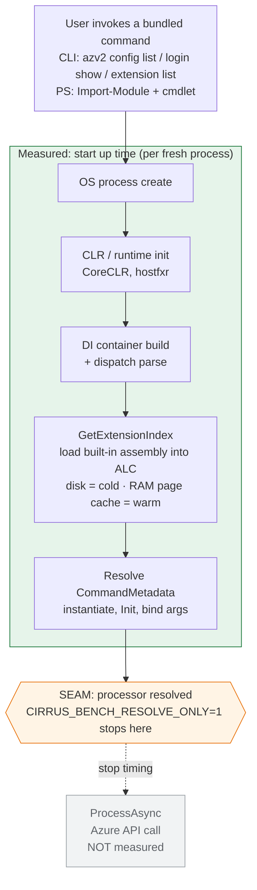

# Measuring Start up time

### Status: Draft

### Purpose:
To align on how and what we are going to measure for the startup time for Cirrus. Also, the intended purpose of its measurement.

### Problem:
[[Feature] CLI Startup & Execution Performance Targets](https://github.com/Azure/CLIPS/issues/47)
> Cold start (first invocation after install/reboot): < X ms
>
> Warm start (subsequent invocations): < Y ms

We need an agreed, repeatable way to measure cold/warm startup so the **X/Y** targets in #47 can actually be set, validated, and defended over time — rather than estimated once and forgotten.

### What will we measure?

#### What do we consider as the start up time?
The real, end-to-end cost a user pays from launching a bundled command up to the point where Cirrus is **ready to execute it** — i.e. all the work *before* any Azure API call.

Both surfaces funnel through `Core.Engine.ExecutionSession`. We stop at the **seam** inside it: after `GetProcessor()` has done all the startup work (runtime init → DI → dispatch parse → load the extension assembly → resolve + bind the command processor) but **before** `ProcessAsync()` fires the API call. This keeps the number:

- **Surface-accurate** — one hook covers both CLI and PowerShell.
- **Network/auth-free** — the seam is reachable logged-out with zero Azure dependency, so it's deterministic and reproducible in CI.

We measure two notions, both **process-level** (a fresh OS process per launch — exactly what a user experiences):

- **Warm start** — assemblies already in the OS page cache (the common "subsequent invocation" case).
- **Cold start** — OS page cache evicted before each launch, so DLLs are re-read from disk (the "first run after install/reboot" case).

*We time from process launch up to the seam (the command processor is fully resolved and bound); `ProcessAsync` and the Azure API call are excluded. The assembly-load step is the only stage whose cost differs cold vs warm (disk vs OS page cache).*

#### Which extensions will we measure and why?
The true-core built-ins shipped with **every** install, seeded in `BuiltInExtensions` and marked "present in every install, never removed": `extension`, `login`, `config`. (All three are verified shipped on Windows/macOS/Linux by the cross-platform packaging tests.)

We measure all three because they ship in every install (representative of the default experience), exercise the full assembly-load + index-resolution path, and need no network or auth to resolve — keeping the measurement clean and deterministic.

- **CLI:** `extension`, `login`, `config` (all three).
- **PS:** `login` and `config` only — `extension` has no PowerShell cmdlet module (the PS surface ships Login and Config), so there is nothing to invoke there.

### How will we measure it?
What framework / techniques will we use

- **Framework:** BenchmarkDotNet, extending the existing `tests/Benchmark` suite — reusing its runner, statistics, gh-pages dashboards, AppInsights export and chart generation.
- **Technique:** each benchmark `Process.Start`s the **real published binary** and `WaitForExit()`s, with `CIRRUS_BENCH_RESOLVE_ONLY=1` set so the child process stops at the seam.
  - **CLI:** launch `azv2 config list` / `login show` / `extension list`.
  - **PS:** `pwsh -NoProfile` → import the staged module → invoke the cmdlet (legitimately includes `pwsh` startup + module import — the real PS cost).
- **Warm vs cold:** warm = BDN steady state (caches hot); cold = a separate job that evicts the OS page cache before each measured launch (Linux `drop_caches`; Windows `EmptyStandbyList`). If eviction isn't permitted on an agent, the cold run **logs-and-skips** rather than reporting warm numbers as cold.
- **Matrix:** CLI × {extension, login, config} + PS × {login, config}, each × {cold, warm} = **(3 + 2) × 2 = 10 tracked numbers.**
- **Product footprint:** ~6 lines — a single `CIRRUS_BENCH_RESOLVE_ONLY` short-circuit in `ExecutionSession`, mirroring existing benchmark hooks (`CIRRUS_NO_EXTENSION_CACHE`, `CIRRUS_AGENT_DISABLED`).

### What will we do with the results?
- **Track over time** on the existing gh-pages benchmark dashboards (new `startup-cli` / `startup-ps` series) and in AppInsights/Grafana, sliced by surface, extension, and mode.
- **Watch for regressions:** warm series use the suite's **115%** threshold to flag drift on the dashboard / via telemetry — **no PR comments or merge blocks** (see Out of scope). Cold is informational only (higher variance).
- **Set & validate targets:** feed measured cold/warm back into #47 to agree realistic **X/Y**, then track drift against them.
- **(Future)** justify and validate optimizations such as ReadyToRun/AOT publishing.

### Out of scope:
- **PR gating** — no hard merge-block **and** no per-PR regression comments; startup numbers (especially cold) are noisy, so we track them on dashboards + telemetry, not on the PR.
- In-process (BenchmarkDotNet-host) micro-timing.
- Core-only baseline / per-extension marginal breakdown (deferred — useful later for *diagnosing* where a regression sits).
- Phase-instrumented internal stopwatch timings.
- ReadyToRun/AOT publishing (a potential *fix* to validate later, not part of measuring).
- A PowerShell surface for `extension` — it has no cmdlet module, so `extension` is measured on the CLI only (building a PS extension module is product work, not benchmarking).
