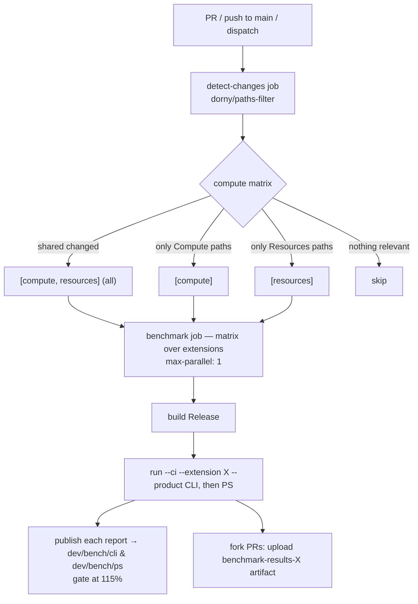

# Design: Extensible Per-Extension Benchmarks (Compute first)

- **Date:** 2026-07-06
- **Status:** Approved (pending spec review)
- **Owner:** Benchmark suite
- **Scope:** Add benchmarks for the **Compute** extension, publish them to the
  gh-pages dashboards like Resources, and make the benchmark suite + CI
  **extensible** so any extension (Login, Extensions, …) can be added with
  minimal, localized changes. CI must run only the benchmarks whose extension's
  files changed.

---

## 1. Context & Problem

The benchmark suite (`tests/Benchmark/`) today measures cold-start CLI/PowerShell
command execution against a stubbed HTTP layer (no real Azure). It is organized
purely by **product**:

- `tests/Benchmark/CLI/ResourceGroupBenchmarks.cs`
- `tests/Benchmark/PS/ResourceGroupBenchmarks.cs`
- `Program.cs` hardcodes the benchmark types in `GetBenchmarkTypes()` and filters
  only by `--product CLI|PS|ALL`.

Results are published to GitHub Pages via `benchmark-action/github-action-benchmark`:

- `dev/bench/cli/` (chart name `Azclips CLI Benchmarks`)
- `dev/bench/ps/` (chart name `Azclips PS Benchmarks`)

CI (`.github/workflows/benchmark.yml`) triggers broadly on `src/**` and **always**
runs both products for the single (Resources) benchmark class. A companion
workflow `benchmark-comment.yml` posts results on fork PRs.

**Problems to solve:**

1. There is no **extension** dimension — only Resources is benchmarked, and the
   runner/CI cannot select benchmarks by extension.
2. CI runs everything on any `src/**` change; it cannot scope a run to the
   extension that actually changed.
3. Adding a new extension currently requires editing `Program.cs`, the workflow,
   and the comment workflow by hand.

---

## 2. Goals & Non-Goals

### Goals

- Add Compute benchmarks (List / Create / Get for the Virtual Machine resource).
- Publish Compute results to the existing gh-pages dashboards as their own charts.
- Make benchmark **discovery** attribute-driven so new extensions need **zero**
  `Program.cs` edits.
- Make **CI** run only the changed extension's benchmarks (shared changes run all),
  driven by a path filter + matrix, so adding an extension is a small, localized
  change.
- Keep existing Resources behavior working; standardize its chart names for
  consistency.

### Non-Goals

- Benchmarking other extensions (Login, Extensions, …) now — only the extensible
  **mechanism** is built and proven with Compute.
- Full-fidelity Azure response emulation. The resource-aware stub returns only the
  minimal shapes the exercised processors/orchestrators actually read (see §5); it is
  not a general Azure mock.
- Changing the Compute extension's command surface (e.g. wiring up the unregistered
  `vm create-basic`). Benchmarks exercise only commands that are actually dispatched.
- Real Azure calls, performance tuning, or interpreting the numbers themselves.

---

## 3. Design Overview

Introduce an **extension** dimension alongside the existing **product** dimension.

```
                 product ─────────────▶   CLI            PS
 extension
   │
   ▼
 Resources                     ResourceGroupBenchmarks   ResourceGroupBenchmarks
 Compute                       VirtualMachineBenchmarks  VirtualMachineBenchmarks
 (future: Login, …)            …                         …
```

- Each benchmark class is tagged with `[BenchmarkExtension("<Name>")]`.
- `Program.cs` discovers classes by reflection and filters by `--product` and a new
  `--extension`.
- gh-pages keeps the two product dashboards; each extension contributes a distinct
  **named chart** on the same page.
- CI detects changed extensions via `dorny/paths-filter` and runs a **matrix** over
  them.

---

## 4. Benchmark Runner Changes (`tests/Benchmark/`)

### 4.1 `[BenchmarkExtension]` attribute (new)

A small assembly-local attribute used purely for discovery/filtering:

```csharp
[AttributeUsage(AttributeTargets.Class, Inherited = false, AllowMultiple = false)]
public sealed class BenchmarkExtensionAttribute : Attribute
{
    public string Name { get; }
    public BenchmarkExtensionAttribute(string name) => Name = name;
}
```

### 4.2 Attribute-driven discovery in `Program.cs`

Replace the hardcoded `GetBenchmarkTypes(product)` switch with reflection:

- Enumerate types in the Benchmark assembly that are concrete and derive from
  `CLI.CLIBenchmarkBase` or `PS.PSBenchmarkBase`.
- **Product** is inferred from the base type (`CLIBenchmarkBase` ⇒ `CLI`,
  `PSBenchmarkBase` ⇒ `PS`).
- **Extension** is read from `[BenchmarkExtension]` (a class without the attribute
  is a hard error surfaced in the run verdict — keeps the taxonomy honest).
- Filter by the `--product` and `--extension` args (each defaults to `ALL`).
- Deterministic ordering (by extension, then product, then type name) for stable
  output.

New arg parsing mirrors the existing `--product` handling:

- `--extension <name>` / `--extension=<name>` → upper-cased filter, `ALL` = no filter.

### 4.3 CI artifacts path includes the extension

`Program.cs` currently writes CI output to
`artifacts/Benchmark/ci/<product>/`. Add the extension so parallel/serial runs never
collide and the publish step can glob a single file:

```
artifacts/Benchmark/ci/<extension ?? "ALL">/<product ?? "ALL">/
```

Each `--ci --extension X --product CLI` run then produces exactly one report:

```
artifacts/Benchmark/ci/<X>/CLI/results/Benchmark.CLI.<ClassName>-report-full-compressed.json
```

### 4.4 Compute benchmark classes (new)

Two classes, mirroring the `ResourceGroupBenchmarks` pattern, named for the primary
resource (**Virtual Machine**):

`tests/Benchmark/CLI/VirtualMachineBenchmarks.cs`

```csharp
[BenchmarkExtension("Compute")]
public class VirtualMachineBenchmarks : CLIBenchmarkBase
{
    protected override IReadOnlyList<string> RequiredExtensions => new[] { "Compute" };

    [Benchmark(Description = "CLI: List VM")]     // vm list
    [Benchmark(Description = "CLI: Create VM")]   // vm create   (orchestrated)
    [Benchmark(Description = "CLI: Get VM")]      // vm show
}
```

`tests/Benchmark/PS/VirtualMachineBenchmarks.cs`

```csharp
[BenchmarkExtension("Compute")]
public class VirtualMachineBenchmarks : PSBenchmarkBase
{
    protected override string ModuleName => "Compute"; // Login pulled in via closure

    [Benchmark(Description = "PS: List VM")]    // Get-VM (by resource group)
    [Benchmark(Description = "PS: Create VM")]  // New-VM (orchestrated)
    [Benchmark(Description = "PS: Get VM")]     // Get-VM -Name
}
```

**Scenario ↔ command mapping (only dispatched commands are used):**

| Operation | CLI command | PS cmdlet | Processor |
|-----------|-------------|-----------|-----------|
| List | `vm list` | `Get-VM` (RG scope) | `ListVMProcessor` (GET, non-LRO) |
| Create | `vm create` | `New-VM` | `NewVMProcessor_Orchestrator` (VNet→NSG→NIC→VM) |
| Get | `vm show` | `Get-VM -Name` | `GetVMProcessor` (GET, non-LRO) |

> **Note:** `vm create-basic` / the single `New-VM` are **not** registered in the
> Compute dispatch tables, so the only exposed create is the orchestrated one. The
> benchmark uses it as-is; it measures the full pipeline + orchestration overhead.

Required parameters (SubscriptionId, ResourceGroupName, Name, Location, VmSize,
AdminUsername/Password, and the orchestrator's network names) are supplied by the
benchmark methods. Exact params are finalized during implementation and validated by
the smoke test (§9).

### 4.5 Resources retrofit (minimal)

Tag the two existing classes so the extension filter and CI matrix treat them
uniformly. **No behavior change.**

- `CLI/ResourceGroupBenchmarks.cs` → add `[BenchmarkExtension("Resources")]`
- `PS/ResourceGroupBenchmarks.cs` → add `[BenchmarkExtension("Resources")]`

### 4.6 `ChartGenerator` generalization (local artifacts only)

`ChartGenerator` produces the local/CI-log HTML + JSON artifacts
(`benchmark-comparison-*.html`, `benchmark-details-*.html`, `benchmark-summary-*.json`).
It does **not** feed the gh-pages dashboard, the regression gate, or PR comments — those
consume BenchmarkDotNet's own `*-report-full-compressed.json`. Today `CalculateOverhead`
hardcodes the three Resource-Group operations (`{ "List RG", "Create RG", "Get RG" }`)
and the comparison subtitle says "…for Resource Group operations", so a Compute run would
render empty/misleading rows.

To keep the local charts extension-agnostic, derive the operation label from each
benchmark's display name by stripping the `"CLI: "` / `"PS: "` prefix (e.g. `"CLI: List VM"`
→ `"List VM"`), group by that label in first-seen order, and make the subtitle generic.
No behavior change for Resources; the dashboard/gate/comments are unaffected either way.

---

## 5. HTTP Stub — Resource-Aware Chained-Response Mocking

The VM create is both **long-running** and **orchestrated**:
`NewVMProcessor_Orchestrator` → `NewNetworkInterfaceProcessor_Orchestrator` creates a
VNet + NSG, then reads `vnet.Properties.Subnets.Select(s => s.Id)` to build a NIC, then
creates the VM from that NIC. The old catch-all `{}` stub has **two** problems:

1. **LRO polling delay.** After the initial `PUT`, LRO processors poll every
   `Retry-After ?? PollingInterval` seconds; `PollingInterval` is **15s** (set by
   `Engine`) → ~42h at 10,000 iterations.
2. **Chained-response dependency (crash).** `VirtualNetwork.Properties` defaults to
   `null!`, so an empty `{}` VNet response makes `vnet.Properties.Subnets` throw a
   **NullReferenceException**. (`nsg.Id` / `nic.Id` are null-tolerant, so *only* the VNet
   response actually needs shaping.)

**Fix:** make the benchmark stub **resource-aware** — return a minimal, correctly-shaped
JSON body per resource type, plus a `Retry-After: 0` header so LRO polls don't wait. The
mapping lives in an explicit static class backed by JSON fixture files.

### 5.1 `StubResponseMappings` (new) — explicit path → fixture mapping

`tests/Common/Stubs/StubResponseMappings.cs`

- Explicit dictionary: ARM **resource-type path segment** (e.g. `/virtualNetworks/`) →
  fixture file name. The request path carries a varying resource name, so the stable type
  segment is matched as a **substring** of the path.
- Fixtures are loaded from disk **once** and cached (segment → body); per-request cost is a
  pure in-memory lookup — no file I/O in the measured path.
- `ResolveBody(path)` returns the matched body, or `DefaultBody = "{}"` when unmapped.

```csharp
internal static class StubResponseMappings
{
    public const string DefaultBody = "{}";

    private static readonly IReadOnlyDictionary<string, string> s_fixtureFiles =
        new Dictionary<string, string>(StringComparer.OrdinalIgnoreCase)
        {
            ["/virtualNetworks/"]       = "virtualNetwork.json",
            ["/virtualMachines/"]       = "virtualMachine.json",
            ["/networkInterfaces/"]     = "networkInterface.json",
            ["/networkSecurityGroups/"] = "networkSecurityGroup.json",
        };

    private static readonly IReadOnlyDictionary<string, string> s_bodies = LoadFixtures();

    public static string ResolveBody(string path)
    {
        foreach (var (segment, body) in s_bodies)
            if (path.Contains(segment, StringComparison.OrdinalIgnoreCase))
                return body;
        return DefaultBody;
    }

    private static Dictionary<string, string> LoadFixtures()
    {
        var dir = Path.Combine(AppContext.BaseDirectory, "Stubs", "Fixtures");
        var map = new Dictionary<string, string>(StringComparer.OrdinalIgnoreCase);
        foreach (var (segment, file) in s_fixtureFiles)
            map[segment] = File.ReadAllText(Path.Combine(dir, file));
        return map;
    }
}
```

### 5.2 `StubHttpTerminateHandler` (updated) — wiring only

`tests/Common/Stubs/StubHttpTerminateHandler.cs`

```csharp
public class StubHttpTerminateHandler : IHttpTerminateHandler
{
    public SendAsyncStep SendAsync { get; } = (request, callback, next) =>
    {
        var path = request.RequestUri?.AbsolutePath ?? string.Empty;
        var response = new HttpResponseMessage(HttpStatusCode.OK)
        {
            Content = new StringContent(StubResponseMappings.ResolveBody(path), Encoding.UTF8, "application/json"),
        };
        response.Headers.TryAddWithoutValidation("Retry-After", "0"); // LRO polls wait 0s
        return Task.FromResult(response);
    };
}
```

### 5.3 Fixtures (new) — `tests/Common/Stubs/Fixtures/*.json`

Minimal bodies. Only the VNet must be shaped (its subnets are read); the rest echo an
`id` / terminal state:

- `virtualNetwork.json` — `{ id, location, properties: { subnets: [ { name, id } ] } }`
- `virtualMachine.json` — `{ id, properties: { provisioningState: "Succeeded" } }`
- `networkInterface.json` — `{ id }`
- `networkSecurityGroup.json` — `{ id }`

### 5.4 Project wiring

The Tests.Common project copies the fixtures to output (they flow transitively to the
Benchmark output, so `AppContext.BaseDirectory` resolves them):

```xml
<ItemGroup>
  <Content Include="Stubs\Fixtures\*.json">
    <CopyToOutputDirectory>PreserveNewest</CopyToOutputDirectory>
  </Content>
</ItemGroup>
```

### 5.5 Why this is safe

- `StubHttpTerminateHandler` is consumed **only** by the Benchmark project
  (`tests/Benchmark/BenchmarkBase.cs`) — confirmed by search. No unit tests are affected.
- Deserialization is case-insensitive and **ignores unknown fields**, so shaped bodies are
  harmless to VM list/get and to **all Resources operations** (their `/resourcegroups/…`
  URLs match no mapping → `{}`, unchanged from today).
- `vm list` ends at `/virtualMachines` (no trailing `/`) → falls through to `{}`; only the
  single-resource `/virtualMachines/{name}` create & get match the VM fixture.
- Adding a future resource shape = one dictionary entry + one `.json` file.

---

## 6. gh-pages Dashboards

**Decision:** keep the two product dashboards; add one **named chart per extension**
on each page (chosen over per-extension subdirectories to preserve existing URLs).

- Dirs stay: `dev/bench/cli`, `dev/bench/ps`.
- Chart `name` becomes extension-qualified so each extension is its own entry/chart
  in the shared `data.js`:
  - Resources → `Azclips Resources CLI Benchmarks` / `Azclips Resources PS Benchmarks`
    (**standardized** from the current generic `Azclips CLI/PS Benchmarks`).
  - Compute → `Azclips Compute CLI Benchmarks` / `Azclips Compute PS Benchmarks`.
- Result: `dev/bench/cli/index.html` shows a Resources chart **and** a Compute chart;
  each new extension adds another chart to the same page.

The fork (`origin`) has no `gh-pages` yet, so standardizing the Resources chart names
loses no history. (Upstream history under the old name would remain but become an
orphaned entry — acceptable.)

---

## 7. CI Workflow (`.github/workflows/benchmark.yml`)

**Decision:** single workflow, `dorny/paths-filter` computes which extensions changed,
a **matrix** runs each. Shared changes run all extensions.

### 7.1 Structure



### 7.2 `detect-changes` job

`dorny/paths-filter` with one `shared` filter plus one filter **per extension**:

```yaml
filters: |
  shared:
    - 'src/Core/**'
    - 'tests/Benchmark/*.cs'          # runner, base, chart gen, stub listener
    - 'tests/Common/**'               # stubs, utilities
    - 'global.json'
    - 'azclips.slnx'
    - 'Shared.props'
    - '.github/workflows/benchmark.yml'
  compute:
    - 'src/Extensions/Compute/**'
    - 'src/PS/Compute/**'
    - 'tests/Benchmark/CLI/VirtualMachineBenchmarks.cs'
    - 'tests/Benchmark/PS/VirtualMachineBenchmarks.cs'
  resources:
    - 'src/Extensions/Resources/**'
    - 'src/PS/Resources/**'
    - 'tests/Benchmark/CLI/ResourceGroupBenchmarks.cs'
    - 'tests/Benchmark/PS/ResourceGroupBenchmarks.cs'
```

A small script converts the filter outputs into the matrix:

- The **extension set** = every filter key except `shared`.
- If `shared` matched → matrix = all extension keys.
- Else → matrix = the extension keys that matched.
- If the resulting set is empty → the benchmark job is skipped.
- Output as JSON (`matrix={"extension":[...]}`) consumed by the benchmark job.

`workflow_dispatch` runs all extensions.

### 7.3 `benchmark` job (matrix)

- `strategy: { matrix: ${{ fromJSON(needs.detect-changes.outputs.matrix) }},
  max-parallel: 1 }` — serialized to avoid concurrent `gh-pages` pushes racing.
- Steps per extension `X`:
  1. harden-runner, checkout, setup-dotnet, `dotnet build … -c Release`.
  2. Run CLI: `dotnet run … -- --ci --extension X --product CLI` (with retry).
  3. Publish CLI: `github-action-benchmark` with
     - `name: 'Azclips <X> CLI Benchmarks'`
     - `output-file-path`: the single JSON located by globbing
       `artifacts/Benchmark/ci/<X>/CLI/results/*-report-full-compressed.json`
       (a shell step resolves the path → no class names in YAML)
     - `benchmark-data-dir-path: dev/bench/cli`, `gh-pages-branch: gh-pages`
     - `auto-push: ${{ github.event_name == 'push' }}`, `alert-threshold: '115%'`,
       `fail-on-alert: false`, comment/summary flags as today.
  4. Run PS + Publish PS symmetrically → `dev/bench/ps`, `name: 'Azclips <X> PS Benchmarks'`,
     `skip-fetch-gh-pages: true` (the CLI publish in the same job already fetched).
  5. Fork PRs: upload `benchmark-results-<X>` artifact with that extension's CLI+PS
     report JSONs.
- Recommended: add a top-level `concurrency` group (e.g.
  `benchmark-${{ github.ref }}`) to avoid overlapping runs pushing to `gh-pages`.

### 7.4 Trigger-level `paths` unchanged

Keep the existing broad `on.push`/`on.pull_request` `paths` (`src/**`,
`tests/Benchmark/**`, `global.json`, `azclips.slnx`, the workflow file). `src/**`
already covers any new extension, so the trigger list rarely changes; `detect-changes`
does the per-extension breakdown.

---

## 8. Fork-PR Comment Workflow (`.github/workflows/benchmark-comment.yml`)

- Download **all** `benchmark-results-*` artifacts (matrix produces one per extension)
  instead of the single fixed `benchmark-results`.
- The existing Python already walks every JSON, classifies by product via the
  `Benchmark.CLI.` / `Benchmark.PS.` prefix, and matches each benchmark by `FullName`
  against previous `dev/bench/<product>/data.js` entries — so multiple extensions and
  multiple named charts are handled without table-structure changes.
- Sparse-checkout of `dev/bench/cli/data.js` + `dev/bench/ps/data.js` stays as-is
  (all extensions' history lives in those two files).

---

## 9. Testing & Validation

- Build Release and stage PS modules:
  `dotnet build azclips.slnx -c Release` + `./build/Set-ModuleConfiguration.ps1 -c Release`.
- Run the **validate-benchmarks** skill (temporarily lowers iterations to 5) to smoke
  test both extensions end-to-end in `--local` mode, then restore iterations to 10000:
  - `--extension Compute --product ALL` (new path) and `--extension ALL --product ALL`
    (regression) must both end with `[Benchmark] PASS`.
- Confirm the Compute Create scenario completes quickly (LRO fix working) and every
  Compute benchmark returns exit code 0 / non-null output.
- Verify the new `--extension` filter selects the expected classes (spot-check console
  output: `Running N benchmark class(es): …`).

---

## 10. Documentation Updates

- `tests/Benchmark/README.md`: document the `--extension` option, the extension
  dimension, the Compute scenarios, and the `[BenchmarkExtension]` convention.
- `docs/spec/benchmark-workflows.md`: document the paths-filter matrix and per-extension
  charts; update dashboard descriptions.
- `wiki/02-deep-dive/testing-benchmarking.md`: update the `StubHttpTerminateHandler`
  description to cover the resource-aware `StubResponseMappings` + JSON fixtures and the
  `Retry-After: 0` LRO handling.

---

## 11. How to Add a New Extension Later (extensibility proof)

To benchmark a future extension `Foo`:

1. Add `tests/Benchmark/CLI/<FooResource>Benchmarks.cs` and the PS counterpart, each
   tagged `[BenchmarkExtension("Foo")]`, overriding `RequiredExtensions` /
   `ModuleName`.
2. Add a `foo:` filter block in `benchmark.yml`'s `dorny/paths-filter` listing
   `src/Extensions/Foo/**`, `src/PS/Foo/**`, and the two new benchmark files.

That's it — discovery (reflection), the matrix (derived from filter keys), the
publish step (globs the report), and the comment workflow all pick it up
automatically. No `Program.cs`, matrix list, or comment-script edits required.

---

## 12. Risks & Mitigations

| Risk | Mitigation |
|------|-----------|
| Orchestrated create throws on empty stub responses (`vnet.Properties.Subnets` NRE) | Resource-aware stub returns a shaped VNet fixture (subnet id); other chained reads (`nsg.Id`, `nic.Id`) are null-tolerant. Smoke-tested via validate-benchmarks. |
| Concurrent matrix jobs race on `gh-pages` push | `max-parallel: 1` + workflow `concurrency` group. |
| `Retry-After: 0` unexpectedly affects other stubbed calls | Only the LRO poll path reads it; stub is benchmark-only. |
| Report-file glob matches >1 file | Each `--ci --extension X --product Y` runs exactly one class ⇒ one report in its own dir. |
| Renaming Resources charts orphans upstream history | Fork has no gh-pages; upstream orphan is acceptable and non-destructive. |

---

## 13. Open Questions

- None blocking. Spec location (`docs/superpowers/specs/` vs `docs/spec/`) to be
  confirmed at review.
