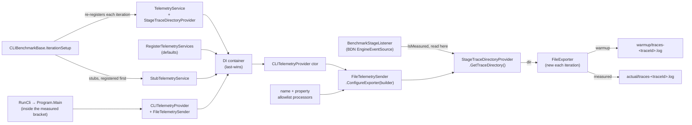

# Benchmark Telemetry Emission — Design

**Date:** 2026-08-18
**Status:** Implemented. Rebased onto `jaysontaimicrosoft-refactor-file-telemetry-sender`, which
decomposed `FileTelemetrySender` and injected `ITelemetrySender` into the client providers. The seam
described here moved down a layer as a result: the directory is now injected into the *sender*
rather than into `CLITelemetryProvider`, which this change no longer touches at all.

## Problem

`tests/Benchmark` measures CLI command execution but deliberately suppresses telemetry:
`BenchmarkBase.RegisterBenchmarkStubs()` registers `StubTelemetryService`, which creates no
exporter and writes nothing. A benchmark therefore tells you *how long* `az group list` takes but
not *where that time goes*.

We want each CLI benchmark method to leave behind a telemetry artifact containing real spans, so a
slow benchmark can be broken down by phase without re-instrumenting anything by hand.

## Goals

Emit span-level telemetry from CLI benchmark runs into the per-run artifacts directory.

**During a run**, each iteration writes its own trace log file — exactly as a real `az` process does
— and warmup iterations are kept in a separate directory from measured iterations:

```
artifacts/Benchmark/telemetry/<benchmark>/warmup/traces-<traceId>.log
artifacts/Benchmark/telemetry/<benchmark>/actual/traces-<traceId>.log
```

Warmup traces are written to real files so warmup and measured iterations cost the same, then deleted
unread. Only `actual/` is ever consumed.

**After the run**, the measured traces are sampled down and collapsed into the deliverable: **one
file per benchmark method**, e.g. `CLI.ResourceGroupBenchmarks.ListResourceGroups.jsonl`, which
`Program.Main` moves into the timestamped run folder. The raw directories are deleted.

**Out of scope.** PowerShell benchmarks (`PSBenchmarkBase`) and startup benchmarks
(`StartupBenchmarkBase`) are untouched. So is any tooling that *consumes* these files — regression
diffing between runs and uploading benchmark traces to OTLP/App Insights are future consumers, and
this change only has to produce a format they could later read.

## Key decisions

### Telemetry is always on, and every iteration pays for it

Emitting telemetry adds file I/O and allocations inside the measured region, so benchmark timings
and `[MemoryDiagnoser]` numbers will shift. That is accepted.

Critically, the cost must be paid *uniformly*. Sampling which iterations emit telemetry would make
the distribution bimodal — and because `CLIBenchmarkBase` carries `[Outliers(OutlierMode.RemoveAll)]`,
the telemetry-paying iterations would then be discarded as outliers, quietly changing what is being
measured.

So **all 10,000 iterations (5000 warmup + 5000 measured) emit telemetry**. Sampling decides only
what survives on disk, and it happens after the run.

### Production parity over raw fidelity

Benchmark telemetry runs through the real stack: `TelemetryService`, `CLITelemetryProvider`, both
allowlist filter processors (`DefaultActivityNameFilterProcessor`,
`DefaultTelemetryPropertyFilterProcessor`), and the real `FileExporter`. Spans and tags absent from
the allowlists are absent from the benchmark files too, so what lands on disk matches what real
telemetry would carry.

The only benchmark-specific behaviour is *where* the exporter writes.

### One trace file per iteration

Each iteration constructs its own `FileExporter`, which writes exactly one `traces-<traceId>.log` —
identical to a real `az` process, which is one invocation writing one file. This is both the most
faithful cost model and the least new code: the benchmark supplies a directory string and adds no
exporter type of its own.

The cost is ~10,000 transient files per benchmark method, deleted in that method's `GlobalCleanup`
before the next benchmark starts.

The rejected alternative was a process-static `FileExporter` shared across iterations, producing two
files per benchmark. Keeping one exporter alive across 10,000 container teardowns needs a
no-op-`Dispose` proxy wrapped around it, plus a `virtual ConfigureExporter` seam in production code so
the benchmark can inject that proxy. Not worth it to avoid transient files that are deleted minutes
later.

## Architecture

### Production changes (`src/`)

`CLITelemetryProvider` receives an `ITelemetrySender` from DI and hands it the builder; the sender
constructs the `FileExporter`. The only hard-coded value in that chain is the destination —
`FileTelemetrySender` reads `HomePaths.GetDefaultTraceDirectory()` directly. Making that one value
injectable is the whole seam.

1. **New `ITraceDirectoryProvider` in `Core.Telemetry`**, with the production implementation next to
   it:

   ```csharp
   public interface ITraceDirectoryProvider
   {
       string GetTraceDirectory();
   }

   public sealed class DefaultTraceDirectoryProvider : ITraceDirectoryProvider
   {
       public string GetTraceDirectory() => HomePaths.GetDefaultTraceDirectory();
   }
   ```

   `ITelemetrySender`, `DirectTelemetrySender`, `CLITelemetryProvider`, `TUITelemetryProvider`, and
   `PSTelemetryProvider` are **not modified**. `HomePaths.GetDefaultTraceDirectory()` keeps its name
   and its callers, so the `--upload-telemetry` path is untouched.

2. **`DIRegisterExtensions.RegisterTelemetryServices()`** registers
   `AddSingleton<ITraceDirectoryProvider, DefaultTraceDirectoryProvider>()` alongside the existing
   telemetry defaults.

   Registering it among the *defaults* rather than in `src/CLI/Program.cs` is deliberate.
   `AzclipsServiceProvider` applies defaults first, then override registrations in enqueue order with
   DI last-wins semantics. The benchmark's override is the only one for this type, so it simply wins —
   no `TryAdd` ordering trick is needed anywhere.

   This is why the seam sits on the *directory* rather than the sender: `src/CLI/Program.cs`
   registers `ITelemetrySender` itself, and that registration is enqueued after the benchmark's, so
   a benchmark-registered sender would be clobbered. Nothing registers `ITraceDirectoryProvider`
   outside the defaults, so the benchmark's override is uncontested.

3. **`FileTelemetrySender` takes `ITraceDirectoryProvider` by constructor** and resolves the
   directory inside `ConfigureExporter` rather than at construction:

   ```csharp
   public void ConfigureExporter(TracerProviderBuilder builder) =>
       builder.AddProcessor(
           new SimpleActivityExportProcessor(
               new FileExporter(_traceDirectory.GetTraceDirectory())));
   ```

   Resolving per export — not per construction — is what lets the benchmark answer "warmup or
   measured?" at the only moment the answer is knowable. See (5).

   It has no parameterless constructor: nothing in the repository constructs it by hand, so a single
   constructor removes any ambiguity about which one DI selects.

4. **`Core.Telemetry.csproj` adds `InternalsVisibleTo Benchmark`**, matching the existing
   `Core.Telemetry.Tests` entry, so the benchmark pruner reuses `TraceFileFormat.Parse` and
   `TraceEntry` and parses trace files exactly as the production uploader does.

That is the entire production diff: one new interface, one registration, and one constructor
parameter on the sender.

**What the provider deliberately does not cover.** `TelemetryUpload.RunPending()` — the
`--upload-telemetry` path — resolves `HomePaths.GetDefaultTraceDirectory()` directly and is not
modified. It runs at the top of `Program.Main`, *before* `AzclipsServiceProvider.Initialize()`, so
there is no container to resolve `ITraceDirectoryProvider` from. In production both resolve to the
same path, so nothing diverges.

The asymmetry is intentional but load-bearing: **the provider governs where traces are written; the
shared `HomePaths` helper governs where the uploader reads.** Benchmarks are unaffected because their
traces are a local artifact that is never uploaded, and `SpawnTelemetryUploader()` early-returns
unless `Environment.ProcessPath` ends in `az`/`az.exe`, which a BDN child process never does. Any
future *production* use of this seam to redirect writes would have to redirect the uploader in step.

### Benchmark changes (`tests/Benchmark/`)

5. **`StageTraceDirectoryProvider : ITraceDirectoryProvider`** is the only benchmark-side type in the
   telemetry pipeline itself. It chooses between the warmup and measured directories **at the moment
   a trace is written**:

   ```csharp
   internal StageTraceDirectoryProvider(
       string warmupDirectory, string actualDirectory, BenchmarkStageListener stage);

   public string GetTraceDirectory()
       => _stage.IsMeasured ? _actualDirectory : _warmupDirectory;
   ```

   **The choice cannot be made in `[IterationSetup]`.** This was measured, not assumed:
   BenchmarkDotNet raises `WorkloadActualStart`/`WorkloadActualStop` around the measured region of
   *each* iteration, and `IterationSetup` runs **outside** that bracket, so it always observes
   `IsMeasured == false` — including on measured iterations. `GetTraceDirectory()` is called while
   `FileTelemetrySender.ConfigureExporter` builds the exporter inside the benchmarked call, which
   *is* inside the bracket, so it observes the true stage.

   Both paths are precomputed in `GlobalSetup`, so the measured region pays only a volatile bool
   read and a reference return — identical work in both stages, so it cannot skew the distribution.

   Note what is *not* here: no sender, no exporter, no processor. DI still resolves the real
   `FileTelemetrySender` into the real `CLITelemetryProvider`, and the sender still builds the real
   `FileExporter` through the real `ConfigureExporter` → `AddProcessor` path. The benchmark
   substitutes a directory string, nothing else.

6. **`BenchmarkStageListener : EventListener`** subscribes to the `BenchmarkDotNet.EngineEventSource`
   (public, `EngineEventSource.SourceName`) and sets its own instance `IsMeasured` property on
   `WorkloadActualStartEventId` / `WorkloadActualStopEventId`.

   This exists solely to distinguish warmup from measured iterations. Counting iterations instead
   would be wrong: BDN's jitting stage invokes the workload once or twice before warmup begins, so
   the boundary is offset, and it drifts silently if the counts change.

7. **`BenchmarkName.FromCommandLine()`** answers one question: *which benchmark method is this
   process running?*

   The deliverable is one file **per benchmark method**, so the file name has to tell
   `ListResourceGroups` apart from `CreateResourceGroup`. Nothing in the benchmark's own code can
   supply that:

   - `[GlobalSetup]` runs before any `[Benchmark]` method is invoked, and takes no parameters.
   - `[IterationSetup]` is no better informed. It is also a parameterless instance method invoked
     through a generated delegate, so it knows exactly what `GlobalSetup` knows: nothing about which
     method is about to run. Deferring the lookup there would repeat the same command-line parse
     10,000 times for a value that cannot change.
   - `GetType()` yields the class — and at runtime BDN's generated subclass of it — not the method.
   - BDN does not surface the running `BenchmarkCase` to user code in either hook.

   There is also nothing to defer *for*: BDN runs one child process per benchmark case, so the answer
   is fixed for the process lifetime. `BenchmarkDotNet.Running.BenchmarkId` exposes
   `FullBenchmarkName` and a `ToArguments()` that builds exactly that child command line, which is
   where `--benchmarkName <fully.qualified>` comes from. The helper reads
   `Environment.GetCommandLineArgs()`, strips the leading `Benchmark.` namespace segment, and
   sanitises the rest for the filesystem:

   ```
   Benchmark.CLI.ResourceGroupBenchmarks.ListResourceGroups
     →         CLI.ResourceGroupBenchmarks.ListResourceGroups
   ```

   This is authoritative and matches the BDN summary rows, so every telemetry file correlates to a
   reported result. If the argument is missing, `GlobalSetup` throws rather than guessing a name and
   silently mislabelling the output.

   **Rejected alternatives.** BDN's `[GlobalSetup(Target = nameof(X))]` / `[IterationSetup(Target =
   ...)]` would identify the method without touching the command line, but only by writing one setup
   method per benchmark method in every benchmark class — and a new benchmark that forgot one would
   silently emit no telemetry. A `[CallerMemberName]` parameter on `RunCli` would also work and
   avoids the BDN coupling entirely, but `params string[] args` cannot be followed by an optional
   parameter, so every call site changes shape, and the name would only be known at the first
   `RunCli` call rather than in `GlobalSetup` where the directories are set up.

8. **`CLIBenchmarkBase` owns the directories and the lifecycle**, as instance fields alongside the
   existing `_extensionsRoot`. No statics are needed: BDN constructs one instance of a benchmark
   class per case and reuses it for `GlobalSetup` → all 10,000 iterations → `GlobalCleanup`, so
   instance state outlives the per-iteration DI container on its own.

   ```csharp
   private BenchmarkStageListener _stage = null!;
   private StageTraceDirectoryProvider _traceDirectory = null!;
   private string _stagingRoot = null!;      // artifacts/Benchmark/telemetry
   private string _telemetryRoot = null!;    // <stagingRoot>/<benchmark>
   private string _benchmarkName = null!;
   ```

   `GlobalSetup`, next to the existing extensions-home reset:

   ```csharp
   _benchmarkName = BenchmarkName.FromCommandLine();       // BDN --benchmarkName
   _stagingRoot   = Path.Combine(RepoRoot, "artifacts", "Benchmark", "telemetry");
   _telemetryRoot = Path.Combine(_stagingRoot, _benchmarkName);
   TryDeleteDirectory(_telemetryRoot);                     // stale state from a previous run

   _stage = new BenchmarkStageListener();
   _traceDirectory = new StageTraceDirectoryProvider(
       Path.Combine(_telemetryRoot, "warmup"),
       Path.Combine(_telemetryRoot, "actual"),
       _stage);
   ```

   Building the provider here — rather than per iteration — is what keeps both directory strings out
   of the measured region.

   Three of these **must not** move to `IterationSetup`, and the reasons are worth stating because
   they are the kind of thing that looks harmless and silently destroys the run:

   - `TryDeleteDirectory(_telemetryRoot)` per iteration would delete every trace written by the
     previous 9,999 iterations. The prune would then find one file.
   - `new BenchmarkStageListener()` per iteration would leave 10,000 live `EventListener`
     subscriptions attached to BDN's `EngineEventSource` for the process lifetime.
   - Computing the warmup/measured paths per iteration would move string building into the measured
     region for no benefit, since both values are constant for the whole run.

   Resolving `_benchmarkName` is a pure function of the command line, so it is constant for the
   process — once is simply the honest place for it.

   `GlobalCleanup`, alongside the existing home-directory delete:

   ```csharp
   _stage.Dispose();
   TraceSampler.Prune(
       Path.Combine(_telemetryRoot, "actual"),
       Path.Combine(_stagingRoot, _benchmarkName + ".jsonl"));
   TryDeleteDirectory(_telemetryRoot);
   ```

   The pruned `.jsonl` lands in `_stagingRoot`, one level above the raw directory that is about to be
   deleted, which is where `Program.Main` later collects it from.

9. **`IterationSetup` re-registers the telemetry services**, after `RegisterBenchmarkStubs()` and
   `RegisterExtensionResolution()`:

   ```csharp
   private void RegisterTelemetryCapture()
   {
       AzclipsServiceProvider.OverrideRegistration(services =>
       {
           // Last-wins over the StubTelemetryService that RegisterBenchmarkStubs
           // just registered, so the production TelemetryService runs.
           services.AddSingleton<ITelemetryService, TelemetryService>();

           // Last-wins over the DefaultTraceDirectoryProvider registered among the defaults.
           // The provider is built once in GlobalSetup and resolves the stage when the exporter
           // asks for a directory — see (5) for why the stage cannot be read here.
           services.AddSingleton<ITraceDirectoryProvider>(_traceDirectory);
       });
   }
   ```

   The registration must be repeated every iteration because `IterationCleanup` disposes the DI
   container, but the object registered is the same instance throughout.

   `RegisterBenchmarkStubs()` itself is not modified, so PS benchmarks keep `StubTelemetryService`.

   `TelemetryService`'s constructor takes `(ITelemetryProvider, IConfigurationService, ClientType)`,
   all already registered, so constructor injection resolves it. `ITraceDirectoryProvider` is not
   `IDisposable`, so per-iteration container teardown disposes nothing that matters.

10. **Where the directories live — no environment variable.** The timestamped run folder
    (`artifacts/Benchmark/<timestamp>/`) is computed in `Program.Main`, which is the *host* process;
    BDN runs each benchmark case in a child process that has no way to learn it. Rather than pass it
    across that boundary, the benchmark derives its own paths from `RepoRoot`, exactly as it already
    does for the extensions home (`artifacts/Benchmark/home/extensions`):

    ```
    artifacts/Benchmark/telemetry/<benchmark>/{warmup,actual}/    raw, deleted in GlobalCleanup
    artifacts/Benchmark/telemetry/<benchmark>.jsonl               pruned output
    ```

    `Program.Main` then moves the `.jsonl` files into `<artifactsPath>/telemetry/` once all summaries
    are in. The per-run association is preserved, and the coupling runs child → host through the
    filesystem, which already exists — not host → child through the environment.

### Flow



## Data flow and output

During a benchmark method's run:

```
artifacts/Benchmark/telemetry/
  CLI.ResourceGroupBenchmarks.ListResourceGroups/
    warmup/traces-<traceId>.log     ~5000 files
    actual/traces-<traceId>.log     ~5000 files, ~35 MB total
```

After that method's `GlobalCleanup`:

```
artifacts/Benchmark/telemetry/
  CLI.ResourceGroupBenchmarks.ListResourceGroups.jsonl    100 traces
```

After `Program.Main` collects them, once every benchmark has finished:

```
artifacts/Benchmark/<timestamp>/telemetry/
  CLI.ResourceGroupBenchmarks.ListResourceGroups.jsonl    100 traces
```

Both raw directories go together — `GlobalCleanup` deletes the whole `<benchmark>/` directory once
`actual/` has been pruned, so the next benchmark method starts from a clean tree and peak disk stays
at roughly 70 MB rather than accumulating across the run.

### Sampling

`TraceSampler` is an `internal static` class in `tests/Benchmark`, alongside the other benchmark
tooling. It reads the raw files with `TraceFileFormat.Parse` and works on the resulting `TraceEntry`
list — both internal to `Core.Telemetry`, reachable through the `InternalsVisibleTo Benchmark`
entry — so the benchmark parses trace files exactly as the production uploader does without any
benchmark-only logic living in a production assembly.

Given the traces from `actual/`:

1. Group spans by `TraceId`; each group is one CLI invocation.
2. Order groups by the earliest span `StartTime` in each. Filenames carry no sequence, and
   `StartTime` is ISO-8601 with 100 ns resolution, so this recovers exact invocation order.
3. `stride = max(1, total / 100)`; take every stride-th group, capped at 100.

The stride adapts to the iteration count. The `validate-benchmarks` skill temporarily drops warmup
and iteration counts to 5, which yields `stride = 1` and keeps all 5 traces rather than emitting
nothing.

### Output format

JSON Lines: one span per line, spans grouped by trace, traces in sampled order. Each line carries the
same object shape `FileExporter` writes today — `TraceId`, `SpanId`, `ParentSpanId`, `OperationName`,
`DisplayName`, `StartTime`, `Duration`, `Status`, `StatusDescription`, `Kind`, `Tags`, `Events`,
`Resource` — serialised without indentation.

## Error handling

The design fails loudly rather than producing empty or mislabelled artifacts:

| Condition | Behaviour |
| --- | --- |
| `TelemetryOptions.Enabled == false` in the developer's config | Detected by outcome, not by config read. `GlobalCleanup` reports `[Telemetry] <name>: kept N sampled trace(s)`, and when `N == 0` names the likely causes. `GlobalSetup` cannot check this directly: it would need `IConfigurationService`, and resolving one requires `AzclipsServiceProvider.Initialize()`, which has not run yet — calling it early would make `Program.Main`'s `PrependRegistration` throw and break every benchmark. |
| `--benchmarkName` absent from the child command line | `GlobalSetup` throws, rather than writing under a guessed name. |
| Stale `artifacts/Benchmark/telemetry/<benchmark>/` from a previous run | `GlobalSetup` deletes it first, mirroring the existing extensions-home reset. The telemetry root is a stable path, so this is the only thing preventing runs from bleeding into each other. |
| Pruning fails (parse error, locked file) | Print a `[Telemetry]` warning and leave the benchmark exit code green. A telemetry-plumbing failure must not trip the 115% regression gate. |
| Fewer `.jsonl` files than expected at collection time | Each benchmark already reports its own outcome: `GlobalCleanup` prints `[Telemetry] <name>: kept N sampled trace(s)`, or a named warning when `N == 0`. `Program.Main` then reports how many files it collected, or `No telemetry was produced by this run`. Exit code stays green, for the same reason. |
| A `.jsonl` is left in `artifacts/Benchmark/telemetry/` from a crashed earlier run | `Program.Main` deletes the telemetry staging directory before `BenchmarkRunner.Run`, so its post-run collection can only pick up files from this run. |

No explicit flush is needed. `SimpleActivityExportProcessor` exports synchronously and `FileExporter`
uses `File.AppendAllText`, so every file is complete on disk by the time `GlobalCleanup` runs.

## Consequences

CLI benchmark means and `[MemoryDiagnoser]` numbers step up once, uniformly, because every iteration
now pays real telemetry cost. The App Insights historical series and the 115% regression gate will
see a one-time discontinuity on the run this lands. Numbers remain comparable run-to-run afterwards.

PS and startup benchmarks are unaffected. Startup benchmarks spawn real `az` processes, which keep
writing to `%LocalAppData%/.azclips/traces` as before.

## Testing

**Unit** (`tests/Core.Telemetry.Tests`) — production surface only:

- `DefaultTraceDirectoryProvider` returns the concrete `%LocalAppData%/.azclips/traces` path,
  guarding the one production behaviour this change touches, and `RegisterTelemetryServices`
  resolves it — the registration the benchmark's override depends on.
- A later `ITraceDirectoryProvider` registration actually reaches the `FileTelemetrySender` that DI
  builds, and that sender configures an exporter without throwing. This is the wiring the whole
  benchmark path rests on, so it is asserted rather than assumed.

`CLITelemetryProvider` is not modified by this change, so nothing that constructs it is affected.

`TraceSampler` and `BenchmarkName.FromCommandLine` are deliberately **not** unit-tested. Both live in
`tests/Benchmark`, which is an `Exe` with no companion test project, and neither a new
`Benchmark.Tests` project nor widening `Tests.Common`'s dependencies was judged worth it for two
helpers. They are covered end-to-end instead. The accepted gap is the stride edge cases.

**Build:** `dotnet build azclips.slnx`.

**Targeted:** `dotnet test tests/Core.Telemetry.Tests/Core.Telemetry.Tests.csproj`.

**End-to-end:** the `validate-benchmarks` 5-iteration smoke run is the primary safety net, so it
asserts more than a smoke test normally would:

- One `.jsonl` per CLI benchmark method under `artifacts/Benchmark/<timestamp>/telemetry/`, each
  named after a row in the BDN summary — validates `BenchmarkName.FromCommandLine`.
- Exactly 5 traces in each file, not 10 — the run does 5 warmup plus 5 measured iterations, so this
  proves the stage listener fired and warmup traces were excluded rather than merely trimmed.
- The degenerate stride path is exercised for free: 5 traces against a target of 100 gives
  `stride = 1`, which must keep all 5 rather than emit nothing.
- Nothing left behind under `artifacts/Benchmark/telemetry/` — validates the `GlobalCleanup` delete.

The normal stride path (5000 measured → `stride = 50` → exactly 100 traces) only appears in a full
run, so it is spot-checked once by hand when the change lands.
