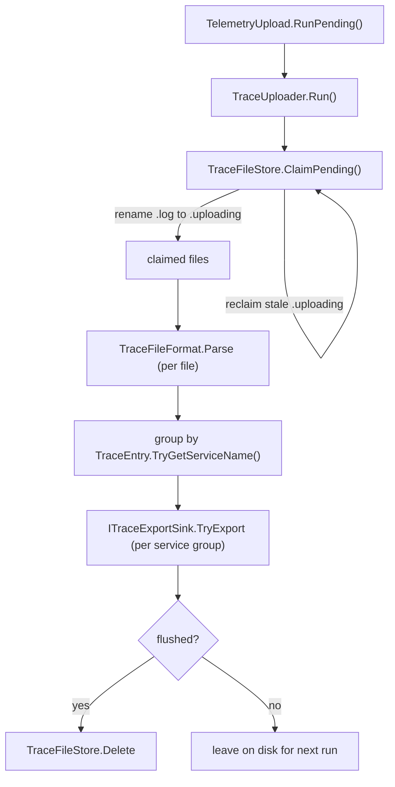

# FileTelemetrySender Refactor — Design

**Date:** 2026-08-19
**Status:** Approved
**Scope:** `src/Core/Core.Telemetry`, plus call sites in CLI, TUI, and PS

## Problem

`FileTelemetrySender.cs` is 438 lines carrying six unrelated jobs:

1. Deciding where trace files live (`GetTraceDirectory`).
2. Wiring the file exporter into a `TracerProviderBuilder` (`ConfigureExporter`).
3. Managing file lifecycle — reclaiming stale claims, claiming files by rename, deleting them.
4. Parsing the on-disk batch format (`ParseTraceFile`).
5. Grouping traces by service name (`ExtractServiceName`).
6. Replaying entries as activities with the parent/child tree intact
   (`ReplayEntries`, `TopologicallyOrder`, `ReplayTrace`).

Three consequences:

**The uploader cannot be tested.** `SendPendingStatic` is static and reaches the
filesystem, the environment, and Azure Monitor on its own. There is no way to verify
its most important guarantee — that trace files survive a failed flush — without
shipping real telemetry. Today all 15 tests cover only the replay helpers.

**The file format has two owners that do not know about each other.** `FileExporter`
writes `--- Batch at {timestamp} ---\n{json}\n`; `ParseTraceFile` splits on that literal
string. Changing either silently breaks the other.

**Bare `catch { }` hides real defects.** The claim loop's catch is legitimate — it means
another uploader won the race — but the same empty handler would swallow a
`NullReferenceException` just as quietly. Normal contention and genuine bugs are
indistinguishable.

Two smaller defects fall out of the same reading:

- `ITelemetrySender.SendPendingAsync()` has no callers anywhere in the repo. The CLI
  spawns a detached `--upload-telemetry` process that calls `SendPendingStatic()`
  directly. The interface method is dead on both implementations.
- `ConfigureExporter`'s `traceDirectory` parameter is never a meaningful value. CLI and
  TUI ask the sender for the path and hand it straight back; PS passes `string.Empty`
  because `DirectTelemetrySender` ignores it.

## Goals

- One responsibility per type, each small enough to read in a sitting.
- The uploader's claim / group / delete logic is unit-testable without a live exporter.
- The on-disk format has exactly one owner, used by both the writer and the reader.
- Every `catch` names the failure it expects; unexpected failures surface.
- Behavior visible to users and to App Insights is unchanged.

## Non-goals

- Changing what telemetry is collected, filtered, or where it is sent.
- Introducing a filesystem abstraction. The repo has none, and temp directories make
  better tests than fakes for this logic.
- Adding retention or cleanup for the trace directory. Tracked separately (see
  [Deferred](#deferred)).

## Constraint: no DI container at the entry point

`--upload-telemetry` is the **first branch in `Main`, before the container is built**
(`src/CLI/Program.cs`). The uploader therefore cannot be resolved from DI.

This does not force static classes. A container is only an automated composition root;
constructor injection works without one. Exactly one type is static for this reason —
`TelemetryUpload`, the hand-wired composition root. Everything beneath it is an instance
class with its dependencies passed in.

The rule applied throughout:

> **Static is reserved for pure functions with no dependencies.** Anything that touches
> the disk, the network, or the environment is an instance whose dependencies are
> injected.

| Type | Kind | Reason |
| --- | --- | --- |
| `TelemetryUpload` | static | composition root; does the job a container would |
| `TraceUploader` | instance | injected store and sink |
| `TraceFileStore` | instance | injected directory |
| `TracerProviderExportSink` | instance | injected target |
| `TraceFileFormat` | static | pure function, no state |
| `TraceReplayer` | static | pure function over an `ActivitySource` parameter |

If the uploader ever moves in-process, migration is mechanical: register the same
instance types in the container and delete `TelemetryUpload`. Nothing below it changes.

## Components

All new types live in `src/Core/Core.Telemetry/` and are `internal` unless noted.

### `TraceEntry.cs`

The on-disk DTO, moved out of `FileTelemetrySender` into its own file. Gains one method:

```csharp
/// <summary>Reads service.name out of the Resource block, or null if absent.</summary>
public string? TryGetServiceName();
```

This replaces `ExtractServiceName`. Interpreting the DTO belongs to the DTO, not to
orchestration.

### `TraceFileFormat.cs`

The single owner of the on-disk shape. `FileExporter` writes through it and the uploader
reads through it, so the two halves cannot drift.

```csharp
/// <summary>Renders one batch, header included, ready to append.</summary>
internal static string FormatBatch(IReadOnlyList<object> traces, DateTime timestampUtc);

/// <summary>Parses every batch in a file. Malformed batches are skipped, not fatal.</summary>
internal static List<TraceEntry> Parse(string content);
```

`TraceFileFormat` owns file *content*; `TraceFileStore` below owns file *naming and
lifecycle*. `FormatBatch` takes `IReadOnlyList<object>` because `FileExporter` builds
anonymous projections of `Activity`; the serialized shape is defined by `TraceEntry`.

### `TraceFileStore.cs`

Owns the directory, the file naming convention, and the claim protocol that lets
concurrent uploaders share it. This is the only type in the pipeline that touches
`System.IO`.

```csharp
private const string FileSearchPattern = "traces-*.log";
private static readonly TimeSpan StaleClaimAge = TimeSpan.FromMinutes(5);

/// <summary>{LocalApplicationData}/.azclips/traces — same root as auth profiles.</summary>
internal static string DefaultDirectory { get; }

/// <summary>The file a given trace buffers into. Used by FileExporter.</summary>
internal static string FileNameFor(string traceId);

internal TraceFileStore(string directory);

internal IReadOnlyList<string> ClaimPending();
internal bool TryRead(string claimedFile, out string content);
internal void Delete(string claimedFile);
```

`FileNameFor` exists because three places must agree on the naming convention:
`FileExporter` writes `traces-{traceId}.log`, `ClaimPending` scans `traces-*.log`, and the
claim renames to `.uploading`. Today those literals are spread across two files. Centralizing
them here means `TraceUploader` contains no `System.IO` calls at all — it is pure
orchestration, which is what makes it testable against a temp directory.

**Why the claim protocol exists.** Every `az` command writes traces to one shared folder
and then spawns a detached uploader. Five quick commands mean five uploaders reading the
same folder at once. Two failures follow: two uploaders send the same file (duplicates in
App Insights), and an uploader reads a file a running command is still appending to
(a truncated JSON batch).

The fix is claim-by-rename. Before reading, the uploader renames `traces-abc.log` to
`traces-abc.uploading`. Rename is atomic, so exactly one process wins; losers get an
exception meaning "someone else got there first" and skip the file. The rename also fails
while a writer still holds the file, so in-flight files are skipped for free. After
`ClaimPending()` returns, the caller holds files no one else will touch — contention
yields fewer results, never an exception.

`Delete` removes a claimed file only after a successful flush. If an uploader crashes
between claiming and deleting, the file is stranded as `.uploading` and the `.log` scan
would never see it again — so anything `.uploading` older than `StaleClaimAge` is presumed
abandoned and renamed back.

```
traces-abc.log --rename--> traces-abc.uploading --flush ok--> deleted
                              |
                              +-- uploader crashes --5 min--> back to .log
```

### `TraceReplayer.cs`

Pure replay logic. Knows nothing about files or exporters.

```csharp
internal static void ReplayEntries(ActivitySource source, IEnumerable<TraceEntry> entries);
private static List<TraceEntry> TopologicallyOrder(List<TraceEntry> entries);
private static void ReplayTrace(ActivitySource source, TraceEntry entry,
                                Dictionary<string, ActivitySpanId> spanIdMap);
```

Logic moves unchanged: OpenTelemetry assigns fresh SpanIds, so parents are emitted first
and each child's parent context is rewritten to its parent's new SpanId, preserving the
original `TraceId` and tree.

### `ITraceExportSink.cs` and `TracerProviderExportSink.cs`

The swappable send step — the seam that makes the uploader testable.

```csharp
internal interface ITraceExportSink
{
    /// <summary>
    /// Exports one service's traces through a dedicated TracerProvider.
    /// A provider's Resource is immutable and supplies service.name, which Azure Monitor
    /// maps to cloud_RoleName — so each service identity needs its own provider. Building
    /// one per group also isolates failures: a timeout for one service never forces a
    /// redelivery (and duplicates) for another.
    ///
    /// Returns true only when the batch flushed successfully. False tells the uploader to
    /// leave the source files on disk for the next attempt.
    /// </summary>
    bool TryExport(string serviceName, IReadOnlyList<TraceEntry> entries);
}

internal sealed class TracerProviderExportSink : ITraceExportSink
{
    private static readonly TimeSpan FlushTimeout = TimeSpan.FromSeconds(10);
    internal TracerProviderExportSink(TelemetryTarget target);
}
```

The one-service-per-call signature makes "one provider per service identity" structural
rather than an unexplained loop body.

### `TraceUploader.cs`

Orchestration only, readable top to bottom.

```csharp
internal sealed class TraceUploader
{
    private readonly TraceFileStore _store;
    private readonly ITraceExportSink _sink;

    internal TraceUploader(TraceFileStore store, ITraceExportSink sink);

    /// <summary>Claim, parse, group by service, export, delete only what shipped.</summary>
    internal void Run();
}
```

Synchronous. `ForceFlush` blocks, so the old `Task`-returning signature was decorative.

### `TelemetryUpload.cs` (public)

The composition root, and the only public entry point the CLI needs.

```csharp
public static class TelemetryUpload
{
    public static void RunPending() =>
        new TraceUploader(
            new TraceFileStore(TraceFileStore.DefaultDirectory),
            new TracerProviderExportSink(TelemetryTargetResolver.Resolve()))
        .Run();
}
```

### `FileTelemetrySender.cs` (public, reduced)

```csharp
public class FileTelemetrySender : ITelemetrySender
{
    public void ConfigureExporter(TracerProviderBuilder builder) =>
        builder.AddProcessor(
            new SimpleActivityExportProcessor(
                new FileExporter(TraceFileStore.DefaultDirectory)));
}
```

Dropping the parameter removes the CLI/TUI round-trip and the PS `string.Empty` hack, and
lets `TraceFileStore` stay `internal`.

### `ITelemetrySender.cs` (reduced)

```csharp
public interface ITelemetrySender
{
    void ConfigureExporter(TracerProviderBuilder builder);
}
```

## Data flow



Inside `TracerProviderExportSink.TryExport`: build a `TracerProvider` whose Resource
carries `serviceName`, replay via `TraceReplayer`, then `ForceFlush(10s)`.

Two existing behaviors are preserved deliberately:

- **Entries are flattened across every file in a service group before replay**, so a
  parent in one file can still link to a child in another. This is why grouping happens
  before export rather than per file.
- **The target is resolved once per run**, so every group goes to the same destination.

Fallback service name when `service.name` is absent stays `AzclipsTelemetryUploader`.

## Error handling

The uploader is a detached, throwaway process. Nobody reads its stderr, and every failure
self-heals: unclaimed files stay `.log`, claimed-but-failed files are reclaimed after five
minutes, and unflushed files are simply not deleted. Logging therefore buys nothing.

That same property makes propagation free. A crash in that process is harmless, and it is
the only way anyone can debug this — run `az --upload-telemetry` by hand and get a stack
trace instead of silence.

So: no logging, no stderr. Narrow each `catch` to the exceptions genuinely expected, with
a comment naming the cause. Everything else propagates.

| Failure | Caught | Reason |
| --- | --- | --- |
| `File.Move` during claim | `IOException`, `UnauthorizedAccessException` | Another uploader won, or the writer still holds it |
| `File.Move` during stale reclaim | `IOException`, `UnauthorizedAccessException` | Another uploader reclaimed it first |
| `TraceFileStore.TryRead` | `IOException`, `UnauthorizedAccessException` | File vanished or is locked; retried next run |
| Malformed JSON batch | `JsonException` | Truncated tail from a killed process; skip that batch, keep the rest |
| `File.Delete` | `IOException`, `UnauthorizedAccessException` | Already gone or locked; harmless |
| Anything else | **not caught** | Propagates; a real defect must not look like contention |

`FileExporter`'s existing `Console.Error` self-log is unchanged — it runs in the user's
foreground process, where the layering rationale still applies.

## Testing

The 15 existing tests move to `TraceReplayerTests.cs` with type names updated. Behavior is
unchanged, so they pass untouched — the safety net for the riskiest 200 lines.

New coverage, none of it previously possible:

| Suite | Setup | Cases |
| --- | --- | --- |
| `TraceFileFormatTests` | none (pure) | multi-batch parse; malformed batch skipped without losing siblings; content with no JSON; empty file; `FormatBatch` → `Parse` round-trip |
| `TraceFileStoreTests` | temp directory | claim renames `.log` to `.uploading` and returns them; missing directory returns empty; `.uploading` older than 5 min reclaimed; fresh `.uploading` left alone; already-claimed file yields no result; `TryRead` returns content, and returns false for a missing file; `Delete` removes |
| `TraceUploaderTests` | temp directory + fake sink | deletes only when the sink returns true; **leaves files when the sink returns false**; one sink call per service name; entries flattened across files in a group; falls back to `AzclipsTelemetryUploader` when `service.name` is absent; no-op on an empty directory |

The emphasized case — trace files survive a failed flush — is the guarantee that protects
users' telemetry, and nothing verifies it today.

`TracerProviderExportSink` gets one construction test across both targets, mirroring the
existing `TelemetryExportersTests`. `TryExport` is deliberately not exercised there: it
builds a live provider and ends in `ForceFlush`, whose outcome and duration depend on
whether a collector is listening. Its behavior is covered through `TraceUploaderTests`
against a fake sink.

## Migration

| File | Change |
| --- | --- |
| `src/CLI/Program.cs` | `await FileTelemetrySender.SendPendingStatic();` → `TelemetryUpload.RunPending();` |
| `src/CLI/Telemetry/CLITelemetryProvider.cs` | drop the directory argument |
| `TUI/Telemetry/TUITelemetryProvider.cs` | drop the directory argument |
| `src/PS/Login/Telemetry/PSTelemetryProvider.cs` | drop the `string.Empty` argument |
| `src/Core/Core.Telemetry/ITelemetrySender.cs` | drop `traceDirectory` and `SendPendingAsync` |
| `src/Core/Core.Telemetry/DirectTelemetrySender.cs` | drop both |
| `src/Core/Core.Telemetry/FileExporter.cs` | name files via `TraceFileStore.FileNameFor`, serialize via `TraceFileFormat.FormatBatch` |
| `tests/Core.Telemetry.Tests/DirectTelemetrySenderTests.cs` | drop the parameter argument |
| `tests/Core.Telemetry.Tests/FileTelemetrySenderTests.cs` | rename to `TraceReplayerTests.cs`, retarget types |
| `wiki/02-deep-dive/telemetry.md` | update names and the ~8 line-number citations into `FileTelemetrySender.cs` |

## Deferred

**The trace directory grows without bound.** If the endpoint is unreachable, files are
never deleted and accumulate indefinitely. Worse, the uploader only runs when the host
executable is `az`/`az.exe`, so benchmark and in-process test runs write trace files that
are never uploaded or cleaned up at all.

An age-based purge would be a few lines inside `TraceFileStore`, but it discards
undelivered telemetry, and choosing a cutoff requires confirming how old a span can be
before Azure Monitor rejects it. Filed separately to keep this change a refactor.

## Decisions

| Decision | Rationale |
| --- | --- |
| Split into eight single-purpose types rather than three | A coarser split leaves IO mixed with format, and pure replay logic mixed with `TracerProvider` construction — which is exactly what makes the send step unswappable |
| Interface only on the export sink | The parser, ordering, and claim protocol are all better tested for real (pure functions, temp directories) than through fakes |
| `TraceFileStore` stays `internal` | Dropping the `ConfigureExporter` parameter removes the only reason to expose it |
| Delete `SendPendingAsync` | No callers on either implementation |
| Synchronous `Run()` | `ForceFlush` blocks; the `Task` return was decorative |
| Keep one `TracerProvider` per service group | A provider's Resource is immutable and cannot be overridden per span; Azure Monitor derives `cloud_RoleName` from it. Collapsing to one provider would merge CLI and PowerShell under a single role name, and would make flush failures all-or-nothing, causing duplicate delivery |
| No logging on failure | Detached process; stderr is unread and every failure self-heals via retry |
