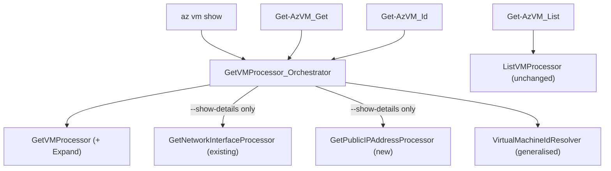

# `az vm show` / `Get-AzVM` parameter migration — design

**Date:** 2026-09-23
**Status:** Approved, ready for planning
**Scope:** `src/Extensions/Compute`, `src/PS/Compute`, `src/CLI/Help/Docs/vm`

## Problem

AzClips exposes `az vm show` and `Get-AzVM` with only four parameters each
(`--subscription-id`/`-SubscriptionId`, `--name`/`-Name`, `--resource-group`/`-ResourceGroupName`,
`--profile`/`-Profile`). The legacy commands carry considerably more surface. This design migrates the
agreed subset while reusing the existing processor and orchestrator machinery rather than adding
parallel code paths.

## Goals

- Add `--ids`, `--include-user-data`/`-u`, and `--show-details`/`-d` to `az vm show`.
- Add `-Id` and `-UserData` to `Get-AzVM`.
- Drive every new flag through a single shared orchestrator so CLI and PowerShell cannot drift.
- Leave plain `az vm show` / `Get-AzVM` output byte-identical to today.

## Non-goals

These were considered and explicitly excluded:

- `Get-AzVM -Status` and the CLI/PS instance-view-only output shape.
- `-DisplayHint` (`Compact`/`Expand`) — a legacy PowerShell formatting concern with no AzClips equivalent.
- `-Location` and a CLI `--location` — would require a location-scoped list endpoint and parameter set.
- `az vm list --show-details`, subscription-wide listing, and wildcard name filtering.

## Final parameter surface

### CLI — `az vm show`

| Flag | Alias | Type | Required | State |
|---|---|---|---|---|
| `--name` | — | string | unless `--ids` | existing; relaxes to optional |
| `--resource-group` | — | string | unless `--ids` | existing; relaxes to optional |
| `--subscription-id` | — | string | no | existing |
| `--profile` | — | string | no | existing |
| `--ids` | — | string[] | no | **new** |
| `--include-user-data` | `-u` | bool | no | **new** |
| `--show-details` | `-d` | bool | no | **new** |

### PowerShell — `Get-AzVM`

| Parameter | Type | Parameter sets | State |
|---|---|---|---|
| `-ResourceGroupName` | string | `Get` (mandatory), `List` (mandatory) | existing |
| `-Name` | string | `Get` (mandatory) | existing |
| `-SubscriptionId` | string | all | existing |
| `-Profile` | string | all | existing |
| `-Id` | string | `Id` (mandatory, position 0) | **new** |
| `-UserData` | SwitchParameter | `Get`, `Id` | **new** |

`-Id` is the single-target PowerShell spelling of `--ids`, matching the precedent already set by
`Stop-AzVM`: the cmdlet wraps it as `new[] { Id }` before handing it to the engine.

## Architecture

One orchestrator serves both clients. Client-specific naming lives entirely in `ExtensionIndex`
metadata, because `ParameterMetadata`'s first argument is the processor property and its second is the
client-facing name:

| Orchestrator property | CLI spelling | PowerShell spelling |
|---|---|---|
| `Ids` (`string[]`) | `--ids` | `-Id` |
| `IncludeUserData` (`bool`) | `--include-user-data` / `-u` | `-UserData` |
| `ShowDetails` (`bool`) | `--show-details` / `-d` | not exposed |



### Reused without modification

| Asset | Role |
|---|---|
| `ComputeProcessorBase.CreateExtendedProcessor<T>` | child-processor composition with inherited runtime context |
| `GetNetworkInterfaceProcessor` | NIC fetch for `--show-details` |
| `ListVMProcessor` | `Get-AzVM_List` stays exactly as it is |
| `ShowIdentityProcessor_Orchestrator` | reference pattern for ID fan-out, aggregation, `WriteOutput` |
| `StartVMProcessor_Orchestrator` | reference pattern for `Ids` on a Compute orchestrator |
| `NewVMProcessor_Orchestrator` | reference pattern for reading child responses via `ReadFromJsonAsync<T>(JsonOptions)` |

No change to `ComputeProcessorBase`.

### Modified

| File | Change |
|---|---|
| `src/Extensions/Compute/Processors/GetVMProcessor.cs` | add `public string? Expand { get; set; }`; append `&$expand={Expand}` to the request URI when non-empty. `Expand` is set by the orchestrator only and is deliberately **not** registered in `ExtensionIndex`, so no client can pass a raw expand string |
| `src/Extensions/Compute/Customization/VirtualMachineIdResolver.cs` | generalise to `ParseResourceId(string id, string provider, string resourceType)`; `ParseVirtualMachineResourceId` becomes a one-line call into it |
| `src/Extensions/Compute/Models/VirtualMachine.cs` | add `VirtualMachineProperties.UserData`, `VirtualMachineProperties.InstanceView`, and the five synthetic detail fields on `VirtualMachine` |
| `src/Extensions/Compute/Models/NetworkInterface.cs` | add `NetworkInterfaceProperties.MacAddress`, `IPConfigurationProperties.PrivateIPAddress`, and `IPConfigurationProperties.PublicIPAddress` (a sub-resource reference carrying only `Id`) |
| `src/Extensions/Compute/ExtensionIndex.cs` | repoint `vm show`, `Get-AzVM_Get`; add `Get-AzVM_Id`; add parameter metadata and aliases |
| `src/PS/Compute/Cmdlets/GetVMCmdlet.cs` | add the `Id` parameter set and the `-UserData` switch |
| `src/CLI/Help/Docs/vm/show.md` | examples for `--ids`, `-u`, `-d` |
| `src/PS/Compute/help/Get-AzVM.md` | `Id` syntax block; `-Id` and `-UserData` parameter sections |

### New

| File | Purpose |
|---|---|
| `src/Extensions/Compute/Processors/GetPublicIPAddressProcessor.cs` | GET a public IP address; mirrors `GetNetworkInterfaceProcessor` |
| `src/Extensions/Compute/Models/PublicIPAddress.cs` | `Id`, `Properties.IpAddress`, `Properties.DnsSettings.Fqdn` |
| `src/Extensions/Compute/Customization/GetVMProcessor_Orchestrator.cs` | the shared orchestrator |
| `tests/Scripts/CLI/VMShow.sh` | CLI smoke script |
| `tests/Scripts/PS/VMShow.ps1` | PowerShell smoke script |

Compute orchestrators live under `Customization/` but declare the
`Microsoft.Azure.Azclips.Extensions.Compute.Processors` namespace, matching
`StartVMProcessor_Orchestrator`.

## Behaviour

### Expand resolution

`GetVMProcessor_Orchestrator` computes a single `Expand` value and hands it to `GetVMProcessor`:

| `ShowDetails` | `IncludeUserData` | `$expand` |
|---|---|---|
| false | false | omitted |
| false | true | `userData` |
| true | false | `instanceView` |
| true | true | `instanceView,userData` |

This matches legacy `az vm show` exactly, and it is the only place any of the three new flags touches
the request.

### Execution

```
targets = Ids is { Length: > 0 }
    ? Ids.Select(id => ParseResourceId(id, "Microsoft.Compute", "virtualMachines"))
    : [ (SubscriptionId, ResourceGroupName, Name) ]

foreach target in targets:
    vm = await CreateExtendedProcessor<GetVMProcessor>(p => {
             p.SubscriptionId = target.SubscriptionId;
             p.ResourceGroupName = target.ResourceGroupName;
             p.Name = target.Name;
             p.Expand = expand;
         }).SendAsync() -> ReadFromJsonAsync<VirtualMachine>(JsonOptions)

    if ShowDetails: await EnrichAsync(vm)
    results.Add(vm)

WriteOutput(Ids is { Length: > 0 } ? results.ToArray() : results[0])
```

When `Ids` is empty the orchestrator writes the single VM object, preserving today's `az vm show`
output. When `Ids` is supplied it always writes an array, even for one ID — matching
`ShowIdentityProcessor_Orchestrator`. This is invisible to PowerShell, because `GetVMCmdlet`
constructs its streams with `enumerateOutput: true`, so a one-element array is enumerated into the
pipeline as a single `VirtualMachine`.

### `EnrichAsync` (`--show-details` only)

For each entry in `vm.Properties.NetworkProfile.NetworkInterfaces`:

1. Parse the NIC ID with `ParseResourceId(id, "Microsoft.Network", "networkInterfaces")`.
2. `CreateExtendedProcessor<GetNetworkInterfaceProcessor>` → collect `Properties.MacAddress`.
3. For each `ipConfiguration`: collect `Properties.PrivateIPAddress`; if
   `Properties.PublicIPAddress?.Id` is present, parse it with
   `ParseResourceId(id, "Microsoft.Network", "publicIPAddresses")`, then
   `CreateExtendedProcessor<GetPublicIPAddressProcessor>` → collect `Properties.IpAddress` and
   `Properties.DnsSettings?.Fqdn`.

Then decorate the VM and discard the instance view:

- `PowerState` = comma-joined `DisplayStatus` for every `Properties.InstanceView.Statuses` entry whose
  `Code` starts with `PowerState/`.
- `PublicIps`, `Fqdns`, `PrivateIps`, `MacAddresses` = comma-joined collected values.
- `Properties.InstanceView = null`, reproducing legacy's `del result['instanceView']`.

Null or absent values are skipped before joining, so a VM with no public IP yields an empty string
rather than a stray comma.

## Output shape

- **Plain:** byte-identical to today. The new model properties carry
  `[JsonIgnore(Condition = JsonIgnoreCondition.WhenWritingNull)]`, because `CliOutputFormatter` does
  not set a global null-ignore policy and would otherwise emit `"powerState": null` and friends on
  every call.
- **`-u` / `-UserData`:** adds `properties.userData`. Note this differs from legacy `az`, which
  client-flattens the ARM payload and surfaces `userData` at the top level. AzClips models preserve
  the ARM `properties` envelope, so the field stays where ARM returns it.
- **`-d`:** adds `powerState`, `publicIps`, `fqdns`, `privateIps`, `macAddresses` at the **top level**
  of the VM object, and `properties.instanceView` is absent. These five are synthetic — they are
  computed by AzClips rather than returned by ARM — so keeping them outside `properties` both matches
  legacy `az vm show -d` and keeps the ARM-sourced payload unpolluted.

## Error handling

| Situation | Behaviour | Rationale |
|---|---|---|
| Malformed ARM ID | `InvalidOperationException` from the resolver, with its existing message | unchanged behaviour, now shared by four callers |
| `--ids` together with `--name` / `--resource-group` | `Ids` wins silently | matches `StartVMProcessor_Orchestrator`, `PowerOffVMProcessor_Orchestrator`, `DeallocateVMProcessor_Orchestrator`, `ShowIdentityProcessor_Orchestrator`; legacy `az` errors here, but in-product consistency was chosen |
| No `Ids` and empty `Name` or `ResourceGroupName` | `InvalidOperationException` naming the missing parameters | `ParameterMetadata` cannot express "required unless `--ids`", so without this guard the user gets a malformed URL and a confusing 404 |
| NIC or public-IP GET fails during `-d` | exception propagates | matches legacy `az vm show -d`; the swallow-and-continue behaviour belonged to `-Status`, which is out of scope |
| VM has no network interfaces | detail fields are empty strings | matches legacy joining of an empty list |

## Testing

No new test project. Coverage comes from:

1. **`tests/Scenario.Tests/VmLifecycleScenarioTests.cs`** — extend with assertions that
   `--show-details` issues the NIC and public-IP requests and populates the five fields, and that
   `--include-user-data` sets `$expand=userData`.
2. **`tests/Scripts/CLI/VMShow.sh`** — exercises plain, `--ids`, `-u`, and `-d` against a real VM,
   cleaning up any resources it creates. Modelled on `VMCreate.sh`.
3. **`tests/Scripts/PS/VMShow.ps1`** — exercises `-Name`, `-Id`, and `-UserData`. Modelled on
   `VMCreate.ps1`.
4. **Regression:** `dotnet build azclips.slnx`, then `Cli.Tests`, `Cmdlets.Tests`, and
   `Core.Extensions.Tests`.

The primary regression risk is plain-output drift from the new model properties; the scenario test
asserting an unchanged plain payload is the guard for it.

## API versions

Unchanged from what the repository already uses: `2025-11-01` for
`Microsoft.Compute/virtualMachines` and `2025-05-01` for `Microsoft.Network/*`. `$expand=instanceView`
and `$expand=userData` are both supported at `2025-11-01`. Legacy `az`/Azure PowerShell sit on
`2026-04-01`; aligning versions is deliberately out of scope.
