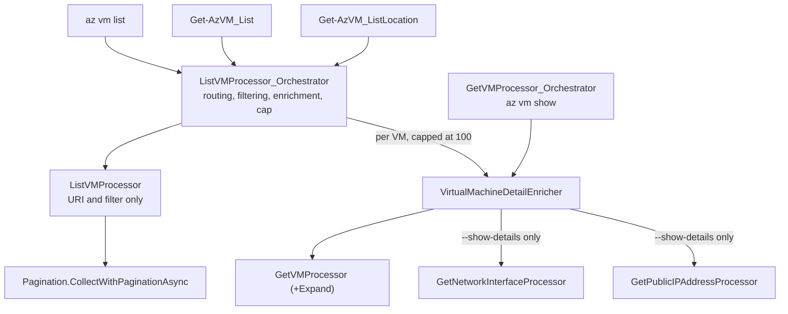

# `az vm list` / `Get-AzVM` list-parameter migration — design

**Date:** 2026-09-25
**Status:** Approved, ready for planning
**Scope:** `src/Extensions/Compute`, `src/Extensions/ExtensionRuntime`, `src/Core/Core.Engine`, `src/PS/Compute`, `src/CLI/Help/Docs/vm`

## Problem

AzClips exposes VM listing through `az vm list` and `Get-AzVM` (parameter set `List`), but both
require `--resource-group` / `-ResourceGroupName` and accept nothing else. Both legacy commands list
subscription-wide when the resource group is omitted, and both carry filtering and detail switches
that AzClips has no answer for.

The preceding `az vm show` / `Get-AzVM` migration deferred exactly this work, naming
"`az vm list --show-details`, subscription-wide listing, and wildcard name filtering" as non-goals.
This design picks those up.

## Goals

- Make the resource group optional on both surfaces so omitting it lists subscription-wide.
- Add `--vmss` and `--show-details`/`-d` to `az vm list`.
- Add `-Name`, `-Location`, `-Status` and a working `-UserData` to `Get-AzVM`'s list parameter sets.
- Drive every path through one shared orchestrator so CLI and PowerShell cannot drift.
- Leave `az vm show`, `Get-AzVM_Get` and `Get-AzVM_Id` behaviour unchanged.

## Non-goals

Considered and explicitly excluded:

- **Wildcard filtering.** Legacy PowerShell matches `-Name` and `-ResourceGroupName` as wildcards
  client-side. We implement exact match only. This is a deliberate divergence.
- **Cross-surface parity.** `--vmss` and `--show-details` stay CLI-only; `-Name`, `-Location` and
  `-Status` stay PowerShell-only. Each surface keeps its legacy shape.
- **`-Status` on the `Get` and `Id` parameter sets.** Those are `vm show` territory, already migrated.
- **`-NextLink`.** Not a public legacy parameter, and AzClips paginates automatically.
- **`-DisplayHint`.** A legacy PowerShell formatting concern with no AzClips equivalent.
- **Server-side `$expand=instanceView` on list endpoints.** Rejected in favour of reusing the
  per-VM `GET`; see "Detail enrichment" below.
- **A `tests/Extensions.Compute.Tests` project.** Smoke scripts only, matching what `vm show` shipped.

## Final parameter surface

### CLI — `az vm list`

| Flag | Alias | Type | Required | State |
|---|---|---|---|---|
| `--subscription-id` | — | string | no | existing |
| `--resource-group` | — | string | no | existing; **relaxes to optional** |
| `--profile` | — | string | no | existing |
| `--vmss` | — | string | no | **new** |
| `--show-details` | `-d` | bool | no | **new** |

`--vmss` accepts a VMSS resource id or a VMSS name. A name requires `--resource-group`.

### PowerShell — `Get-AzVM`

| Parameter | Type | Parameter sets | State |
|---|---|---|---|
| `-ResourceGroupName` | string | `List` (optional), `Get` (mandatory) | **relaxes to optional in `List`** |
| `-Name` | string | `List` (optional), `Get` (mandatory) | **new in `List`** |
| `-Location` | string | `ListLocation` (mandatory) | **new** |
| `-Status` | SwitchParameter | `List`, `ListLocation` | **new** |
| `-UserData` | SwitchParameter | `Get`, `Id`, **`List`**, **`ListLocation`** | **extended to the list sets** |
| `-SubscriptionId` | string | all | existing |
| `-Profile` | string | all | existing |
| `-Id` | string | `Id` (mandatory, position 0) | existing, unchanged |

`ListLocation` is a new parameter set. `Get` and `Id` are untouched.

## Routing

| Invocation | ARM operation |
|---|---|
| `az vm list` · `Get-AzVM` | `VirtualMachines_ListAll` |
| `az vm list -g rg` · `Get-AzVM -ResourceGroupName rg` | `VirtualMachines_List` |
| `az vm list --vmss <id>` | `VirtualMachines_List` (resource group parsed from the id) + `$filter` |
| `az vm list --vmss <name> -g rg` | `VirtualMachines_List` + `$filter` |
| `az vm list --vmss <name>` without `-g` | usage error |
| `Get-AzVM -Name n` | `VirtualMachines_ListAll` + exact-match name filter |
| `Get-AzVM -ResourceGroupName rg -Name n` | single `VirtualMachines_Get` |
| `Get-AzVM -Location loc` | `VirtualMachines_ListByLocation` |

PowerShell should bind `-ResourceGroupName rg -Name n` to the `Get` set, because it satisfies more
mandatory parameters. The list orchestrator nevertheless routes a concrete resource-group-plus-name
pair to a single `GET`, so behaviour is identical whichever set wins. Legacy relies on the same
value-based branching rather than trusting set selection.

## Behaviour consolidation

Legacy CLI and legacy PowerShell disagree in eight places. Each is resolved as follows.

| # | Divergence | Resolution |
|---|---|---|
| 1 | Only legacy lists subscription-wide | Both surfaces; resource group becomes optional |
| 2 | CLI `-d` returns IPs, FQDNs, MACs and power state; PS `-Status` returns power state, OS and maintenance status | Both kept, each native to its surface, both fan out per VM |
| 3 | PS filters names with wildcards; CLI has no name filter | Exact match only; CLI gains no name filter |
| 4 | Both legacies fan out per VM even though REST supports `$expand=instanceView` on the list | Fan-out retained, reusing the per-VM `GET` |
| 5 | PS caps `-Status` fan-out at 100 and warns; CLI has no cap | Cap applied to **every** fan-out switch on both surfaces |
| 6 | PS declares `-UserData` on list sets but silently ignores it | Fixed: functional via the capped fan-out |
| 7 | PS emits `PSVirtualMachineList` or `PSVirtualMachineListStatus` | One `VirtualMachine` model with a union of nullable synthetic fields |
| 8 | CLI quotes the `$filter` value; the spec's description does not | Use the CLI's quoted form; see "Error handling" |

### Detail enrichment

No list endpoint can satisfy these switches on its own. At API version `2025-11-01`:

| Endpoint | `$expand` | `$filter` | `statusOnly` |
|---|---|---|---|
| `VirtualMachines_List` | `instanceView` | VMSS id equality | — |
| `VirtualMachines_ListAll` | `instanceView` (spec: requires a valid `$filter`) | VMSS id equality | `true` |
| `VirtualMachines_ListByLocation` | — | — | — |

`userData` is not expandable on any of them, and `--show-details` needs NIC and public-IP data that
no list endpoint returns. So every detail switch resolves to a per-VM `GET`, reusing the machinery
`az vm show` already has. `--show-details` is accepted as slow; the 100-VM cap bounds it.

When several detail switches are combined, they produce **one** fan-out pass per VM with a
comma-joined expand, reusing the existing `GetVMProcessor_Orchestrator.ResolveExpand()` mapping
(`instanceView`, `userData`, or `instanceView,userData`).

## Architecture



The processor owns the HTTP shape; the orchestrator owns everything a client can switch on. That
boundary matches the `GetVMProcessor` / `GetVMProcessor_Orchestrator` split already in place.

Order of operations in the orchestrator: resolve the target endpoint, collect every page, filter by
exact name, enrich up to the cap, then write the whole enriched set once.

### Reused without modification

| Asset | Role |
|---|---|
| `ComputeProcessorBase.CreateExtendedProcessor<T>` | child-processor composition (access widened, see below) |
| `GetVMProcessor` | per-VM `GET` with `$expand`, for every detail switch |
| `GetNetworkInterfaceProcessor`, `GetPublicIPAddressProcessor` | `--show-details` network enrichment |
| `VirtualMachineIdResolver.ParseResourceId` | generalised by the `vm show` work; now also parses VMSS ids |

### Modified

| File | Change |
|---|---|
| `src/Extensions/ExtensionRuntime/Pagination.cs` | add `CollectWithPaginationAsync` returning the batched list; reimplement `WriteOutputWithPaginationAsync` as collect-then-write. No behaviour change for the seven existing callers |
| `src/Core/Core.Engine/Engine.Subscriptions.cs` | subscribe `Events.Warning`, which is declared but has no subscriber today, so the cap notice is not silently dropped. It routes to `loggingService.Info` with a `WARNING:` prefix, because `ILoggingService` has no `Warning` method and adding one would mean touching four Core files for a single message. `Info` writes to stderr, so the notice cannot corrupt piped JSON |
| `src/Extensions/Compute/Processors/ListVMProcessor.cs` | `ResourceGroupName` becomes optional; add `Location` and `Filter`; `CreateRequestUri()` selects one of three ARM paths and appends `$filter`. `Filter` is orchestrator-set and deliberately **not** registered in `ExtensionIndex`, so no client can inject a raw filter |
| `src/Extensions/Compute/Processors/ComputeProcessorBase.cs` | widen `CreateExtendedProcessor<T>` from `protected` to `protected internal` so the extracted enricher can compose child processors |
| `src/Extensions/Compute/Customization/GetVMProcessor_Orchestrator.cs` | move the private `EnrichAsync` and `ResolveExpand` into the shared enricher and call them; `az vm show` behaviour is unchanged |
| `src/Extensions/Compute/Models/VirtualMachine.cs` | add four synthetic fields; document every synthetic field's consumers |
| `src/Extensions/Compute/ExtensionIndex.cs` | repoint `vm list` and `Get-AzVM_List` at the orchestrator; add `Get-AzVM_ListLocation`; add parameter metadata and the `d` alias |
| `src/PS/Compute/Cmdlets/GetVMCmdlet.cs` | relax `List`, add `-Name`, `-Status`, `-UserData` to the list sets, add the `ListLocation` set |
| `src/CLI/Help/Docs/vm/list.md` | document subscription-wide listing, `--vmss`, `-d` |
| `src/PS/Compute/help/Get-AzVM.md` | `ListLocation` syntax block; `-Location`, `-Status`, list-mode `-Name` and `-UserData` |

### New

| File | Purpose |
|---|---|
| `src/Extensions/Compute/Customization/ListVMProcessor_Orchestrator.cs` | the shared list orchestrator |
| `src/Extensions/Compute/Customization/VirtualMachineDetailEnricher.cs` | enrichment extracted from `GetVMProcessor_Orchestrator` and shared by both orchestrators. Owns the switch-to-`$expand` mapping plus two independent enrichment modes: **network** (NIC and public-IP fan-out filling `PublicIps`, `Fqdns`, `PrivateIps`, `MacAddresses`) and **instance view** (filling `PowerState`, and for `-Status` also `OsName`, `OsVersion`, `HyperVGeneration`, `MaintenanceRedeployStatus`). `--show-details` requests both modes; `-Status` requests instance view only |
| `tests/Scripts/CLI/VMList.sh` | CLI smoke script |
| `tests/Scripts/PS/VMList.ps1` | PowerShell smoke script |

Compute orchestrators live under `Customization/` but declare the `...Compute.Processors` namespace,
matching the existing orchestrators.

### Model documentation

`VirtualMachine` already carries `PowerState`, `PublicIps`, `Fqdns`, `PrivateIps` and `MacAddresses`
from the `vm show` work. This change adds `OsName`, `OsVersion`, `HyperVGeneration` and
`MaintenanceRedeployStatus`, with the matching real fields added to `VirtualMachineInstanceView`.

Every synthetic property carries a doc comment naming the exact command, cmdlet, parameter set and
parameter that populates it, so the union model stays readable:

```csharp
/// <summary>
/// Power state flattened out of the instance view.
/// CLI: populated by `az vm show -d` and `az vm list -d`.
/// PowerShell: populated by `Get-AzVM -Status` (parameter sets `List`, `ListLocation`).
/// Null when no detail switch was supplied.
/// </summary>
public string? PowerState { get; set; }
```

| Synthetic field | CLI | PowerShell |
|---|---|---|
| `PowerState` | `az vm show -d`, `az vm list -d` | `Get-AzVM -Status` (`List`, `ListLocation`) |
| `PublicIps`, `Fqdns`, `PrivateIps`, `MacAddresses` | `az vm show -d`, `az vm list -d` | not populated |
| `OsName`, `OsVersion`, `HyperVGeneration`, `MaintenanceRedeployStatus` | not populated | `Get-AzVM -Status` (`List`, `ListLocation`) |

## Error handling

| Case | Behaviour |
|---|---|
| `--vmss <name>` without `--resource-group` | Fail fast with a usage error, mirroring legacy's `RequiredArgumentMissingError` and the `EnsureAddressable()` precedent |
| `--vmss <id>` | Resource group parsed from the id, so `--resource-group` is optional. A malformed id surfaces the resolver's existing error |
| `$filter` construction | Emit `'virtualMachineScaleSet/id' eq '<id>'`, URL-encoded — the form Azure CLI ships. The spec's description omits the opening quote around the value but retains the closing one, so it is an unbalanced documentation typo rather than a different grammar |
| More than 100 VMs with any detail switch | Enrich the first 100 in list order, leave the remainder un-enriched, publish a warning adapted from legacy's wording. The cap is a single budget of 100 VMs counted **after** name filtering, regardless of how many detail switches are set, since combined switches still cost one `GET` per VM. Legacy capped only `-Status` |
| A per-VM `GET` fails during enrichment | Swallow it, set `PowerState` to `"Info Not Available"` (legacy's sentinel) and publish a warning event, so one deleted or erroring VM cannot fail the whole listing. Legacy swallows silently; publishing the event is a deliberate improvement |
| Empty result, or `-Name` matches nothing | Write an empty array. CLI prints `[]`, PowerShell emits nothing. Not an error |
| `--show-details` subscription-wide | Accepted as slow; the cap bounds the worst case |

## Testing

Smoke scripts only, following `VMShow.sh` / `VMShow.ps1`, each creating its own resources and
cleaning them up:

- `tests/Scripts/CLI/VMList.sh` — subscription-wide list, resource-group list, `--vmss` by name and
  by id, the missing-resource-group usage error, and `-d`.
- `tests/Scripts/PS/VMList.ps1` — no-argument list, `-ResourceGroupName`, `-Name` alone,
  `-Location`, `-Status`, and list-mode `-UserData`.

Plus `dotnet build azclips.slnx` and a manual check that the seven existing list processors are
unaffected by the `Pagination` refactor.

## Risks

- **PowerShell parameter-set resolution.** Relaxing `List` makes `-ResourceGroupName` plus `-Name`
  bindable by both `List` and `Get`. The value-based routing in the orchestrator makes the outcome
  identical either way, but the bound set name still selects the command metadata, so this must be
  exercised in the smoke script.
- **VMSS `$filter` quoting** is unverified against a live ARM endpoint; the smoke script covers it.
- **`Pagination` refactor** touches a helper shared by seven processors across four extensions.
