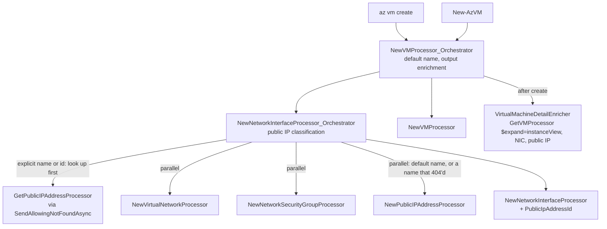

# `az vm create --public-ip-address` / `New-AzVM -PublicIpAddressName` — design

**Date:** 2026-09-28
**Status:** Approved, ready for planning
**Scope:** `src/Extensions/Compute`, `src/PS/Compute`, `src/CLI/Help/Docs/vm`,
`tools/Help/Azclips.Help.Tool.Tests/Fixtures/cli-export`, `tests/Scenario.Tests`, `tests/Scripts`

## Problem

`az vm create` and `New-AzVM` provision a virtual network, network security group, network
interface and virtual machine, but never a public IP, and offer no way to ask for one. A VM
created by AzClips is reachable only from inside its virtual network.

Both legacy commands take a public IP parameter: Azure CLI's `--public-ip-address` and Azure
PowerShell's `-PublicIpAddressName`. Legacy Azure CLI also creates a public IP by default.

## Goals

- Add `--public-ip-address` to `az vm create` and `-PublicIpAddressName` to `New-AzVM`, both
  driving one orchestrator property.
- Consolidate both surfaces on legacy Azure CLI semantics, including creating `{vm}PublicIP`
  when the parameter is omitted.
- Return the created VM enriched with the `az vm show -d` detail fields, so the public IP is
  visible without a second command.
- Leave `az vm delete` and `Remove-AzVM` unchanged.

## Non-goals

- **Public IP sub-parameters.** `--public-ip-sku`, `--public-ip-address-allocation`,
  `--public-ip-address-dns-name`, `-PublicIpSku`, `-AllocationMethod`, `-DomainNameLabel`, zones
  and edge zones. The new IP uses the defaults both legacies share: Standard SKU, Static allocation.
- **An auto-generated DNS label.** Legacy PowerShell invents `{vm}-xxxxxx`; legacy CLI sets none.
  We follow CLI.
- **Legacy CLI's summary output shape.** We return the enriched `VirtualMachine` model instead.
- **Pre-flight checks** that an existing IP is unassociated, in the VM's region, or
  SKU-compatible. Neither legacy checks; ARM reports it.
- **Deleting the public IP with the VM.** Neither legacy does.
- **New fake-ARM orchestration tests.** Coverage comes from the live scenario recordings and the
  create smoke scripts.
- **Exposing `vm nic create` / `vm nic create-orchestrated`.** That dormant metadata is untouched.

## Parameter surface

| Surface | Parameter | Type | Required | Help group | Binds to |
|---|---|---|---|---|---|
| `az vm create` | `--public-ip-address` | string | no | Network Arguments | `PublicIpAddress` |
| `New-AzVM` | `-PublicIpAddressName` | string | no | — (single parameter set) | `PublicIpAddress` |

Help text on both surfaces, adapted from legacy CLI's: *Name of the public IP address to create
(default: '{vm}PublicIP') or of an existing one to attach. Can also reference an existing public
IP by resource ID, or specify "" for none.*

## Behaviour

Identical on both surfaces. This is legacy CLI's classification
(`_validators.py:1074-1094`, `custom.py:1047-1072` in `azure-cli` at `8bead7f`).

| Value | Classification | Requests | NIC references |
|---|---|---|---|
| omitted (PowerShell: also `$null`) | new, default name `{vm}PublicIP` | `PUT` — create-or-update, no lookup | the new IP |
| `""` or whitespace | none | — | nothing |
| a name | look up in the VM's resource group | `GET`; on 404 also `PUT` | the existing IP, untouched, or the new one |
| a resource id (contains `/`) | look up at the id — any resource group or subscription | `GET` only | the existing IP; a 404 is an error |

**New public IP.** Location from `--location`, `sku.name = Standard`,
`properties.publicIPAllocationMethod = Static`. No DNS settings, zones, tags, IP version or idle
timeout — exactly the properties legacy CLI's template sets (`_template_builder.py:91-135`). It
attaches to the NIC's primary IP configuration (`ipconfig0`) only.

**Output.** Both commands return the created `VirtualMachine`, enriched exactly like
`az vm show -d`: `powerState`, `publicIps`, `fqdns`, `privateIps`, `macAddresses`. `fqdns` is empty
because no DNS label is set; `publicIps` is empty when the caller opts out with `""`.

**Breaking change.** Both commands now create a billable public IP by default. Scripts that must
not get one pass `--public-ip-address ""` or `-PublicIpAddressName ""`.

### Legacy comparison

Legacy sources: `azure-cli` at `8bead7f` (2026-09-10), `azure-powershell` at `a270237`
(2026-09-11), and the shared `Azure/azure-powershell-common` Strategies engine.

| # | Topic | Legacy CLI | Legacy PowerShell | AzClips |
|---|---|---|---|---|
| 1 | Omitted | creates `{vm}PublicIP` | no public IP — `PublicIpAddressName = PublicIpAddressName;` (`NewAzureVMCommand.cs:836-841`) | CLI |
| 2 | `""` | none | none (`CreateNetworkInterfaceConfigNoPublicIP`) | both |
| 3 | Existing name | referenced untouched (`check_existence`) | reused untouched (`TargetStateExtensions.AddIfRequired`) | both |
| 4 | Default name already exists | overwritten by the deployment's PUT | not applicable | CLI |
| 5 | Resource id | supported, any resource group or subscription | names only | CLI |
| 6 | Resource id that does not exist | fails inside the ARM deployment | not applicable | fails early with a clear message |
| 7 | SKU / allocation | Standard / Static | Standard / Static | both |
| 8 | DNS label | none unless requested | auto-generated `{vm}-xxxxxx` | CLI |
| 9 | Create output | summary object with `publicIpAddress`, `fqdns`, `privateIpAddress`, `macAddress`, `powerState` | full VM plus `FullyQualifiedDomainName` | enriched VM model on both |
| 10 | `vm delete` / `Remove-AzVM` | public IP survives | public IP survives | unchanged — public IP survives |

## Architecture

Order inside the NIC orchestrator:

1. Classify `PublicIpAddress`. For an explicit name or id, `GET` it first. A missing id fails
   here, before anything is created — as legacy CLI's existence checks run before its deployment.
2. Run the VNet `PUT`, the NSG `PUT` and, for the default name or a name that returned 404, the
   public IP `PUT`, all in parallel.
3. `PUT` the NIC with the public IP id on its primary IP configuration.

The VM orchestrator then `PUT`s the VM and, in `BeforeWriteOutputAsyncAndReturn`, re-reads it with
`$expand=instanceView` and runs the same enrichment as `az vm show -d`.

### New

| File | Purpose |
|---|---|
| `src/Extensions/Compute/Processors/NewPublicIPAddressProcessor.cs` | Generated-style `PUT .../providers/Microsoft.Network/publicIPAddresses/{name}?api-version=2025-05-01`, with its long-running operation wired like the NSG and NIC processors. Flattened properties: `SubscriptionId`, `ResourceGroupName`, `Name`, `Location`, `Sku` (default `Standard`), `AllocationMethod` (default `Static`). Not registered in `ExtensionIndex`. Hand-written in `GetPublicIPAddressProcessor`'s style rather than generating the whole Network spec for one operation. |

### Modified

| File | Change |
|---|---|
| `src/Extensions/Compute/Models/PublicIPAddress.cs` | Add `Location`, `Sku { Name }` and `Properties.PublicIPAllocationMethod`, all omitted when null so the `show -d` read path is unaffected. |
| `src/Extensions/Compute/Processors/ComputeProcessorBase.cs` | Add `internal SendAllowingNotFoundAsync()`: the same request and tracing as `SendAsync`, but a 404 is returned to the caller instead of publishing `ResourceOperationFailed`; every other failure behaves as today. `EnsureSuccessAsync` publishes before it throws, so catching a 404 afterwards would still print an error. Mirrors `ExistsResourceGroupProcessor_Orchestrator` in the Resources extension. |
| `src/Extensions/Compute/Processors/NewNetworkInterfaceProcessor.cs` | Add `PublicIpAddressId`. When set, `ipconfig0` gets `publicIPAddress.id`; when unset the request body is byte-for-byte unchanged. |
| `src/Extensions/Compute/Customization/NewNetworkInterfaceProcessor_Orchestrator.cs` | Add `PublicIpAddress` and `DefaultPublicIpAddressName`. A private resolver implements the behaviour table with the look-up-then-parallel ordering above. When `PublicIpAddress` is null and `DefaultPublicIpAddressName` is empty, no public IP is created. |
| `src/Extensions/Compute/Customization/NewVMProcessor_Orchestrator.cs` | Add `[ParameterGroup("Network Arguments")] string? PublicIpAddress`; pass it and `"{Name}PublicIP"` to the NIC orchestrator; enrich the output after creation. |
| `src/Extensions/Compute/Models/VirtualMachine.cs` | The synthetic-field doc comments (`PowerState`, `PublicIps`, `Fqdns`, `PrivateIps`, `MacAddresses`) add `az vm create` and `New-AzVM`. |
| `src/Extensions/Compute/ExtensionIndex.cs` | `["public-ip-address"]` on `s_newVMOrchestrator_CLI` and `["PublicIpAddressName"]` on `s_newVMOrchestrator_PS`, both mapped to `PublicIpAddress`. |
| `src/PS/Compute/Cmdlets/NewVMCmdlet.cs` | `[Parameter(Mandatory = false)] string? PublicIpAddressName`, forwarded only when bound and non-null, so omitted and `""` stay distinct. |
| `src/CLI/Help/Docs/vm/create.md` | Describe the default public IP, the `""` opt-out, name and id reuse, and the enriched output; add an example. |
| `src/PS/Compute/help/New-AzVM.md` | Syntax, a `-PublicIpAddressName` block, description, example and OUTPUTS. |
| `tools/Help/Azclips.Help.Tool.Tests/Fixtures/cli-export/vm.json` | The new parameter, plus any `create.md` text changes. |
| `tests/Scenario.Tests/VmCreateScenarioTests.cs` and its recording | Assert `PublicIps` and `PowerState`; re-recorded live. |
| `tests/Scenario.Tests/VmLifecycleScenarioTests.cs` and its recording | Flip the "vm create allocates no public IP" expectation; re-recorded live. |
| `tests/Scenario.Tests/FakeVmArmBackend.cs` | Maintenance only: serve the public IP `PUT` and the enrichment reads so the existing `VmCreateOrchestrationTests` keep passing. |
| `tests/Scripts/CLI/VMCreate.sh`, `tests/Scripts/PS/VMCreate.ps1` | Cover the default public IP, an explicit name and the `""` opt-out. |

The benchmark stub (`tests/Common/Stubs`) needs no change: unmapped paths return `{}`, which
carries no `provisioningState`, so the public IP's long-running operation ends immediately and the
benchmarks keep running.

### Reused unchanged

| Asset | Role |
|---|---|
| `GetPublicIPAddressProcessor` | Explicit name and id lookup. |
| `VirtualMachineIdResolver.ParseResourceId` | Resource-id validation and its error wording. |
| `VirtualMachineDetailEnricher` | Output enrichment, identical to `az vm show -d`. |
| `GetVMProcessor` (`Expand`) | The instance-view re-read after creation. |
| `IPConfigurationProperties.PublicIPAddress` | Already models the NIC-to-public-IP reference. |

Compute orchestrators live under `Customization/` but declare the `...Compute.Processors`
namespace, matching the existing orchestrators.

## Error handling

| Case | Behaviour |
|---|---|
| Malformed resource id | Fails before any request with the resolver's message: `Invalid public ip address resource id '<id>'. Expected /subscriptions/{subscriptionId}/resourceGroups/{resourceGroupName}/providers/Microsoft.Network/publicIPAddresses/{publicIpAddressName}.` |
| Well-formed resource id, 404 | Fails before anything is created: `Public IP address '<id>' was not found.` |
| Lookup returns 403, 5xx or similar | The normal error path; only a 404 is special. |
| Existing IP in use, in another region, or otherwise incompatible | Not pre-checked. ARM rejects the NIC `PUT` (for example `PublicIPAddressInUse`) and the error surfaces. |
| Default `{vm}PublicIP` already exists | Overwritten by the `PUT`, as legacy CLI's deployment does. A hand-added DNS label is removed; an incompatible change such as a SKU conversion fails with ARM's error. The common case — a leftover from an earlier `vm create` then `vm delete` — is a no-op that keeps the static address. |
| Public IP `PUT` fails (quota, policy) | ARM's error surfaces. A VNet or NSG created in parallel stays behind — the existing no-rollback non-goal noted on `ComputeProcessorBase`. |
| Enrichment fails after the VM exists | The command succeeds, returns the un-enriched VM and publishes `Events.Warning`: `Created virtual machine '<name>' but could not retrieve its details: <reason>`. Gentler than legacy CLI, which errors, and consistent with `vm list`'s enrichment-failure precedent. |
| `""` or whitespace | No public IP. |
| PowerShell `$null` | Treated as omitted: the default public IP is created. |
| Several subnets | The public IP attaches to `ipconfig0` only. |
| Public IP name format | Not validated locally, as in both legacies; ARM validates it. |

## Testing

- **Live scenario recordings**, re-recorded by the user with `AZURE_TEST_MODE=Record` after
  implementation, both on the default path:
  `VmCreateScenarioTests.CreatesVirtualMachine` and
  `VmLifecycleScenarioTests.CreateListShowStopDeallocateStartDeleteVirtualMachine`.
  `VmCreateScriptScenarioTests` replays the re-recorded vm create file through its three scripts
  and must still consume every entry. These tests fail playback until the recordings are refreshed.
- **Smoke scripts** `tests/Scripts/CLI/VMCreate.sh` and `tests/Scripts/PS/VMCreate.ps1`: the
  default public IP, an explicit name, and the `""` opt-out.
- **Maintenance only:** `FakeVmArmBackend`, so the existing `VmCreateOrchestrationTests` keep
  passing. No new orchestration tests.
- **Build and suites:** `dotnet build azclips.slnx`; `Scenario.Tests`, `Azclips.Help.Tool.Tests`
  and `Cli.Tests`; `devops/scripts/ci/scan_recordings.py` over the new recordings.

Order: implement → build and non-recorded tests green → the user records → commit the recordings →
full suite and secret scan.

## Risks

- **A default-on public IP** is a visible behaviour change on both surfaces: cost, and exposure
  subject to NSG rules. It is documented as breaking; `""` opts out.
- **Overwriting the default `{vm}PublicIP`** can strip a hand-added DNS label. Accepted for legacy
  CLI parity.
- **Recordings must be refreshed live** before CI is green. That needs credentials, quota for the
  VMs plus two Standard public IPs, and the `Microsoft.Compute` and `Microsoft.Network` providers.
- **Explicit-name and resource-id reuse** is covered only by the manual smoke scripts, not by CI.
- **A stale comment** in `tests/Scripts/CLI/VMShow.sh` and `tests/Scripts/PS/VMShow.ps1` says
  `vm create` allocates no public IP. Out of scope here; worth a follow-up.
