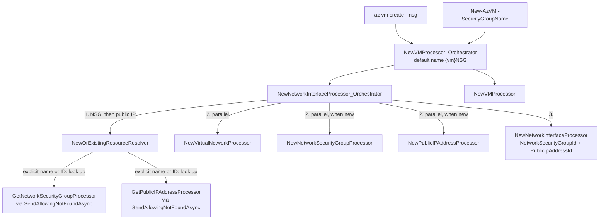

# `az vm create --nsg` / `New-AzVM -SecurityGroupName` — design

**Date:** 2026-09-30
**Status:** Approved, ready for planning
**Scope:** `src/Extensions/Compute`, `src/PS/Compute`, `src/CLI/Help/Docs/vm`,
`tools/Help/Azclips.Help.Tool.Tests/Fixtures/cli-export`, `wiki/01-getting-started`,
`tests/Scenario.Tests`, `tests/Benchmark`, `tests/Scripts`

## Problem

`az vm create` and `New-AzVM` require a network security group name
(`--network-security-group-name` / `-NetworkSecurityGroupName`) and always `PUT` that NSG with the
`--rule-*` rules. An existing NSG of that name is overwritten. There is no way to attach an existing
NSG, from this or another resource group, and no way to create the VM without an NSG.

Legacy Azure CLI's `--nsg` is optional: it defaults to `{vm}NSG`, reuses an existing NSG by name or
resource ID, and accepts `""` for none. Legacy Azure PowerShell's `-SecurityGroupName` is optional too.

## Goals

- Replace `--network-security-group-name` with `--nsg` on `az vm create` and
  `-NetworkSecurityGroupName` with `-SecurityGroupName` on `New-AzVM`. Both are optional and drive one
  orchestrator property.
- Consolidate both surfaces on legacy Azure CLI semantics, including creating `{vm}NSG` when the
  parameter is omitted.
- Share one new-or-existing resolver between the NSG and the public IP, so both follow the same
  rules and error wording.
- Leave `az vm delete`, `Remove-AzVM` and the `--rule-*` / `-Rule*` parameters unchanged.

## Non-goals

- **`--nsg-rule` and legacy's default inbound rule.** Legacy CLI adds `rdp` (3389) or
  `default-allow-ssh` (22) to a new NSG; legacy PowerShell opens `-OpenPorts` (3389 and 5985 on
  Windows, 22 on Linux). A new NSG here gets exactly the `--rule-*` rules — none by default — as today.
- **Validating `--rule-*` against the NSG mode.** They apply only when an NSG is created and are
  otherwise ignored, as legacy CLI ignores `--nsg-rule`.
- **Aliases for the old parameter names.** Removed outright, as `--vm-size` was for `--size`.
- **Pre-flight checks** that an existing NSG is in the VM's region or subscription. ARM reports it.
- **Deleting the NSG with the VM.** Neither legacy does.
- **New NSG smoke-script cases.** The NSG modes are covered by fake-ARM orchestration tests in CI.
- **Exposing `vm nic create-orchestrated`.** Its dormant metadata only re-points to the renamed
  property.

## Parameter surface

| Surface | Parameter | Replaces | Type | Required | Help group | Binds to |
|---|---|---|---|---|---|---|
| `az vm create` | `--nsg` | `--network-security-group-name` | string | no | Network Arguments | `NetworkSecurityGroup` |
| `New-AzVM` | `-SecurityGroupName` | `-NetworkSecurityGroupName` | string | no | — (single parameter set) | `NetworkSecurityGroup` |

Help text on both surfaces, adapted from legacy CLI's (`_params.py:466`), in the shape of the public
IP help: *Name of the network security group to create (default: '{vm}NSG') or of an existing one to
attach. Can also reference an existing NSG by resource ID, or specify "" for none.*

## Behaviour

Identical on both surfaces. This is legacy CLI's classification (`_validators.py:1049-1065`,
`custom.py:1040-1065` in `azure-cli` at `6cd38278b6`).

| Value | Classification | Requests | NIC references |
|---|---|---|---|
| omitted (PowerShell: also `$null`) | new, default name `{vm}NSG` | `PUT` with the `--rule-*` rules — create-or-update, no lookup | the new NSG |
| `""` or whitespace | none | — | no NSG |
| a name | look up in the VM's resource group | `GET`; on 404 also `PUT` with the `--rule-*` rules | the existing NSG, untouched, or the new one |
| a resource ID (contains `/`) | look up at the ID — any resource group or subscription | `GET` only | the existing NSG; a 404 is an error |

**New NSG.** Location from `--location`; security rules from `--rule-*`, exactly as today's NSG
request (`NewNetworkSecurityGroupProcessor` is unchanged).

**`--rule-*`.** Used only when an NSG is created. With `""`, a resource ID or an existing name they
are silently ignored.

**Breaking changes.**

- `--network-security-group-name` and `-NetworkSecurityGroupName` are removed with no alias.
- An explicit name that already exists is now reused untouched instead of being overwritten with the
  `--rule-*` rules.

### Legacy comparison

Legacy sources: `azure-cli` at `6cd38278b6` (2026-09-23), `azure-powershell` at `4567216be53`
(2026-09-07), and the shared `Azure/azure-powershell-common` Strategies engine.

| # | Topic | Legacy CLI | Legacy PowerShell | AzClips |
|---|---|---|---|---|
| 1 | Omitted | creates `{vm}NSG` (`custom.py:1043`) | NSG named after the VM (`NewAzureVMCommand.cs:863`) | CLI |
| 2 | `""` | no NSG (`_validators.py:1060-1062`) | no opt-out | CLI |
| 3 | Existing name | referenced untouched (`check_existence`) | reused untouched (Strategies engine) | both |
| 4 | Default name already exists | overwritten by the deployment's `PUT` | reused untouched | CLI |
| 5 | Resource ID | supported, any resource group or subscription | names only | CLI |
| 6 | Resource ID that does not exist | treated as a new NSG named by the ID; fails inside the ARM deployment | not applicable | fails early with a clear message |
| 7 | Lookup fails with anything but 404 | treated as missing, so the NSG is created (`_vm_utils.py:101-105`) | error; only a 404 means missing (`ResourceConfigExtensions.cs`) | the error surfaces; only a 404 means create |
| 8 | Rules on a new NSG | `--nsg-rule`: `rdp` or `default-allow-ssh` by OS, priority 1000; `NONE` for none (`_template_builder.py:199-233`) | `-OpenPorts`, by OS (`NetworkSecurityGroupPolicy.cs:36-56`) | `--rule-*`, none by default — unchanged |
| 9 | Rules with an existing NSG or none | `--nsg-rule` ignored | `-OpenPorts` ignored | `--rule-*` ignored |
| 10 | `vm delete` / `Remove-AzVM` | NSG survives | NSG survives | unchanged — NSG survives |

Rows 6 and 7 match the public IP decisions.

## Architecture

Order inside the NIC orchestrator:

1. Resolve the NSG, then the public IP — the order legacy CLI validates them in
   (`_validators.py:1615-1616`). Explicit names and IDs are looked up first; a missing ID fails
   here, before anything is created, and the public IP is never looked up.
2. Run the VNet `PUT` and, for each of the NSG and the public IP that is new, its `PUT`, all in
   parallel.
3. `PUT` the NIC with the NSG ID (existing, new, or none) and the public IP ID.

The VM orchestrator then `PUT`s the VM and enriches the output exactly as today.

### New

| File | Purpose |
|---|---|
| `src/Extensions/Compute/Customization/NewOrExistingResourceResolver.cs` | Internal static `ResolveAsync`. Inputs: the argument value; the default name; the subscription and resource group names are looked up in; the resource's provider, type, display name and name token, for resource-ID parsing and messages; and a `findIdAsync(subscriptionId, resourceGroupName, name)` delegate returning the resource ID, or null on 404. Returns `(ExistingId, NameToCreate)` — both null for none. Implements the behaviour table once for the NSG and the public IP. Resource IDs go through `VirtualMachineIdResolver.ParseResourceId`; a missing one throws `"{displayName} '{value}' was not found."`. The name mirrors legacy CLI's `new` / `existing` / None classification (`nsg_type`, `public_ip_address_type`). |

### Modified

| File | Change |
|---|---|
| `src/Extensions/Compute/Customization/NewNetworkInterfaceProcessor_Orchestrator.cs` | `NetworkSecurityGroupName` becomes `string? NetworkSecurityGroup`, plus `DefaultNetworkSecurityGroupName`; null with an empty default means none, as for the public IP. `ClassifyPublicIpAddressAsync` is replaced by `NewOrExistingResourceResolver`, keeping the public IP's behaviour and messages. Add `FindNetworkSecurityGroupIdAsync` beside `FindPublicIpAddressIdAsync`. The NSG `PUT` runs only when the NSG is new; the NIC's `NetworkSecurityGroupId` is the existing or new ID, or empty. |
| `src/Extensions/Compute/Customization/NewVMProcessor_Orchestrator.cs` | `[ParameterGroup("Network Arguments")] string? NetworkSecurityGroup` replaces `NetworkSecurityGroupName`; pass it and `"{Name}NSG"` to the NIC orchestrator. |
| `src/Extensions/Compute/ExtensionIndex.cs` | `vm create`: `["nsg"]` replaces `["network-security-group-name"]`. `New-AzVM`: `["SecurityGroupName"]` replaces `["NetworkSecurityGroupName"]`. Both map to `NetworkSecurityGroup` with `IsRequired: false` and the help text above. The dormant `vm nic create-orchestrated` entry's property name becomes `NetworkSecurityGroup`; nothing else about it changes. |
| `src/PS/Compute/Cmdlets/NewVMCmdlet.cs` | `[Parameter(Mandatory = false)] string? SecurityGroupName` replaces the mandatory `NetworkSecurityGroupName`. It is forwarded only when bound and non-null, so omitted and `""` stay distinct. |
| `src/CLI/Help/Docs/vm/create.md` | Describe the default `{vm}NSG`, reuse by name or ID, and `""`; drop `--network-security-group-name` from the description and examples; add an example that reuses an existing NSG. |
| `tools/Help/Azclips.Help.Tool.Tests/Fixtures/cli-export/vm.json` | Mirror the parameter and `create.md` changes. |
| `src/PS/Compute/help/New-AzVM.md` | Syntax, a `-SecurityGroupName` block replacing `-NetworkSecurityGroupName`, description and examples. |
| `wiki/01-getting-started/powershell-usage.md` | The `New-AzVM` example uses `-SecurityGroupName`. |

The test changes are listed under [Testing](#testing).

### Reused unchanged

| Asset | Role |
|---|---|
| `GetNetworkSecurityGroupProcessor` | Explicit name and ID lookup. Present today but unused. |
| `ComputeProcessorBase.SendAllowingNotFoundAsync` | A 404 comes back to the resolver instead of printing an error. |
| `VirtualMachineIdResolver.ParseResourceId` | Resource-ID validation and its error wording. |
| `NewNetworkSecurityGroupProcessor` | Creates the NSG with the `--rule-*` rules. |
| `NewNetworkInterfaceProcessor` | Already omits `networkSecurityGroup` when `NetworkSecurityGroupId` is empty. |

Compute orchestrators live under `Customization/` but declare the `...Compute.Processors`
namespace; the resolver follows suit.

## Error handling

| Case | Behaviour |
|---|---|
| Malformed resource ID (contains `/`, wrong shape or type) | Fails before any request with the resolver's message: `Invalid network security group resource id '<id>'. Expected /subscriptions/{subscriptionId}/resourceGroups/{resourceGroupName}/providers/Microsoft.Network/networkSecurityGroups/{networkSecurityGroupName}.` |
| Well-formed resource ID, 404 | Fails before anything is created: `Network security group '<id>' was not found.` |
| Lookup returns 403, 5xx or similar | The normal error path; only a 404 is special. |
| Both the NSG and the public IP are invalid | The NSG error is reported; the public IP is never looked up. |
| Existing NSG in another region or subscription, or otherwise incompatible | Not pre-checked. ARM rejects the NIC `PUT` and the error surfaces. |
| Default `{vm}NSG` already exists | Overwritten by the `PUT`, as legacy CLI's deployment does: its rules are replaced by the `--rule-*` rules, none by default. |
| NSG `PUT` fails (quota, policy) | ARM's error surfaces. A VNet or public IP created in parallel stays behind — the existing no-rollback non-goal noted on `ComputeProcessorBase`. |
| `""` or whitespace | No NSG; the NIC request has no `networkSecurityGroup`. |
| PowerShell `$null` | Treated as omitted: `{vm}NSG` is created. |
| `--rule-*` when no NSG is created | Silently ignored. |
| NSG name format | Not validated locally, as in both legacies; ARM validates it. |

## Testing

- **Fake-ARM orchestration tests** in `tests/Scenario.Tests/VmCreateOrchestrationTests.cs`, run in CI:
  - NSG modes: omitted (`PUT` `{vm}NSG`, no NSG `GET`); a new name (`GET` 404, then `PUT`); an
    existing name (`GET` only, no NSG `PUT`, the NIC references it); an existing resource ID in
    another resource group (`GET` at the ID only); a missing resource ID (`was not found`, and no
    `PUT` to any network resource or the VM); a malformed ID (vm create sends no request); and
    `""` (no NSG request, no `networkSecurityGroup` in the NIC request).
  - PowerShell: `-SecurityGroupName` binds to the same property, and omitting it gives `{vm}NSG`.
  - Public IP regression cases for the shared resolver: default, `""`, an existing name and a missing
    resource ID. CI has none today, and this change refactors that code.
  - The existing tests switch to `--nsg scenario-vm-nsg` / `SecurityGroupName` and keep their
    assertions.
- **`tests/Scenario.Tests/FakeVmArmBackend.cs`:** remember NSGs once `PUT`, so unknown names answer
  404 as public IPs already do; accept pre-existing NSGs and public IPs to seed; and build NSG and
  public IP IDs from the request path, so resources in other resource groups resolve.
- **Live scenario recordings**, re-recorded by the user with `AZURE_TEST_MODE=Record` after
  implementation, both on the default path: `VmCreateScenarioTests.CreatesVirtualMachine` and
  `VmLifecycleScenarioTests.CreateListShowStopDeallocateStartDeleteVirtualMachine` drop the NSG
  argument on both surfaces, so the NSG becomes `{vm}NSG`. The three
  `tests/Scenario.Tests/Scripts/vm-create*` scripts drop it too, and `VmCreateScriptScenarioTests`
  must still consume every entry. These tests fail playback until the recordings are refreshed.
- **Benchmarks** `tests/Benchmark/CLI/VirtualMachineBenchmarks.cs` and
  `tests/Benchmark/PS/VirtualMachineBenchmarks.cs`: drop the NSG argument. The default path keeps
  today's request count, so results stay comparable.
- **Smoke scripts** `tests/Scripts/CLI/VM{Create,Delete,List,Show,Stop}.sh` and
  `tests/Scripts/PS/VM{Create,Delete,List,Show,Stop}.ps1`: rename to `--nsg` / `-SecurityGroupName`,
  keeping their explicit names. No new cases.
- **Build and suites:** `dotnet build azclips.slnx`; `Scenario.Tests`, `Azclips.Help.Tool.Tests`
  and `Cli.Tests`; `devops/scripts/ci/scan_recordings.py` over the new recordings.

Order: implement test-first against the fake ARM → build and non-recorded tests green → the user
records → commit the recordings → full suite and secret scan.

## Risks

- **A breaking rename on both surfaces.** Scripts passing `--network-security-group-name` or
  `-NetworkSecurityGroupName` fail with an unknown-parameter error. Documented; no alias.
- **Overwriting the default `{vm}NSG`** replaces its rules: a rule added by hand to `myvmNSG`
  disappears when a VM named `myvm` is created again. Accepted for legacy CLI parity; legacy CLI
  re-applies its default rule instead.
- **No inbound rule by default.** Unlike both legacies, a new NSG opens no ports unless `--rule-*`
  asks, so the default VM — Windows, with a public IP — is not reachable over RDP out of the box.
  This is today's behaviour; `--nsg-rule` is the follow-up.
- **Refactoring the public IP resolution** could change its behaviour or wording. The public IP
  regression cases pin both.
- **Recordings must be refreshed live** before CI is green. That needs credentials and quota for the
  VMs, and the `Microsoft.Compute` and `Microsoft.Network` providers.
