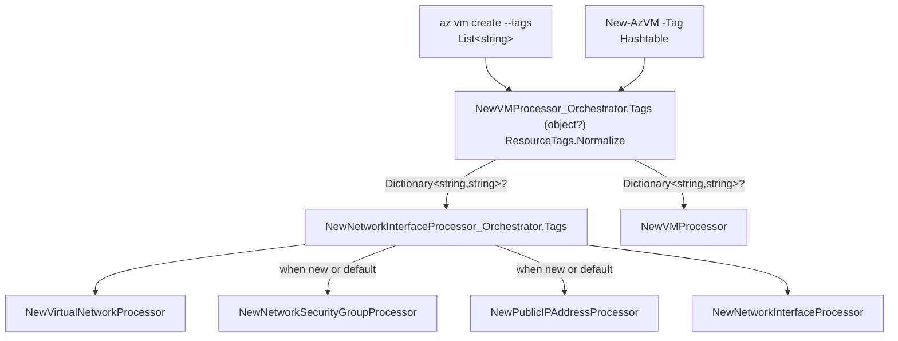

# `az vm create --tags` / `New-AzVM -Tag` — design

**Date:** 2026-10-02
**Status:** Approved, ready for planning
**Scope:** `src/Extensions/Compute`, `src/PS/Compute`, `src/CLI/Help/Docs/vm`,
`tools/Help/Azclips.Help.Tool.Tests/Fixtures/cli-export`, `tests/Extensions.Compute.Tests`,
`tests/Scenario.Tests`, `tests/Scripts`

## Problem

`az vm create` and `New-AzVM` cannot tag anything. The VM and the network resources the command
creates come out untagged, and scripts that rely on tags for cost allocation, ownership or policy
cannot move over.

Legacy Azure CLI's `--tags` applies one set of tags to the VM and to every resource
`az vm create` creates. Legacy Azure PowerShell's `-Tag` tags the VM, but only in the `-VM`
config-object parameter set. The simple parameter set, which AzClips' `New-AzVM` mirrors, has no
`-Tag`.

## Goals

- Add `--tags` to `az vm create` and `-Tag` to `New-AzVM`. Both are optional and bind to one
  orchestrator property.
- Behave identically on both surfaces: the tags go on the VM and on every network resource the
  command `PUT`s.
- Parse each surface's input exactly as its legacy tool does.
- Surface the VM's tags in `vm create` / `New-AzVM` output, and in `vm show`, `vm list` and
  `Get-AzVM`.
- Keep every request body byte-identical to today's when no tags are given.

## Non-goals

- **Client-side validation** of tag count, length or characters. Neither legacy tool validates;
  ARM does.
- **Tagging the OS disk.** ARM's VM `osDisk` has no tags, and neither legacy tool tags the disk.
- **Tagging an existing NSG or public IP** attached by name or resource ID. vm create never `PUT`s
  those.
- **A `-Tags` alias.** Legacy `New-AzVM` has none.
- **Pipeline binding for `-Tag`.** No other `New-AzVM` parameter takes pipeline input.
- **Framework-level dictionary binding** in the core CLI parser.
- **Consolidating the repository's other tag parsers** (Network, Resources, ManagedServiceIdentity),
  which differ from each other and from legacy.
- **Changelog entries.** The earlier parameter commits on this branch did not edit `CHANGELOG.md`
  or `src/PS/Compute/ChangeLog.md`.

## Parameter surface

| Surface | Added | Metadata type | Binds to |
|---|---|---|---|
| `az vm create` | `--tags` | `List<string>` | `NewVMProcessor_Orchestrator.Tags` (`object?`) |
| `New-AzVM` | `-Tag` | `Hashtable` | `NewVMProcessor_Orchestrator.Tags` (`object?`) |

Both are optional. Neither belongs to a `[ParameterGroup]`; legacy CLI lists `--tags` under the
general arguments.

Help text:

- **`--tags`**, adapted from legacy CLI's `tags_type` (`parameters.py:280-284`): *Space-separated
  tags: key[=value] [key[=value] ...]. Applied to the VM and to each network resource the command
  creates or updates. Use "" to clear existing tags.*
- **`-Tag`**, adapted from legacy `New-AzVM.md` without its outdated 15-tag limit: *Key-value
  pairs in the form of a hash table, applied to the VM and to each network resource the command
  creates or updates. For example: @{key0="value0";key1=$null;key2="value2"}.*

## Behaviour

### Parsing

`ResourceTags.Normalize(object?)` turns the bound value into a `Dictionary<string, string>?`
before any request is sent. It checks, in order: `null`, then `IDictionary` (the PowerShell
path), then `IEnumerable<string>` (the CLI path). The result uses the default, case-sensitive
comparer.

| Input | Result | Rule |
|---|---|---|
| omitted, or PowerShell `$null` | `null` | no `tags` property in any request |
| `--tags env=prod owner=team-a` | `{env: prod, owner: team-a}` | |
| `--tags owner` | `{owner: ""}` | the value is optional |
| `--tags team=a=b` | `{team: "a=b"}` | split on the first `=` |
| `--tags " a = b "` | `{" a ": " b "}` | no trimming |
| `--tags =v` | `{"": "v"}` | sent as-is; ARM decides |
| `--tags env=a env=b` | `{env: b}` | the last duplicate wins |
| `--tags Env=a env=b` | `{Env: a, env: b}` | keys are compared case-sensitively |
| `--tags a=1 --tags b=2` | `{a: 1, b: 2}` | repeated flags accumulate, as for every AzClips CLI list parameter |
| `--tags ""`, or a bare `--tags` | `{}` | sent as `"tags": {}` |
| `-Tag @{env='prod'; count=5}` | `{env: prod, count: "5"}` | keys and values go through `ToString()` |
| `-Tag @{owner=$null}` | `{owner: ""}` | a `$null` value becomes `""` |
| `-Tag @{}` | `{}` | sent as `"tags": {}` |
| any other runtime type | `ArgumentException` | guards against programming errors only |

CLI tokens follow `validate_tags` / `validate_tag` (`validators.py:40-55`). Dictionaries follow
`TagsConversionHelper.CreateTagDictionary`. Its `validate: true` check throws only when a non-empty
hashtable yields an empty dictionary, which cannot happen, so it is not carried over.

### Which resources are tagged

| Resource | When vm create `PUT`s it | Tagged |
|---|---|---|
| VM | always | yes |
| NIC (`--network-interface-name`) | always | yes |
| VNet (`--virtual-network-name`) | always, as create-or-update | yes; the tags of an existing VNet are replaced |
| NSG | the default `{vm}NSG` (create-or-update), or a named NSG that does not exist | yes |
| NSG | an existing name or a resource ID | no — never `PUT`, so untouched |
| Public IP | the default `{vm}PublicIP` (create-or-update), or a named public IP that does not exist | yes |
| Public IP | an existing name or a resource ID | no — never `PUT`, so untouched |
| OS disk | created implicitly by the VM `PUT` | no |

Every tagged resource gets the same dictionary.

### Request bodies

- **No tags given:** the VirtualMachine, NetworkInterface, VirtualNetwork and PublicIPAddress
  models omit a null `Tags`, so those bodies are byte-identical to today's. The NSG model already
  has `Tags` without `[JsonIgnore]`, so its body keeps sending `"tags": null` exactly as today.
- **Tags given, including empty ones:** every tagged resource's body carries `"tags": {...}`, or
  `"tags": {}` when empty.

### Output

`VirtualMachine.Tags` is read back from ARM. The `vm create` / `New-AzVM` output shows it, as do
`vm show`, `vm list` and `Get-AzVM`, because they share the model and their enrichers mutate the
ARM response in place. A VM without tags looks exactly as it does today.

### Legacy comparison

Legacy sources: `azure-cli` at `6cd38278b6` (2026-09-23), `azure-powershell` at `4567216be53`
(2026-09-07), and `Azure/azure-powershell-common`
`src/ResourceManager/Version2016_09_01/Tags/TagsConversionHelper.cs`.

| # | Topic | Legacy CLI | Legacy PowerShell | AzClips |
|---|---|---|---|---|
| 1 | Where the parameter exists | `vm create --tags` (`_params.py:164-166`) | `-Tag` only in `DefaultParameterSet` (`NewAzureVMCommand.cs:142-146`); the simple set has none (`NewAzureVMCommand.cs:683-716`) | both surfaces |
| 2 | Resources tagged | every resource the deployment creates: VM, NIC, VNet, NSG, public IP, storage account (`custom.py:983-1131`; `_template_builder.py:79,103,179,205,244,778`) | the VM (`NewAzureVMCommand.cs:1036`) | legacy CLI's rule, for what vm create `PUT`s |
| 3 | Existing VNet | not `PUT`; a subnet is added instead, so its tags survive (`custom.py:1011-1038`) | not applicable | always `PUT` (existing behaviour), so its tags are replaced |
| 4 | Existing NSG or public IP attached | untouched | not applicable | untouched |
| 5 | OS disk | untagged | untagged | untagged |
| 6 | Input | `key[=value]` tokens (`validators.py:40-55`) | hashtable (`HashTableExtensions.cs:23-26` → `CreateTagDictionary`) | each surface keeps its legacy input |
| 7 | Key without a value | `""` | `$null` becomes `""` | same |
| 8 | Whitespace | not trimmed | not trimmed | not trimmed |
| 9 | Duplicate key | last wins, case-sensitive | hashtable keys are unique; both casings survive a case-sensitive hashtable | last wins, case-sensitive, on both surfaces |
| 10 | Repeated flag | argparse keeps the last occurrence | not possible (PowerShell rejects a repeated parameter) | accumulates — **documented difference** |
| 11 | Validation | none | none in practice | none |
| 12 | Omitted | sends `"tags": {}` (`custom.py:983`) | the `-VM` object's tags | no `tags` property, as today; a new resource ends up untagged either way |
| 13 | Empty (`""`, `@{}`) | `"tags": {}` | `"tags": {}` | `"tags": {}` |

## Architecture

`NewVMProcessor_Orchestrator.SendAsync` normalizes `Tags` first, so a bad runtime type fails
before any request. The request order and parallelism are unchanged.

### Why one `object?` property works

- **CLI:** `CLIArgumentParsingProvider` converts by the metadata type
  (`CLIArgumentParsingProvider.cs:48`), so `--tags` arrives as a `List<string>`. The tokenizer
  (`ExtensionParser.cs:47-91`) keeps `""` as a token, and gives a bare `--tags` an empty list.
- **PowerShell:** `PSArgumentParsingProvider` converts only arrays and generic collections
  (`PSArgumentParsingProvider.cs:31-38`), so a `Hashtable` passes through untouched.
- **Binding:** `ArgumentParsingService.SetProperty` assigns a value directly when it already fits
  the property type (`ArgumentParsingService.cs:59-61`), and anything fits `object`.
- **Help:** help reads `[ParameterGroup]` / `[PopulatorCommand]` from the property
  (`ProcessorParameterReflection.cs`) and the type from the metadata
  (`ExtensionHelpManifestBuilder.cs:246`), so `object?` never surfaces.
- **Telemetry:** `TelemetryService.FormatParameters` masks every value (`TelemetryService.cs:102-115`),
  so tag contents are not recorded.

### New

| File | Purpose |
|---|---|
| `src/Extensions/Compute/Customization/ResourceTags.cs` | Internal static `Normalize(object? value)` returning `Dictionary<string, string>?`. Implements the parsing table: `null` → `null`; `IDictionary` → the legacy PowerShell conversion; `IEnumerable<string>` → the legacy CLI parse; anything else throws `ArgumentException`. Declares the `...Compute.Processors` namespace, like the other Customization helpers. |
| `tests/Extensions.Compute.Tests/ResourceTagsTests.cs` | Unit tests for every row of the parsing table. |

### Modified

| File | Change |
|---|---|
| `src/Extensions/Compute/Customization/NewVMProcessor_Orchestrator.cs` | `public object? Tags`. `SendAsync` calls `ResourceTags.Normalize(Tags)` first, then passes the result to the NIC orchestrator and to `NewVMProcessor`. |
| `src/Extensions/Compute/Customization/NewNetworkInterfaceProcessor_Orchestrator.cs` | `public Dictionary<string, string>? Tags`, passed to the VNet and NIC processors, and to the NSG and public IP processors when it creates those. |
| `src/Extensions/Compute/Processors/NewVMProcessor.cs`, `NewNetworkInterfaceProcessor.cs`, `NewVirtualNetworkProcessor.cs`, `NewNetworkSecurityGroupProcessor.cs`, `NewPublicIPAddressProcessor.cs` | `public Dictionary<string, string>? Tags`, copied onto the request body. No dispatch table registers these processors, so this adds no public surface. |
| `src/Extensions/Compute/Models/VirtualMachine.cs`, `NetworkInterface.cs`, `VirtualNetwork.cs`, `PublicIPAddress.cs` | `Dictionary<string, string>? Tags` with `[JsonIgnore(Condition = JsonIgnoreCondition.WhenWritingNull)]`, right after `Location`. `NetworkSecurityGroup.cs` is unchanged. |
| `src/Extensions/Compute/ExtensionIndex.cs` | `["tags"]` in `s_newVMOrchestrator_CLI` and `["Tag"]` in `s_newVMOrchestrator_PS`, both mapping to `Tags`, `IsRequired: false`, with the help text above. |
| `src/PS/Compute/Cmdlets/NewVMCmdlet.cs` | `[Parameter(Mandatory = false)] public Hashtable? Tag`, forwarded unchanged as `"Tag"` when bound and non-null. |
| `src/CLI/Help/Docs/vm/create.md` | One description sentence on what gets tagged and that an existing NSG or public IP is left untouched, plus a `--tags env=prod owner=team-a` example. |
| `tools/Help/Azclips.Help.Tool.Tests/Fixtures/cli-export/vm.json` | Mirror the new parameter and the `create.md` changes. |
| `src/PS/Compute/help/New-AzVM.md` | Syntax, a `-Tag` block (`System.Collections.Hashtable`), the description, and an example. |

The test changes are listed under [Testing](#testing).

### Reused unchanged

| Asset | Role |
|---|---|
| `NetworkSecurityGroup.Tags` | Already on the model; the NSG processor now sets it. |
| `NewOrExistingResourceResolver` | Decides which NSG and public IP are `PUT`, and therefore tagged. |
| `VirtualMachineDetailEnricher`, `GetVMProcessor`, `ListVMProcessor` | Mutate the ARM response in place, so `Tags` reaches the output with no change. |
| The CLI and PowerShell argument-parsing providers | Deliver `List<string>` and `Hashtable` as described above. |

## Error handling

| Case | Behaviour |
|---|---|
| ARM rejects the tags (count, length, characters, empty key) | The parallel VNet, NSG and public IP `PUT`s fail before the NIC or VM is attempted, and ARM's error surfaces. This is the same path as any network `PUT` failure today, including the existing no-rollback non-goal noted on `ComputeProcessorBase`. |
| `Tags` holds an unsupported runtime type | `ArgumentException` before any request. Unreachable through either surface. |
| An existing NSG or public IP is attached | It is never `PUT`, so its tags are untouched. |
| The VNet, `{vm}NSG` or `{vm}PublicIP` already exists | Its tags are replaced by the given ones, or by `{}` for `--tags ""`. Without `--tags`, its tags are handled as today. |

## Testing

- **Unit tests** in `tests/Extensions.Compute.Tests/ResourceTagsTests.cs`, which can see
  internals through the existing `InternalsVisibleTo`:
  - CLI tokens: every CLI row of the parsing table, including the value-less key, splitting on the
    first `=`, no trimming, the empty key, the last duplicate winning, case-sensitive keys, `""`
    being skipped, and an empty list giving `{}`.
  - Dictionaries: a `Hashtable` with a `$null` value and a non-string value; a
    `Dictionary<string, string>`; an empty hashtable giving `{}`.
  - `null` giving `null`, and an unsupported type throwing.
- **Fake-ARM orchestration tests** in `tests/Scenario.Tests/VmCreateOrchestrationTests.cs`:
  - `--tags` puts identical tags in the VNet, NSG, public IP, NIC and VM `PUT` bodies.
  - The no-tags invariant: without `--tags`, the VNet, public IP, NIC and VM bodies have no
    top-level `tags` property, and the NSG body keeps `"tags": null`. The NIC body's embedded NSG
    reference keeps its `"tags": null` too, as today. The recorded scenario tests replay without
    comparing bodies (`matchBody: false`), so this test is what pins the invariant.
  - An existing NSG or public IP attached by name is not `PUT`, so it gets no tags.
  - `--tags ""` sends `"tags": {}`.
  - PowerShell: a `Hashtable` passed as `Tag` produces the same bodies as the CLI.
  - Output: the create output carries the tags. `FakeVmArmBackend` echoes the VM `PUT`'s tags in
    its VM `GET` response.
- **Recorded scenario tests** (`VmCreateScenarioTests`, `VmLifecycleScenarioTests`) and
  **benchmarks** stay unchanged. They never pass tags, so no re-recording is needed.
- **Smoke scripts** `tests/Scripts/CLI/VMCreate.sh` and `tests/Scripts/PS/VMCreate.ps1`, folded
  into the existing cases so quota stays at four VMs:
  - Cases 1 (default) and 3 (existing public IP, existing NSG by name) pass tags that exercise
    legacy parsing: a regular pair and a key without a value (`--tags azclips-tags=vm-create
    azclips-empty` / `-Tag @{'azclips-tags'='vm-create'; 'azclips-empty'=$null}`).
  - Case 1 checks, through `"$AZ" rest` / `Invoke-AzRestMethod`, that the VM, its NIC, its VNet,
    `{vm}NSG` and `{vm}PublicIP` all carry both tags.
  - Case 3 checks that the VM, its NIC and its VNet carry them, and that the pre-created NSG and
    public IP do not. Their own `azclips-smoke` tag is already checked.
  - The script headers list the new checks.
- **Build and suites:** `dotnet build azclips.slnx`; `Extensions.Compute.Tests`,
  `Scenario.Tests`, `Azclips.Help.Tool.Tests` and `Cli.Tests`.

Order: implement test-first against the fake ARM → build and suites green → the user runs the
smoke scripts live.

## Risks

- **Replacing an existing VNet's tags.** vm create always `PUT`s the VNet, unlike legacy CLI,
  which adds a subnet to an existing VNet. With `--tags`, an existing VNet's tags are replaced. The
  always-`PUT` behaviour predates this change.
- **Overwriting `{vm}NSG` and `{vm}PublicIP`.** Re-creating a VM of the same name replaces the
  tags on its default NSG and public IP. This matches legacy CLI's deployment.
- **No client-side validation.** Bad tags surface as ARM errors from the first network `PUT`s,
  before the NIC or VM is attempted.
- **Output change for show and list.** Tagged VMs gain a `tags` field in `vm show`, `vm list` and
  `Get-AzVM`. Untagged VMs are unchanged.
