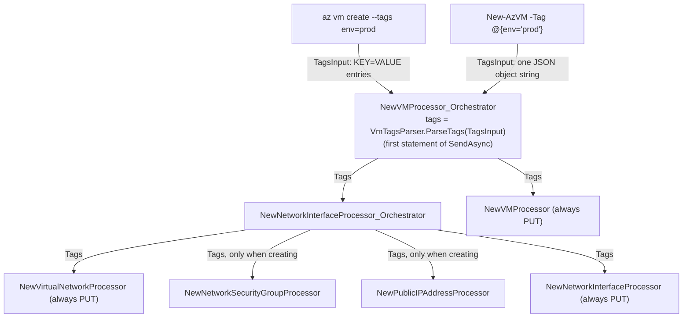

# `az vm create --tags` / `New-AzVM -Tag` design

- **Date:** 2026-10-09
- **Status:** Approved in brainstorming. Next step: implementation plan.
- **Scope:** Compute extension (`src/Extensions/Compute`), Compute PowerShell module (`src/PS/Compute`), and their tests and docs.

## Goal

Add a `--tags` parameter to `az vm create` and a `-Tag` parameter to `New-AzVM`. Implement them the same way the ManagedServiceIdentity (MSI) extension implements tags, without depending on MSI or any other extension. Copy code into Compute instead of sharing it. Neither MSI project changes.

## Background

- **How MSI implements tags.**
  - CLI: `az identity create --tags` binds to `string[] TagsInput` on `CreateIdentityProcessor_Orchestrator`. `IdentityCliArgumentParser.ParseTags` then turns it into `Dictionary<string, string> Tags`.
  - PowerShell: `New-AzUserAssignedIdentity -Tag <Hashtable>` is converted by `IdentityCmdletArgumentConverter.ToStringDictionary` and bound to `Tags` on the base `CreateIdentityProcessor`.
- **Why Compute needs its own parser.** The core CLI binder cannot bind `KEY=VALUE` tokens to a dictionary (see the TODO in MSI's parser). That is why MSI parses tags inside the extension.
- **How Compute is structured.** `vm create` and `New-AzVM` both run `NewVMProcessor_Orchestrator`. The orchestrator calls `NewNetworkInterfaceProcessor_Orchestrator`, which creates the VNet, NSG and public IP and then the NIC. Finally, `NewVMProcessor` creates the VM.
- **Legacy behavior.**
  - `az vm create --tags` applies the tags to the VM and to every resource the command newly creates (VNet, NSG, public IP, NIC).
  - Legacy `New-AzVM -Tag` exists only on the parameter set that takes a `-VM` object, and it tags only the VM.

## Decisions

1. **Self-contained.** Copy MSI's tag parser into the Compute extension, and MSI's `Hashtable` converter into the Compute PowerShell module. Compute takes no project or assembly reference on MSI, and MSI is not modified.
2. **Single binding property.** Both surfaces bind to one `string[] TagsInput` property on `NewVMProcessor_Orchestrator`. The `New-AzVM` cmdlet serializes its `Hashtable` to a JSON string, and the parser's JSON branch reads it back without losing data.
3. **Tag every resource the command PUTs, on both surfaces.** This matches legacy `az vm create`. Resources that are only looked up and attached are never modified.
4. **MSI parsing rules.** Tags are parsed exactly as MSI parses them, not as legacy `az` does.

## Parameter surface

| Surface | Parameter | Metadata key | Bound property | Metadata type | Description |
| --- | --- | --- | --- | --- | --- |
| CLI `az vm create` | `--tags` | `tags` | `TagsInput` | `string[]` | Space-separated tags in KEY=VALUE format, or a JSON object. Applied to the virtual machine and to every resource the command creates. |
| PS `New-AzVM` | `-Tag <Hashtable>` | `Tag` | `TagsInput` | `string[]` | Tags to apply to the virtual machine and to every resource the command creates. |

- Accepted CLI forms: `--tags env=prod owner=me` and `--tags '{"env":"prod","owner":"me"}'`.
- `TagsInput` has no `[ParameterGroup]` attribute, so `--tags` is listed in the general Arguments group in help, as in legacy `az`.
- `PSArgumentParsingProvider` looks up metadata keys case-sensitively, so the cmdlet must pass exactly `"Tag"`.
- The unregistered `s_newVM_PS` and `s_newVM_CLI` (`vm create-basic`) metadata entries are not changed.

## Parsing rules (copied from MSI)

`VmTagsParser` is a new internal static class in `src/Extensions/Compute/Customization/`, in namespace `Microsoft.Azure.Azclips.Extensions.Compute.Processors`, like the other Customization helpers. It is a straight copy of MSI's `ParseTags` and `ParseDictionary`:

- `null` or an empty array returns `null`, meaning no tags.
- If the entries, joined with spaces and trimmed, start with `{`, the input is deserialized as a JSON `Dictionary<string, string>`. Any empty or whitespace key throws `InvalidOperationException("Invalid dictionary entry. Keys cannot be empty.")`. Only strict JSON is accepted. Malformed JSON, shorthand such as `{env:prod}`, and values that are not strings all throw `JsonException`, as in MSI.
- Otherwise, every entry must be `KEY=VALUE`. The entry is split at the first `=`. The key is trimmed and must not be empty. The value is kept exactly as given, so it may contain `=` or be empty (`env=`). The resulting dictionary is case-insensitive, and the last value wins.
- Malformed entries throw `InvalidOperationException` with MSI's messages:
  - `Invalid dictionary entry '{entry}'. Expected KEY=VALUE format.`
  - `Invalid dictionary entry '{entry}'. Keys cannot be empty.`
- Differences from legacy `az`, kept on purpose to match MSI:
  - A bare `key` is an error, where legacy `az` treats it as `key=""`.
  - `--tags ""` is an error, where legacy `az` treats it as "no tags".
  - The JSON form comes from MSI. Legacy `az vm create` has no JSON form, so there `--tags '{"env":"prod"}'` becomes a single tag whose key is the literal JSON text.
- MSI has no tests or help examples for the JSON form. Compute adds tests for it (see Testing).

## PowerShell conversion

`New-AzVM -Tag <Hashtable>` adds `[Parameter(Mandatory = false)] public Hashtable? Tag`.

`VmCmdletArgumentConverter` is a new internal static class in `src/PS/Compute/Cmdlets/`, in namespace `Microsoft.Azure.Azclips.Cmdlets.Compute`. It has two methods:

1. `ToStringDictionary(Hashtable)` is a copy of MSI's converter:
   - A `null` key throws `ArgumentException`.
   - A `null` value becomes `""`.
   - Any other value becomes `ToString()`.
   - The dictionary is case-insensitive.
2. `ToTagsInput(Hashtable)` returns `[JsonSerializer.Serialize(ToStringDictionary(table))]`. `System.Text.Json` is part of net10.0, so no new package is needed.

The cmdlet adds `parameters["Tag"] = VmCmdletArgumentConverter.ToTagsInput(Tag)` only when `-Tag` is bound and is not `$null`. Skipping `$null` is a deliberate change from MSI, which throws `NullReferenceException`. It matches how `NewVMCmdlet` already handles `$null` for `-SecurityGroupName` and `-PublicIpAddressName`.

Effects:

- `-Tag @{}` serializes to `"{}"`, which the parser turns into an empty dictionary, so the body contains `"tags":{}`. MSI's PowerShell path behaves the same.
- An empty-string key is rejected locally by the parser's JSON branch. MSI's PowerShell path would forward it to ARM, which rejects it.

## Data flow



- `NewVMProcessor_Orchestrator` gets `public string[]? TagsInput { get; set; }`. The first statement of `SendAsync` parses it, so malformed tags fail before the image lookup and before any PUT.
- `NewNetworkInterfaceProcessor_Orchestrator`, `NewVirtualNetworkProcessor`, `NewNetworkSecurityGroupProcessor`, `NewPublicIPAddressProcessor`, `NewNetworkInterfaceProcessor` and `NewVMProcessor` each get `public Dictionary<string, string>? Tags { get; set; }`. Each atomic processor sets `Tags = Tags` in `CreateRequestBody()`.

## Which resources get tagged

| Resource | Request the command sends | Tagged |
| --- | --- | --- |
| VM | PUT, always | Yes |
| NIC | PUT, always (create-or-update) | Yes |
| VNet | PUT, always (create-or-update) | Yes |
| NSG: default `{vm}NSG`, or a `--nsg` / `-SecurityGroupName` name that does not exist | PUT | Yes |
| NSG: an existing name or a resource ID | GET only, then attached | No. Left untouched. |
| NSG: `""` | None | Not applicable |
| Public IP: default `{vm}PublicIP`, or a name that does not exist | PUT | Yes |
| Public IP: an existing name or a resource ID | GET only, then attached | No. Left untouched. |
| Public IP: `""` | None | Not applicable |

The VNet, the NIC, and the default `{vm}NSG` and `{vm}PublicIP` are sent as PUTs without checking whether they already exist. If one of them does exist, its tags are replaced by the given tags. This is the same full replacement the command already performs today.

## Models

`VirtualMachine`, `VirtualNetwork`, `PublicIPAddress` and `NetworkInterface` each get this property:

```csharp
[JsonIgnore(Condition = JsonIgnoreCondition.WhenWritingNull)]
public Dictionary<string, string>? Tags { get; set; }
```

- `VirtualNetwork.cs` needs `using System.Text.Json.Serialization;`.
- `NetworkSecurityGroup` already has `Tags`. It is left unchanged, so it still serializes as `"tags":null` when no tags are set.
- Request bodies do not change when no tags are given.
- **Output impact.** `VirtualMachine` is also the output model. Tagged VMs now show `tags` in the output of `az vm create`, `az vm show`, `az vm list`, `New-AzVM` and `Get-AzVM`; today these tags are silently dropped. CLI output for untagged VMs is unchanged. PowerShell VM objects gain a `Tags` property, which is empty for untagged VMs; the Compute module has no format view, so the property appears in the default list output. No recorded fixtures contain tags.

## Files

New:

- `src/Extensions/Compute/Customization/VmTagsParser.cs`
- `src/PS/Compute/Cmdlets/VmCmdletArgumentConverter.cs`
- `tests/Extensions.Compute.Tests/VmTagsParserTests.cs`
- `tests/Cmdlets.Tests/VmCmdletArgumentConverterTests.cs`

Modified:

- `src/Extensions/Compute/ExtensionIndex.cs`
- `src/Extensions/Compute/Customization/NewVMProcessor_Orchestrator.cs`
- `src/Extensions/Compute/Customization/NewNetworkInterfaceProcessor_Orchestrator.cs`
- `src/Extensions/Compute/Processors/NewVMProcessor.cs`, `NewVirtualNetworkProcessor.cs`, `NewNetworkSecurityGroupProcessor.cs`, `NewPublicIPAddressProcessor.cs`, `NewNetworkInterfaceProcessor.cs`
- `src/Extensions/Compute/Models/VirtualMachine.cs`, `VirtualNetwork.cs`, `PublicIPAddress.cs`, `NetworkInterface.cs`
- `src/PS/Compute/Cmdlets/NewVMCmdlet.cs`
- `src/PS/Compute/Cmdlets.Compute.csproj`: add `InternalsVisibleTo` for `Cmdlets.Tests`, using the same Release and non-Release item groups as `Cmdlets.Accounts.csproj`
- `tests/Cmdlets.Tests/Cmdlets.Tests.csproj`: add a project reference to `src/PS/Compute/Cmdlets.Compute.csproj`
- `tests/Cli.Tests/VmCreateTests.cs`
- `tests/Scenario.Tests/VmCreateOrchestrationTests.cs`
- `tests/Scenario.Tests/VmLifecycleScenarioTests.cs`, and its recording `tests/Scenario.Tests/SessionRecords/VmLifecycleScenarioTests/CreateListShowStopDeallocateStartDeleteVirtualMachine.json` (re-recorded)
- `tools/Help/Azclips.Help.Tool.Tests/Fixtures/cli-export/vm.json`: regenerated
- `src/CLI/Help/Docs/vm/create.md`
- `src/PS/Compute/help/New-AzVM.md`
- `tests/Scripts/CLI/VMCreate.sh`
- `tests/Scripts/PS/VMCreate.ps1`

Not changed: everything under `src/Extensions/ManagedServiceIdentity` and `src/PS/ManagedServiceIdentity`.

## Testing

- **Parser unit tests** (`tests/Extensions.Compute.Tests/VmTagsParserTests.cs`):
  - KEY=VALUE pairs
  - the JSON-object form
  - values containing `=`
  - empty values (`env=`)
  - case-insensitive keys, where the last value wins
  - a missing `=` is rejected
  - empty keys are rejected in both the KEY=VALUE and the JSON forms
  - shorthand such as `{env:prod}` throws `JsonException`
  - `null` or empty input returns `null`
- **Cmdlet unit tests** (`tests/Cmdlets.Tests/VmCmdletArgumentConverterTests.cs`):
  - `ToTagsInput` returns exactly one JSON string that round-trips to the same dictionary
  - `$null` values become `""`
  - non-string values are converted with `ToString()`
- **Metadata tests** (`tests/Cli.Tests/VmCreateTests.cs`): `vm create` exposes `tags` and `New-AzVM` exposes `Tag`. Both map to `TagsInput`, have type `string[]`, and are optional.
- **Orchestration tests** (`tests/Scenario.Tests/VmCreateOrchestrationTests.cs`, fake ARM backend):
  - CLI `--tags env=test owner=me` puts the tags in the VM, NIC, VNet, default NSG and default public IP PUT bodies.
  - The CLI JSON form tags the VM.
  - The PowerShell path, with `Tag` set to a one-element JSON `string[]`, tags the VM.
  - With no tags, the VM body has no `tags` key.
  - With tags given, an existing NSG and an existing public IP are still not PUT.
  - A malformed tag (`--tags novalue`) fails before any PUT under `/providers/`.
- **Lifecycle scenario** (`tests/Scenario.Tests/VmLifecycleScenarioTests.cs`, record/playback):
  - The Network extension joins the systems under test.
  - Both `vm create` calls pass tags.
  - After the first create, the test reads back that create's virtual network and default public IP with `network vnet show` / `Get-AzVirtualNetwork` and `network public-ip show` / `Get-AzPublicIpAddress`.
  - On both surfaces, the VM, the virtual network and the public IP must carry the tags.
  - The recording is refreshed against live Azure with `devops/scripts/live/refresh_recordings.py --filter VmLifecycleScenarioTests`, and only after the user explicitly approves the live run.
- **Help export:** regenerate `cli-export/vm.json` with `pwsh build/Update-CliExportFixtures.ps1`. `CliExportFixturesTests` then has to pass.
- **PowerShell help gate:** `pwsh -File build/Test-PSHelpMarkdown.ps1 -Module Compute` has to pass.
- **Live smoke scripts:** add tags to case 1 and check them on the VM and on the resources it creates. The scripts' existing checks that attached resources keep their own tags stay as they are. These scripts need a live subscription, so they are written but not run as part of this change.

## Docs

- `src/CLI/Help/Docs/vm/create.md`: add one sentence to the description that says what gets tagged, and add a "Create a VM with tags" example.
- `src/PS/Compute/help/New-AzVM.md`: add `[-Tag <hashtable>]` to the syntax, a `-Tag` parameter section (type `System.Collections.Hashtable`, optional), and an example.
- No ChangeLog entry, following the precedent of #1044.

## Validation commands

```text
dotnet build azclips.slnx
dotnet test tests/Extensions.Compute.Tests/Extensions.Compute.Tests.csproj
dotnet test tests/Cmdlets.Tests/Cmdlets.Tests.csproj
dotnet test tests/Cli.Tests/Cli.Tests.csproj --filter "FullyQualifiedName~VmCreateTests"
dotnet test tests/Scenario.Tests/Scenario.Tests.csproj --filter "FullyQualifiedName~VmCreate"
dotnet test tests/Scenario.Tests/Scenario.Tests.csproj --filter "FullyQualifiedName~VmLifecycleScenarioTests"
pwsh build/Update-CliExportFixtures.ps1
dotnet test tools/Help/Azclips.Help.Tool.Tests/Azclips.Help.Tool.Tests.csproj
pwsh -File build/Test-PSHelpMarkdown.ps1 -Module Compute
```

## Out of scope

- Sharing code with MSI or changing MSI.
- Dictionary support in the core binder.
- Legacy `az` tag rules (bare keys, `""` to clear tags).
- Tagging existing resources that are only attached.
- Tags on any other command, such as `vm update`.
