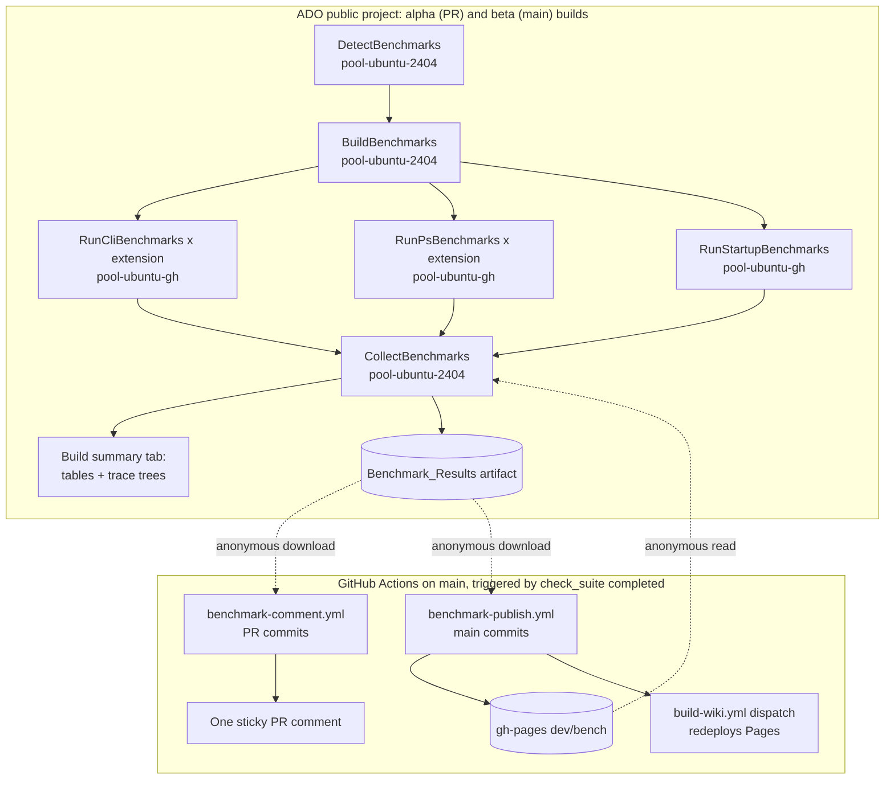

# Benchmarks on Azure DevOps — Design

Date: 2026-11-23
Status: Implemented. This revision describes the committed design;
[Changes during implementation](#changes-during-implementation) lists what moved from the
approved design.

## Goal

Move the performance benchmarks from GitHub Actions (`.github/workflows/benchmark.yml` and
`.github/workflows/benchmark-comment.yml`) to Azure DevOps while keeping today's workflow:

1. On same-repo and fork PRs into `main`, build the solution once, detect which benchmark
   families the change affects, and run only those CLI, PowerShell, and startup benchmarks
   on the fixed-hardware `pool-ubuntu-gh` machines.
2. Compare the PR's results and telemetry traces with `main`, show them on the build, and
   post one PR comment that lists every benchmark's percent change and flags regressions.
3. After a merge to `main`, rerun the affected benchmarks and persist the results to
   `gh-pages` so the dashboards keep tracking performance per commit.

## Background

The repository before this change:

- `benchmark.yml` is `disabled_manually` on `Azure/azclips`. Its benchmark legs ran on the
  1ES pool `pool-ubuntu-gh`. That pool is also registered in the `azclitools` ADO
  organization under the same name and is available to the `public` project.
- The shared ADO template `templates/dist/stages/build-unsigned-distribution.yml` already
  has a placeholder `Benchmark` stage (`jobs/benchmark-suite.yml`, a dummy job). `Finalize`
  requires it to succeed. The template is used by `azclips-alpha-build` (PR validation),
  `azclips-beta-build` (CI on `main`, `batch: true`), `azclips-stable-release`, and
  `azclips-stable-release-test`.
- ADO PR builds run in the `public` project. Fork builds never receive secrets
  (`enforceNoAccessToSecretsFromForks: true`). The only GitHub write credential (the Key
  Vault PAT) lives in the `release` project.
- A same-repository ADO pipeline-completion trigger runs the triggering branch's copy of
  the YAML. A privileged pipeline triggered by PR builds would therefore run fork-controlled
  YAML, so it is not an option.
- GitHub Pages is deployed by `.github/workflows/build-wiki.yml`. It merges `gh-pages`
  `dev/bench/**` into the wiki site and is currently triggered by `workflow_run` of
  "Performance Benchmarks".
- The Azure Pipelines GitHub App reports each ADO run to the commit it built (for a PR,
  the PR head commit) as one check suite. It contains a top-level check run named after
  the pipeline (for example `azclips-alpha-build`) whose `external_id` is
  `<definitionId>|<buildId>|<projectId>`, plus one check run per job.
- Public-project ADO REST calls, timelines, and pipeline-artifact downloads work
  anonymously. Artifact downloads stream a zip with no `Content-Length` and reject range
  requests.

## Decisions

| Topic | Decision |
| --- | --- |
| Where benchmarks run | Replace the placeholder `Benchmark` stage in the shared distribution template. Benchmarks run once per pipeline run, Ubuntu only. |
| Gating | Blocking. `Finalize` keeps requiring `Benchmark` to succeed. A benchmark leg that still fails after its retry fails the stage. Regressions never fail the build. |
| Stable releases | `azclips-stable-release` and `azclips-stable-release-test` skip benchmarks. Their `Benchmark` stage becomes a no-op that succeeds. |
| Benchmark pool | `pool-ubuntu-gh`, added to `templates/variables.yml` as `benchmark_pool`. |
| GitHub writes | Two GitHub Actions workflows triggered by the Azure Pipelines check suite completing (`check_suite: completed`). They use `GITHUB_TOKEN` on GitHub-hosted runners. ADO never writes to GitHub. |
| Spec location | This file. |

## Architecture



### Mapping from today's workflows

| Today (GitHub Actions) | New |
| --- | --- |
| `detect-changes` (`dorny/paths-filter` + `detect-benchmark-changes.sh`) | ADO `DetectBenchmarks` running `detect_benchmark_changes.py` |
| `build` | ADO `BuildBenchmarks` |
| `run-cli`, `run-ps`, `run-startup` on `pool-ubuntu-gh` | ADO `RunCliBenchmarks`, `RunPsBenchmarks`, `RunStartupBenchmarks` on `pool-ubuntu-gh` |
| `collect` (trace job summary, `benchmark-results` artifact) | ADO `CollectBenchmarks` (build summary tab, `Benchmark_Results` artifact) |
| `publish-extensions` and `publish-startup` (`github-action-benchmark`: same-repo PR comments and `main` auto-push) | `benchmark-comment.yml` (PR comments) and `benchmark-publish.yml` (`main` dashboards) |
| `publish-traces` | `benchmark-publish.yml` |
| `benchmark-comment.yml` (fork PRs via `workflow_run`) | `benchmark-comment.yml` (all PRs via `check_suite`) |
| `build-wiki.yml` `workflow_run` on "Performance Benchmarks" | `build-wiki.yml` dispatched by `benchmark-publish.yml` |

## ADO Benchmark Stage

### Template wiring

- `build-unsigned-distribution.yml` gets two parameters: `run_benchmarks` (boolean,
  default `false`) and `benchmark_pool` (string, default `''`). It passes both to
  `jobs/benchmark-suite.yml` together with `ubuntu_pool`. The stage keeps its name,
  `dependsOn: [Init, BuildCommon]`, and `condition: succeeded()`. `Finalize` is unchanged.
- Entry pipelines set the parameters explicitly. `azclips-alpha-build` and
  `azclips-beta-build` set `run_benchmarks: true` and
  `benchmark_pool: ${{ variables.benchmark_pool }}`. `azclips-stable-release` and
  `azclips-stable-release-test` set `run_benchmarks: false`.
- With `run_benchmarks: false`, `benchmark-suite.yml` emits one no-op job on `ubuntu_pool`
  (`checkout: none`, prints that benchmarks are disabled for this pipeline) so the stage
  result is `Succeeded`. It no longer logs a warning.

### Jobs

All jobs keep checkout task retries at the Azure Pipelines default (none).

| Job | Pool | Runs when | Work |
| --- | --- | --- | --- |
| `DetectBenchmarks` | `ubuntu_pool` | always | Full-history checkout. Runs `detect_benchmark_changes.py` and sets output variables (step name `detect`): `hasExtensionWork`, `runStartup`, `extensionMatrix`, and the human-readable `extensions` and `changeBase`. |
| `BuildBenchmarks` | `ubuntu_pool` | `hasExtensionWork` or `runStartup` | `UseDotNet@2` (`global.json`), then `dotnet build azclips.slnx -c Release -p:CopilotSkipCliDownload=true`. Publishes `artifacts/Release` as `Benchmark_Build_Outputs` (a success-only publish that ends its job). `Shared.props` sends every project's output there, so `tests/Benchmark/bin/Release`, which the GitHub workflow also uploaded, is never produced. |
| `RunCliBenchmarks` | `benchmark_pool` | `hasExtensionWork` | Runtime matrix from `extensionMatrix` (`{"<ext>": {"Extension": "<ext>"}}`). Steps come from `steps/run-benchmark-leg.yml`: checkout, `UseDotNet@2`, download `Benchmark_Build_Outputs` into `artifacts/Release`, then `run_benchmark.sh dotnet artifacts/Release/Benchmark/Benchmark.dll --ci --extension $(Extension) --product CLI`. The wrapper gives each attempt a 60-minute timeout and retries once after 30 seconds, like `nick-fields/retry` today; `retryCountOnTaskFailure` is not used because it does not retry a step that times out. Publishes `artifacts/Benchmark/ci` as `Benchmark_CLI_$(Extension)` through `steps/publish-artifact.yml` (`succeededOrFailed()`, suffix mode). |
| `RunPsBenchmarks` | `benchmark_pool` | `hasExtensionWork` | Same as CLI with `--product PS`, artifact `Benchmark_PS_$(Extension)`. |
| `RunStartupBenchmarks` | `benchmark_pool` | `runStartup` | Same steps with `--ci --product STARTUP`, a 20-minute attempt timeout and one retry; artifact `Benchmark_STARTUP`. |
| `CollectBenchmarks` | `ubuntu_pool` | not canceled, and `hasExtensionWork` or `runStartup` (also after leg failures) | See "Collect" below. |

Job timeouts leave room for the retry: 150 minutes for CLI and PS legs, 60 for startup,
30 for build and collect, 10 for detect. Matrix legs run unthrottled, as today.

### Change detection (`detect_benchmark_changes.py`)

The decision depends on the build reason and branch:

| Context | Changed files | Result |
| --- | --- | --- |
| `Build.Reason = PullRequest`, target branch `main` (accept `main` or `refs/heads/main`) | `git diff --name-only HEAD^1 HEAD` on the PR merge commit | Rules below. If the checkout is not a merge commit, everything runs, with a warning. |
| PR into any other branch | — | Nothing runs |
| `IndividualCI`, `BatchedCI` or `Manual` on `refs/heads/main` | `git diff --name-only <base> HEAD`, where `<base>` is the `sourceVersion` of the most recent succeeded run of the same definition on `refs/heads/main` (ADO REST, `System.AccessToken`) | Rules below. If there is no such run, its commit isn't an ancestor of `HEAD`, or the lookup fails in any way (an HTTP error, a truncated or unexpected response), everything runs, with a warning. |
| `Manual` on any other branch | — | Everything runs (the old `workflow_dispatch` behavior) |
| `Schedule` and any other reason (for example alpha's nightly run) | — | Nothing runs |

The rules match today's `dorny/paths-filter` and Bash logic, with the workflow and script
paths updated and the build-wide inputs that filter missed added:

- **Universe**: every `[BenchmarkExtension("<Name>")]` under `tests/Benchmark/**/*.cs`,
  lowercased. Adding an extension still needs no pipeline edits. A name must match
  `^[A-Za-z][A-Za-z0-9]*\Z`, because it becomes a matrix leg and artifact name; any other
  name fails detection.
- **Shared** paths run every extension plus startup: `src/Core/**`,
  `src/Extensions/ExtensionRuntime/**`, files directly in `src/CLI/`, `src/CLI/<dir>/**`
  except `src/CLI/Help/`, files directly in `src/CLI/Help/`, `src/CLI/Help/<dir>/**` except
  `src/CLI/Help/Docs/`, `tests/Benchmark/*.cs`, `tests/Benchmark/*.csproj`,
  `tests/Benchmark/Auth/**`, `tests/Benchmark/Fixtures/**`, `tests/Benchmark/Telemetry/**`,
  `tests/Benchmark/CLI/CLIBenchmarkBase.cs`,
  `tests/Benchmark/CLI/BenchmarkAssemblyConfigurationService.cs`,
  `tests/Benchmark/PS/PSBenchmarkBase.cs`, `tests/Benchmark/PS/PSManifestStager.cs`,
  `tests/Common/**`, `global.json`, `azclips.slnx`, `Shared.props`, the build-wide inputs
  (`Directory.Build.targets`, `src/Directory.Build.props`,
  `src/Extensions/Directory.Build.targets`, `src/Extensions/Targets/**`, `src/PS/Common/**`,
  `tests/Directory.Build.props` and `NuGet.config`),
  `.azure-pipelines/templates/dist/jobs/benchmark-suite.yml`,
  `.azure-pipelines/templates/dist/steps/run-benchmark-leg.yml`, and
  `devops/scripts/benchmark/**`. The rest of the stage's pipeline wiring
  (`stages/build-unsigned-distribution.yml`, `steps/publish-artifact.yml`,
  `templates/variables.yml` and the entry pipelines) is not shared.
- **Startup** paths run startup only: `tests/Benchmark/Startup/**`.
- **Extension** hits: a changed benchmark class file maps to its attribute's extension, and
  `src/Extensions/<Ext>/**` or `src/PS/<Ext>/**` maps to `<ext>` when `<ext>` is in the
  universe. `src/PS/Az/**` (the `Az` rollup module manifest) and `src/Extensions/Extension/**`
  (the `az extension` command group, which no project references) name no benchmarked
  extension, so they select nothing.

When no extension is selected, `extensionMatrix` holds a placeholder leg so the run jobs
skip on their condition instead of failing matrix expansion.

### Collect

`CollectBenchmarks`:

1. Downloads every `Benchmark_CLI_*`, `Benchmark_PS_*`, and `Benchmark_STARTUP*` artifact
   of the current run with `DownloadPipelineArtifact@2`, which does not fail when nothing
   matches. `collect_benchmark_results.py` keeps the newest attempt of each leg
   (`<name>` is attempt 1, `<name>_attempt<N>` is attempt N), merges their telemetry for
   the trace aggregation, and copies their reports into `Benchmark_Results`. It then warns
   once for each selected leg (detection's `extensions` and `runStartup`) that contributed no
   `*-report-full-compressed.json`, so a leg that succeeded but whose reports were not found
   (for example, after a layout or artifact-pattern change) is noticed. The warning never
   fails the stage: a leg that fails, including the PS leg of an extension without PS
   benchmarks, already fails it.
2. Clones `gh-pages` read-only and anonymously from `https://github.com/$(Build.Repository.Name)`
   (sparse `dev/bench`). If the clone fails, it warns and renders "no baseline".
3. Renders the summary with `compare_benchmarks.py --format summary` (the same tables as
   the PR comment) and appends the per-span trace comparison from
   `aggregate_benchmark_traces.py --baseline gh-pages/dev/bench/traces --sidecar-out sidecars`.
   It uploads the summary with `##vso[task.uploadsummary]`, so it appears on the build's
   Extensions tab.
4. Publishes `Benchmark_Results` through `steps/publish-artifact.yml` (suffix mode):

   ```text
   metadata.json                                        # build ID and URL, reason, branch, commit (PR head for PRs), PR number, selected extensions
   reports/<EXT>/<PRODUCT>/results/<Namespace.Class>-report-full-compressed.json  # BenchmarkDotNet JSON in the runner's layout (EXT = ALL for STARTUP)
   sidecars/<EXT>/<PRODUCT>/<Benchmark>.json            # aggregated trace trees
   summary.md                                           # the rendered build summary
   ```

   `metadata.json` feeds the build summary only; the GitHub workflows never trust it.

### Failure behavior

- A leg that fails after its retry fails the `Benchmark` stage, which skips `Finalize`.
  This is the accepted trade-off.
- `CollectBenchmarks` still runs, so the summary and the PR comment show partial results.
- A missing baseline or trace input is a warning, never a failure. So is a selected leg
  that produced no reports.
- A new push to a PR cancels the in-flight alpha run (`autoCancel: true`), as today.
- "Rerun failed jobs" republishes leg and collect artifacts under `_attempt<N>` names.
  Consumers always take the highest attempt.

## GitHub Workflows

### Trigger and trust model

Both workflows use `on: check_suite: types: [completed]` and `workflow_dispatch`.

- GitHub runs `check_suite` workflows only from the default branch, so they execute
  trusted `main` code with the base repository's `GITHUB_TOKEN`, including for fork PRs.
  Only installed GitHub Apps can create check suites, so a fork can't trigger them with
  forged data.
- The job condition requires `github.event.check_suite.app.slug == 'azure-pipelines'`
  (or a manual dispatch). `benchmark-publish.yml` also requires the suite's `head_branch`
  to be `main`.
- Neither workflow checks out PR code. Downloaded artifacts are data only.
- They run on `ubuntu-latest` with the pinned `step-security/harden-runner` (audit) and
  `actions/checkout` versions used today.
- Each keeps its configuration in workflow `env`: ADO organization URL
  (`https://dev.azure.com/azclitools`), project (`public`), its pipeline name
  (`azclips-alpha-build` or `azclips-beta-build`), and, for the comment, the 15% threshold.

### `benchmark-comment.yml` (rewritten, "Post Benchmark Comment")

Permissions: `contents: read`, `checks: read`, `pull-requests: write`.

1. Resolve the build. On `check_suite`, list the suite's check runs with
   `check_name=azclips-alpha-build` and parse the build id from `external_id`. Exit quietly
   if the suite has no such check run (for example, the suite of an `azclips-beta-build`
   run). On dispatch, use the `ado_build_id` input.
2. Verify with the ADO API (`fetch_ado_benchmark_results.py`): project `public`,
   definition `azclips-alpha-build`, a completed run with an ID, and
   `reason = pullRequest`. On `check_suite`, `triggerInfo['pr.sourceSha']` must also equal
   the suite's head SHA. On dispatch, that SHA becomes the expected head SHA. Read the PR
   number from `triggerInfo['pr.number']`. A run that no PR triggered (the nightly
   schedule on `main`, or a manual run) means there is nothing to post: the script prints a
   notice, writes `available=false` and exits 0, on both `check_suite` and dispatch.
   Project, definition, status, ID, PR number and commit problems still fail the run with
   `::error::`.
3. In the same step, download the highest-attempt `Benchmark_Results` artifact and read
   the `Benchmark` stage result and failed job names from the ADO timeline. Exit quietly if
   there is no artifact (nothing was benchmarked); an existing comment is left as is.
4. Read the PR from the GitHub API. A failed lookup fails the run. Exit quietly if the PR
   isn't open or its head SHA differs from the expected one. Dispatch may pass `pr_number`
   to target a PR in the workflow's own repository (for testing on a fork); the head SHA
   check is skipped in that case.
5. Sparse-check out `gh-pages` `dev/bench` and render the comment with
   `compare_benchmarks.py --format comment`.
6. Upsert the comment that contains `<!-- benchmark-results -->` and is authored by
   `github-actions[bot]`. This is the marker today's fork comment uses, so existing
   comments are updated in place.

Concurrency group: `benchmark-comment-<app slug>-<head SHA>`, with the build id instead of
the head SHA on dispatch, without cancelling in-progress runs. Every app's check suite
starts this workflow, so the app slug keeps other apps' suites on the same commit from
replacing a pending Azure Pipelines run. Runs for different commits never collide, and a
stale commit exits at step 4.

### Comment format

```markdown
## 🟢 Benchmark results          (🔴 … when the Benchmark stage failed)

Commit `abc1234` · [ADO build 378289](<build url>) · compared with the latest `main`
results on the [CLI](https://azure.github.io/azclips/dev/bench/cli/) and
[PS](https://azure.github.io/azclips/dev/bench/ps/) dashboards

> ⚠️ **2 benchmarks are more than 15% slower than `main`.**
> (or: ✅ No benchmark is more than 15% slower than `main`.)

### CLI
| Benchmark | This PR | main | Change |
| --- | --- | --- | --- |
| `VirtualMachine.CreateVirtualMachine` | 20.1 ms ± 0.2 ms | 16.8 ms | +19.6% ⚠️ |
| `VirtualMachine.ListVirtualMachines` | 12.3 ms ± 0.1 ms | 11.9 ms | +3.4% |

### PowerShell
…

### Startup
… (warm rows use the threshold; cold rows are labelled informational and never flagged)

Failed benchmark jobs: `CLI Benchmarks compute`   (only when there are failures)

Per-span telemetry comparison: [build summary](<build url>&view=ms.vss-build-web.run-extensions-tab)
<!-- benchmark-results -->
```

- When the artifact has no results (for example, the build job failed), the tables are
  replaced by "No benchmark results were produced."
- The benchmark label is the class name without the `Benchmarks` suffix, then the method.
- "This PR" is the BenchmarkDotNet mean ± standard deviation. Units scale automatically
  (ns, µs, ms, s).
- The `main` baseline for each benchmark `FullName` is its most recent value by entry
  `date` across all series of the four `data.js` files (`cli`, `ps`, `startup-cli`,
  `startup-ps`). A benchmark with no baseline shows `new`.
- Change is `(PR − main) / main × 100`, with one decimal and a sign. It is flagged ⚠️ when
  that displayed value is above +15.0% (so +15.04% shows as +15.0% and is not flagged),
  matching today's 115% alert threshold.
- Rows are sorted by extension, then label. The body is capped below GitHub's 65,536
  characters, with a truncation note.

### `benchmark-publish.yml` (new, "Publish Benchmark Dashboard")

Permissions: `contents: write`, `checks: read`, `actions: write`.

1. Resolve the build from the suite's `azclips-beta-build` check run (or the dispatch
   input). Exit quietly if the suite has no such check run (for example, the nightly
   `azclips-alpha-build` suite on `main`). Verify with the ADO API: project `public`,
   definition `azclips-beta-build`, `sourceBranch = refs/heads/main`, and, on
   `check_suite`, `sourceVersion` equal to the suite's head SHA. On dispatch, the build's
   `sourceVersion` is the commit to publish.
2. Download the highest-attempt `Benchmark_Results`. Exit quietly if there is none.
3. Check out `gh-pages` and run `publish_benchmark_dashboard.py`:
   - Series keys and files are unchanged, so history continues.
     - Extensions: `Azclips <Ext> <PRODUCT> Benchmarks` in `dev/bench/<cli|ps>/data.js`,
       where `<Ext>` is the extension name lowercased with its first letter uppercased
       (for example `Managedserviceidentity`).
     - Startup: `Azclips CLI Startup (warm)` and `Azclips CLI Startup (cold)` in
       `dev/bench/startup-cli`, and `Azclips PS Startup (warm)` and
       `Azclips PS Startup (cold)` in `dev/bench/startup-ps`.
   - Each new entry matches `github-action-benchmark`'s `benchmarkdotnet` format:
     `{commit, date: <now ms>, tool: "benchmarkdotnet", benches: [{name: FullName, value: Statistics.Mean, unit: "ns", range: "± <Statistics.StandardDeviation>"}]}`.
     - `commit` is built from the GitHub commits API: `author` and `committer`
       (`email`, `name`, `username`), `distinct: true`, `id`, `message`, `timestamp`,
       `tree_id`, `url`.
     - The entry includes benches from all report files of the series. Today only the
       first file was published, so ManagedServiceIdentity's `UserAssignedIdentity`
       benchmarks never reached the dashboard.
     - Benches without statistics are skipped with a warning.
   - The publisher skips a series that already has an entry for this commit id, so reruns
     and backfills are idempotent. It also skips a series whose entries include a later
     commit (by committer timestamp), so a late or backfilled publish never reorders a
     chart. It updates `lastUpdate` and keeps `repoUrl`.
   - It writes `window.BENCHMARK_DATA = <JSON, 2-space indent>`, the action's format,
     byte for byte, so existing files only gain the new entries.
   - Trace sidecars are merged into `dev/bench/traces/<EXT>/<PRODUCT>/`. Every path is
     validated (`^[A-Z0-9]+/(?:CLI|PS|STARTUP)/[A-Za-z0-9._-]+\.json\Z`; others are skipped
     with a warning), and a sidecar never replaces one generated later
     (`source.generated`, which must match `^\d{4}-\d{2}-\d{2}T\d{2}:\d{2}:\d{2}Z\Z`).
4. Commit as `github-actions[bot]` with message
   `bench: publish results for <sha7> (ADO build <id>)`. If the push is rejected, reset to
   `origin/gh-pages`, re-apply, and retry, up to 5 attempts. There is no concurrency group,
   because GitHub cancels queued runs beyond one pending run and could drop a publish.
5. If anything was pushed, run `gh workflow run build-wiki.yml --ref main` to redeploy
   Pages.

### `build-wiki.yml`

Remove "Performance Benchmarks" from `workflow_run.workflows` and keep
"Extension Test Coverage". Its `workflow_dispatch` trigger already exists.

## Scripts (`devops/scripts/benchmark/`)

The Python scripts are stdlib-only Python 3, run with `python3` from the repository root.
They resolve paths from their own location and keep decision logic in pure functions so
tests can call them directly. Their validation regexes end with `\Z` rather than `$`,
because Python's `$` also matches before a trailing newline.

| Script | Responsibility |
| --- | --- |
| `benchmark_results.py` | Shared library: load BenchmarkDotNet reports from a results tree, parse and write `data.js`, map series names and files, pick the newest artifact attempts, and print warnings in the format of the CI system running the script: `warn()` prints `##vso[task.logissue type=warning]` when `TF_BUILD` is set, `::warning::` when `GITHUB_ACTIONS` is set, and `warning:` on stderr otherwise. |
| `detect_benchmark_changes.py` | ADO-side change detection (above). Emits `##vso[task.setvariable …;isOutput=true]`. |
| `run_benchmark.sh` | Runs a benchmark leg with a per-attempt GNU `timeout` (which stops BenchmarkDotNet's child processes too) and retries, like `nick-fields/retry`. |
| `collect_benchmark_results.py` | Combines the newest attempt of each leg into merged telemetry and the `Benchmark_Results` reports, warns about selected legs without reports, and writes `metadata.json`. |
| `compare_benchmarks.py` | Renders the comparison markdown (`--format summary` or `comment`) from a results tree and a `dev/bench` baseline directory. |
| `aggregate_benchmark_traces.py` | Moved from `.github/scripts/aggregate-benchmark-traces.py`. Its warnings go through `warn()`. |
| `fetch_ado_benchmark_results.py` | GitHub-side: verify an ADO build against the expected project, definition, status, trigger, branch, and commit, treating an `azclips-alpha-build` run that no PR triggered as nothing to post (`available=false`, exit 0); pick the highest-attempt `Benchmark_Results`; stream it with a size cap; extract it safely (no absolute paths, `..`, links, or unexpected names; per-file and total size caps); report the `Benchmark` stage result and failed job names from the timeline. |
| `publish_benchmark_dashboard.py` | Update a `gh-pages` checkout (`data.js` entries and trace sidecars) idempotently. |
| `benchmark_fixtures.py` | Test support that writes reports and `data.js` files in the pipeline's shapes. |

`.github/scripts/detect-benchmark-changes.sh` and
`.github/scripts/aggregate-benchmark-traces.py` are deleted.

## Security

- No GitHub write credential enters ADO, and no new secret, service connection, or
  pipeline definition is needed.
- GitHub writes happen only in default-branch workflows with explicit least-privilege
  permissions.
- The ADO build, the PR, and the commit are bound to each other through the ADO and GitHub
  APIs, never through `metadata.json` or any other artifact content.
- Artifact handling assumes fork-controlled content:
  - Downloads are streamed with a size cap.
  - Extraction accepts only regular files with safe relative paths and expected names.
  - Each JSON file has a size limit; numbers must be finite.
  - Benchmark names must match `^[A-Za-z0-9_.]{1,300}\Z` (others are skipped with a
    warning) and render inside code spans. Failed job names from the timeline are reduced to
    `[A-Za-z0-9 _().-]`.
  - The comment body is built only from these validated values. Text from the build
    (including `summary.md`) is never reposted.
- The comment workflow edits only comments authored by `github-actions[bot]` that contain
  the marker.
- `gh-pages` is written only from builds of `azclips-beta-build` on `refs/heads/main` whose
  commit equals the suite's head SHA.

## Edge Cases

| Case | Behavior |
| --- | --- |
| Docs-only PR, or PR into a non-`main` branch | Detect selects nothing; no artifact; no comment change |
| PR head moved or PR closed before the comment runs | Comment workflow exits quietly |
| Benchmark crashed in one leg | Stage fails, `Finalize` skipped, comment shows 🔴 with partial results and the failed jobs |
| New benchmark with no `main` history | Shown as `new` |
| `gh-pages` unreachable from ADO | Summary renders without a baseline (warning) |
| Concurrent `main` publishes | Push retry re-applies on top of the latest `gh-pages` |
| Lost publish (outage) | Dispatch `benchmark-publish.yml` with the beta build id; idempotent backfill. A commit older than a series' newest entry is not inserted. |
| Batched `main` builds, or an earlier beta failure | Detection diffs against the last succeeded beta run, so those changes are covered |
| Manual run of `main` | Detection diffs against the pipeline's last succeeded `main` run, like a CI build |
| Manual run of any other branch | Everything runs |
| Lookup of the last succeeded `main` run fails (HTTP error, truncated or unexpected response) | Everything runs, with a warning |
| A build-wide input changes (`Directory.Build.targets`, `NuGet.config`, …) | Everything runs |
| A selected leg contributed no reports (for example, it succeeded but its reports were not found after a layout or artifact-pattern change) | Collect warns; the stage result is unchanged |
| Nightly scheduled or manual `azclips-alpha-build` run, which no PR triggered | `benchmark-comment.yml` prints a notice and exits quietly; `benchmark-publish.yml` does nothing, because it needs an `azclips-beta-build` check run on `main` |

## Intentional Behavior Changes

1. Benchmarks gate alpha and beta builds: a benchmark crash fails the build. Previously
   they were a separate non-required workflow.
2. Same-repo PRs get one combined comment instead of one comment per extension and
   product.
3. The comment shows percent change and readable units instead of a ratio and raw
   nanoseconds.
4. All report files of a series are published, which adds the missing ManagedServiceIdentity
   `UserAssignedIdentity` series data.
5. PRs into non-`main` branches and the nightly alpha run don't benchmark. Manual runs of
   `main` benchmark what changed since the pipeline's last successful `main` run, like CI
   builds; manual runs of other branches benchmark everything.
6. The comment appears when the commit's Azure Pipelines check suite completes, which is
   after `Finalize`.
7. Fork PRs from non-contributors are benchmarked only after the existing `/azp run`
   approval for the alpha pipeline.
8. Changes to the build-wide inputs (`Directory.Build.targets`, `src/Directory.Build.props`,
   `src/Extensions/Directory.Build.targets`, `src/Extensions/Targets/**`,
   `src/PS/Common/**`, `tests/Directory.Build.props` and `NuGet.config`) run every
   benchmark; the old filter missed them.

## Testing and Validation

- Unit tests (`unittest`, stdlib) in `devops/scripts/benchmark/test_*.py`:
  - detection rules per build reason and path class, including extglob-equivalent
    exclusions, the build-wide inputs, manual runs of `main`, and fallback-to-all on any
    base-lookup failure;
  - the retry wrapper (Bash, skipped on Windows);
  - leg collection, including the warning for selected legs without reports;
  - percent math, threshold boundaries (the displayed, rounded change decides), units,
    baseline selection, and name sanitizing;
  - `data.js` round-trip, series naming, append-only idempotent appends, multi-report
    merge, and sidecar path validation;
  - safe extraction (zip-slip, links, size caps), highest-attempt selection, build
    verification against stubbed ADO responses, and alpha runs that no PR triggered;
  - the stage contract (`test_benchmark_stage_contract.py`): the output variables, job and
    step names, matrix key and leg artifact names that `benchmark-suite.yml` shares with
    the detection and collection scripts, read from the YAML as text.
- `UnitTestsLinux` in `jobs/test-suite.yml` runs
  `python3 -m unittest discover -s devops/scripts/benchmark -p 'test_*.py' -v`, alongside
  the existing pipeline input safety tests. Those must keep passing, including the rule
  that failure-tolerant publishes use `steps/publish-artifact.yml`.
- This PR's own alpha build runs the whole ADO stage on `pool-ubuntu-gh`. Its template and
  script changes are shared paths, so every extension and startup are exercised.
- Before merging, check the GitHub side without write access: run
  `fetch_ado_benchmark_results.py` and `compare_benchmarks.py` locally against this PR's
  alpha run to render the comment, and `publish_benchmark_dashboard.py` against a scratch
  copy of `gh-pages` to inspect the diff. No `main` beta run has `Benchmark_Results` until
  this merges, and `workflow_dispatch` only works for workflows already on a repository's
  default branch, so the workflows themselves are first exercised after merging: the
  first PR into `main` runs `benchmark-comment.yml`, the first `main` build runs
  `benchmark-publish.yml`, and the first nightly alpha suite shows `benchmark-comment.yml`
  exiting quietly. A scratch repository can host an earlier dispatch test if wanted.

## Documentation Updates

- `.azure-pipelines/AGENTS.md`: the real `Benchmark` stage, `run_benchmarks`,
  `benchmark_pool`, the new artifacts, and the stable no-op.
- `devops/scripts/AGENTS.md`: the `benchmark/` directory and its tests.
- `tests/Benchmark/README.md`: CI flow, script paths, and where summaries appear.
- `eng-docs/spec/benchmark-workflows.md`: rewritten for the ADO and GitHub split. It also
  corrects the stale claim that regressions fail the check.
- `wiki/02-deep-dive/build-cicd.md`: the two benchmark workflows, and the alpha and beta
  `Benchmark` stages, in the CI table.
- `wiki/02-deep-dive/testing-benchmarking.md`: how the alpha and beta builds benchmark
  PRs and `main`, and how regressions are reported rather than gated.

## Files

| Change | Path |
| --- | --- |
| Modify | `.azure-pipelines/templates/dist/jobs/benchmark-suite.yml` |
| Add | `.azure-pipelines/templates/dist/steps/run-benchmark-leg.yml` |
| Modify | `.azure-pipelines/templates/dist/stages/build-unsigned-distribution.yml` |
| Modify | `.azure-pipelines/templates/dist/jobs/test-suite.yml` |
| Modify | `.azure-pipelines/templates/variables.yml` |
| Modify | `.azure-pipelines/azclips-alpha-build.yml`, `azclips-beta-build.yml`, `azclips-stable-release.yml`, `azclips-stable-release-test.yml` |
| Add | `devops/scripts/benchmark/*.py` and `run_benchmark.sh` (scripts and tests listed above, including `test_benchmark_stage_contract.py`) |
| Rewrite | `.github/workflows/benchmark-comment.yml` |
| Add | `.github/workflows/benchmark-publish.yml` |
| Modify | `.github/workflows/build-wiki.yml` |
| Delete | `.github/workflows/benchmark.yml`, `.github/scripts/detect-benchmark-changes.sh`, `.github/scripts/aggregate-benchmark-traces.py` |
| Modify | `.azure-pipelines/AGENTS.md`, `devops/scripts/AGENTS.md`, `tests/Benchmark/README.md`, `eng-docs/spec/benchmark-workflows.md`, `wiki/02-deep-dive/build-cicd.md`, `wiki/02-deep-dive/testing-benchmarking.md` |

## Out of Scope

- Benchmark content, BenchmarkDotNet configuration, and the 15% threshold.
- Dashboard HTML (`index.html`) changes.
- Failing builds on regressions.
- Windows or macOS benchmark runs.
- Backfilling commits missed while `benchmark.yml` was disabled. Manual dispatch makes
  this possible later.

## Changes during implementation

What moved from the approved design while it was implemented and reviewed:

- Validation regexes end with `\Z` instead of `$`, because Python's `$` also matches
  before a trailing newline.
- `warn()` falls back to `warning:` on stderr outside CI; `::warning::` is used only when
  `GITHUB_ACTIONS` is set.
- The build-wide inputs (`Directory.Build.targets`, `src/Directory.Build.props`,
  `src/Extensions/Directory.Build.targets`, `src/Extensions/Targets/**`,
  `src/PS/Common/**`, `tests/Directory.Build.props`, `NuGet.config`) are shared paths; the
  stage's other pipeline wiring is not.
- Manual runs of `main` use the `main` CI rule instead of benchmarking everything; manual
  runs of other branches still benchmark everything.
- Detection also fails on an extension name that can't be a matrix leg, and runs
  everything when a PR checkout is not a merge commit.
- `collect_benchmark_results.py` warns about each selected leg that produced no reports.
- `benchmark-comment.yml` treats an `azclips-alpha-build` run that no PR triggered (nightly
  schedule, manual) as nothing to post instead of rejecting it, so those suites no longer
  fail the workflow.
- A failed PR lookup fails `benchmark-comment.yml`; the design didn't cover it, and an
  early version exited quietly as if the PR were closed.
- The comment workflow's concurrency group includes the check suite's app slug, so other
  apps' suites on the same commit can't replace a pending Azure Pipelines run.
- The comment workflow downloads the results in its verification step, before it checks
  the PR.
- `test_benchmark_stage_contract.py` pins the names `benchmark-suite.yml` shares with the
  detection and collection scripts.
- The wiki's CI and benchmarking pages (`wiki/02-deep-dive/build-cicd.md` and
  `testing-benchmarking.md`) were updated too.
