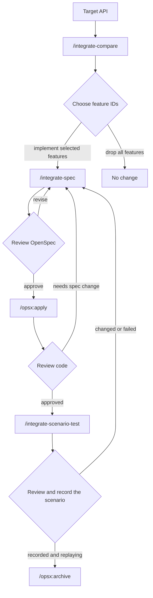

# Integrate upstream custom code

Use this workflow when you want to bring custom behavior from Azure CLI or Azure PowerShell into Azclips for one command.

Custom-code prompts own the command-specific steps: compare upstream behavior, write the OpenSpec contract, and generate scenario tests. OpenSpec prompts own implementation and archive.

The prompts read upstream evidence from these remote GitHub branches: `Azure/azure-cli` on `dev`, `Azure/azure-cli-extensions` on `main`, and `Azure/azure-powershell` on `main`. They should not use local clones, local checkouts, forks, feature branches, or PR branches as upstream evidence.

## Command Reference

| Command | When to run it | Result |
| --- | --- | --- |
| `/integrate-compare` | Start here with a Swagger/TSP service module, resource, and action. | Feature decision table. |
| `/integrate-spec` | Run after you choose feature IDs from the decision table. | OpenSpec proposal, design, tasks, and spec. |
| `/opsx:apply <change-id>` | Run after you review and approve the OpenSpec change. | Product-code implementation. |
| `/integrate-scenario-test <change-id>` | Run after approved behavior exists in OpenSpec, usually after product-code changes. | Azclips record/playback scenario tests. |
| `/opsx:archive <change-id>` | Run after code and scenario tests are reviewed. | Archived OpenSpec change and synced specs when needed. |

You make three review decisions during the workflow:

- Confirm the CLI and PowerShell command mapping.
- Choose which custom features to implement or drop.
- Review generated OpenSpec, code, and scenario tests before closing the change.

## Workflow



## Before You Start

Identify the Swagger/TSP service module, resource, and action. You will include these values in the first prompt.

Optional details are helpful but not required:

- Known Azure CLI command or its repo-relative upstream source path.
- Known Azure PowerShell cmdlet or its repo-relative upstream source path.
- Features you already know should be excluded.

## Step 1: Compare Upstream Behavior

Start with `/integrate-compare`. This step is read-only.

```text
/integrate-compare

Target API:
- Service module: Compute
- Resource: virtual machine
- Action: create

Optional hints:
- Azure CLI command: az vm create
- Azure PowerShell cmdlet: New-AzVM
```

The prompt should return a target mapping and a feature comparison table with these columns:

| command ID | Feature | Azure CLI source + code block | Azure PowerShell source + code block | Current Azclips evidence block | Action |
| --- | --- | --- | --- | --- | --- |

Review whether the command mapping and recommended actions look right.

## Step 2: Create The OpenSpec Change

Choose the feature IDs you want to implement or drop, then run `/integrate-spec`.

If the comparison finds many custom features, prefer implementing a small batch of feature IDs per pass. Smaller batches reduce long-running model sessions and provide a narrower review scope.

```text
/integrate-spec

Target API:
- Service module: Compute
- Resource: virtual machine
- Action: create

Implement F1, F2, F3 using the recommended action.
Implement F10 for PowerShell only.
Drop F6, F8, F12, F13.
```

Only selected features move into the OpenSpec contract. This step creates or updates OpenSpec artifacts only. It should not generate product code or tests.

Review the proposal, tasks, and spec. The spec should describe the Azclips behavior you want, not upstream history or implementation details.

## Step 3: Apply The OpenSpec Change

When the OpenSpec change looks correct, run the normal OpenSpec apply command.

```text
/opsx:apply compute-virtual-machine-create
```

For changes generated by `/integrate-spec`, apply should change product code only. It should not create or edit files under `tests/`.

## Step 4: Review The Code Changes

Review the code at a command level. Check that it implements only the features you selected.

If a selected feature needs changes outside the selected command scope, stop and decide how to handle that case separately.

## Step 5: Generate Scenario Tests

After approved behavior exists in OpenSpec, generate scenario tests.

```text
/integrate-scenario-test compute-virtual-machine-create
```

In this workflow, "tests" means record/playback scenario tests at this path:

- `tests/Scenario.Tests/<CommandName>ScenarioTests.cs`

One scenario covers both client surfaces, because the CLI command and the PowerShell cmdlet resolve to the same processor and emit identical ARM traffic. The authoring guide is [tests/Scenario.Tests/README.md](../../tests/Scenario.Tests/README.md).

When the module has never been used in a scenario, the step also adds an `ExtensionUnderTest` entry to `tests/Scenario.Tests/ScenarioHost.cs` and a project reference to `tests/Scenario.Tests/Scenario.Tests.csproj`. Without those the scenario cannot compile.

Review that the scenario has assertions for the selected behavior. It should not only run commands.

## Step 6: Record The Scenario

A new scenario has no recording yet, so playback fails until you record it. Recording is a manual step: it runs against real Azure, needs credentials, and creates billable resources. The agent never runs it for you.

Follow the `Record vs. playback` and `Secret scanning` sections of [tests/Scenario.Tests/README.md](../../tests/Scenario.Tests/README.md) for the exact commands, using the `--filter` value the agent reported. Afterwards, review the recording it wrote, replay it without credentials, and delete the resources the record run created.

Report the result.

```text
I reviewed tests/Scenario.Tests/VmCreateScenarioTests.cs, recorded it, and playback passes on both surfaces.
```

If you changed the scenario or it failed, update the OpenSpec contract first. Then apply the change and regenerate the scenario.

```text
I reviewed tests/Scenario.Tests/VmCreateScenarioTests.cs and made changes.
Use the current reviewed scenario as feedback.
Update the active OpenSpec spec first, then I will re-run /opsx:apply and /integrate-scenario-test.
```

## Step 7: Close The Change

When the OpenSpec change, code, and recorded scenario tests are ready, archive the change with the normal OpenSpec command.

```text
/opsx:archive compute-virtual-machine-create
```

The archive workflow handles final OpenSpec checks and spec sync prompts.
