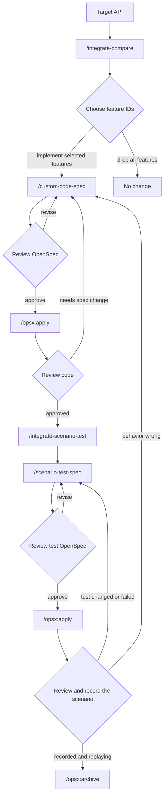

# Integrate upstream custom code

Use this workflow when you want to bring custom behavior from Azure CLI or Azure PowerShell into Azclips for one command.

Custom-code prompts own the command-specific steps: compare upstream behavior, write the OpenSpec contract, and generate scenario tests. OpenSpec prompts own implementation and archive.

The prompts read upstream evidence from these remote GitHub branches: `Azure/azure-cli` on `dev`, `Azure/azure-cli-extensions` on `main`, and `Azure/azure-powershell` on `main`. They should not use local clones, local checkouts, forks, feature branches, or PR branches as upstream evidence.

## Command Reference

| Command | When to run it | Result |
| --- | --- | --- |
| `/integrate-compare` | Start here with a Swagger/TSP service module and operation group, and optionally the actions to compare. | Feature decision table, with the business logic of every feature. |
| `/custom-code-spec` | Run with feature content in its input format. | OpenSpec proposal, design, tasks, and spec. |
| `/opsx:apply <change-id>` | Run after you review and approve the OpenSpec change. | Product code, or scenario tests for a scenario-test change. |
| `/integrate-scenario-test` | Run with the service module and operation group, and optionally the actions to test, usually after product-code changes. | The test cases the coverage rules require, with each surface's steps and expectations. |
| `/scenario-test-spec` | Run with test case content in its input format. | OpenSpec change for the scenario tests. |
| `/opsx:archive <change-id>` | Run after code and scenario tests are reviewed. | Archived OpenSpec change and synced specs when needed. |

You make three review decisions during the workflow:

- Confirm the CLI and PowerShell command mapping.
- Choose which custom features to implement.
- Review generated OpenSpec, code, and scenario tests before closing the change.

## Workflow



## Before You Start

Identify the Swagger/TSP service module and operation group, and the actions when you only want some of its commands. You will include these values in the first prompt. Without actions, the whole operation group is compared.

Optional details are helpful but not required:

- Known Azure CLI command or its repo-relative upstream source path.
- Known Azure PowerShell cmdlet or its repo-relative upstream source path.
- Features you already know should be excluded.

## Step 1: Compare Upstream Behavior

Start with `/integrate-compare`. This step is read-only.

```text
/integrate-compare

Target API:
- Service module: Compute
- Operation group: virtual machines
- Actions (optional): create

Optional hints:
- Azure CLI command: az vm create
- Azure PowerShell cmdlet: New-AzVM
```

The prompt should return a target mapping and a feature comparison table with these columns:

| command ID | Feature | Azure CLI source + code block | Azure PowerShell source + code block | Current Azclips evidence block | Action |
| --- | --- | --- | --- | --- | --- |

Below the table, a `Business logic` section states what each feature does, one `When <condition>, <observable outcome>` line per outcome. That text is what goes into the spec when you select the feature.

Review whether the command mapping, the recommended actions, and the business logic look right.

## Step 2: Create The OpenSpec Change

Choose the feature IDs you want to implement. Add a surface note to change where a feature lands, such as `F10 powershell-only`. Features you leave out are not carried forward.

Assemble the selected features into the input format of `/custom-code-spec`, defined in `.github/prompts/custom-code-spec.prompt.md`. Copy each feature's business logic from the comparison as written, and take the rest from the table: the commands from the target mapping, the surface from the `Action` column, and whether it adds or updates behavior from the current Azclips evidence.

```text
/custom-code-spec

Target: Compute / virtual machines / create
Commands:
- CLI: vm create
- PowerShell: New-AzVM

## F1 <feature title>
Surface: both
Action: add behavior
Business logic:
- When <condition>, <observable outcome>.
Reference: <upstream links>

## F10 <feature title>
Surface: powershell-only
...
```

If the comparison finds many custom features, prefer implementing a small batch of feature IDs per pass. Smaller batches reduce long-running model sessions and provide a narrower review scope.

`/custom-code-spec` also accepts feature content you write from scratch, for behavior that did not come from `/integrate-compare`, such as a later change to a command already in Azclips. Use the same input format:

```text
/custom-code-spec

Target: Compute / virtual machines / create
Surface: powershell-only
Action: update behavior
Business logic:
- When <condition>, <observable outcome>.
```

Only selected features move into the OpenSpec contract. This step creates or updates OpenSpec artifacts only. It should not generate product code or tests.

Each operation group has one spec, named from the module and the REST operation group, such as `compute-virtual-machines` for every VM command. A later change to the same operation group, whichever command or wording it starts from, modifies that spec instead of creating another. The step reports a change ID of the form `<spec-id>-<short-description>`, such as `compute-virtual-machines-create-default-nsg`. The later steps refer to it as `<change-id>`.

Review the proposal, tasks, and spec, and check that the report maps every feature ID you selected to a requirement. The spec should describe the Azclips behavior you want, not upstream history or implementation details.

## Step 3: Apply The OpenSpec Change

When the OpenSpec change looks correct, run the normal OpenSpec apply command.

```text
/opsx:apply <change-id>
```

For changes generated by `/custom-code-spec`, apply should change product code only. It should not create or edit files under `tests/`.

## Step 4: Review The Code Changes

Review the code at a command level. Check that it implements only the features you selected.

If a selected feature needs changes outside the selected command scope, stop and decide how to handle that case separately.

## Step 5: Generate Scenario Tests

After approved behavior exists in OpenSpec, summarize the upstream live tests into test cases. This step is read-only. Pass the service module and operation group, the same one the spec is named after:

```text
/integrate-scenario-test

Target:
- Service module: Compute
- Operation group: virtual machines
- Actions (optional): get, list
```

The scope is every command of that operation group, including generated commands without custom code, not only the ones the custom-code change touched. Actions narrow it to those operations; leave them out to test the whole operation group.

It returns the command coverage, the upstream test cases with a decision for each, and a `Test cases` section: one block per proposed case, with the steps of each surface it runs on and the expectations that check each step. There is nothing to choose here: the coverage rules decide which cases become tests. Pass the whole `Test cases` section to `/scenario-test-spec`.

```text
/scenario-test-spec

## T1 <title, optional>
Surface: both
CLI:
1. group create <arguments>
2. vm create <arguments>
   - expect: <assertion on the vm create result>
PowerShell:
1. New-AzResourceGroup <parameters>
2. New-AzVM <parameters>
   - expect: <assertion on the New-AzVM result>
```

Each `expect:` line sits under the step whose result it checks and becomes one assertion. A step without one, such as creating the resource group, only prepares the test.

It writes a scenario-test change of its own, such as `compute-virtual-machines-tests-create-default-nsg`. Each test case becomes a scenario titled with its case ID, holding each surface's commands and its expectations as written, in the operation group's test spec, `compute-virtual-machines-tests` beside the behavior spec `compute-virtual-machines`. Its requirements carry the titles of the behavior requirements they check, so each test lines up with the feature it verifies. Review it, then apply it:

```text
/opsx:apply <test-change-id>
```

In this workflow, "tests" means record/playback scenario tests at this path:

- `tests/Scenario.Tests/<Module>/<Name>ScenarioTests.cs`

A case that runs on both client surfaces gives each surface its own steps and expectations, because the CLI command and the PowerShell cmdlet do not always resolve to the same processor. The authoring guide is [tests/Scenario.Tests/README.md](../../tests/Scenario.Tests/README.md).

When the module or its verb has never been used in a scenario, the apply also adds an `ExtensionUnderTest` entry to `tests/Scenario.Tests/Infrastructure/ScenarioHost.cs` and a project reference to `tests/Scenario.Tests/Scenario.Tests.csproj`. Without those the scenario cannot compile. A new command under a verb already registered with the root leaf `""` needs neither.

Review that the scenario has assertions for the selected behavior. It should not only run commands.

## Step 6: Record The Scenario

A new scenario has no recording yet, so playback fails until it is recorded. Recording runs against real Azure, needs credentials, and creates billable resources, so the agent never starts it on its own: once you confirm the scenario code, it asks whether to record. If you agree, it checks that you are signed in with the azclips CLI, then records only the scenarios you approved, one `--filter` at a time, following the `Record vs. playback` section of [tests/Scenario.Tests/README.md](../../tests/Scenario.Tests/README.md).

Afterwards, review the recording it wrote against the `Secret scanning` section of the same README, replay it without credentials, and delete the resources the record run created, which the agent lists.

Report the result.

```text
I reviewed tests/Scenario.Tests/VmCreateScenarioTests.cs and its recording, and playback passes on both surfaces.
```

If you changed the scenario or it failed, update the scenario-test change first, or the custom-code change when the behavior itself is wrong. Then apply the change again.

```text
I reviewed tests/Scenario.Tests/VmCreateScenarioTests.cs and made changes.
Use the current reviewed scenario as feedback.
Update the active OpenSpec change first, then I will re-run /opsx:apply.
```

## Step 7: Close The Changes

When the OpenSpec changes, code, and recorded scenario tests are ready, archive both with the normal OpenSpec command.

```text
/opsx:archive <change-id>
/opsx:archive <test-change-id>
```

The archive workflow handles final OpenSpec checks and spec sync prompts.
