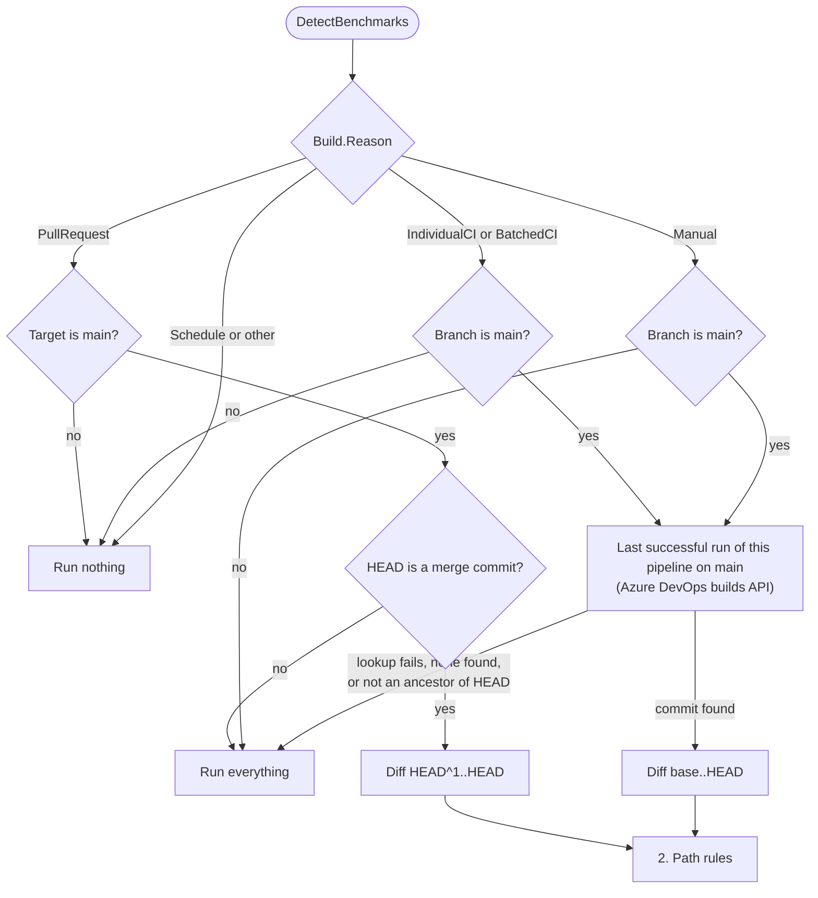
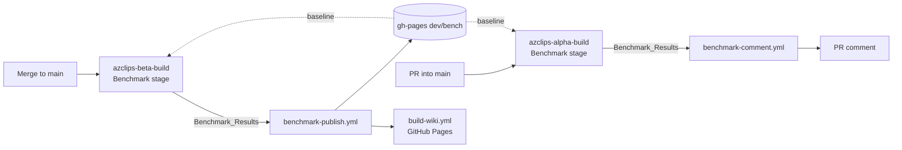

# Benchmark Workflows

## Overview

Performance benchmarks run in the `Benchmark` stage of two Azure DevOps pipelines and are compared with `main`'s latest results on GitHub Pages.

- **Pull requests into `main`** (`azclips-alpha-build`) — the changed extensions are benchmarked, the comparison appears on the build's summary page, and one PR comment lists every benchmark's change against `main`, flagging anything more than **15%** slower. Same-repo and fork PRs work the same way. Regressions never fail the build; a benchmark that still crashes after its retry does.
- **Merges to `main`** (`azclips-beta-build`) — the changed extensions are benchmarked again and the results are appended to the GitHub Pages dashboards, which become the baseline for later comparisons.

**Dashboards** (one page per product; one chart per extension):
- CLI — https://azure.github.io/azclips/dev/bench/cli/ (charts: `Azclips <Extension> CLI Benchmarks`)
- PS — https://azure.github.io/azclips/dev/bench/ps/ (charts: `Azclips <Extension> PS Benchmarks`)
- Startup — https://azure.github.io/azclips/dev/bench/startup-cli/ and https://azure.github.io/azclips/dev/bench/startup-ps/ (warm runs tracked, cold runs informational)

## Azure DevOps `Benchmark` stage

Defined in `.azure-pipelines/templates/dist/jobs/benchmark-suite.yml` and turned on with `run_benchmarks: true` in the alpha and beta pipelines. Stable releases skip it.

| Job | Pool | Purpose |
| --- | --- | --- |
| `DetectBenchmarks` | `pool-ubuntu-2404` | `devops/scripts/benchmark/detect_benchmark_changes.py` selects the extensions, and whether startup runs |
| `BuildBenchmarks` | `pool-ubuntu-2404` | Builds the solution once and publishes `Benchmark_Build_Outputs` |
| `RunCliBenchmarks`, `RunPsBenchmarks` | `pool-ubuntu-gh` (fixed hardware) | One leg per selected extension; 60-minute attempts, one retry |
| `RunStartupBenchmarks` | `pool-ubuntu-gh` | Whole-process startup; 20-minute attempts, one retry |
| `CollectBenchmarks` | `pool-ubuntu-2404` | Compares with `main`, writes the build summary, publishes `Benchmark_Results` |

Selection is **fully generic across extensions**: the extension set comes from the `[BenchmarkExtension("<Name>")]` attribute, so adding an extension needs no pipeline edits. Shared changes run **every** extension and startup: `src/Core/**`, `src/Extensions/ExtensionRuntime/**`, `src/CLI/**` apart from `src/CLI/Help/Docs/**`, the benchmark base classes, fixtures and telemetry, `tests/Common/**`, the build-wide inputs (`global.json`, `azclips.slnx`, `Shared.props`, `NuGet.config`, `Directory.Build.targets`, `src/Directory.Build.props`, `src/Extensions/Directory.Build.targets`, `src/Extensions/Targets/**`, `src/PS/Common/**` and `tests/Directory.Build.props`), and the benchmark templates and scripts. A change confined to `src/Extensions/<Ext>/**`, `src/PS/<Ext>/**` or an extension's benchmark classes runs only that extension, and `tests/Benchmark/Startup/**` runs startup. Pull requests compare their merge commit with the target branch. `main` builds and manual runs of `main` compare with the pipeline's last successful `main` build, and run everything when that build is unknown or its lookup fails. Manual runs of other branches benchmark everything, and other triggers benchmark nothing.

The stage never writes to GitHub.

## GitHub workflows

Both run from the default branch when a commit's Azure Pipelines check suite completes. They verify the run through the Azure DevOps API, download its `Benchmark_Results` artifact anonymously, and use only `GITHUB_TOKEN`.

### `benchmark-comment.yml` — Post Benchmark Comment

For a PR commit, it renders the comparison from the downloaded results and `main`'s gh-pages data, then creates or updates the PR's single `<!-- benchmark-results -->` comment. PR code never runs in this workflow.

### `benchmark-publish.yml` — Publish Benchmark Dashboard

For a `main` commit, it appends the results to gh-pages `dev/bench/{cli,ps,startup-cli,startup-ps}/data.js`, under the series github-action-benchmark used, and merges trace trees into `dev/bench/traces`. It then dispatches `build-wiki.yml` to redeploy GitHub Pages.

## How `detect_benchmark_changes.py` selects benchmarks

**1. Pick what to compare with**

**2. Map changed files to benchmarks**

| Changed path | Runs |
| --- | --- |
| Any shared path (listed above) | Every extension (CLI + PS) and startup |
| `src/Extensions/<Ext>/**`, `src/PS/<Ext>/**`, or a class tagged `[BenchmarkExtension("<Ext>")]` | `<ext>` (CLI + PS), if it has benchmarks |
| `tests/Benchmark/Startup/**` | Startup |
| Anything else | Nothing |

The extension set is every `[BenchmarkExtension]` name under `tests/Benchmark/`. The result becomes the `detect` step's outputs (`hasExtensionWork`, `runStartup`, `extensionMatrix`, `extensions`), which the leg and collect jobs read.

## Architecture

The full design is in `docs/superpowers/specs/2026-11-23-benchmarks-ado-migration-design.md`.
