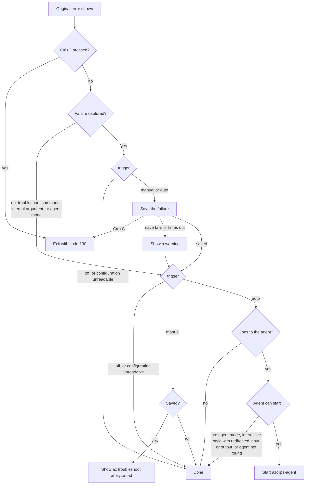

## Context

Recovery adds a local failure history and a manual entry point to the existing
automatic Agent flow. The configuration system stays as in main; recovery keys are
ordinary leaf keys under `agent.recovery`.

## Goals / Non-Goals

**Goals:**

- Independent trigger and style, defaulting to off and oneshot.
- Keep the complete failed command and error text for diagnosis.
- Show the original error first in every mode.
- No extra work on the command path while recovery is off.

**Non-Goals:**

- No new model, SDK, background service, completion engine, or PowerShell recovery commands.
- No dynamic history-ID completion.

## Decisions

### Configuration

`agent.recovery.trigger`, `agent.recovery.style`, and `agent.recovery.historySize`
are plain keys declared in `AgentOptions.RecoveryOptions`. Allowed values and the
minimum size are enforced by the existing schema attributes.

The retired keys `agent.enabled`, `agent.sessionStyle`, and `agent.builtin.endpoint`
are removed by `RetiredAgentKeys` when the Agent starts. It lists the stored
configuration and deletes any of the three that exist. Failures are ignored and
time-boxed to one second. Ordinary commands never delete configuration.

### Service access in troubleshoot commands

**Decision**: `az troubleshoot list` and `show` obtain `IFailureHistoryStore` from
`AzclipsServiceProvider` when they run. `az troubleshoot analyze` also obtains
`IConfigurationService` and the telemetry services the same way.

**Rationale**: The runtime creates processors with `Activator.CreateInstance`
and passes only `ProcessorContext`, which holds the HTTP pipeline, publisher,
auth handler, output handler, and profile. None of the services these commands
need are in `ProcessorContext`, and a processor cannot declare constructor
parameters.

**Alternative considered**:
- Constructor injection through `ActivatorUtilities.CreateInstance`, as proposed
  in `eng-docs/spec/extension-framework.md` section 4.2. This changes how every
  processor is created and belongs in a runtime change.
- Add the failure history store to `ProcessorContext`. Every processor would
  carry a service that only troubleshoot uses.

### Clearing history on off

The Config `set` and `delete` commands call `NotifyChangeHandlersAsync` after the
write succeeds:

1. The key is canonicalized the same way as `ConfigurationService.CanonicalizeKnownKey`.
2. On delete, every schema key under the deleted prefix (`GetAllKeys()`) is also checked.
3. Each key is looked up with `AzclipsServiceProvider.GetKeyedService<IConfigurationChangeHandler>(key)`.

`RecoveryConfigurationChangeHandler` is registered for `agent.recovery.trigger` in
`Core.Runtime`. A value of off, or a delete (the default is off), clears the history.
If clearing fails, the command still succeeds and prints a warning that tells the
user to run the same off command again.

**Rationale**: Turning recovery off must delete the saved failures. The Config
extension must not reference recovery code, and recovery must not change the
Config extension for each new key. `IConfigurationChangeHandler` in
`Core.Abstractions` and a keyed registration keep both sides independent.

**Alternative considered**:
- Call the handlers inside `ConfigurationService` after a write, with
  `IEnumerable<IConfigurationChangeHandler>` injected through its constructor.
  The dependency is visible, but `RetiredAgentKeys` also deletes keys through
  `ConfigurationService` and would trigger the handlers.
- Check `agent.recovery.trigger` in the Config extension directly. This couples
  Config to recovery.

### History store

- Files: `history.json`, `history.key` (Windows), and `history.lock`.
- `history.json` is `{nextSequence, records:[{id, occurredAt, kind, payload}]}`, with no
  version field. `kind` is `encrypted` or `plain`. An encrypted payload is AES-GCM with a
  random nonce per record; its authenticated data binds the record ID and time.
- Lock: main's `FileLock.TryAcquireAsync(ownerOnly: true)`. Under the lock the store reads
  the file, writes a `0600` (Windows: owner-only ACL) temporary file, and replaces the
  history with `File.Replace`, or `File.Move` when it does not exist.
- Save: keep the latest `historySize` records by sequence, encrypted and plain together.
  The CLI reads `historySize` once and passes it in.
- A file that can't be parsed is treated as empty history and replaced on the next save.
- Clear: take the lock and delete `history.json`, its temporary files, and finally the Windows key
  file. The macOS Keychain and Linux Secret Service entries stay and are reused.
  The counter resets with the file.
- IDs: `<PID>-<8 random lowercase hex digits>`, parent-shell PID. Each record also stores its sequence, which orders, selects and trims records.

### Key storage

- Windows: DPAPI. macOS: Keychain with no-UI queries. Linux: Secret Service over
  Tmds.DBus.Protocol, with no activation, Unlock, or Prompt calls.
- On Linux, a locked item or an empty search on a locked collection is treated as
  unavailable, not as a missing key.
- When key storage is unavailable, encrypted records are kept and only the latest
  failure is saved unencrypted, and the CLI warns. The next save with the key drops it.
- When key storage is available and the key is absent, a new key is created; records
  the new key can't open are skipped and removed on the next save.

### Failure path

- Off is decided from configuration alone; no history file is opened.
- Capture has a two-second budget. Storage work that cannot be cancelled runs in
  a short-lived worker process over anonymous pipes.
- The original error is printed before capture and before any AI output.
- While `agent.recovery.trigger` is not stored in the configuration file, a captured
  failure shows two hints that explain how to enable recovery, at most 15 times
  (counter in `agent/state.json`). Storing any trigger value, including off, stops
  the hints.

The flow below starts after the original error is shown. An `AzclipsErrorException`
goes to the agent only when its `AgentFallbackEligible` is true; see the exit-code
section of `eng-docs/spec/extension-management.md`. Any other exception always goes
to the agent.

A failure saved without encryption also shows a warning. The enable hints from the
previous bullet are shown only for captured failures that were not canceled.

### Shared Agent flow

Manual and automatic recovery send the same `FailedCommand` and `ErrorText` through
the same anonymous pipe to the same Agent prompt, tools, and approvals. The failure
text is never placed in arguments or environment variables. Style comes from
configuration or a manual `--style` override.

## Validation

- Linux key storage was checked in Docker (Ubuntu noble, gnome-keyring, Xvfb, gcr).
  With a locked keyring, MSAL `WithLinuxKeyring` launched gcr-prompter and blocked
  read and write until a 30-second kill. The Tmds-only path returned in about
  145 ms (read) and 140 ms (write: unavailable), with no prompter.
- Automated tests assert that the original error precedes the AI plan and that the
  failure reaches the Agent only through the pipe, using a fake Agent process.

## Risks / Trade-offs

- Native key storage can be locked or slow: keep encrypted records and store the latest
  failure in plaintext with a warning.
- Parent-shell association can be affected by wrapper processes and PID reuse.
- Troubleshoot processors and `ConfigCommandBase` resolve services from the
  static provider, so their dependencies are not visible in their declarations,
  and their tests replace registrations in the shared provider and cannot run in
  parallel.
- `GetKeyedService` is a new resolution entry point on `AzclipsServiceProvider`.
