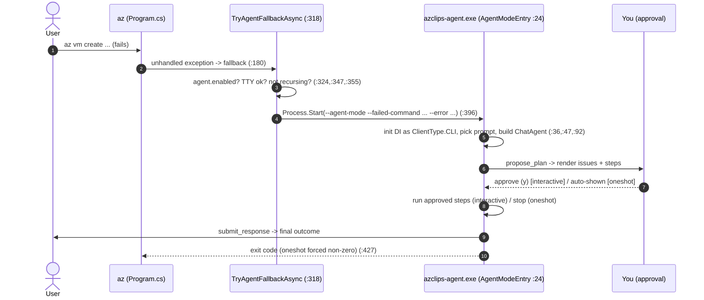
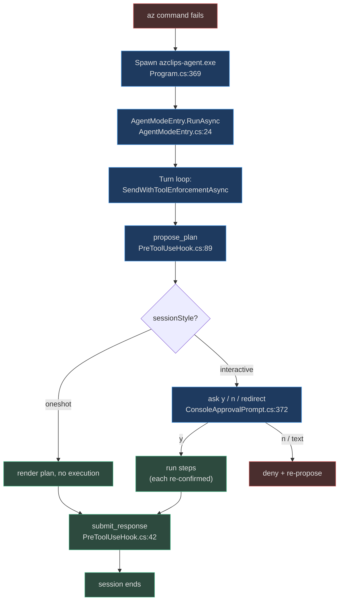

# AI Agent Fallback Quickstart

## Why an "agent fallback"

When an `az` command fails, the useful next step is often obvious to a human but
tedious to work out: a renamed flag, a missing required parameter, a region
where the requested VM SKU isn't available, or simply "you're not signed in."
The **AI agent fallback** turns that failure into a fix. On an unhandled error,
the classic CLI can hand the failed command and its error text to a separate AI
agent that diagnoses the problem and proposes a concrete, ready-to-run plan —
which **you must approve** before anything executes.

Two design decisions shape everything about this feature:

1. **It is a separate process, not the TUI.** The CLI spawns a standalone
   executable, `azclips-agent.exe` (project `Agent/Core.Agent.csproj`,
   `AssemblyName azclips-agent`), as a child process with inherited stdio
   (`src/CLI/Program.cs:369`). This is the single most important correction over
   older documentation: the interactive Terminal UI (`Core.Tui`) does **not**
   host agent mode.
2. **It is opt-in and off by default.** During Private Preview the master switch
   `agent.enabled` defaults to `false` (`src/Core/Core.Abstractions/AgentOptions.cs:11`).
   Until you turn it on, a failed command surfaces its original error and never
   spawns the agent.

## Step 1 — Enable it

```powershell
az config set --key agent.enabled --value true
```

The fallback reads this key through `AgentOptions` and refuses to run if it is
unset or unreadable (fail-safe: unknown state is treated as disabled)
(`src/CLI/Program.cs:324`). The relevant configuration keys:

| Key | Type | Default | Meaning |
|-----|------|---------|---------|
| `agent.enabled` | bool | `false` | Master opt-in for the fallback (`AgentOptions.cs:11`) |
| `agent.provider` | string | `builtin` | `builtin` (Microsoft-hosted GPT via APIM) or `github` (`AgentOptions.cs:12`) |
| `agent.sessionStyle` | string | `oneshot` | `oneshot` or `interactive` (`AgentOptions.cs:17`) |
| `agent.interactive.verbose` | bool | `false` | Show internal tool args/output in interactive mode (`AgentOptions.cs:40`) |
| `agent.trace.enabled` | bool | `false` | Write a JSONL session trace (`AgentOptions.cs:46`) |
| `agent.builtin.modelId` | string | `gpt-5.4` | Model id for the builtin provider (`AgentOptions.cs:58`) |

## Step 2 — Choose a session style

`agent.sessionStyle` selects between two fundamentally different experiences,
resolved through `AgentOptions.IsInteractive` (`src/Core/Core.Abstractions/AgentOptions.cs:31`):

| Style | Behavior | Safe with redirected stdio? |
|-------|----------|----------------------------|
| `oneshot` (default) | Diagnoses the failure, prints one complete plan, and exits. It never runs a command itself and asks nothing interactively. | **Yes** — not TTY-gated |
| `interactive` | Opens a chat loop: it can ask questions, propose plans you approve with `y`/`n`, and (after approval) run commands across turns. | **No** — requires a live TTY |

Because an interactive chat loop reads `y`/`n` approvals from the terminal, it is
gated behind a live-TTY check: if stdin **or** stdout is redirected, interactive
fallback is silently skipped and the original error is surfaced instead
(`src/CLI/Program.cs:347`). One-shot is deliberately **not** gated — it is useful
even in CI or a pipe because it only prints text.

```powershell
# Opt into the collaborative chat loop (requires an interactive terminal)
az config set --key agent.sessionStyle --value interactive
```

## Step 3 — Trigger it with a real failure

Run a command that fails. The error propagates to `Program.Main`'s try/catch,
which routes `HttpRequestException` and any generic `Exception` to the fallback —
but deliberately **not** structured `AzclipsErrorException`, which represents a
well-known error with an unambiguous fix and bypasses the agent
(`src/CLI/Program.cs:165`).



Before spawning, `TryAgentFallbackAsync` checks three gates in order — the
`agent.enabled` switch (`src/CLI/Program.cs:324`), the interactive TTY guard
(`src/CLI/Program.cs:347`), and a recursion guard that stops an agent-spawned
`az` from spawning another agent (`AZCLIPS_IN_AGENT_MODE=1`,
`src/CLI/Program.cs:355`). It then starts the child with
`--agent-mode --failed-command <cmd> [--error <text>]` and inherited stdio
(`src/CLI/Program.cs:396`).

## What the agent does once running

`AgentModeEntry.RunAsync` (`Agent/AgentMode/AgentModeEntry.cs:24`) owns the
session. It initializes its own DI container as `ClientType.CLI` (a deliberate
choice documented in code — the entry used to live inside `Core.Tui`)
(`Agent/AgentMode/AgentModeEntry.cs:36`), selects the prompt from the session
style (`oneshot.md` vs `inline.md`, `Agent/AgentMode/AgentModeEntry.cs:47`),
builds a `ChatAgent` on the GitHub Copilot SDK
(`Agent/ChatAgent.cs:102`), and synthesizes the first user prompt as
*"I tried `<cmd>` but it failed… Help me fix it."* (`Agent/AgentMode/AgentModeEntry.cs:111`).

The safety model is a **plan-approval protocol**: the agent must call
`propose_plan` and get your approval before any shell command is allowed to run
(`Agent/Hooks/PreToolUseHook.cs:161`). In interactive mode you answer `y`/`n` (or
type free-text to redirect); in one-shot mode the plan is simply shown and the
agent exits without executing anything.



## Safety brakes and stopping

- **Interaction brake.** An interactive session counts your messages and applies
  a soft reminder at **12** exchanges and a hard stop at **20**
  (`Agent/AgentMode/AgentModeEntry.cs:21` and `:199`). These are fixed MVP
  constants, not yet configurable.
- **Ctrl+C / Esc.** During a busy turn an `AbortKeyWatcher`
  (`Agent/Hosting/AbortKeyWatcher.cs:34`) watches stdin: **Esc** aborts the
  current turn, **Ctrl+C** quits the whole session
  (`Agent/Hosting/AbortKeyWatcher.cs:88`).
- **Exit codes.** One-shot always reports a non-zero exit code even if the agent
  itself exits 0 — the original command still failed, so `&&`, CI, and `$?` see
  it as a failure. Interactive passes the agent's real exit code through
  (`src/CLI/Program.cs:427`).
- **Exit words.** In an interactive loop, typing `exit`, `quit`, `/exit`,
  `/quit`, or `:q` ends the session (`Agent/AgentMode/AgentModeEntry.cs:195`).

## Next steps

- [Agent Architecture](../02-deep-dive/agent-architecture.md) — the standalone process lifecycle and turn contract.
- [Prompts & Plan Mode](../02-deep-dive/prompts-and-plan-mode.md) — the `propose_plan` / `submit_response` protocol and its guards.
- [Copilot SDK Integration](../02-deep-dive/copilot-sdk-integration.md) — how the agent drives the bundled `copilot` daemon.

## References

- `src/CLI/Program.cs:318` — `TryAgentFallbackAsync`, the gate + spawn.
- `src/CLI/Program.cs:347` — the interactive non-TTY guard.
- `src/Core/Core.Abstractions/AgentOptions.cs:11` — the `agent.enabled` opt-in.
- `src/Core/Core.Abstractions/AgentOptions.cs:17` — `SessionStyle` (oneshot/interactive).
- `Agent/AgentMode/AgentModeEntry.cs:24` — `RunAsync`, the session host.
- `Agent/ChatAgent.cs:102` — `CreateAsync`, building the SDK-backed agent.
- `Agent/Hooks/PreToolUseHook.cs:161` — the plan-before-execute gate.
- `Agent/Hosting/AbortKeyWatcher.cs:34` — Ctrl+C / Esc handling.
