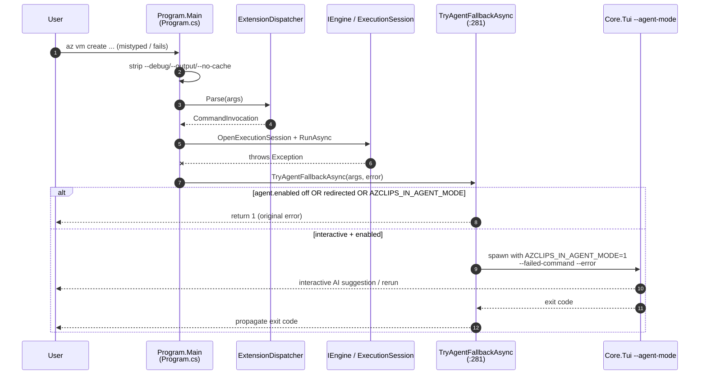

# CLI Usage

## Why the CLI Works This Way

The `az` binary is a thin front door over the Core engine. It does almost no business logic itself — instead it parses a handful of **global flags**, converts your arguments into a `CommandInvocation`, and hands off to `IEngine`. Command *surfaces* (like `group`, `vm`, `config`) are not compiled into the CLI; they are **extensions** loaded dynamically at runtime, and their authoritative documentation lives as Markdown under `src/CLI/Help/Docs/`. This keeps the CLI small and lets new command groups ship without changing `Program.cs`.

## Command Surface

The installed command groups are documented under `src/CLI/Help/Docs/` — each folder is a verb: `config`, `deployment`, `disk`, `extension`, `group`, `login`, `logout`, `profile`, `rest`, and `vm`. These `index.md` files are the authoritative command surface. Representative examples:

| Command | Example | Docs |
| --- | --- | --- |
| Create a resource group | `az group create --name myrg --location eastus --subscription-id <sub>` | `src/CLI/Help/Docs/group/index.md` |
| List resource groups | `az group list --subscription-id <sub>` | `src/CLI/Help/Docs/group/index.md` |
| Manage VMs | `az vm create ... / az vm list / az vm show` | `src/CLI/Help/Docs/vm/index.md` |
| Get/set/list config | `az config get --key output.format` · `az config set --key output.format --value json` · `az config list` | `src/CLI/Help/Docs/config/index.md` |
| Authenticate | `az login --subscription-id <sub> [--use-device-code]` | `src/CLI/Help/Docs/login/index.md` |
| Manage extensions | `az extension add / list` | `src/CLI/Help/Docs/extension/index.md` |
| Raw ARM call | `az rest ...` | `src/CLI/Help/Docs/rest/index.md` |

Configuration keys use dot notation (e.g. `output.format`, `core.debug`) and persist to your local config file (`src/CLI/Help/Docs/config/index.md`).

## Global Flags

Before dispatch, `Program.Main` strips three global flags from the argument vector. Each is parsed by a dedicated helper:

| Flag | Effect | Implementation |
| --- | --- | --- |
| `--debug` | Raises the effective log level for the invocation. | `ParseDebugFlag` (`src/CLI/Program.cs:155`) |
| `--output json` / `--output plain` (also `--output=json`) | Selects JSON vs. plain output; JSON mode renders errors as `{ "error": { code, message, details } }`. | `ParseOutputFlag` (`src/CLI/Program.cs:220`) |
| `--no-cache` | Bypasses the extension cache by setting `AZCLIPS_NO_EXTENSION_CACHE=true`. | `ParseNoCacheFlag` (`src/CLI/Program.cs:246`) |

The order matters: `--debug` is parsed first so the resolved log level applies to everything that follows (`src/CLI/Program.cs:69`).

```mermaid
graph LR
    ARGS["raw args[]"] --> DBG["ParseDebugFlag<br>(:155)"]
    DBG --> LVL["ResolveEffectiveLevel<br>build OutputStreams"]
    LVL --> OUT["ParseOutputFlag<br>(:220)"]
    OUT --> NC["ParseNoCacheFlag<br>(:246)<br>sets AZCLIPS_NO_EXTENSION_CACHE"]
    NC --> PARSE["ExtensionDispatcher.Parse<br>(:44)"]
    PARSE --> INV["CommandInvocation"]
    INV --> EXEC["IEngine.OpenExecutionSession"]

    style ARGS fill:#2d333b,stroke:#6d5dfc,color:#e6edf3
    style DBG fill:#2d333b,stroke:#6d5dfc,color:#e6edf3
    style LVL fill:#2d333b,stroke:#6d5dfc,color:#e6edf3
    style OUT fill:#2d333b,stroke:#6d5dfc,color:#e6edf3
    style NC fill:#2d333b,stroke:#6d5dfc,color:#e6edf3
    style PARSE fill:#2d333b,stroke:#6d5dfc,color:#e6edf3
    style INV fill:#2d333b,stroke:#6d5dfc,color:#e6edf3
    style EXEC fill:#2d333b,stroke:#6d5dfc,color:#e6edf3
```



## Help Dispatch

Help is modeled as *control flow via exceptions*. When the dispatcher sees a bare top-level help request (`az`, `az --help`, `az -h`, `az help`) it throws `DispatchHelpException` (`src/CLI/Parser/ExtensionDispatcher.cs:50`); a group- or command-scoped help request throws `RuntimeExtensionHelpException` (`src/CLI/Parser/ExtensionDispatcher.cs:57`). `Program.Main` catches these and renders through `RuntimeHelpDispatcher` (`src/CLI/Program.cs:91`–`:120`), so help output is generated from the same extension metadata the executor uses.

## Shell Completions

Tab-completion metadata is produced by `CompletionGenerator`, which emits a JSON completion tree built from `ExtensionIndex` metadata (`src/CLI/Completions/CompletionGenerator.cs:17`). It is triggered by `--completions` as the first argument and is handled *after* DI initialization so it can resolve `IEngine` directly (`src/CLI/Program.cs:56`):

```bash
az --completions            # full tree
az --completions vm         # commands in the vm group
az --completions vm create  # metadata for a specific command
```

The generator handles requests in `TryHandleAsync` (`src/CLI/Completions/CompletionGenerator.cs:28`) and ships shell scripts alongside it: `az.completions.bash`, `az.completions.zsh`, and `az.completions.ps1` (in `src/CLI/Completions/`).

## Profiles

Commands accept a `--profile` override, and a global profile can be configured so subsequent commands reuse the same account context. Profile state is persisted under the LocalApplicationData `.azclips` root (`src/Core/Core.Abstractions/HomePaths.cs:47`), and PowerShell exposes the mirror `Get-AzProfile` / `Set-AzProfile` cmdlets.

## The AI Agent-Mode Fallback

The CLI's most distinctive UX is what happens when a command *fails*. On an unhandled exception, `Program.Main` calls `TryAgentFallbackAsync` (`src/CLI/Program.cs:281`). Rather than hosting AI in-process, it **spawns the TUI as a child process** in `--agent-mode`, handing over the failed command and error text so the agent can suggest or run a corrected command interactively.

Crucially, this only happens when it is safe:

- `agent.enabled` must be `true` (opt-in; off by default). Enable it with `az config set --key agent.enabled --value true`.
- The session must be an interactive TTY — if stdin or stdout is redirected (CI, a pipe, an unattended script), the fallback is skipped and the original error is surfaced (`src/CLI/Program.cs:308`).
- A recursion guard: if `AZCLIPS_IN_AGENT_MODE == 1`, no nested agent is spawned (`src/CLI/Program.cs:315`).



The child inherits stdio directly so streaming tokens, y/n approvals, and device-code links all render live in your terminal (`src/CLI/Program.cs:332`). The parent intercepts Ctrl+C (leaving cancellation to the child) to avoid a "terminal hijack" where the shell prompt redraws over the child's output (`src/CLI/Program.cs:354`).

## References

- `src/CLI/Program.cs:155` — `--debug` (`ParseDebugFlag`).
- `src/CLI/Program.cs:220` — `--output json|plain` (`ParseOutputFlag`).
- `src/CLI/Program.cs:281` — `TryAgentFallbackAsync` agent-mode fallback.
- `src/CLI/Parser/ExtensionDispatcher.cs:44` — argument parsing and help exceptions.
- `src/CLI/Help/Docs/config/index.md` — authoritative `config` command surface.
- `src/CLI/Completions/CompletionGenerator.cs:17` — shell completion tree generator.
