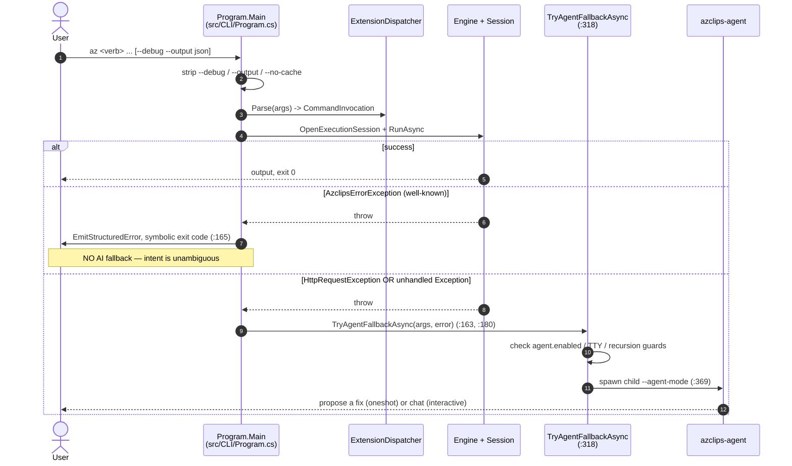
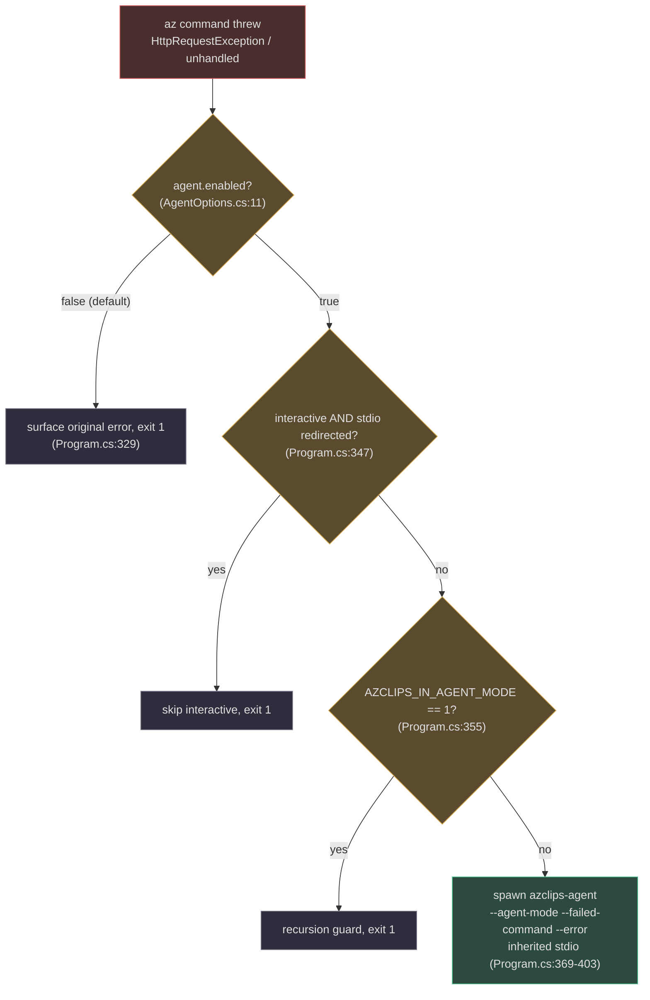

# CLI Usage

## Why the CLI Works the Way It Does

The `az` binary (`src/CLI/Core.Cli.csproj:4`) is deliberately thin. Its job is to turn a line of text into a `CommandInvocation`, run it through the shared engine, and then make one decision when something goes wrong: **is this a well-understood failure I should report cleanly, or an unexpected one worth handing to the AI agent?** Understanding that fork — and the three global flags that shape it — is most of what you need to use the CLI effectively. Everything here is traced to `src/CLI/Program.cs`.

The repository is `Azure/cirrus`; the binary and namespaces use the **Azclips** identity.

## Command Surface

Top-level verbs are contributed by extensions and documented under `src/CLI/Help/Docs/`. The folders there are the authoritative command surface:

| Verb | Example | Owner | Help docs |
| --- | --- | --- | --- |
| `group` | `az group create --name rg1 --location eastus` | Resources | `src/CLI/Help/Docs/group` |
| `vm`, `disk` | `az vm create ...`, `az disk ...` | Compute | `src/CLI/Help/Docs/vm`, `.../disk` |
| `config` | `az config set --key <k> --value <v>` / `get` / `list` / `delete` / `info` | Config (built-in) | `src/CLI/Help/Docs/config` |
| `login`, `logout` | `az login`, `az logout` | Login (built-in) | `src/CLI/Help/Docs/login` |
| `profile` | `az profile list` / `show` / `set` / `remove` | Login (built-in) | `src/CLI/Help/Docs/profile` |
| `extension` | `az extension add` / `list` / `remove` | Extension (built-in) | `src/CLI/Help/Docs/extension` |
| `deployment`, `rest` | `az deployment ...`, `az rest ...` | Resources | `src/CLI/Help/Docs/deployment`, `.../rest` |
| `agent` | `az agent tool ...` | Agent.Commands | `src/CLI/Help/Docs/agent` |

Bare `az` prints a welcome banner; `az --help` and `az --version` are host cold-paths handled without loading an extension (`src/CLI/Program.cs:113-156`).

## Global Flags

Three global flags are stripped from the argument list *before* dispatch, each by a dedicated parser in `Program.cs`:

| Flag | Effect | Parser |
| --- | --- | --- |
| `--debug` | Raises the effective log level so `DEBUG`/`VERBOSE` lines emit | `ParseDebugFlag` (`src/CLI/Program.cs:192`) |
| `--output json` / `--output=json` / `plain` | `json` makes errors render as `{ "error": { code, message, details } }` | `ParseOutputFlag` (`src/CLI/Program.cs:257`) |
| `--no-cache` | Sets `AZCLIPS_NO_EXTENSION_CACHE=true`, bypassing the extension assembly cache | `ParseNoCacheFlag` (`src/CLI/Program.cs:283`) |

`--no-cache` is a thin wrapper: it just exports an environment variable that `AssemblyLoadingOptions.BypassExtensionCache` reads through the configuration service (`src/CLI/Program.cs:289`), which is why it also works for benchmarking harnesses that set the variable directly.

After `--debug` is stripped, the *effective* log level is resolved by `CliLoggingPolicy.ResolveEffectiveLevel` (`src/CLI/CliLoggingPolicy.cs:27`), which combines the configured `core.logging.level` with the `--debug` override.

```powershell
az group create --name rg1 --location eastus --output json    # structured output/errors
az vm create ... --debug                                       # verbose diagnostics
az group list --no-cache                                       # skip the ext ALC cache
```

## The Error → Fallback Ladder

The heart of `Program.Main` is a single `try/catch` (`src/CLI/Program.cs:140-181`) that classifies the outcome. Inside it, `ExtensionDispatcher.Parse` turns the argument array into a `CommandInvocation` (`src/CLI/Parser/ExtensionDispatcher.cs:46`) before the engine runs it:



- **`AzclipsErrorException`** → `EmitStructuredError` renders `error: [code] message` (text) or a `{ "error": { code, message, details } }` object under `--output json` (`src/CLI/Program.cs:293-316`), then returns the exception's symbolic `ExitCode`. **No** AI fallback: the failure is well-known.
- **`HttpRequestException`** and **any other `Exception`** both call `TryAgentFallbackAsync` (`src/CLI/Program.cs:163`, `:180`).

Regardless of outcome, the `finally` block disposes DI and fires a detached background telemetry upload (`src/CLI/Program.cs:183-187`).

## The Agent Fallback UX

`TryAgentFallbackAsync` (`src/CLI/Program.cs:318`) is conservative by design — three gates must pass before any child process starts:



| Gate | Rule | Source |
| --- | --- | --- |
| **Enabled** | `agent.enabled` is `false` by default. Opt in: `az config set --key agent.enabled --value true`. | `src/Core/Core.Abstractions/AgentOptions.cs:11`, checked `src/CLI/Program.cs:329` |
| **Interactive TTY** | `interactive` session style is skipped when input/output is redirected; `oneshot` is never gated. | `src/CLI/Program.cs:347` |
| **Recursion** | `AZCLIPS_IN_AGENT_MODE=1` (set on the child) prevents a nested agent spawn. | `src/CLI/Program.cs:26`, `:355` |

When the gates pass, the CLI launches `azclips-agent` with the failed command and error text as arguments and **inherited stdio** so its output streams live into your terminal (`src/CLI/Program.cs:396-403`). In `oneshot` mode the agent proposes a fix and exits without ever running your command, so the CLI forces a non-zero exit code — `&&` chains, CI, and `$?` still see the original command as failed (`src/CLI/Program.cs:418-431`). See [AI Agent Fallback Quickstart](/01-getting-started/agent-mode-quickstart) for the interactive experience.

## Exit-Code Semantics

| Situation | Exit code |
| --- | --- |
| Success | `0` |
| Structured `AzclipsErrorException` | the exception's symbolic `ExitCode` (`src/CLI/Program.cs:171`) |
| Fallback disabled / gated off | `1` |
| `oneshot` agent ran | non-zero (original command still failed) (`src/CLI/Program.cs:431`) |
| `interactive` agent ran | the agent's own exit code, passed through (`src/CLI/Program.cs:429`) |

## References

- `src/CLI/Program.cs:192` — `ParseDebugFlag` (`--debug`)
- `src/CLI/Program.cs:257` — `ParseOutputFlag` (`--output json|plain`)
- `src/CLI/Program.cs:283` — `ParseNoCacheFlag` (`--no-cache` → `AZCLIPS_NO_EXTENSION_CACHE`)
- `src/CLI/Program.cs:140-181` — the error-classification `try/catch`
- `src/CLI/Program.cs:293` — `EmitStructuredError` (JSON/text error rendering)
- `src/CLI/Program.cs:318` — `TryAgentFallbackAsync` and its three gates
- `src/CLI/Parser/ExtensionDispatcher.cs:46` — `Parse(args)` → `CommandInvocation`
- `src/CLI/CliLoggingPolicy.cs:27` — effective log level (`core.logging.level` + `--debug`)
- `src/Core/Core.Abstractions/AgentOptions.cs:11` — `agent.enabled` (default `false`)
- `src/CLI/Help/Docs/` — authoritative per-verb help (group, vm, config, login, profile, extension, ...)
- `src/CLI/Core.Cli.csproj:4` — the `az` assembly name
