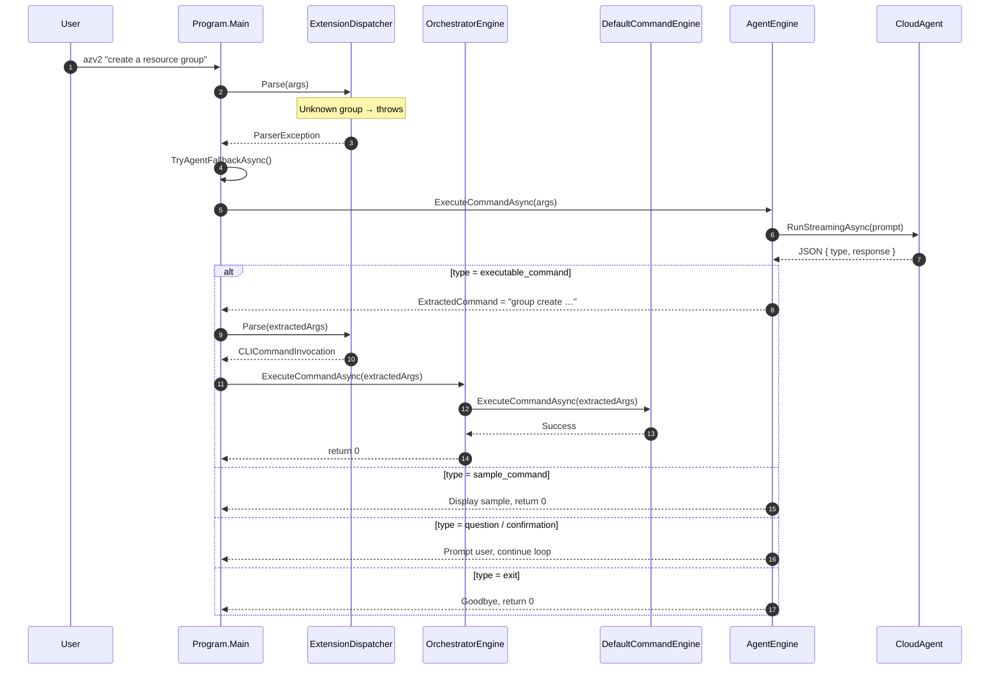
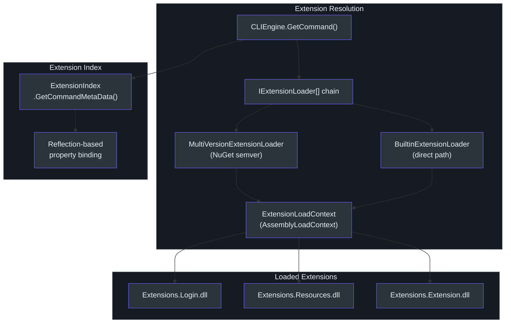

# CLI Usage Guide

## CLI Binary

The CLI is compiled as a self-contained executable named **`azv2`**. After building the solution the binary is located at:

```
artifacts/<Configuration>/Core.Cli/azv2
```

Inside the dev container, both `artifacts/Debug/Core.Cli` and `artifacts/Release/Core.Cli` are on `PATH` (`.devcontainer/devcontainer.json:60-61`), so `azv2` is directly invocable.

The assembly name is set to `azv2` in the CLI project file, producing a single executable entry point at `src/CLI/Program.cs:22`.

## Command Syntax

Cirrus supports **two modes** of input in a single binary:

### Structured Commands

```bash
azv2 <group> <command> [--Parameter value ...]
```

Examples:

```bash
azv2 group create --Name my-rg --Location eastus --SubscriptionId <id>
azv2 group get --SubscriptionId <id> --Name my-rg
azv2 login show
azv2 login logout
```

Arguments are parsed by `ExtensionDispatcher.Parse()` (`src/CLI/Parser/ExtensionDispatcher.cs:32-45`). The method:

1. Validates that at least one argument is present (`ExtensionDispatcher.cs:34`).
2. Checks for help flags (`--help`, `-h`, `help`, `?`, `-?`) and throws `DispatchHelpException` (`ExtensionDispatcher.cs:35-36`).
3. Resolves the extension name via `CommandGroupIndex` (`ExtensionDispatcher.cs:37`).
4. Delegates to `ExtensionParser.Parse()` for the command name and parameter dictionary (`ExtensionDispatcher.cs:42-44`).

### Natural Language Commands

```bash
azv2 "create a resource group named test in eastus"
azv2 "list all my resource groups"
azv2 "how do I log in?"
```

When the structured engine cannot match the input, the orchestrator falls back to the AI agent automatically — no special flag is needed.

## Command Group Index

`CommandGroupIndex` (`src/CLI/Parser/CommandGroupIndex.cs:14-21`) maintains a static dictionary that maps user-facing group names to internal extension names:

| Group Name | Extension Name | Description |
|-----------|---------------|-------------|
| `Group` | `Resources` | Resource group management |
| `Login` | `Login` | Authentication |
| `Extension` | `Extension` | Extension management |

The lookup method `getExtensionNameByCommandGroupName()` (`CommandGroupIndex.cs:22-28`) performs a case-insensitive match and throws if the group is unknown — triggering the AI fallback path.

## How AI Fallback Works

The fallback is implemented at two levels. The `OrchestratorEngine` handles the core retry loop (`src/Core/Core.Engine/OrchestratorEngine.cs:60-119`), while `Program.Main` provides an additional outer fallback for parse-level errors (`src/CLI/Program.cs:71-134`).



### Retry Logic

Both `Program.TryAgentFallbackAsync()` (`Program.cs:73`) and `OrchestratorEngine` (`OrchestratorEngine.cs:73`) enforce a maximum of **five retry attempts**. Each cycle:

1. The AI agent receives the original (or last) user input.
2. The agent returns a JSON response with a `type` and `response` field.
3. If the type is `executable_command`, the extracted command string is tokenised, the leading assembly name token is stripped (`Program.cs:98-103`), and the resulting args are fed back to the dispatcher.
4. If the structured engine succeeds on retry, execution completes with exit code **0**.
5. If all retries are exhausted, exit code **1** is returned.

### Flavour-Based Routing

The `AZURECLI_FLAVOR` environment variable controls routing inside `OrchestratorEngine` (`OrchestratorEngine.cs:62-70`):

| Value | Behaviour |
|-------|-----------|
| `"azure cli"` (default) | Full orchestration: try structured first, fall back to AI |
| `"azure powershell"` | Skip structured parsing, route directly to AI agent |

## Agent Response Types

`AgentEngine.ExecuteCommandAsync()` (`src/Core/Core.Engine/AgentEngine.cs:53-230`) streams the AI response through `CloudAgent.RunStreamingAsync()` and deserialises the result as JSON. Five response types are handled:

| Type | Behaviour | Lines |
|------|-----------|-------|
| `executable_command` | Displays the command in cyan, stores it in `ExtractedCommand`, triggers retry | `AgentEngine.cs:153-168` |
| `sample_command` | Displays a syntax example in cyan, exits without executing | `AgentEngine.cs:170-177` |
| `exit` | Prints a goodbye message and exits | `AgentEngine.cs:179-186` |
| `confirmation` | Prompts the user for yes/no confirmation (CLI only) | `AgentEngine.cs:188-215` |
| `question` | Asks a clarifying question (CLI only), continues conversation | `AgentEngine.cs:188-215` |

For PowerShell flavour, interactive prompts (`confirmation` / `question`) are suppressed — the agent response is displayed but no input is requested (`AgentEngine.cs:196-200`). Instead, a special `__PSEXEC__{command}` marker is written for PowerShell to intercept (`AgentEngine.cs:164`).

### Spinner Animation

While waiting for the AI response, the CLI displays a Unicode spinner (`AgentEngine.cs:80`):

```
⠋ ⠙ ⠹ ⠸ ⠼ ⠴ ⠦ ⠧ ⠇ ⠏
```

The spinner runs on a background task and is cancelled as soon as the first streaming token arrives (`AgentEngine.cs:103-109`).

## Extension Loading

When `DefaultCommandEngine` resolves a command, it delegates to `CLIEngine.GetCommand()` (`src/Core/Core.Engine/CLIEngine.cs:52-108`) which loads the extension assembly at runtime.



Two loaders are tried in chain-of-responsibility order (`CLIEngine.cs:58-62`):

1. **`MultiVersionExtensionLoader`** (`ExtensionLoader.cs:66-137`) — scans for versioned sub-directories, parses `NuGetVersion`, selects the latest (`ExtensionLoader.cs:106-119`).
2. **`BuiltinExtensionLoader`** (`ExtensionLoader.cs:13-63`) — constructs the path `{extensionsDir}/{folderName}/{name}.dll` and loads directly (`ExtensionLoader.cs:49-62`).

Both loaders use a custom `ExtensionLoadContext` (`ExtensionLoader.cs:15-44`) that shares `Core.*` and `Microsoft.Extensions.DependencyInjection` assemblies from the host process to avoid type duplication (`ExtensionLoader.cs:22-26`).

## Help System

The help system is exception-driven. When a help flag is detected during parsing, a `DispatchHelpException` is thrown (`src/CLI/Parser/ExtensionDispatcher.cs:35-36`). `Program.Main` catches it and returns exit code **0** (`src/CLI/Program.cs:46-48`).

Help output is rendered through a table system:

- **`HelpLine`** (`src/CLI/Help/HelpLine.cs:5-30`) — a single help entry with `Short`, `Names`, `Tags`, `Description`, and `Detail` arrays plus a `Group` category.
- **`HelpCell`** (`src/CLI/Help/HelpCell.cs:3-100`) — handles column width calculation and word wrapping (`HelpCell.cs:37-71`). The `RenderLine()` static method (`HelpCell.cs:76-99`) merges multiple cells side-by-side for aligned console output.
- **`HelpTableRenderedGroup`** (`src/CLI/Help/HelpTableRenderedGroup.cs:3-7`) — groups rendered lines by category name.

Available help triggers:

```bash
azv2 --help
azv2 -h
azv2 help
azv2 ?
azv2 -?
```

## Exit Codes

| Code | Meaning | Set At |
|------|---------|--------|
| **0** | Success — command executed or help displayed | `Program.cs:46, 52` |
| **0** | AI provided informational response (no executable command) | `Program.cs:92` |
| **1** | Error — command failed or max retries exhausted | `Program.cs:61, 134` |

## Parameter Parsing

`ExtensionParser.Parse()` (`src/CLI/Parser/ExtensionParser.cs:29-91`) splits the argument array into a command name and a parameter dictionary:

- **Command name** (`ExtensionParser.cs:35-38`) — all tokens before the first `-`-prefixed argument are concatenated as the command name.
- **Parameters** (`ExtensionParser.cs:46-78`) — keys are parameter names (kebab-case); values are `List<List<string>>` supporting repeated parameters.

Property binding uses reflection: `CLIEngine.GetCommand()` iterates public properties with `ArgumentInfoAttribute` and calls `CommandLineArgs.Parse()` (`src/Core/Core.Engine/CLIEngine.cs:83-107`) to hydrate the command object.

### `CommandLineArgs` Helper

`CommandLineArgs.Parse()` (`CLIEngine.cs:238-292`) provides structured access:

| Property | Type | Purpose |
|----------|------|---------|
| `PositionalArgs` | `List<string>` | Arguments without `-` prefix |
| `Properties` | `Dictionary<string, List<string>>` | Named parameters |
| `ShowHelp` | `bool` | Detected `--help` / `-h` |
| `ShowVersion` | `bool` | Detected `--version` |

## Error Handling

Cirrus uses a hierarchy of custom exceptions (`src/CLI/Exceptions/`):

| Exception | Trigger | Outcome |
|-----------|---------|---------|
| `DispatchHelpException` | Help flag detected at dispatch level | Exit 0, render help |
| `CommandGroupHelpException` | Help at command group level | Exit 0, render group help |
| `CommandHelpException` | Help at command level | Exit 0, render command help |
| `ExtensionHelpException` | Help at extension level | Exit 0, render extension help |
| `CommandParserException` | Malformed arguments | Triggers AI fallback |
| `ParserException` | Base parsing error | Triggers AI fallback |

The general flow in `Program.Main` (`Program.cs:54-62`):

1. Log the error.
2. Record the exception in the telemetry activity (`Program.cs:58-59`).
3. Call `TryAgentFallbackAsync()` to attempt AI-assisted recovery (`Program.cs:61`).

## Cloud Agent Conversation

`CloudAgent` (`src/Core/Core.Agent/CloudAgent.cs:13-115`) maintains a `_conversationHistory` list so multi-turn interactions (questions, confirmations) are context-aware.

- **`CreateAsync(flavor)`** (`CloudAgent.cs:29-79`) — loads `.env`, reads `prompt.md`, replaces the `{{flavor}}` placeholder, and creates an `AIAgent` via `AzureOpenAIClient`.
- **`RunStreamingAsync(userInput)`** (`CloudAgent.cs:84-101`) — appends the user message to history, streams the response, and appends the assistant reply.
- **`ClearHistory()`** (`CloudAgent.cs:111-114`) — resets conversation state.

## References

| Source | Path |
|--------|------|
| CLI entry point | `src/CLI/Program.cs` |
| Extension dispatcher | `src/CLI/Parser/ExtensionDispatcher.cs` |
| Extension parser | `src/CLI/Parser/ExtensionParser.cs` |
| Command group index | `src/CLI/Parser/CommandGroupIndex.cs` |
| Orchestrator engine | `src/Core/Core.Engine/OrchestratorEngine.cs` |
| Default command engine | `src/Core/Core.Engine/DefaultCommandEngine.cs` |
| CLI engine | `src/Core/Core.Engine/CLIEngine.cs` |
| Agent engine | `src/Core/Core.Engine/AgentEngine.cs` |
| Cloud agent | `src/Core/Core.Agent/CloudAgent.cs` |
| Extension loader | `src/Core/Core.Engine/ExtensionLoader.cs` |
| Help cell renderer | `src/CLI/Help/HelpCell.cs` |
| Help line model | `src/CLI/Help/HelpLine.cs` |
| Help rendered group | `src/CLI/Help/HelpTableRenderedGroup.cs` |
| Parser exceptions | `src/CLI/Exceptions/ParserException.cs` |
