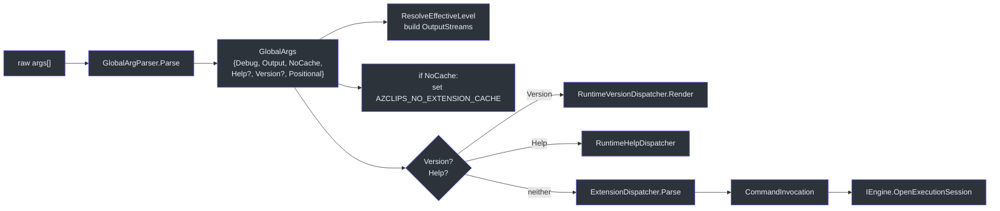
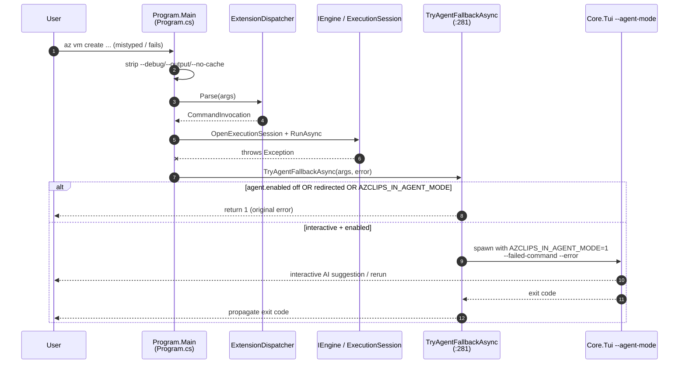

# CLI Usage

## Why the CLI Works This Way

The `az` binary is a thin front door over the Core engine. It does almost no business logic itself — instead it parses a handful of **global flags**, converts your arguments into a `CommandInvocation`, and hands off to `IEngine`. Command _surfaces_ (like `group`, `vm`, `config`) are not compiled into the CLI; they are **extensions** loaded dynamically at runtime, and their authoritative documentation lives as Markdown under `src/CLI/Help/Docs/`. This keeps the CLI small and lets new command groups ship without changing `Program.cs`.

## Command Surface

The installed command groups are documented under `src/CLI/Help/Docs/` — each folder is a verb: `config`, `deployment`, `disk`, `extension`, `group`, `login`, `logout`, `profile`, `rest`, and `vm`. These `index.md` files are the authoritative command surface. Representative examples:

| Command                 | Example                                                                                                   | Docs                                   |
| ----------------------- | --------------------------------------------------------------------------------------------------------- | -------------------------------------- |
| Create a resource group | `az group create --name myrg --location eastus --subscription-id <sub>`                                   | `src/CLI/Help/Docs/group/index.md`     |
| List resource groups    | `az group list --subscription-id <sub>`                                                                   | `src/CLI/Help/Docs/group/index.md`     |
| Manage VMs              | `az vm create ... / az vm list / az vm show`                                                              | `src/CLI/Help/Docs/vm/index.md`        |
| Get/set/list config     | `az config get --key output.format` · `az config set --key output.format --value json` · `az config list` | `src/CLI/Help/Docs/config/index.md`    |
| Authenticate            | `az login --subscription-id <sub> [--use-device-code]`                                                    | `src/CLI/Help/Docs/login/index.md`     |
| Manage extensions       | `az extension add / list`                                                                                 | `src/CLI/Help/Docs/extension/index.md` |
| Raw ARM call            | `az rest ...`                                                                                             | `src/CLI/Help/Docs/rest/index.md`      |

Configuration keys use dot notation (e.g. `output.format`, `core.debug`) and persist to your local config file (`src/CLI/Help/Docs/config/index.md`).

## Global Flags

Before dispatch, `Program.Main` calls `GlobalArgParser.Parse` once to classify every global flag in a single pass, returning a `GlobalArgs` record consumed by the rest of `Main`.

| Flag                                                      | Effect                                                                                                                                                                         | Modeled as                                |
| --------------------------------------------------------- | ------------------------------------------------------------------------------------------------------------------------------------------------------------------------------ | ----------------------------------------- |
| `--debug`                                                 | Raises the effective log level for the invocation.                                                                                                                             | `GlobalArgs.Debug` (bool)                 |
| `--output json\|jsonc\|table\|tsv\|yaml\|yamlc` (also `--output=json`, `-o json`) | Selects both command-result rendering and error shape (`json`/`jsonc` render errors as `{ "error": { code, message, details } }`; the others render plain-text errors). Defaults to `clients.cli.output.format` config when not passed. `jsonc`/`yamlc` colorize subject to `core.output.color`'s gating; `json`/`yaml` never colorize. Unknown values raise a usage error at parse time. | `GlobalArgs.Output` (`OutputFormat?` enum) |
| `--no-cache`                                              | Bypasses the extension cache by setting `AZCLIPS_NO_EXTENSION_CACHE=true`. The env-var mutation lives at the call site in `Program.Main`, not in the parser.                   | `GlobalArgs.NoCache` (bool)               |
| `--help` / `-h` / `-?` / `?` / `help` subcommand          | Classified as root or extension-scoped help.                                                                                                                                   | `GlobalArgs.Help` (`HelpRequest?`)        |
| `--version` / `version`                                   | Classified as text (flag form) or JSON (verb form).                                                                                                                            | `GlobalArgs.Version` (`VersionRequest?`)  |

See [`GlobalArgParser.Parse`](../../src/CLI/Parser/GlobalArgParser.cs) for the classifier and [`GlobalArgs`](../../src/CLI/Parser/GlobalArgs.cs) for the record shape. All matching is position-insensitive and case-insensitive.



## Help Dispatch

Help is a **record field**, not an exception. `GlobalArgParser.Parse` classifies the invocation into `GlobalArgs.Help` (a `HelpRequest?`); `Program.Main` branches on it before calling `ExtensionDispatcher.Parse`. An empty `Help.Path` is root help (`az`, `az --help`, `az help`); a non-empty path (e.g. `["vm"]` or `["vm", "create"]`) is extension-scoped help dispatched through [`RuntimeHelpDispatcher.RenderExtensionHelp`](../../src/CLI/Help/RuntimeHelpDispatcher.cs).

Bare `az` (no arguments at all) also produces `Help.Path == []` — same rendering path — with one difference: `Program.Main` captures `IsBareInvocation = args.Length == 0` before any parsing and, on that path only, prints an ASCII `AzCLIPS` banner ([`WelcomeBanner`](../../src/CLI/Help/WelcomeBanner.cs)) above the help output. `az --help`, `az -h`, and `az help` do **not** print the banner — keeping their output grep-friendly for scripts.

## Shell Completions

Tab-completion metadata is produced by `CompletionGenerator`, which emits a JSON completion tree built from `ExtensionIndex` metadata (`src/CLI/Completions/CompletionGenerator.cs:17`). It is triggered by `--completions` as the first argument and is handled _after_ DI initialization so it can resolve `IEngine` directly (`src/CLI/Program.cs:56`):

```bash
az --completions            # full tree
az --completions vm         # commands in the vm group
az --completions vm create  # metadata for a specific command
```

The generator handles requests in `TryHandleAsync` (`src/CLI/Completions/CompletionGenerator.cs:28`) and ships shell scripts alongside it: `az.completions.bash`, `az.completions.zsh`, and `az.completions.ps1` (in `src/CLI/Completions/`).

## Profiles

Commands accept a `--profile` override, and a global profile can be configured so subsequent commands reuse the same account context. Profile state is persisted under the LocalApplicationData `.azclips` root (`src/Core/Core.Abstractions/HomePaths.cs:47`), and PowerShell exposes the mirror `Get-AzProfile` / `Set-AzProfile` cmdlets.

## The AI Agent-Mode Fallback

The CLI's most distinctive UX is what happens when a command _fails_. On an unhandled exception, `Program.Main` calls `TryAgentFallbackAsync` (`src/CLI/Program.cs:281`). Rather than hosting AI in-process, it **spawns the TUI as a child process** in `--agent-mode`, handing over the failed command and error text so the agent can suggest or run a corrected command interactively.

Crucially, this only happens when it is safe:

- `agent.enabled` must be `true` (opt-in; off by default). Enable it with `az config set --key agent.enabled --value true`.
- The session must be an interactive TTY — if stdin or stdout is redirected (CI, a pipe, an unattended script), the fallback is skipped and the original error is surfaced (`src/CLI/Program.cs:308`).
- A recursion guard: if `AZCLIPS_IN_AGENT_MODE == 1`, no nested agent is spawned (`src/CLI/Program.cs:315`).



The child inherits stdio directly so streaming tokens, y/n approvals, and device-code links all render live in your terminal (`src/CLI/Program.cs:332`). The parent intercepts Ctrl+C (leaving cancellation to the child) to avoid a "terminal hijack" where the shell prompt redraws over the child's output (`src/CLI/Program.cs:354`).

## References

- [`src/CLI/Parser/GlobalArgParser.cs`](../../src/CLI/Parser/GlobalArgParser.cs) — single-pass classifier for `--debug`, `--output`, `--no-cache`, `--help`, `--version`.
- [`src/CLI/Parser/GlobalArgs.cs`](../../src/CLI/Parser/GlobalArgs.cs) — the `GlobalArgs` / `HelpRequest` / `VersionRequest` record family.
- `src/CLI/Program.cs` — `TryAgentFallbackAsync` agent-mode fallback.
- [`src/CLI/Parser/ExtensionDispatcher.cs`](../../src/CLI/Parser/ExtensionDispatcher.cs) — extension routing (help / version dispatched upstream).
- `src/CLI/Help/Docs/config/index.md` — authoritative `config` command surface.
- `src/CLI/Completions/CompletionGenerator.cs:17` — shell completion tree generator.
