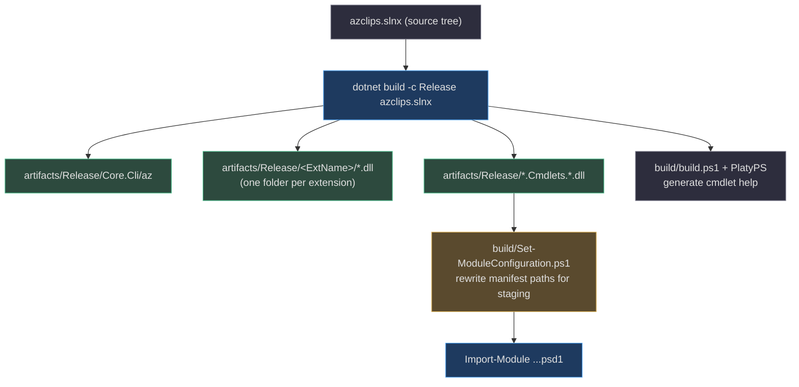
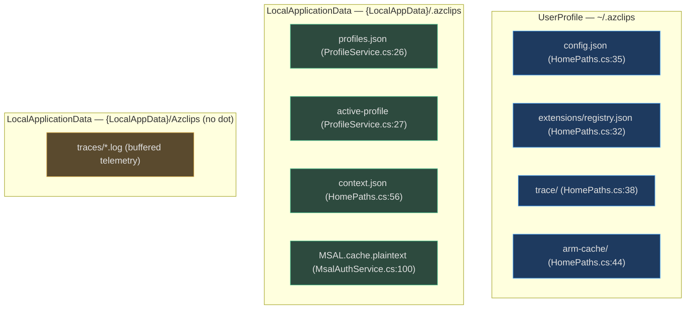

# Environment Setup

## Why This Page Matters

Azclips is a multi-surface product (CLI, PowerShell, TUI, agent) built from **one** solution, so a correct environment means one pinned SDK and one `dotnet build`. The two things newcomers get wrong are (1) using the wrong .NET SDK — the repo pins an exact version and treats warnings as errors, so a mismatched SDK fails the build outright — and (2) assuming there is a single "home" directory. In reality Azclips writes to **three different roots**, which matters the moment you try to back up, clear, or debug state. This page nails both down from source.

Remember the naming split: the repository is `Azure/cirrus`, the product identity is **Azclips** (`Shared.props:3`). The built binary is `az` (`src/CLI/Core.Cli.csproj:4`).

## Prerequisites

| Requirement | Version / detail | Why | Source |
| --- | --- | --- | --- |
| .NET SDK | **`10.0.203`**, `rollForward: latestMinor` | Whole solution is `net10.0`; build fails on a lower SDK | `global.json:1-6` |
| Target framework | `net10.0` (Nullable on, `TreatWarningsAsErrors`) | Enforced repo-wide | `src/Directory.Build.props:4-10` |
| PowerShell | **7+** | Required to import the binary PS modules (`Login.psd1` needs PS `7.5`) | `src/PS/Login/Login.psd1:36` |
| PlatyPS (optional) | `Microsoft.PowerShell.PlatyPS` | Only for generating cmdlet help artifacts | `build/Install-BuildDependencies.ps1` |

Verify your SDK matches `global.json` before anything else:

```powershell
dotnet --info      # the "Version" line must satisfy global.json (10.0.203, latestMinor)
```

## The Solution Layout

The solution file `azclips.slnx` is the map. Everything below builds from it.

| Group | Projects | Path |
| --- | --- | --- |
| CLI | `Core.Cli` (builds `az`) | `src/CLI/Core.Cli.csproj` (`azclips.slnx:3-5`) |
| Core libraries (**10**) | Abstractions, Authentication, Engine, Telemetry, Runtime, DependencyInjection, AssemblyLoading, ArgumentParsing, Configuration, Extensions | `src/Core/` (`azclips.slnx:6-17`) |
| Built-in extensions (**6**) | ExtensionRuntime, Extension, Resources, Login, Config, Compute | `src/Extensions/` (`azclips.slnx:18-25`) |
| Terminal UI | `Core.Tui` | `TUI/Core.Tui.csproj` (`azclips.slnx:26-28`) |
| Agent (**3** projects) | `Core.Agent` (→ `azclips-agent`), `Core.Agent.Tools`, `Agent.Commands` | `Agent/` (`azclips.slnx:29-32`) |
| PowerShell modules (**6** folders) | Az, Common, Compute, Config, Login, Resources | `src/PS/` |
| Tests & tooling | `Cli.Tests`, `Cmdlets.Tests`, `Core.*.Tests`, `Benchmark`, help tool | `tests/`, `tools/Help` (`azclips.slnx:36-48`) |

> Not every `src/PS/` folder is a compiled project: `azclips.slnx:50-55` lists four binary cmdlet projects (Resources, Compute, Login, Config), while `Az` is a rollup manifest and `Common` is a shared helper library. `src/PS/TelemetryHelper.ps1` is a plain script shared across modules.

## Building

`Shared.props` gives every project a deterministic output path keyed by its `ExtName`, so each extension lands in its own folder:

```
<OutputPath>$(RepoArtifacts)$(Configuration)/$(ExtName)/</OutputPath>   # Shared.props:9
```



**Typical commands:**

```powershell
# Full solution (Release). Debug is the default and is what CI's fast lane uses.
dotnet build -c Release azclips.slnx

# Convenience wrapper: build + stage PS modules + generate help.
./build/build.ps1

# Run the freshly built CLI
./artifacts/Release/Core.Cli/az --help
```

The PowerShell manifests reference built assemblies by relative path (e.g. `../../../artifacts/Debug/...` in `src/PS/Compute/Compute.psd1:59-66`); `build/Set-ModuleConfiguration.ps1` rewrites those to absolute paths when staging so PowerShell's `RequiredAssemblies` resolver can find them.

## Where Azclips Writes State — Three Roots

This is the single most surprising thing about the environment. Config, profiles/auth, and telemetry each use a **different** base directory (`src/Core/Core.Abstractions/HomePaths.cs`, `src/Core/Core.Runtime/ProfileService.cs`).



| State | Path | Root API | Source |
| --- | --- | --- | --- |
| Config | `~/.azclips/config.json` | `HomePaths.GetDefaultConfigFilePath` | `src/Core/Core.Abstractions/HomePaths.cs:35` |
| Extension registry | `~/.azclips/extensions/registry.json` | `HomePaths.GetDefaultRegistryPath` | `src/Core/Core.Abstractions/HomePaths.cs:32` |
| Agent trace (opt-in) | `~/.azclips/trace/` | `HomePaths.GetDefaultTraceDirectory` | `src/Core/Core.Abstractions/HomePaths.cs:38` |
| ARM cache | `~/.azclips/arm-cache/` | `HomePaths.GetDefaultArmCacheDirectory` | `src/Core/Core.Abstractions/HomePaths.cs:44` |
| Profiles + active pointer | `{LocalAppData}/.azclips/profiles.json`, `active-profile` | `ProfileService` ctor | `src/Core/Core.Runtime/ProfileService.cs:15-27` |
| Auth context | `{LocalAppData}/.azclips/context.json` | `HomePaths.GetDefaultAuthContextFilePath` | `src/Core/Core.Abstractions/HomePaths.cs:56` |

> On Windows these are three *different* directories: `%USERPROFILE%\.azclips`, `%LOCALAPPDATA%\.azclips`, and `%LOCALAPPDATA%\Azclips`. `HomePaths.GetDefaultHomeRoot` resolves `~` from `SpecialFolder.UserProfile` (`src/Core/Core.Abstractions/HomePaths.cs:23`), while `GetDefaultLocalAppDataRoot` uses `SpecialFolder.LocalApplicationData` (`src/Core/Core.Abstractions/HomePaths.cs:50`).

## Verifying the Install

```powershell
dotnet --info                                   # SDK matches global.json
./artifacts/Release/Core.Cli/az --version       # CLI runs
Import-Module ./src/PS/Login/Login.psd1         # PS module imports (initializes DI)
```

Importing `Login.psd1` triggers `ModuleInitializer.OnImport`, which calls `AzclipsServiceProvider.Initialize(ClientType.PowerShell)` (`src/PS/Login/ModuleInitializer.cs:24`) — proof the shared engine wired up correctly. See [PowerShell Module Usage](/01-getting-started/powershell-usage) for details.

## References

- `global.json:1-6` — pinned SDK `10.0.203`, `rollForward: latestMinor`
- `src/Directory.Build.props:4-10` — `net10.0`, Nullable, `TreatWarningsAsErrors`
- `azclips.slnx:3-55` — the full solution layout
- `Shared.props:9` — `OutputPath=$(RepoArtifacts)$(Configuration)/$(ExtName)/`
- `src/CLI/Core.Cli.csproj:4` — `AssemblyName=az`
- `src/Core/Core.Abstractions/HomePaths.cs:12,23,32-56` — `~/.azclips` roots and path helpers
- `src/Core/Core.Runtime/ProfileService.cs:15-27` — profiles + active pointer under LocalAppData
- `build/build.ps1`, `build/Install-BuildDependencies.ps1`, `build/Set-ModuleConfiguration.ps1` — build + module staging + help generation
- `src/PS/Compute/Compute.psd1:59-66` — relative `RequiredAssemblies` rewritten at staging
