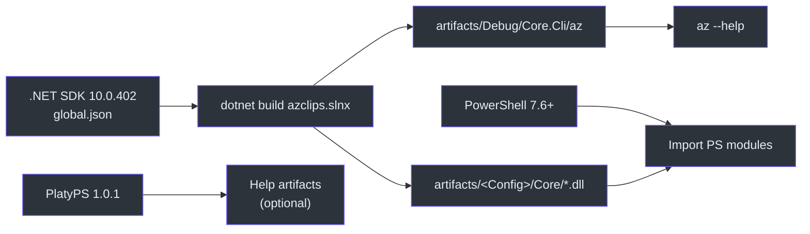
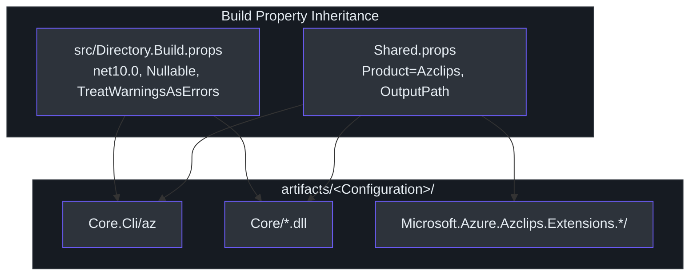

# Environment Setup

## Why This Matters

Project Azclips is a multi-project .NET 10 solution that produces both a native-style `az` binary and a set of PowerShell modules that load the *same* compiled Core assemblies. Because the PowerShell manifests reference DLLs by their build-output path (for example `../../../artifacts/Debug/Core/Core.Engine.dll` in `src/PS/Compute/Compute.psd1:60`), your toolchain and output layout must match what the projects expect. Getting the SDK version, output paths, and shared build properties right up front is what makes every downstream surface — CLI, PowerShell, TUI — work from a single `dotnet build`.

## Prerequisites

| Requirement | Version | Why | Source |
| --- | --- | --- | --- |
| .NET SDK | **10.0.402** (roll-forward `latestMinor`) | Target framework is `net10.0` | `global.json:3` |
| PowerShell | **7.6+** | Minimum declared by the Az rollup manifest | `src/PS/Az/Az.psd1:10` |
| Azure subscription | — | Live ARM calls; not required for scenario playback | `tests/Scenario.Tests/README.md:7` |
| PlatyPS | **1.0.1** (only for help artifacts) | `-GenerateHelpArtifacts`; auto-installed by `build/Install-BuildDependencies.ps1` | `build/Install-BuildDependencies.ps1:1` |
| Node.js / npm | **24** for the wiki CI environment | Wiki site and TypeScript toolkit; separate from the product solution | `.github/workflows/build-wiki.yml:47`, `toolkit/package.json:16` |

The SDK pin is deliberate. `global.json` requests `10.0.402` with `"rollForward": "latestMinor"` (`global.json:1`). Resolution stays within the requested major version and cannot select a version below the requested one. Use `dotnet --version` from the repository root to verify what actually resolves; do not assume an older 10.0.2xx SDK satisfies this pin.



## Solution Layout

The solution is defined in the modern XML `azclips.slnx` format (`azclips.slnx:1`). It groups projects into logical folders:

| Folder | Projects | Role |
| --- | --- | --- |
| `/src/CLI/` | `Core.Cli` | The `az` binary entry point. |
| `/src/Core/` | `Core.Abstractions`, `Core.Authentication`, `Core.Engine`, `Core.Telemetry`, `Core.Runtime`, `Core.DependencyInjection`, `Core.AssemblyLoading`, `Core.ArgumentParsing`, `Core.Configuration`, `Core.Extensions` | The 10-project core engine. |
| `/src/Extensions/` | `Extension`, `Resources`, `Accounts`, `Config`, `Compute`, `Network`, `KeyVault`, `ManagedServiceIdentity`, `MsGraph`, `Storage` | Ten command extension projects plus the shared `ExtensionRuntime`; presence in the solution does not guarantee every command is exposed. |
| `/TUI/` | `Core.Tui` | Interactive terminal UI / agent-mode host. |
| `/Agent/` | `Core.Agent`, `Core.Agent.Tools`, `Agent.Commands` (+ tests) | Copilot SDK host, tools, and agent/troubleshoot commands. |
| `/src/PS/` | Accounts, Compute, Config, Resources, Network, KeyVault, ManagedServiceIdentity, MsGraph, Storage | Nine feature modules, with an `Az` rollup manifest. |
| `/tests/` | CLI, cmdlet, Core, extension-specific, recording, scenario, benchmark, and fixture projects | See [Testing & Benchmarking](../02-deep-dive/testing-benchmarking.md). |
| `/tools/` | Help tools and `Azclips.ExtensionSidecar` | Help validation/export and extension routing metadata generation. |
| `/toolkit/` | TypeScript workspaces and a separate .NET generator host | TypeSpec-to-extension compiler; built separately from `azclips.slnx`. |

## Building

The repository's default build produces Debug artifacts, matching the development manifests:

```bash
# From the repo root
dotnet build azclips.slnx

# The CLI binary lands here:
./artifacts/Debug/Core.Cli/az --help

# Add it to PATH for convenience:
export PATH="$PWD/artifacts/Debug/Core.Cli:$PATH"
```

For Release artifacts use `dotnet build -c Release azclips.slnx` and the corresponding
`artifacts/Release` paths. Configure/stage PowerShell manifests with
`build/Set-ModuleConfiguration.ps1` for the intended configuration rather than importing a
Debug-pointing source manifest after a Release-only build (`AGENTS.md:29`).
PowerShell helper scripts live under `build/`:

| Script | Purpose |
| --- | --- |
| `build/build.ps1` | Orchestrated build wrapper. |
| `build/Install-BuildDependencies.ps1` | Installs PlatyPS 1.0.1 and other build deps. |
| `build/New-PSHelpMarkdown.ps1` | Generates PowerShell help markdown. |
| `build/Set-ModuleConfiguration.ps1` | Configures module manifests. |

The TypeScript toolkit has its own build boundary. See [TypeSpec Code Generation](../02-deep-dive/typespec-code-generation.md) before generating or regenerating an extension.

## Output & Artifact Conventions

Output paths are driven centrally by `Shared.props`. Every project writes to `artifacts/$(Configuration)/$(ExtName)/` and does **not** append the target framework to the path (`Shared.props:8`):

```xml
<AppendTargetFrameworkToOutputPath>false</AppendTargetFrameworkToOutputPath>
<OutputPath>$(RepoArtifacts)$(Configuration)/$(ExtName)/</OutputPath>
<PublishDir>$(OutputPath)</PublishDir>
```

That is why the CLI ends up at `artifacts/Release/Core.Cli/az` and Core DLLs at `artifacts/<Config>/Core/*.dll` — exactly the locations the `.psd1` manifests hard-reference (`src/PS/Compute/Compute.psd1:59`).

Shared compiler behavior comes from `src/Directory.Build.props`, which every project imports (`src/Directory.Build.props:1`):

| Property | Value | Effect |
| --- | --- | --- |
| `TargetFramework` | `net10.0` | .NET 10 everywhere (`:4`). |
| `ImplicitUsings` | `enable` | Global usings on (`:5`). |
| `Nullable` | `enable` | Nullable reference types on (`:6`). |
| `TreatWarningsAsErrors` | `true` | Warnings fail the build (`:10`). |
| `EnableNETAnalyzers` / `AnalysisLevel` | `true` / `latest` | Latest analyzer rules (`:7`). |



## Where User State Lands

At runtime, user-scoped state uses the home root centralized in `HomePaths`:

- `~/.azclips/` — `config.json`, `extensions/`, profiles, authentication stores,
  `data-boundary-cache.json`, telemetry under `traces/`, and Agent program data under `agent/`.

`context.json` is no longer the profile store. `AZCLIPS_HOME` overrides this root, allowing
scenario tests to isolate all state from the developer's normal login and configuration
(`src/Core/Core.Abstractions/HomePaths.cs:19`, `src/Core/Core.Abstractions/HomePaths.cs:36`).
Old trace and boundary-cache files under `{LocalApplicationData}/.azclips` are not read
or migrated automatically.

## Verify Your Setup

Confirm your SDK resolves to what `global.json` pins:

```bash
dotnet --info        # SDK must satisfy global.json (10.0.402 or compatible roll-forward)
dotnet --version     # Honors global.json roll-forward
```

If `dotnet --version` reports a 9.x SDK or errors on the pin, install the .NET 10 SDK before building.

## References

- `global.json:1` — SDK pin `10.0.402`, `rollForward: latestMinor`.
- `azclips.slnx:1` — solution layout (CLI, Core, Extensions, TUI, Agent, PS, tests, tools).
- `Shared.props:8` — `OutputPath` / artifacts convention.
- `src/Directory.Build.props:1` — shared build properties (`net10.0`, Nullable, TreatWarningsAsErrors).
- `src/PS/Az/Az.psd1:10` — PowerShell 7.6 minimum and rollup modules.
- `src/Core/Core.Abstractions/HomePaths.cs:12` — `~/.azclips` and LocalApplicationData roots.
- `src/PS/Compute/Compute.psd1:59` — PowerShell manifest referencing artifact DLLs.
