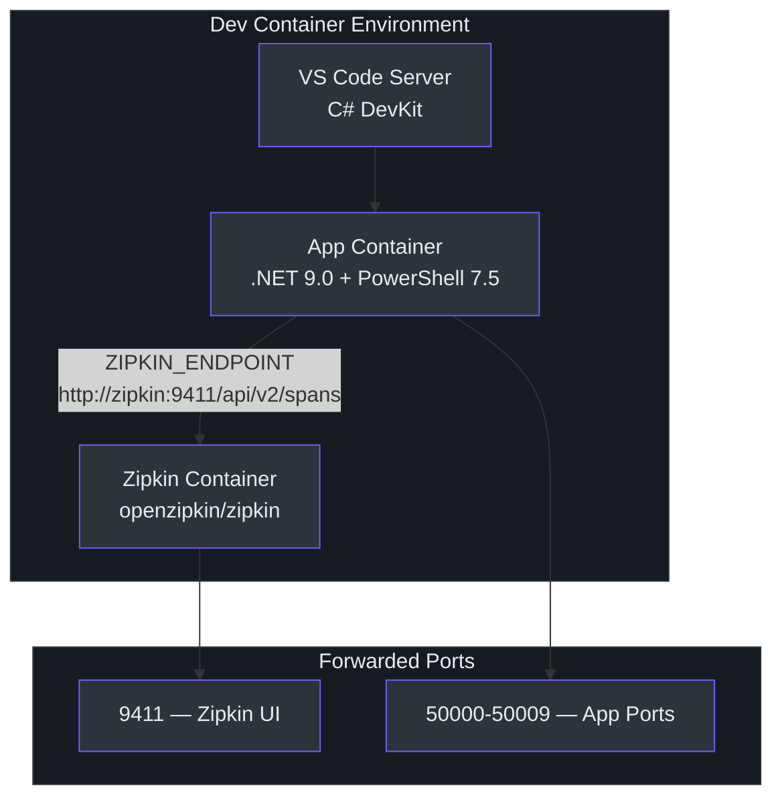
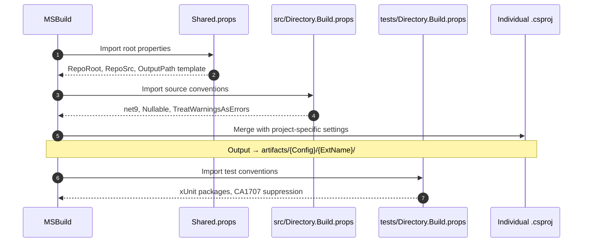

# Environment Setup & Development

## Prerequisites

| Requirement | Version / Detail | Source |
|-------------|-----------------|--------|
| **.NET SDK** | 9.0.308 (`latestMinor` roll-forward) | `global.json:3` |
| **PowerShell** | 7.5+ (Core edition) | `src/PS/Login/Login.psd1:36` |
| **Docker** | Required for dev container | `.devcontainer/docker-compose.yml` |
| **VS Code** | With C# DevKit extension | `.devcontainer/devcontainer.json:71-73` |
| **Git** | Any recent version | — |

::: tip
The fastest path to a working environment is the **VS Code Dev Container**. It installs the SDK, PowerShell, browser helpers, and Zipkin automatically.
:::

## Dev Container Setup

The repository ships a complete multi-container development environment defined in `.devcontainer/`. Opening the repo in VS Code and selecting **"Reopen in Container"** provisions everything needed.

### Container Architecture



### Docker Compose Services

The `docker-compose.yml` (`.devcontainer/docker-compose.yml:1-30`) defines two services:

**App service** (`docker-compose.yml:2-16`) — the primary development container built from `Dockerfile` with the workspace mounted at `/workspaces/cirrus:cached`. Environment variables `ZIPKIN_ENDPOINT` and `BROWSER` are injected automatically. The container runs `sleep infinity` so VS Code can attach.

**Zipkin service** (`docker-compose.yml:18-30`) — the `openzipkin/zipkin` image exposes port **9411** with a health check (every 5 s, 3 s timeout, 5 retries, 10 s start period). Restart policy is `unless-stopped`.

### Post-Create Script

`.devcontainer/post-create.sh` runs once after the container is built:

1. Installs `platyPS` PowerShell module for help generation (`post-create.sh:5`).
2. Installs `Az.Accounts` for Azure context support (`post-create.sh:8`).
3. Appends the CLI artefact directory to `PATH` in `.bashrc` (`post-create.sh:12-17`).
4. Creates browser symlinks (`xdg-open`, `gnome-open`, `kfmclient`) so MSAL interactive auth can open VS Code's embedded browser (`post-create.sh:24-30`).

### Post-Start Script

`.devcontainer/post-start.sh` runs on every container start and re-creates the browser symlinks to ensure MSAL authentication flows work after container restarts.

### Environment Variables

| Variable | Value | Set In |
|----------|-------|--------|
| `PATH` | Includes `artifacts/Debug/Core.Cli` and `artifacts/Release/Core.Cli` | `devcontainer.json:60-61` |
| `BROWSER` | VS Code browser helper path | `devcontainer.json:62` |
| `ZIPKIN_ENDPOINT` | `http://zipkin:9411/api/v2/spans` | `devcontainer.json:63` |
| `AZURECLI_FLAVOR` | `"azure cli"` (default) or `"azure powershell"` | Runtime |
| `AZURE_OPENAI_ENDPOINT` | Your Azure OpenAI endpoint | `.env` file |
| `AZURE_OPENAI_API_KEY` | API key | `.env` file |
| `AZURE_OPENAI_DEPLOYMENT` | Deployment name | `.env` file |

## Building the Solution

### Quick Build

```bash
dotnet build cirrus.slnx
```

The PowerShell build wrapper (`build/build.ps1:1`) does the same:

```powershell
dotnet build "$PSScriptRoot/../cirrus.slnx"
```

### Release Build

```bash
dotnet build -c Release cirrus.slnx
```

### Build Properties

The build system uses a layered MSBuild property hierarchy:



**`Shared.props:2-11`** defines the artefact layout. Key properties:

| Property | Value | Effect |
|----------|-------|--------|
| `RepoArtifacts` | `$(RepoRoot)artifacts/` | Root output directory |
| `OutputPath` | `$(RepoArtifacts)$(Configuration)/$(ExtName)/` | Per-extension output |
| `AppendTargetFrameworkToOutputPath` | `false` | Flattens TFM folder |

**`src/Directory.Build.props:4-10`** enables strict code analysis:

- `TargetFramework` = `net9`
- `Nullable` = `enable`
- `TreatWarningsAsErrors` = `true`
- `EnforceCodeStyleInBuild` = `true`
- `AnalysisLevel` = `latest`

**`tests/Directory.Build.props:11-13`** relaxes these for test projects — warnings are **not** treated as errors and `CA1707` (underscores in identifiers) is suppressed to allow `Method_Should_When` naming.

### Artefact Output

After a successful build the `artifacts/` directory contains:

```
artifacts/
├── Debug/
│   ├── Core.Cli/
│   │   └── azv2              ← CLI executable
│   ├── Core/                 ← Shared core DLLs
│   ├── Microsoft.Azure.Cirrus.Extensions.Login/
│   ├── Microsoft.Azure.Cirrus.Extensions.Resources/
│   └── Microsoft.Azure.Cirrus.Extensions.Extension/
└── Release/                  ← Same structure
```

## Running the CLI

Once built, the CLI is available at:

```bash
# Debug build (default)
./artifacts/Debug/Core.Cli/azv2

# Release build
./artifacts/Release/Core.Cli/azv2
```

Inside the dev container, both paths are on `PATH` (`devcontainer.json:60-61`), so you can invoke:

```bash
azv2 --help
azv2 group list -SubscriptionId <id>
azv2 "create a resource group named test in eastus"
```

## Running Tests

### Unit Tests

```bash
dotnet test tests/Cli.Tests/Cli.Tests.csproj
```

### With Coverage

```bash
dotnet test --collect:"XPlat Code Coverage"
```

Coverage is collected via **Coverlet 6.0.4** (`tests/Directory.Build.props:17`). The test SDK uses **Microsoft.NET.Test.Sdk 17.14.1** and **xUnit 2.9.3** (`tests/Directory.Build.props:18-19`).

### CI Pipeline Tests

The GitHub Actions workflow `.github/workflows/build-and-test.yml` runs on every PR:

1. `dotnet restore` → `dotnet build` → `dotnet test`
2. **E2E CLI**: executes `./artifacts/Debug/Core.Cli/azv2 --help` to verify the binary starts.
3. **E2E PowerShell**: imports the Login module and verifies exported commands:
   ```powershell
   Import-Module ./src/PS/Login/Login.psd1
   Get-Command -Module Login
   ```

## VS Code Debug Configurations

`.vscode/launch.json` defines **seven** launch profiles. All use `coreclr` type and launch the `azv2` binary from `artifacts/Debug/Core.Cli/` with `integratedTerminal` console. A `dotnet: build` pre-launch task (`.vscode/tasks.json:4-13`) compiles the solution first.

| # | Profile                     | Purpose | Key Args |
|---|-----------------------------|---------|----------|
| 1 | `.NET Core Attach`          | Attach debugger to running process | — |
| 2 | `C#: group create Debug`    | Test resource group creation | `group create -SubscriptionId … -Name yabo-test-group-1 -Location eastus` |
| 3 | `C#: group show Debug`      | Test resource group retrieval | `group show -SubscriptionId … -Name …` |
| 4 | `C#: login show Debug`      | Test login status | `login show` |
| 5 | `C#: logout Debug`          | Test logout | `login logout` |
| 6 | `az: natural language (AI)` | Test AI fallback with a prompt | `"create a resource group"` |
| 7 | `az: help`                  | Test help output | `--help` |

All profiles point to the same program path (`launch.json:18`):

```
${workspaceFolder}/artifacts/Debug/Core.Cli/azv2
```

## Telemetry & Tracing

Cirrus uses **OpenTelemetry 1.8.1** for distributed tracing. In DEBUG builds, traces export to the local Zipkin container via the `ZIPKIN_ENDPOINT` environment variable.

| Package | Version | Condition |
|---------|---------|-----------|
| `OpenTelemetry` | 1.8.1 | Always |
| `OpenTelemetry.Instrumentation.Http` | 1.8.1 | Always |
| `OpenTelemetry.Exporter.Zipkin` | 1.8.1 | DEBUG only |
| `Azure.Monitor.OpenTelemetry.Exporter` | 1.2.0 | Release |

To view traces, navigate to **http://localhost:9411** in your browser (port forwarded by the dev container at `devcontainer.json:45-48`).

## AI Agent Configuration

The `AgentEngine` requires Azure OpenAI credentials. Create a `.env` file in `src/Core/Core.Agent/` (see `.env.example`):

```env
AZURE_OPENAI_ENDPOINT=https://<resource>.openai.azure.com/
AZURE_OPENAI_API_KEY=<key>
AZURE_OPENAI_DEPLOYMENT=<deployment-name>
```

`CloudAgent.CreateAsync()` (`src/Core/Core.Agent/CloudAgent.cs:35-50`) searches for this file in four locations: `AppContext.BaseDirectory`, current directory, assembly directory, and `bin/`.

## Common Issues & Solutions

| Issue | Cause | Fix |
|-------|-------|-----|
| `dotnet build` fails with SDK error | Wrong SDK version | Run `dotnet --info` and compare with `global.json:3` (expects 9.0.308) |
| MSAL browser window doesn't open | Missing symlinks | Re-run `.devcontainer/post-start.sh` or recreate symlinks manually |
| Zipkin UI unavailable | Container not healthy | Run `docker compose -f .devcontainer/docker-compose.yml ps` and check health |
| `CA1707` warnings in tests | Underscore naming convention | Already suppressed in `tests/Directory.Build.props:12` — verify import chain |
| Extension DLL not found | Build output mismatch | Ensure `Shared.props:6-8` `$(ExtName)` is set correctly in the extension `.csproj` |
| AI agent returns no response | Missing `.env` | Create `.env` with OpenAI credentials in `src/Core/Core.Agent/` |
| PowerShell module won't import | Missing assemblies | Build the solution first — module manifests reference `artifacts/Debug/Core/` DLLs |

## References

| Source | Path |
|--------|------|
| Dev container config | `.devcontainer/devcontainer.json` |
| Docker Compose | `.devcontainer/docker-compose.yml` |
| Post-create setup | `.devcontainer/post-create.sh` |
| Post-start script | `.devcontainer/post-start.sh` |
| SDK version | `global.json` |
| Root build properties | `Shared.props` |
| Source build properties | `src/Directory.Build.props` |
| Test build properties | `tests/Directory.Build.props` |
| Debug configurations | `.vscode/launch.json` |
| Build tasks | `.vscode/tasks.json` |
| Build script | `build/build.ps1` |
| Solution file | `cirrus.slnx` |
| CI workflow | `.github/workflows/build-and-test.yml` |
| Cloud agent config | `src/Core/Core.Agent/CloudAgent.cs` |
