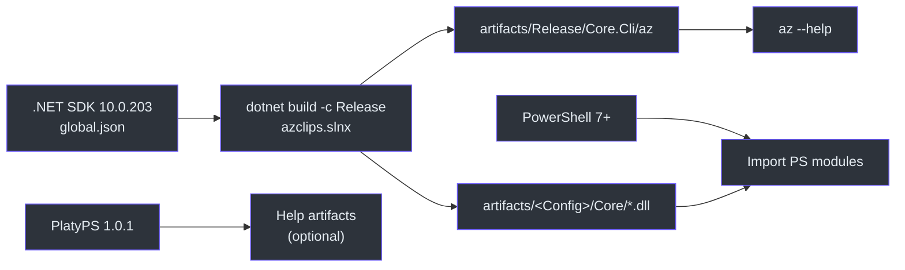
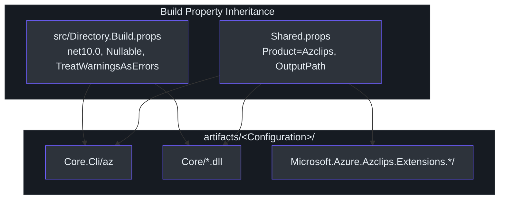

# Environment Setup

## Why This Matters

Project Azclips is a multi-project .NET 10 solution that produces both a native-style `az` binary and a set of PowerShell modules that load the *same* compiled Core assemblies. Because the build stages each PowerShell module as a self-contained folder under `artifacts/<Config>/PS/<Module>/`, whose manifest loads its payload by module-relative paths (for example `Core/Core.Engine.dll` in `src/PS/Compute/Compute.psd1:60`), your toolchain and output layout must match what the projects expect. Getting the SDK version, output paths, and shared build properties right up front is what makes every downstream surface — CLI, PowerShell, TUI — work from a single `dotnet build`.

## Prerequisites

| Requirement | Version | Why | Source |
| --- | --- | --- | --- |
| .NET SDK | **10.0.203** (roll-forward `latestMinor`) | Target framework is `net10.0` | `global.json:3` |
| PowerShell | **7.0+** | Running the PowerShell modules | `README.md:76` |
| Azure subscription | — | Live ARM calls (`az login`, `az group create`) | `README.md:77` |
| PlatyPS | **1.0.1** (only for help artifacts) | `-GenerateHelpArtifacts`; auto-installed by `build/Install-BuildDependencies.ps1` | `README.md:78` |

The SDK pin is deliberate. `global.json` requests `10.0.203` with `"rollForward": "latestMinor"` (`global.json:1`), meaning any installed 10.0.x SDK at or above that patch is acceptable, but a 9.x or 11.x SDK is not.



## Solution Layout

The solution is defined in the modern XML `azclips.slnx` format (`azclips.slnx:1`). It groups projects into logical folders:

| Folder | Projects | Role |
| --- | --- | --- |
| `/src/CLI/` | `Core.Cli` | The `az` binary entry point. |
| `/src/Core/` | `Core.Abstractions`, `Core.Authentication`, `Core.Engine`, `Core.Telemetry`, `Core.Runtime`, `Core.DependencyInjection`, `Core.AssemblyLoading`, `Core.ArgumentParsing`, `Core.Configuration`, `Core.Extensions` | The 10-project core engine. |
| `/src/Extensions/` | `ExtensionRuntime`, `Extension`, `Resources`, `Accounts`, `Config`, `Compute` | The 6 dynamically-loaded extensions. |
| `/TUI/` | `Core.Tui` | Interactive terminal UI / agent-mode host. |
| `/Agent/` | `Core.Agent` (+ tests) | GitHub Copilot SDK integration. |
| `/src/PS/` | `Cmdlets.Resources`, `Cmdlets.Compute`, `Cmdlets.Accounts`, `Cmdlets.Config` | Mirrored PowerShell cmdlets. |
| `/tests/` | `Cli.Tests`, `Benchmark`, `Cmdlets.Tests`, `Tests.Common`, `Core.Extensions.Tests`, `Core.Telemetry.Tests`, and fixtures | Test suites. |
| `/tools/` | `Azclips.Help.Tool` (+ tests) | Help artifact generation. |

## Building

The canonical build produces a Release `az` binary:

```bash
# From the repo root
dotnet build -c Release azclips.slnx

# The CLI binary lands here:
./artifacts/Release/Core.Cli/az --help

# Add it to PATH for convenience:
export PATH="$PWD/artifacts/Release/Core.Cli:$PATH"
```

This matches the documented Quick Start (`README.md:80`). PowerShell helper scripts live under `build/`:

| Script | Purpose |
| --- | --- |
| `build/build.ps1` | Orchestrated build wrapper. |
| `build/Install-BuildDependencies.ps1` | Installs PlatyPS 1.0.1 and other build deps. |
| `build/New-PSHelpMarkdown.ps1` | Generates PowerShell help markdown. |

> **Note:** The catalogue prompt references a `scripts/deploy.sh`, but the current tree ships PowerShell build scripts under `build/` (verified: no `deploy.sh` exists). Prefer the `build/*.ps1` scripts above.

## Output & Artifact Conventions

Output paths are driven centrally by `Shared.props`. Every project writes to `artifacts/$(Configuration)/$(ExtName)/` and does **not** append the target framework to the path (`Shared.props:8`):

```xml
<AppendTargetFrameworkToOutputPath>false</AppendTargetFrameworkToOutputPath>
<OutputPath>$(RepoArtifacts)$(Configuration)/$(ExtName)/</OutputPath>
<PublishDir>$(OutputPath)</PublishDir>
```

That is why the CLI ends up at `artifacts/Release/Core.Cli/az` and Core DLLs at `artifacts/<Config>/Core/*.dll`, which the build copies into each staged module's `Core/` folder (`src/PS/PSModule.targets`).

Shared compiler behavior comes from `src/Directory.Build.props`, which every project imports (`src/Directory.Build.props:1`):

| Property | Value | Effect |
| --- | --- | --- |
| `TargetFramework` | `net10.0` | .NET 10 everywhere (`:4`). |
| `ImplicitUsings` | `enable` | Global usings on (`:5`). |
| `Nullable` | `enable` | Nullable reference types on (`:6`). |
| `TreatWarningsAsErrors` | `true` | Warnings fail the build (`:10`). |
| `EnableNETAnalyzers` / `AnalysisLevel` | `true` / `latest` | Latest analyzer rules (`:7`). |



## Where User State Lands

At runtime, user-scoped state is created under two roots, both centralized in `HomePaths`:

- `~/.azclips/` — home root for `config.json`, the `extensions/` folder, `arm-cache/`, and `trace/` (`src/Core/Core.Abstractions/HomePaths.cs:12`).
- `{LocalApplicationData}/.azclips/` — auth context and profiles, e.g. `context.json` (`src/Core/Core.Abstractions/HomePaths.cs:47`).

## Verify Your Setup

Confirm your SDK resolves to what `global.json` pins:

```bash
dotnet --info        # Version should be 10.0.x (>= 10.0.203)
dotnet --version     # Honors global.json roll-forward
```

If `dotnet --version` reports a 9.x SDK or errors on the pin, install the .NET 10 SDK before building.

## References

- `global.json:1` — SDK pin `10.0.203`, `rollForward: latestMinor`.
- `azclips.slnx:1` — solution layout (CLI, Core, Extensions, TUI, Agent, PS, tests, tools).
- `Shared.props:8` — `OutputPath` / artifacts convention.
- `src/Directory.Build.props:1` — shared build properties (`net10.0`, Nullable, TreatWarningsAsErrors).
- `README.md:71` — Prerequisites and build Quick Start.
- `src/Core/Core.Abstractions/HomePaths.cs:12` — `~/.azclips` and LocalApplicationData roots.
- `src/PS/Compute/Compute.psd1:59` — PowerShell manifest referencing its staged assemblies.
