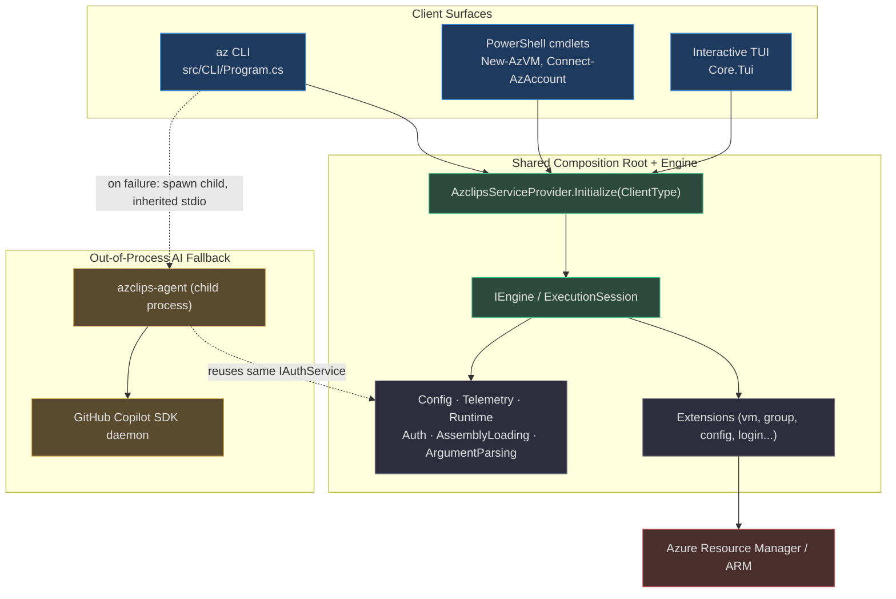
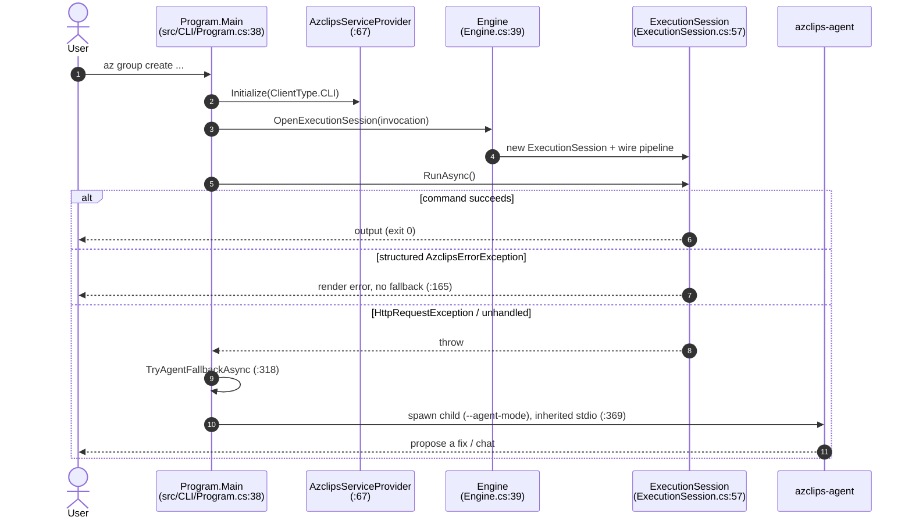

# Overview & Architecture

## Why Project Azclips Exists

Project **Azclips** is an experimental re-imagining of the Azure command-line experience. Instead of one monolithic tool, it factors the product into a small **core engine** plus a set of dynamically-loaded **extensions**, then drives that engine from several independent *client surfaces*. The single design goal that shapes everything else: **every surface runs the same code path**. A resource group created from a PowerShell cmdlet flows through the exact same `IEngine`, HTTP pipeline, authentication, and telemetry as one created from the `az` CLI — because all four surfaces converge on one dependency-injection composition root.

A naming note that trips up every new reader: **the GitHub repository is [`Azure/cirrus`](https://github.com/Azure/cirrus), but the product/code identity is `Azclips`.** These are the *same codebase*, not two projects. The MSBuild `<Product>` is `Azclips` (`Shared.props:3`), on-disk state lives under `~/.azclips` (`src/Core/Core.Abstractions/HomePaths.cs:12`), namespaces are `Core.*`, and environment variables are prefixed `AZCLIPS_` (`src/CLI/Program.cs:26`). Wherever this wiki says "Azclips," it means the code in `Azure/cirrus`.

The whole product targets **.NET 10 (`net10.0`)**, pinned to SDK `10.0.203` with `rollForward: latestMinor` (`global.json:3`) and enforced repo-wide (`src/Directory.Build.props:4`).

## The Four Client Surfaces

All four surfaces call `AzclipsServiceProvider.Initialize(...)` and resolve the same `IEngine`. Only three of them are distinct `ClientType` values — the AI agent deliberately reuses `ClientType.CLI` rather than defining its own (`src/Core/Core.Abstractions/ClientType.cs`).

| Surface | Entry point | Assembly / project | `ClientType` |
| --- | --- | --- | --- |
| **`az` CLI** | `Program.Main` (`src/CLI/Program.cs:38`) | `az` (`src/CLI/Core.Cli.csproj:4`) | `ClientType.CLI` |
| **PowerShell cmdlets** | `ProcessRecord` (e.g. `src/PS/Compute/Cmdlets/NewVMCmdlet.cs:93`) | six modules under `src/PS/` | `ClientType.PowerShell` |
| **Interactive Terminal UI** | `TUI/Program.cs` | `Core.Tui.csproj` | `ClientType.TUI` |
| **AI agent fallback** | `AgentModeEntry.RunAsync` (`Agent/AgentMode/AgentModeEntry.cs:24`) | `azclips-agent` (`Agent/Core.Agent.csproj:6`) | `ClientType.CLI` (reused) |

> **Correction vs. older docs:** The AI fallback is **not** the TUI. When a CLI command fails, `Program.TryAgentFallbackAsync` (`src/CLI/Program.cs:318`) spawns a **separate standalone executable, `azclips-agent`** (`Agent/Core.Agent.csproj:6`, `OutputType=Exe`), as a child process — it does not host an in-process agent engine and does not launch `Core.Tui`. The agent is built on the GitHub Copilot SDK, not Azure OpenAI directly.

### The codebase at a glance

| Area | Count | Location |
| --- | --- | --- |
| `Core.*` engine libraries | **10** | `src/Core/` (Abstractions, ArgumentParsing, AssemblyLoading, Authentication, Configuration, DependencyInjection, Engine, Extensions, Runtime, Telemetry) — see `azclips.slnx:6-17` |
| Built-in extensions | **6** | `src/Extensions/` (Compute, Config, Extension, ExtensionRuntime, Login, Resources) — `azclips.slnx:18-25` |
| PowerShell module folders | **6** | `src/PS/` (Az, Common, Compute, Config, Login, Resources) |
| Agent projects | **3** | `Agent/` (Core.Agent, Core.Agent.Tools, Agent.Commands) — `azclips.slnx:29-32` |

## System Context

## The CLI Happy Path

`Program.Main` is a thin host: it wires client-specific services into the shared container, initializes DI once, then hands a parsed invocation to the engine.

1. **Register + initialize DI.** `PrependRegistration` adds the CLI's extension loaders and dispatcher; `OverrideRegistration` swaps in CLI implementations of assembly loading, argument parsing, telemetry, and User-Agent; then `Initialize(ClientType.CLI)` builds the container exactly once (`src/CLI/Program.cs:57-71`).
2. **Parse global flags** (`--debug`, `--output`, `--no-cache`) and build the output streams (`src/CLI/Program.cs:91-95`).
3. **Dispatch → engine session.** The `ExtensionDispatcher` parses args into a `CommandInvocation`, then `IEngine.OpenExecutionSession` (`src/Core/Core.Abstractions/IEngine.cs:10`, implemented at `src/Core/Core.Engine/Engine.cs:39`) creates an isolated `ExecutionSession`, and `session.RunAsync()` drives the resolved processor (`src/Core/Core.Engine/ExecutionSession.cs:57`).

## The Failure Path (Opt-In AI Fallback)

`Program.Main`'s `try/catch` distinguishes three outcomes (`src/CLI/Program.cs:158-181`):

- **`AzclipsErrorException`** — a well-known, structured failure. It renders as JSON or text and returns a symbolic exit code with **no** AI fallback (`src/CLI/Program.cs:165`), because the user's intent is unambiguous.
- **`HttpRequestException`** and **any other unhandled `Exception`** — both route to `TryAgentFallbackAsync` (`src/CLI/Program.cs:163`, `:180`).

The fallback is gated and safe by default:

| Gate | Behavior | Source |
| --- | --- | --- |
| `agent.enabled` | Off by default (Private Preview). Opt in with `az config set --key agent.enabled --value true`. | `src/Core/Core.Abstractions/AgentOptions.cs:11`, checked at `src/CLI/Program.cs:329` |
| Interactive TTY guard | `interactive` session style is skipped when stdio is redirected (CI, pipes). `oneshot` is not gated. | `src/CLI/Program.cs:347` |
| `AZCLIPS_IN_AGENT_MODE` | Recursion guard — a failing `az` invoked from inside an agent session never spawns another agent. | `src/CLI/Program.cs:26`, `:355` |

When all gates pass, the CLI starts `azclips-agent` with `--agent-mode --failed-command ... --error ...` and **inherited stdio** (`RedirectStandardOutput=false`, `src/CLI/Program.cs:369-403`) so streaming tokens, approval prompts, and device-code links appear live in the user's terminal. Crucially, the agent reuses the **same** `IAuthService` the engine uses — it is not a parallel credential path (see [Authentication (MSAL)](/02-deep-dive/authentication)).

## Where to Go Next

- [Environment Setup](/01-getting-started/environment-setup) — SDK prerequisites, the solution layout, and where state lands on disk.
- [CLI Usage](/01-getting-started/cli-usage) — commands, global flags, and the error/fallback UX.
- [PowerShell Module Usage](/01-getting-started/powershell-usage) — importing modules and how cmdlets share the engine.
- [Core Engine & Orchestration](/02-deep-dive/core-engine-orchestration) — the composition root and session model in depth.

## References

- `Shared.props:3` — `<Product>Azclips</Product>` (product identity vs. the `Azure/cirrus` repo)
- `src/Core/Core.Abstractions/HomePaths.cs:12` — `~/.azclips` on-disk root
- `src/Core/Core.Abstractions/ClientType.cs` — the three `ClientType` values (PowerShell, CLI, TUI)
- `src/CLI/Program.cs:38` — `Program.Main`, the CLI entry point and error/fallback ladder
- `src/CLI/Program.cs:318` — `TryAgentFallbackAsync`, the out-of-process agent spawn
- `src/Core/Core.DependencyInjection/AzclipsServiceProvider.cs:67` — `Initialize(ClientType)` composition root
- `src/Core/Core.Abstractions/IEngine.cs:10` / `src/Core/Core.Engine/Engine.cs:39` — `OpenExecutionSession`
- `src/Core/Core.Engine/ExecutionSession.cs:57` — `RunAsync`
- `src/Core/Core.Abstractions/AgentOptions.cs:11` — `agent.enabled` opt-in gate
- `Agent/Core.Agent.csproj:6` — `AssemblyName=azclips-agent`, `OutputType=Exe`
- `global.json:3`, `src/Directory.Build.props:4` — `net10.0` / SDK `10.0.203`
- `azclips.slnx:6-32` — solution layout (10 `Core.*`, 6 extensions, agent projects)
