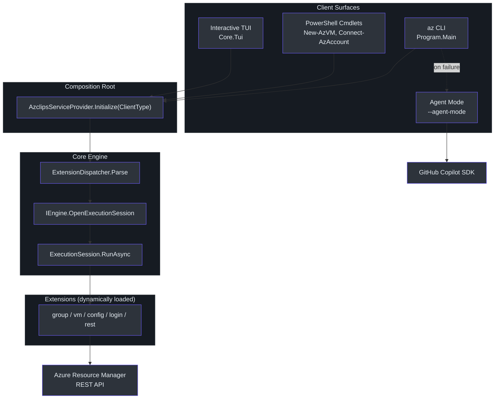
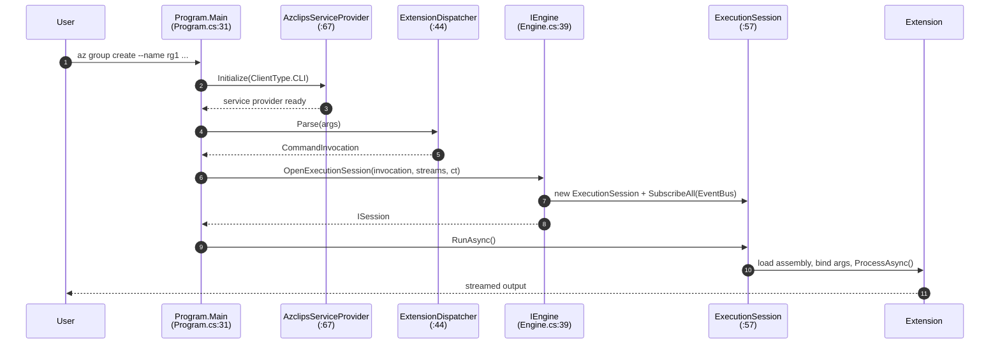
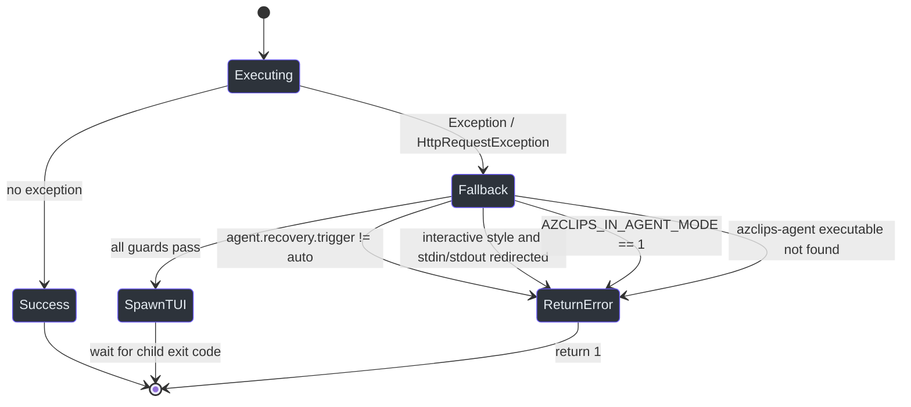

# Overview & Architecture

## Why Project Azclips Exists

Project Azclips is an experimental re-imagining of the Azure command-line experience. Instead of shipping one monolithic tool, it factors the product into a small **core engine** and a set of dynamically-loaded **extensions**, then exposes that engine through several *client surfaces* — a classic `az` CLI, mirrored PowerShell cmdlets, an interactive terminal UI (TUI), and an AI **agent mode** that takes over when a command fails. The central design goal is that *every* surface runs the **same** code path: a single dependency-injection (DI) composition root wires up identical services, so a resource group created from PowerShell behaves exactly like one created from the CLI.

The product targets **`net10.0`** (.NET 10) — not .NET 9 as some older docs imply. This is enforced repo-wide in `global.json` (`global.json:3`) and `src/Directory.Build.props` (`src/Directory.Build.props:4`). The project codename is **Azclips**: the MSBuild `<Product>` is `Azclips` (`Shared.props:3`) and user state lives under `~/.azclips` (`src/Core/Core.Abstractions/HomePaths.cs:12`). The `Azclips` name appears throughout namespaces, environment variables (`AZCLIPS_IN_AGENT_MODE`), and exception types. The shipping products are branded **Azure CLI** (the `az` binary) and **Azure PowerShell** (the cmdlet modules).

## The Four Client Surfaces

All four surfaces converge on one composition root, `AzclipsServiceProvider`, and one contract, `IEngine`.

| Surface | Entry point | `ClientType` | Notes |
| --- | --- | --- | --- |
| **CLI** (`az`) | `src/CLI/Program.cs:31` | `ClientType.CLI` | Produces the `az` binary; parses global flags then dispatches. |
| **PowerShell** | e.g. `src/PS/Compute/Cmdlets/NewVMCmdlet.cs:87` | `ClientType.PowerShell` | Cmdlets resolve `IEngine` and pump output to `WriteObject`. |
| **Interactive TUI** | `TUI/Core.Tui.csproj` | — | Terminal UI host for interactive sessions. |
| **Agent mode** | `Agent/Program.cs:9`, launched with `--agent-mode` | `ClientType.CLI` | Standalone recovery process with isolated Agent telemetry. |

> The composition root is `AzclipsServiceProvider`. AI orchestration uses the **GitHub Copilot
> SDK** with a builtin Azure-backed or GitHub provider, and runs in **`azclips-agent`**, separate
> from the CLI and the Hex1b shell (`Agent/Program.cs:9`,
> `Agent/Providers/BuiltinProviderConfig.cs:68`).

## System Context

## The Happy Path

When you run `az group create ...`, control flows through a predictable pipeline. `Program.Main` first handles the special `--upload-telemetry` mode, then registers CLI-specific services and calls `AzclipsServiceProvider.Initialize(ClientType.CLI)` (`src/CLI/Program.cs:53`). Global flags are stripped, the `ExtensionDispatcher` parses the argument vector into a `CommandInvocation` (`src/CLI/Parser/ExtensionDispatcher.cs:44`), and the engine opens a session that actually loads the extension and runs the command.

Key contract: `IEngine` is intentionally tiny (`src/Core/Core.Abstractions/IEngine.cs:8`) — it exposes `OpenExecutionSession` and `OpenDiscoverySession`. The concrete `Engine` creates a **per-invocation output channel** so that concurrent invocations (important for PowerShell) never cross-talk (`src/Core/Core.Engine/Engine.cs:39`). `ExecutionSession.RunAsync` simply wires the output writer and awaits the extension processor (`src/Core/Core.Engine/ExecutionSession.cs:57`).

## The Failure Path — AI Agent Fallback

When execution throws an unhandled or HTTP-level exception, `Program.Main` funnels it into `TryAgentFallbackAsync` (`src/CLI/Program.cs:281`). This method is deliberately conservative: it only escalates to AI when it is safe to do so.

The guards, in order (`src/CLI/Program.cs:281`–`:373`):

| Guard | Behavior | Rationale |
| --- | --- | --- |
| `agent.recovery.trigger` is not `auto` | return `1` | Opt-in feature (default `off`); fail safe if config unreadable. `manual` saves the failure for `az troubleshoot recover` instead. |
| Interactive style with redirected stdin/stdout | keep original error | Interactive recovery requires a terminal; one-shot recovery does not. |
| `AZCLIPS_IN_AGENT_MODE == 1` | return `1` | Recursion guard — a failed `az` *inside* the agent must not spawn another. |
| `azclips-agent executable` missing | return `1` | Nothing to launch. |
| All pass | launch `azclips-agent --agent-mode` | Runs a recovery request with the failed command and error context. |

When guards pass, `AgentProcessRunner` runs the standalone agent. Automatic one-shot recovery
preserves the original error exit code because it only suggests a fix; interactive recovery
can return the agent result, and cancellation returns 130
(`src/CLI/Program.cs:611`, `src/CLI/Program.cs:639`,
`src/CLI/Recovery/AutomaticRecoveryPolicy.cs:11`).

## Where State Lives

User-scoped state is centralized in `HomePaths` to avoid scattered path literals (`src/Core/Core.Abstractions/HomePaths.cs:10`):

| Path | Constant | Purpose |
| --- | --- | --- |
| `~/.azclips/` | `DefaultHomeDirectoryName` (`:12`) | Home root for config, extensions, cache. |
| `~/.azclips/config.json` | `ConfigFileName` (`:15`) | Persisted configuration. |
| `~/.azclips/extensions/registry.json` | `RegistryFileName` (`:14`) | Installed-extension registry. |
| `{LocalApplicationData}/.azclips/profiles.json` | `ProfilesFileName` (`:36`) | Named connection definitions. |
| `{LocalApplicationData}/.azclips/active-profile` | `ActiveProfileFileName` (`:37`) | Active connection name. |
| `{LocalApplicationData}/.azclips/traces/` | `TraceDirectoryName` (`:26`) | Telemetry upload queue. |
| `{LocalApplicationData}/.azclips/agent/` | `AgentDirectoryName` (`:27`) | Agent caches, traces, and failure history. |

`AZCLIPS_HOME` overrides both default roots. Authentication uses protected user/app token
stores and a separate service-principal credential store; see
[Authentication](../02-deep-dive/authentication.md). The TypeSpec-to-extension generation
toolchain is a separate build-time workspace under `toolkit/`, described in
[TypeSpec Code Generation](../02-deep-dive/typespec-code-generation.md)
(`src/Core/Core.Abstractions/HomePaths.cs:19`, `toolkit/build.ps1:9`).

## References

- `src/CLI/Program.cs:31` — `Program.Main` entry point.
- `src/CLI/Program.cs:281` — `TryAgentFallbackAsync` failure path.
- `src/Core/Core.DependencyInjection/AzclipsServiceProvider.cs:67` — DI composition root `Initialize`.
- `src/Core/Core.Abstractions/IEngine.cs:8` — `IEngine` contract.
- `src/Core/Core.Engine/Engine.cs:39` — `OpenExecutionSession`.
- `src/Core/Core.Engine/ExecutionSession.cs:57` — `RunAsync`.
- `src/CLI/Parser/ExtensionDispatcher.cs:44` — `Parse`.
- `global.json:3` and `src/Directory.Build.props:4` — `net10.0` target.
- `Shared.props:3` — `Azclips` product name.
- `src/Core/Core.Abstractions/HomePaths.cs:12` — `~/.azclips` home root.
