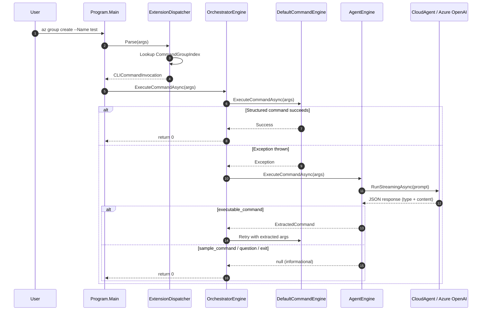

# Project Overview & Architecture

## What Is Cirrus?

Cirrus is an extension-based command-line framework built on .NET 10 that provides **two complementary interfaces** for managing Azure resources: a structured CLI (producing the `az` binary) and a set of PowerShell modules. When a user issues a command that the structured engine cannot resolve, Cirrus automatically falls back to an **AI-powered agent** that interprets natural language and either answers the question or extracts a concrete command for retry.

The solution is organised in the modern `.slnx` format (`cirrus.slnx:1-24`) and pins its SDK to **10.0.203** via `global.json:2-5` with a `latestMinor` roll-forward policy so contributors stay on a consistent toolchain.

## High-Level Architecture

```mermaid
graph TB
    subgraph User["User Interfaces"]
        style User fill:#161b22,stroke:#30363d,color:#e6edf3
        CLI["az CLI Binary"]
        PS["PowerShell Modules<br>(Login · Resources)"]
    end

    subgraph Routing["Command Routing"]
        style Routing fill:#161b22,stroke:#30363d,color:#e6edf3
        Parser["ExtensionDispatcher<br>+ CommandGroupIndex"]
        Orchestrator["OrchestratorEngine"]
    end

    subgraph Engines["Execution Engines"]
        style Engines fill:#161b22,stroke:#30363d,color:#e6edf3
        Default["DefaultCommandEngine"]
        Agent["AgentEngine<br>(AI Fallback)"]
    end

    subgraph Extensions["Extension Layer"]
        style Extensions fill:#161b22,stroke:#30363d,color:#e6edf3
        Loader["ExtensionLoader<br>(Builtin · MultiVersion)"]
        Login["Extensions.Login"]
        Resources["Extensions.Resources"]
        ExtMgr["Extensions.Extension"]
    end

    subgraph Infrastructure["Infrastructure"]
        style Infrastructure fill:#161b22,stroke:#30363d,color:#e6edf3
        DI["AzclipsServiceProvider"]
        Auth["MsalAuthService"]
        Telemetry["OpenTelemetry + Zipkin"]
        Cloud["Azure OpenAI<br>(CloudAgent)"]
    end

    CLI --> args  Parser
    PS --> PSCommandInvocation  Orchestrator
    Parser --> Orchestrator
    Orchestrator --> "try first"  Default
    Default --> exception  Agent
    Agent --> Cloud
    Default --> Loader
    Loader --> Login
    Loader --> Resources
    Loader --> ExtMgr
    DI --> Auth
    DI --> Telemetry
    Orchestrator -.-> retry extracted cmd  Default

    style CLI fill:#2d333b,stroke:#6d5dfc,color:#e6edf3
    style PS fill:#2d333b,stroke:#6d5dfc,color:#e6edf3
    style Parser fill:#2d333b,stroke:#6d5dfc,color:#e6edf3
    style Orchestrator fill:#2d333b,stroke:#6d5dfc,color:#e6edf3
    style Default fill:#2d333b,stroke:#6d5dfc,color:#e6edf3
    style Agent fill:#2d333b,stroke:#6d5dfc,color:#e6edf3
    style Loader fill:#2d333b,stroke:#6d5dfc,color:#e6edf3
    style Login fill:#2d333b,stroke:#6d5dfc,color:#e6edf3
    style Resources fill:#2d333b,stroke:#6d5dfc,color:#e6edf3
    style ExtMgr fill:#2d333b,stroke:#6d5dfc,color:#e6edf3
    style DI fill:#2d333b,stroke:#6d5dfc,color:#e6edf3
    style Auth fill:#2d333b,stroke:#6d5dfc,color:#e6edf3
    style Telemetry fill:#2d333b,stroke:#6d5dfc,color:#e6edf3
    style Cloud fill:#2d333b,stroke:#6d5dfc,color:#e6edf3
```

## Key Features

| Feature | Description |
|---------|-------------|
| **Extension Loading** | Dynamically loads command extensions via custom `AssemblyLoadContext` with dependency isolation (`src/Core/Core.Engine/ExtensionLoader.cs:15-44`). Supports both built-in and multi-version (NuGet semver) loaders. |
| **AI Fallback** | When `DefaultCommandEngine` throws, `OrchestratorEngine` automatically invokes `AgentEngine` backed by Azure OpenAI (`src/Core/Core.Engine/OrchestratorEngine.cs:94-114`). |
| **Dual Interface** | The same business logic is exposed through both the `az` CLI binary and PowerShell modules (`Login`, `Resources`), sharing a common DI container (`src/Core/Core.DependencyInjection/AzclipsServiceProvider.cs:1-30`). |
| **Structured Telemetry** | OpenTelemetry with Zipkin exporter in DEBUG builds; Azure Monitor exporter for production (`src/Core/Core.Telemetry/`). |
| **MSAL Authentication** | Browser-based interactive auth via MSAL, with dev-container helpers that bridge VS Code's browser (`src/Core/Core.Authentication/`). |

## Technology Stack

| Component | Technology | Version | Purpose |
|-----------|-----------|---------|---------|
| Runtime | .NET | 10.0.203 | Core framework (`global.json:3`) |
| Language | C# | 13 | All source projects (`src/Directory.Build.props:4`) |
| AI | Azure OpenAI | - | Natural language agent (`src/Core/Core.Agent/CloudAgent.cs:53-58`) |
| Auth | MSAL | - | Azure AD authentication |
| Telemetry | OpenTelemetry | 1.8.1 | Distributed tracing |
| Tracing | Zipkin | - | Local trace visualisation (dev container) |
| Shell | PowerShell | 7.5 | Module interface (`src/PS/Login/Login.psd1:36`) |
| Testing | xUnit | 2.9.3 | Unit & integration tests (`tests/Directory.Build.props:19`) |
| Coverage | Coverlet | 6.0.4 | Code coverage collection (`tests/Directory.Build.props:17`) |
| CI/CD | GitHub Actions | - | Build, test, package (`.github/workflows/build.yml`) |

## Repository Structure

```mermaid
graph LR
    subgraph Root["cirrus/"]
        style Root fill:#161b22,stroke:#30363d,color:#e6edf3
        SLN["cirrus.slnx"]
        Global["global.json"]
        Shared["Shared.props"]
    end

    subgraph SrcDir["src/"]
        style SrcDir fill:#161b22,stroke:#30363d,color:#e6edf3
        CLI_D["CLI/<br>Core.Cli.csproj"]
        Core_D["Core/<br>7 projects"]
        Ext_D["Extensions/<br>3 projects"]
        PS_D["PS/<br>Login · Resources"]
    end

    subgraph CoreSub["Core/"]
        style CoreSub fill:#161b22,stroke:#30363d,color:#e6edf3
        Abs["Abstractions"]
        Eng["Engine"]
        AgentP["Agent"]
        AuthP["Authentication"]
        DIP["DependencyInjection"]
        Rt["Runtime"]
        Tel["Telemetry"]
    end

    subgraph TestDir["tests/"]
        style TestDir fill:#161b22,stroke:#30363d,color:#e6edf3
        CliTest["Cli.Tests"]
        Bench["Benchmark"]
    end

    subgraph BuildDir["build/ · scripts/"]
        style BuildDir fill:#161b22,stroke:#30363d,color:#e6edf3
        BuildPS["build.ps1"]
        Deploy["deploy.sh"]
    end

    Root --> SrcDir
    Root --> TestDir
    Root --> BuildDir
    SrcDir --> CoreSub

    style SLN fill:#2d333b,stroke:#6d5dfc,color:#e6edf3
    style Global fill:#2d333b,stroke:#6d5dfc,color:#e6edf3
    style Shared fill:#2d333b,stroke:#6d5dfc,color:#e6edf3
    style CLI_D fill:#2d333b,stroke:#6d5dfc,color:#e6edf3
    style Core_D fill:#2d333b,stroke:#6d5dfc,color:#e6edf3
    style Ext_D fill:#2d333b,stroke:#6d5dfc,color:#e6edf3
    style PS_D fill:#2d333b,stroke:#6d5dfc,color:#e6edf3
    style Abs fill:#2d333b,stroke:#6d5dfc,color:#e6edf3
    style Eng fill:#2d333b,stroke:#6d5dfc,color:#e6edf3
    style AgentP fill:#2d333b,stroke:#6d5dfc,color:#e6edf3
    style AuthP fill:#2d333b,stroke:#6d5dfc,color:#e6edf3
    style DIP fill:#2d333b,stroke:#6d5dfc,color:#e6edf3
    style Rt fill:#2d333b,stroke:#6d5dfc,color:#e6edf3
    style Tel fill:#2d333b,stroke:#6d5dfc,color:#e6edf3
    style CliTest fill:#2d333b,stroke:#6d5dfc,color:#e6edf3
    style Bench fill:#2d333b,stroke:#6d5dfc,color:#e6edf3
    style BuildPS fill:#2d333b,stroke:#6d5dfc,color:#e6edf3
    style Deploy fill:#2d333b,stroke:#6d5dfc,color:#e6edf3
```



## The Orchestrator Pattern

The centrepiece of Cirrus's execution model is `OrchestratorEngine` (`src/Core/Core.Engine/OrchestratorEngine.cs:33-120`). It implements `ICommandEngine` and coordinates two child engines inside a retry loop capped at **five attempts** (`src/Core/Core.Engine/OrchestratorEngine.cs:73`).

### Execution Flow

1. **Flavour check** — the `AZURECLI_FLAVOR` environment variable is inspected (`OrchestratorEngine.cs:62-70`). When set to `"azure powershell"`, the engine skips structured parsing entirely and routes straight to the AI agent.
2. **Structured attempt** — `DefaultCommandEngine.ExecuteCommandAsync()` parses arguments via `CommandParser`, binds them to a command object with `CommandBinder`, and executes (`src/Core/Core.Engine/DefaultCommandEngine.cs:31-48`).
3. **Graceful exit** — if the command is recognised but not yet implemented (`NotImplementedException`), the engine exits cleanly (`OrchestratorEngine.cs:87-92`).
4. **AI fallback** — any other exception triggers `AgentEngine.ExecuteCommandAsync()` (`OrchestratorEngine.cs:98`). The agent streams a response from Azure OpenAI and may return an `ExtractedCommand`.
5. **Retry** — if `ExtractedCommand` is non-empty the orchestrator parses it and loops back to step 2 (`OrchestratorEngine.cs:112-113`).



### Dependency Injection Wiring

All services are registered as **singletons** inside `Bootstrapper.RegisterServices()` (`src/Core/Core.Engine/Bootstrapper.cs:49-107`). The factory for `ICommandEngine` wires the orchestrator:

- `ILoggingService` → `ConsoleLoggingService` (`Bootstrapper.cs:53`)
- `IAuthService` → `MsalAuthService` (`Bootstrapper.cs:55`)
- `DefaultCommandEngine` — singleton (`Bootstrapper.cs:79`)
- `AgentEngine` — singleton, receives flavour from env var (`Bootstrapper.cs:85-91`)
- `ICommandEngine` → `OrchestratorEngine` — factory resolves both child engines (`Bootstrapper.cs:98-105`)

The DI container is initialised once per process via `AzclipsServiceProvider.Initialize(ClientType)` (`src/Core/Core.DependencyInjection/AzclipsServiceProvider.cs:1-30`), which is called from `Program.cs:24` for the CLI and from each PowerShell module script (e.g., `src/PS/Login/Login.psm1:5`).

### Build Artefact Layout

The `Shared.props:6-8` file defines output paths so all projects publish into a single `artifacts/` tree:

```
artifacts/
├── Debug/
│   ├── Core.Cli/az          ← CLI executable
│   ├── Core/                  ← Shared core DLLs
│   ├── Microsoft.Azure.Azclips.Extensions.Login/
│   └── Microsoft.Azure.Cirrus.Extensions.Resources/
└── Release/                   ← Same structure
```

Extensions are loaded at runtime from sub-directories relative to the CLI binary (`src/Core/Core.Engine/ExtensionLoader.cs:49-62`), enabling independent versioning and deployment of each extension.

## References

| Source | Path |
|--------|------|
| CLI entry point | `src/CLI/Program.cs` |
| Orchestrator engine | `src/Core/Core.Engine/OrchestratorEngine.cs` |
| Default command engine | `src/Core/Core.Engine/DefaultCommandEngine.cs` |
| AI agent engine | `src/Core/Core.Engine/AgentEngine.cs` |
| Cloud agent (OpenAI) | `src/Core/Core.Agent/CloudAgent.cs` |
| DI container | `src/Core/Core.DependencyInjection/AzclipsServiceProvider.cs` |
| Bootstrapper | `src/Core/Core.Engine/Bootstrapper.cs` |
| Extension loader | `src/Core/Core.Engine/ExtensionLoader.cs` |
| Command group index | `src/CLI/Parser/CommandGroupIndex.cs` |
| Extension dispatcher | `src/CLI/Parser/ExtensionDispatcher.cs` |
| Solution file | `cirrus.slnx` |
| SDK version | `global.json` |
| Shared build props | `Shared.props` |
| Source build props | `src/Directory.Build.props` |
