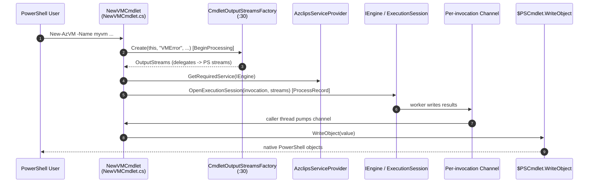
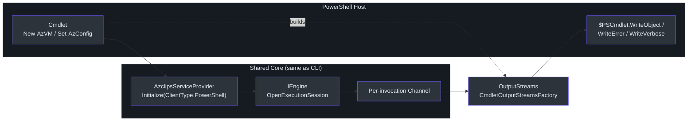

# PowerShell Module Usage

## Why a PowerShell Surface Exists

PowerShell users expect object output, pipelines, and cmdlet ergonomics — not text scraping. Project Azclips satisfies that by shipping cmdlets that are **thin wrappers over the exact same Core engine** the `az` CLI uses. A cmdlet doesn't re-implement resource-group creation; it builds a `CommandInvocation`, resolves `IEngine` from the shared `AzclipsServiceProvider`, and opens an execution session whose output is pumped back into the PowerShell stream via `$PSCmdlet.WriteObject`. This means CLI and PowerShell stay behaviorally identical while giving PowerShell users native objects.

## Modules and Cmdlets

The cmdlet projects live under `src/PS/` and are listed in `azclips.slnx:40`: `Cmdlets.Resources`, `Cmdlets.Compute`, `Cmdlets.Accounts`, and `Cmdlets.Config`. Each ships a `.psd1` manifest and per-module help Markdown under `src/PS/<Module>/help/`.

| Module | Representative cmdlets | Source |
| --- | --- | --- |
| **Accounts** | `Connect-AzAccount`, `Disconnect-AzAccount`, `Get-AzProfile`, `Set-AzProfile`, `Remove-AzProfile` | `src/PS/Accounts/Cmdlets/ConnectAccountCmdlet.cs:11` |
| **Resources** | `New-AzResourceGroup`, `Get-AzResourceGroup`, `New-AzResourceGroupDeployment`, `Invoke-AzRestMethod` | `src/PS/Resources/Cmdlets/NewResourceGroupCmdlet.cs` |
| **Compute** | `New-AzVM`, `Get-AzVM`, `Remove-AzVM` | `src/PS/Compute/Cmdlets/NewVMCmdlet.cs:11` |
| **Config** | `Get-AzConfig`, `Set-AzConfig`, `Get-AzConfigList`, `Get-AzConfigInfo`, `Remove-AzConfig` | `src/PS/Config/Cmdlets/SetAzConfigCmdlet.cs` |

> **Naming note:** All modules carry the `Az` noun prefix so cmdlet names match Azure PowerShell. Accounts and Config define the prefix via `Constants.CommandPrefix = "Az"` (`src/PS/Accounts/Constants.cs:11`), giving `Connect-AzAccount` and `Set-AzConfig`; Compute and Resources use `Az`-prefixed nouns like `New-AzVM` and `New-AzResourceGroup`.

### Importing and Using

```powershell
# Import a built module (manifests reference artifact DLLs by relative path)
Import-Module ./artifacts/Debug/Microsoft.Azure.Azclips.Extensions.Accounts/Accounts.psd1
Import-Module ./artifacts/Debug/Microsoft.Azure.Azclips.Extensions.Compute/Compute.psd1

# Authenticate, then create a resource group and a VM
Connect-AzAccount -SubscriptionId <sub-id>
New-AzResourceGroup -Name myrg -Location eastus -SubscriptionId <sub-id>
New-AzVM -Name myvm -ResourceGroupName myrg -Location eastus -SubscriptionId <sub-id> `
       -VmSize Standard_D2s_v3 -AdminUsername azureuser -AdminPassword <pwd> `
       -NetworkInterfaceName nic1 -VirtualNetworkName vnet1 -NetworkSecurityGroupName nsg1
Get-AzVM -ResourceGroupName myrg -SubscriptionId <sub-id>

# Opt out of telemetry via config
Set-AzConfig -Key telemetry.enabled -Value false
```

The `Set-AzConfig -Key telemetry.enabled -Value false` opt-out is the documented PowerShell equivalent of the CLI's `az config set` (`README.md:166`). Note the Compute module declares the Accounts module as a `RequiredModule` (`src/PS/Compute/Compute.psd1:55`), so importing Compute pulls in Accounts automatically.

## Shared Engine, Per-Invocation Output Channel

Every cmdlet follows the same three-step pattern, visible in `NewVMCmdlet`:

1. In `BeginProcessing`, build an `OutputStreams` bound to this cmdlet and resolve `IEngine` from the shared provider (`src/PS/Compute/Cmdlets/NewVMCmdlet.cs:87`).
2. In `ProcessRecord`, assemble a `CommandInvocation` from bound parameters (`src/PS/Compute/Cmdlets/NewVMCmdlet.cs:130`).
3. Open an execution session and run it synchronously (`src/PS/Compute/Cmdlets/NewVMCmdlet.cs:133`).

The engine is explicitly designed for this. Its documented **Thread Safety** and **Output Routing** guarantees state that each invocation gets its own `Channel`: the worker thread writes to the channel, and the caller's thread reads and dispatches to the provided output delegate — *e.g.* `$PSCmdlet.WriteObject` (`src/Core/Core.Engine/Engine.cs:13`–`:21`). This per-invocation isolation is what allows concurrent cmdlet execution without output cross-talk.

The bridge between engine output and PowerShell streams is `CmdletOutputStreamsFactory.Create`, which constructs an `OutputStreams` whose delegates map each engine channel to the correct PowerShell stream (`src/PS/Common/CmdletOutputStreamsFactory.cs:30`):

| Engine stream | PowerShell target | Source |
| --- | --- | --- |
| `WriteOutput` | `cmdlet.WriteObject(value[, enumerate])` | `src/PS/Common/CmdletOutputStreamsFactory.cs:39` |
| `WriteError` | `cmdlet.WriteError(new ErrorRecord(...))` | `src/PS/Common/CmdletOutputStreamsFactory.cs:91` |
| `WriteWarning` | `cmdlet.WriteWarning(...)` | `src/PS/Common/CmdletOutputStreamsFactory.cs:82` |
| `WriteVerbose` | `WriteVerbose` / host verbose line | `src/PS/Common/CmdletOutputStreamsFactory.cs:52` |
| `WriteDebug` | `WriteDebug` / host debug line | `src/PS/Common/CmdletOutputStreamsFactory.cs:67` |
| `WriteInformation` | `cmdlet.WriteInformation(...)` | `src/PS/Common/CmdletOutputStreamsFactory.cs:100` |

Verbose/Debug/Info/Warn honor the configured log level via `ShouldEmit`, but `-Verbose`/`-Debug` bound parameters force emission (`src/PS/Common/CmdletOutputStreamsFactory.cs:135`).

## End-to-End Flow





## Manifests and Help

Each module ships a `.psd1` manifest (e.g. `src/PS/Compute/Compute.psd1`) declaring `ModuleVersion`, required modules, and the artifact DLLs it loads, plus `help/*.md` files (e.g. `src/PS/Compute/help/New-AzVM.md`) generated for `Get-Help`. Because manifests reference DLLs under `artifacts/<Config>/...` (`src/PS/Compute/Compute.psd1:59`), you must build the solution before importing a module.

## References

- `src/PS/Common/CmdletOutputStreamsFactory.cs:30` — maps engine streams to `$PSCmdlet` output methods.
- `src/PS/Compute/Cmdlets/NewVMCmdlet.cs:87` — cmdlet resolves `IEngine` and opens a session.
- `src/Core/Core.Engine/Engine.cs:13` — per-invocation channel thread-safety / output-routing contract.
- `azclips.slnx:40` — PowerShell cmdlet projects (`Resources`, `Compute`, `Accounts`, `Config`).
- `src/PS/Accounts/Constants.cs:11` — `Az` command-noun prefix.
- `README.md:166` — `Set-AzConfig -Key telemetry.enabled` opt-out.
