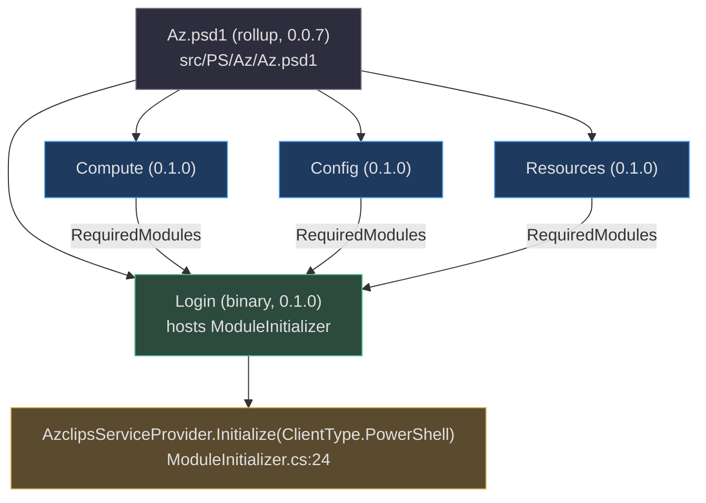
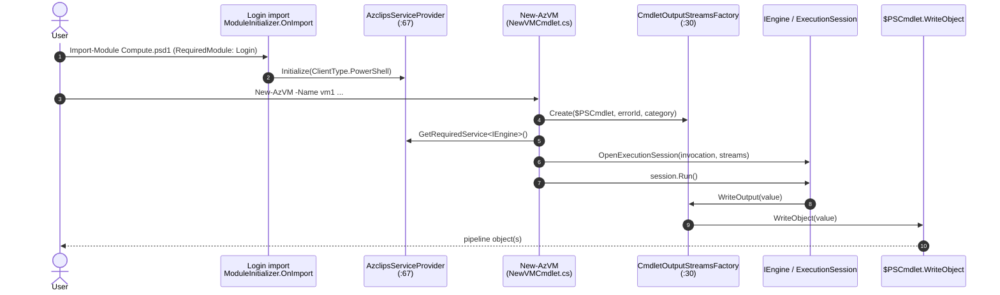

# PowerShell Module Usage

## Why There Is a PowerShell Surface At All

The PowerShell modules are **not** a re-implementation of the CLI — they are a second front door to the *same* engine. A `New-AzVM` call and an `az vm create` call resolve the identical `IEngine`, build the identical HTTP pipeline, authenticate with the identical `IAuthService`, and differ only in how output is delivered to the caller. That is the whole point: parity for free. This page shows how to import the modules and use the cmdlets, and explains the one mechanism that makes the shared-engine model work in PowerShell — `CmdletOutputStreamsFactory`.

Reminder: the repo is `Azure/cirrus`; modules, cmdlets, and namespaces carry the **Azclips** identity.

## The Six Module Folders

`src/PS/` contains six folders, but they play different roles:

| Folder | Role | Key files |
| --- | --- | --- |
| `Login` | **Binary** module; hosts the DI initializer | `Login.psd1`, `ModuleInitializer.cs`, cmdlets |
| `Compute` | Binary module (VM cmdlets) | `Compute.psd1`, `Cmdlets/{New,Get,Remove}VMCmdlet.cs` |
| `Config` | Binary module (config cmdlets) | `Config.psd1`, `Cmdlets/SetAzConfigCmdlet.cs` |
| `Resources` | Resource cmdlets | `Resources.psd1`, `Cmdlets/`, `exports/` |
| `Az` | **Rollup** manifest (no cmdlets of its own) | `Az.psd1` |
| `Common` | Shared helper library used by the binary cmdlet projects | `CmdletOutputStreamsFactory.cs` |

Plus `src/PS/TelemetryHelper.ps1`, a script shared across modules that starts/stops per-cmdlet telemetry activities.

The `Az` module is a convenience rollup: importing it pulls in Login, Compute, Resources, and Config as required modules (`src/PS/Az/Az.psd1:11-16`). Because every binary module lists `Login` in its `RequiredModules`, importing any of them boots the shared DI container exactly once.



## Importing and Using the Modules

```powershell
# Option A: import the rollup (brings in Login + Compute + Resources + Config)
Import-Module ./src/PS/Az/Az.psd1

# Option B: import a single module. Compute declares Login as a RequiredModule,
# so importing Compute imports Login first (which boots the shared DI container).
Import-Module ./src/PS/Compute/Compute.psd1

# Sign in, then use resource cmdlets
Connect-AzAccount
New-AzVM -SubscriptionId <sub> -ResourceGroupName rg1 -Name vm1 -Location eastus `
         -VmSize Standard_D2s_v5 -AdminUsername azureuser -AdminPassword <pw> ...
Get-AzVM -SubscriptionId <sub> -ResourceGroupName rg1 -Name vm1
Remove-AzVM -SubscriptionId <sub> -ResourceGroupName rg1 -Name vm1

# Opt out of telemetry (same key the CLI uses)
Set-AzConfig -Key telemetry.enabled -Value $false
```

Exported cmdlets per module (from the manifests):

| Module | Cmdlets | Manifest |
| --- | --- | --- |
| Login | `Connect-AzAccount`, `Disconnect-AzAccount`, `Get-AzProfile`, `Set-AzProfile`, `Remove-AzProfile` | `src/PS/Login/Login.psd1:85` |
| Compute | `New-AzVM`, `Get-AzVM`, `Remove-AzVM` | `src/PS/Compute/Compute.psd1:80` |
| Config | `Get-AzConfig`, `Set-AzConfig`, `Remove-AzConfig`, `Get-AzConfigList`, `Get-AzConfigInfo` | `src/PS/Config/Cmdlets/` |

## How a Cmdlet Shares the CLI's Engine

DI is bootstrapped **once, at module import**, not per cmdlet call. `Login` implements `IModuleAssemblyInitializer`; its `OnImport` registers PowerShell-specific providers and then calls `AzclipsServiceProvider.Initialize(ClientType.PowerShell)` (`src/PS/Login/ModuleInitializer.cs:16-25`). Because every binary module lists `Login` (directly or transitively) in `RequiredModules`, that initializer always runs first.

From then on, each cmdlet is a thin adapter:

1. `BeginProcessing` builds an `OutputStreams` bound to the live `$PSCmdlet` and resolves `IEngine` from the shared container (`src/PS/Compute/Cmdlets/NewVMCmdlet.cs:87-91`).
2. `ProcessRecord` packs parameters into a `CommandInvocation`, opens an execution session, and calls the **synchronous** `session.Run()` (`src/PS/Compute/Cmdlets/NewVMCmdlet.cs:93-134`).



### CmdletOutputStreamsFactory — the output bridge

The engine writes to an abstract `OutputStreams` regardless of surface. For PowerShell, `CmdletOutputStreamsFactory.Create` (`src/PS/Common/CmdletOutputStreamsFactory.cs:30`) builds that struct so each channel routes back to the cmdlet's native streams:

| Engine channel | PowerShell target | Source line |
| --- | --- | --- |
| `WriteOutput` | `$PSCmdlet.WriteObject` (enumerated when appropriate) | `src/PS/Common/CmdletOutputStreamsFactory.cs:43-47` |
| `WriteError` | `$PSCmdlet.WriteError(new ErrorRecord(...))` | `src/PS/Common/CmdletOutputStreamsFactory.cs:91-98` |
| `WriteVerbose` | `WriteVerbose` / host UI, honoring `-Verbose` | `src/PS/Common/CmdletOutputStreamsFactory.cs:52-64` |
| `WriteWarning` / `WriteInformation` | `WriteWarning` / `WriteInformation`, severity-gated by `core.logging.level` | `src/PS/Common/CmdletOutputStreamsFactory.cs:82-108` |

This is why the same engine code that streams to `Console.WriteLine` in the CLI produces first-class pipeline objects in PowerShell — only the `OutputStreams` delegates differ. The deep dive [PowerShell Cmdlet Architecture](/02-deep-dive/powershell-cmdlet-architecture) traces this end-to-end.

## Telemetry Opt-Out

Telemetry is on by default and can be disabled per the config key shared with the CLI:

```powershell
Set-AzConfig -Key telemetry.enabled -Value $false
```

`src/PS/TelemetryHelper.ps1` resolves `ITelemetryService` from the same container (`Get-TelemetryService`, `src/PS/TelemetryHelper.ps1:10-23`) and wraps cmdlet activities via `Start-CmdletActivity` / `Complete-CmdletActivity`.

## References

- `src/PS/Login/ModuleInitializer.cs:24` — `Initialize(ClientType.PowerShell)` at module import
- `src/Core/Core.DependencyInjection/AzclipsServiceProvider.cs:67` — the shared composition root
- `src/PS/Compute/Cmdlets/NewVMCmdlet.cs:87-134` — `BeginProcessing`/`ProcessRecord` → engine session
- `src/PS/Common/CmdletOutputStreamsFactory.cs:30` — output bridge to `$PSCmdlet`
- `src/PS/Login/Login.psd1:85` — Login cmdlet exports (`Connect-AzAccount`, ...)
- `src/PS/Compute/Compute.psd1:80` — Compute cmdlet exports (`New-AzVM`, ...) and `RequiredModules: Login`
- `src/PS/Az/Az.psd1:11-16` — rollup that requires Login/Compute/Resources/Config
- `src/PS/TelemetryHelper.ps1:10-23` — shared telemetry activity helper
