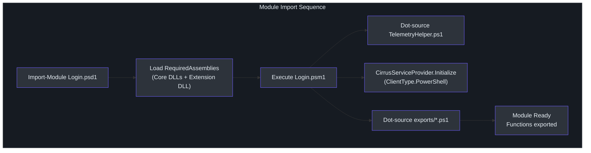
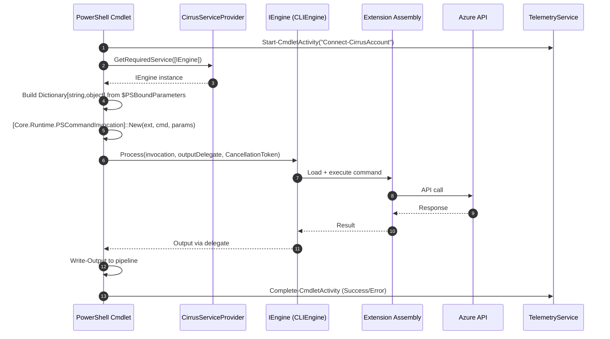

# PowerShell Module Guide

## Available Modules

Cirrus ships two PowerShell modules that expose the same underlying C# extensions as the CLI:

| Module | Directory | Version | PS Edition | GUID |
|--------|-----------|---------|-----------|------|
| **Login** | `src/PS/Login/` | 0.0.1 | Core only | `4a689b34-4900-472a-ae8a-f5473e0e7df2` |
| **Resources** | `src/PS/Resources/` | 0.1.0 | Core, Desktop | `d4bb27e5-ae5f-4f79-a25c-ad1cecdc443a` |

A shared helper module `src/PS/TelemetryHelper.ps1` provides telemetry functions used by both.

## Importing Modules

Build the solution first so the required assemblies exist under `artifacts/`:

```powershell
dotnet build cirrus.slnx

# Import individual modules
Import-Module ./src/PS/Login/Login.psd1
Import-Module ./src/PS/Resources/Resources.psd1
```

Each module manifest (`Login.psd1`, `Resources.psd1`) declares `RequiredAssemblies` pointing to the build output (`src/PS/Login/Login.psd1:59-65`):

```
artifacts/Debug/Core/Core.Abstractions.dll
artifacts/Debug/Core/Core.Telemetry.dll
artifacts/Debug/Core/Core.Runtime.dll
artifacts/Debug/Core/Core.Engine.dll
artifacts/Debug/Core/Core.DependencyInjection.dll
artifacts/Debug/Microsoft.Azure.Cirrus.Extensions.Login/
    Microsoft.Azure.Cirrus.Extensions.Login.dll
```

## Module Initialisation

Both `.psm1` files follow an identical bootstrap pattern. For example, `Login.psm1` (`src/PS/Login/Login.psm1:1-15`):

1. **Dot-source telemetry** (`Login.psm1:2`) — `. (Join-Path $PSScriptRoot '..\TelemetryHelper.ps1')`
2. **Initialise DI container** (`Login.psm1:5`) — `[Core.DependencyInjection.CirrusServiceProvider]::Initialize([Core.Abstractions.ClientType]::PowerShell)`
3. **Register cleanup** (`Login.psm1:6-8`) — disposes the DI container on module removal via `$MyInvocation.MyCommand.ScriptBlock.Module.OnRemove`.
4. **Auto-load exports** (`Login.psm1:10-14`) — dot-sources every `.ps1` file in `./exports/`.
5. **Export functions** (`Login.psm1:15`) — `Export-ModuleMember -Function *`.

`Resources.psm1` (`src/PS/Resources/Resources.psm1:1-12`) follows the same steps.



## Authentication Cmdlets

### `Connect-CirrusAccount`

Authenticates to Azure with a subscription and tenant (`src/PS/Login/exports/Connect-CirrusAccount.ps1:1-61`).

```powershell
Connect-CirrusAccount -SubscriptionId <guid> -TenantId <guid>
```

**Parameters** (`Connect-CirrusAccount.ps1:3-9`):

| Parameter | Type | Mandatory |
|-----------|------|-----------|
| `SubscriptionId` | `string` | Yes |
| `TenantId` | `string` | Yes |

Supports `ShouldProcess` (`-WhatIf`, `-Confirm`) with `ConfirmImpact = 'Medium'` (`Connect-CirrusAccount.ps1:2`).

### `Disconnect-CirrusAccount`

Signs out of the current Cirrus session (`src/PS/Login/exports/Disconnect-CirrusAccount.ps1:1-52`).

```powershell
Disconnect-CirrusAccount
```

No parameters. Supports `ShouldProcess` with `ConfirmImpact = 'Medium'` (`Disconnect-CirrusAccount.ps1:2`).

### `Get-CirrusAccount`

Returns information about the current authenticated session (`src/PS/Login/exports/Get-CirrusAccount.ps1:1-48`).

```powershell
Get-CirrusAccount
```

No parameters. Uses basic `[CmdletBinding()]` without `ShouldProcess` since it is a read-only operation (`Get-CirrusAccount.ps1:2`).

## Resource Management Cmdlets

### `New-ResourceGroup`

Creates a new Azure resource group (`src/PS/Resources/exports/New-ResourceGroup.ps1:1-67`).

```powershell
New-ResourceGroup -Name "my-rg" -Location "eastus"
New-ResourceGroup -Name "my-rg" -Location "eastus" -SubscriptionId <guid>
```

**Parameters** (`New-ResourceGroup.ps1:3-12`):

| Parameter | Type | Mandatory |
|-----------|------|-----------|
| `Name` | `string` | Yes |
| `Location` | `string` | Yes |
| `SubscriptionId` | `string` | No |

`SubscriptionId` is conditionally added to the parameter dictionary only when provided (`New-ResourceGroup.ps1:32-40`).

### `Get-ResourceGroup`

Retrieves one or all resource groups in a subscription (`src/PS/Resources/exports/Get-ResourceGroup.ps1:1-66`).

```powershell
# Get a specific resource group
Get-ResourceGroup -SubscriptionId <guid> -Name "my-rg"

# List all resource groups
Get-ResourceGroup -SubscriptionId <guid>
```

**Parameter Sets** (`Get-ResourceGroup.ps1:4-5`):

| Set | Required Parameters | Command Routed To |
|-----|-------------------|-------------------|
| `Get` | `SubscriptionId`, `Name` | `Get-ResourceGroup_Get` |
| `List` | `SubscriptionId` | `Get-ResourceGroup_List` |

The active parameter set name is appended to the command name (`Get-ResourceGroup.ps1:30-31`):

```powershell
$commandName = "Get-ResourceGroup_$($PSCmdlet.ParameterSetName)"
```

This `Get-ResourceGroup` cmdlet also features an enhanced output delegate that handles array responses with a `$true` flag (`Get-ResourceGroup.ps1:19-24`).

## C# Bridge Pattern

Every PowerShell cmdlet follows the same five-step pattern to delegate execution to the C# engine. This is the core integration point between the PowerShell and .NET layers.



### Step-by-Step Breakdown

Taking `Connect-CirrusAccount.ps1` as the canonical example:

**1. Start telemetry** (`Connect-CirrusAccount.ps1:13`)

```powershell
$activity = Start-CmdletActivity -CmdletName "Connect-CirrusAccount" -Parameters $PSBoundParameters
```

**2. Get the engine from DI** (`Connect-CirrusAccount.ps1:15`)

```powershell
$engine = [Core.DependencyInjection.CirrusServiceProvider]::GetRequiredService(
    [Core.Abstractions.IEngine])
```

**3. Create an output delegate** (`Connect-CirrusAccount.ps1:16-20`)

An asynchronous `CommandOutputDelegate` is created that writes objects to the PowerShell pipeline.

**4. Build the invocation** (`Connect-CirrusAccount.ps1:25-35`)

```powershell
$extensionName = "Login"
$commandName   = "Connect-CirrusAccount"
$parameters    = [System.Collections.Generic.Dictionary[string,object]]::new()
$parameters.Add("SubscriptionId", $SubscriptionId)
$parameters.Add("TenantId", $TenantId)

$invocation = [Core.Runtime.PSCommandInvocation]::New(
    $extensionName, $commandName, $parameters)
```

**5. Execute and handle results** (`Connect-CirrusAccount.ps1:36-47`)

```powershell
$engine.Process($invocation, $outputDelegate, [System.Threading.CancellationToken]::None)
```

Success and failure are recorded via `Complete-CmdletActivity` in the `end` block.

## Telemetry Helper

`src/PS/TelemetryHelper.ps1` is dot-sourced by every module and provides three exported functions plus one internal:

### `Get-TelemetryService` (internal)

Lazy-loads the `ITelemetryService` from the DI container (`TelemetryHelper.ps1:7-20`):

```powershell
[Core.DependencyInjection.CirrusServiceProvider]::GetRequiredService(
    [Core.Abstractions.ITelemetryService])
```

The service is cached in `$script:TelemetryService` (`TelemetryHelper.ps1:4-5`). If retrieval fails, the error is logged verbosely and telemetry is silently disabled (`TelemetryHelper.ps1:15-17`).

### `Start-CmdletActivity`

Creates a new telemetry activity for a cmdlet invocation (`TelemetryHelper.ps1:22-47`).

| Parameter | Type | Required |
|-----------|------|----------|
| `CmdletName` | `string` | Yes |
| `Parameters` | `IDictionary` | No |

Calls `[Core.Telemetry.TelemetryExtensions]::StartPowerShellActivity($service, $CmdletName, $Parameters)` (`TelemetryHelper.ps1:36-45`) and returns an `Activity` object.

### `Complete-CmdletActivity`

Finalises a telemetry activity (`TelemetryHelper.ps1:49-86`).

| Parameter | Type | Default |
|-----------|------|---------|
| `Activity` | `Activity` | — |
| `Success` | `bool` | `$true` |
| `ErrorMessage` | `string` | — |

On success: sets `ActivityStatusCode::Ok` (`TelemetryHelper.ps1:68-69`).
On failure: sets `ActivityStatusCode::Error` and attaches an error event with the message (`TelemetryHelper.ps1:70-78`).
Always disposes the activity (`TelemetryHelper.ps1:80`).

### `Stop-Telemetry`

Disposes the cached telemetry service on module removal (`TelemetryHelper.ps1:88-97`).

## Module Manifest Structure

Both `.psd1` files follow the standard PowerShell module manifest format. Key sections in `Login.psd1` (`src/PS/Login/Login.psd1`):

| Section | Purpose | Example |
|---------|---------|---------|
| `RootModule` | Entry script | `Login.psm1` (line 12) |
| `ModuleVersion` | Semantic version | `0.0.1` (line 15) |
| `CompatiblePSEditions` | Runtime constraint | `@('Core')` (line 18) |
| `PowerShellVersion` | Minimum PS version | `7.5` (line 36) |
| `RequiredAssemblies` | C# DLLs to load | 7 assemblies (lines 59-65) |
| `FunctionsToExport` | Public surface | `Connect-CirrusAccount`, `Disconnect-CirrusAccount`, `Get-CirrusAccount` (line 80) |

The `Resources.psd1` manifest (`src/PS/Resources/Resources.psd1`) is similar but targets a broader audience:

- `CompatiblePSEditions` = `@('Core', 'Desktop')` (line 18)
- `PowerShellVersion` = `5.1` (line 36)
- `DotNetFrameworkVersion` = `4.7.2` (line 45)
- `FunctionsToExport` = `New-ResourceGroup`, `Get-ResourceGroup` (line 88)

## Complete Cmdlet Reference

| Cmdlet | Module | Parameters | ShouldProcess | Parameter Sets |
|--------|--------|-----------|---------------|----------------|
| `Connect-CirrusAccount` | Login | `SubscriptionId`*, `TenantId`* | Yes (Medium) | Default |
| `Disconnect-CirrusAccount` | Login | — | Yes (Medium) | Default |
| `Get-CirrusAccount` | Login | — | No | Default |
| `New-ResourceGroup` | Resources | `Name`*, `Location`*, `SubscriptionId` | Yes (Medium) | Default |
| `Get-ResourceGroup` | Resources | `SubscriptionId`*, `Name`* | No | Get, List |

\* = Mandatory in at least one parameter set.

## Module Dependency Graph

```mermaid
graph TB
    subgraph PSModules["PowerShell Modules"]
        style PSModules fill:#161b22,stroke:#30363d,color:#e6edf3
        LoginMod["Login Module<br>(Login.psm1)"]
        ResMod["Resources Module<br>(Resources.psm1)"]
    end

    subgraph Shared["Shared Components"]
        style Shared fill:#161b22,stroke:#30363d,color:#e6edf3
        TelHelper["TelemetryHelper.ps1"]
    end

    subgraph CoreDLLs["Core Assemblies (C#)"]
        style CoreDLLs fill:#161b22,stroke:#30363d,color:#e6edf3
        Abstractions["Core.Abstractions.dll"]
        EngDLL["Core.Engine.dll"]
        RuntimeDLL["Core.Runtime.dll"]
        DIDLL["Core.DependencyInjection.dll"]
        TelDLL["Core.Telemetry.dll"]
    end

    subgraph ExtDLLs["Extension Assemblies (C#)"]
        style ExtDLLs fill:#161b22,stroke:#30363d,color:#e6edf3
        LoginDLL["Extensions.Login.dll"]
        ResDLL["Extensions.Resources.dll"]
    end

    LoginMod -->|dot-source| TelHelper
    ResMod -->|dot-source| TelHelper
    LoginMod -->|RequiredAssemblies| Abstractions
    LoginMod -->|RequiredAssemblies| EngDLL
    LoginMod -->|RequiredAssemblies| RuntimeDLL
    LoginMod -->|RequiredAssemblies| DIDLL
    LoginMod -->|RequiredAssemblies| TelDLL
    LoginMod -->|RequiredAssemblies| LoginDLL
    ResMod -->|RequiredAssemblies| Abstractions
    ResMod -->|RequiredAssemblies| EngDLL
    ResMod -->|RequiredAssemblies| RuntimeDLL
    ResMod -->|RequiredAssemblies| DIDLL
    ResMod -->|RequiredAssemblies| ResDLL

    style LoginMod fill:#2d333b,stroke:#6d5dfc,color:#e6edf3
    style ResMod fill:#2d333b,stroke:#6d5dfc,color:#e6edf3
    style TelHelper fill:#2d333b,stroke:#6d5dfc,color:#e6edf3
    style Abstractions fill:#2d333b,stroke:#6d5dfc,color:#e6edf3
    style EngDLL fill:#2d333b,stroke:#6d5dfc,color:#e6edf3
    style RuntimeDLL fill:#2d333b,stroke:#6d5dfc,color:#e6edf3
    style DIDLL fill:#2d333b,stroke:#6d5dfc,color:#e6edf3
    style TelDLL fill:#2d333b,stroke:#6d5dfc,color:#e6edf3
    style LoginDLL fill:#2d333b,stroke:#6d5dfc,color:#e6edf3
    style ResDLL fill:#2d333b,stroke:#6d5dfc,color:#e6edf3
```



## References

| Source | Path |
|--------|------|
| Login module script | `src/PS/Login/Login.psm1` |
| Login module manifest | `src/PS/Login/Login.psd1` |
| Resources module script | `src/PS/Resources/Resources.psm1` |
| Resources module manifest | `src/PS/Resources/Resources.psd1` |
| Connect-CirrusAccount | `src/PS/Login/exports/Connect-CirrusAccount.ps1` |
| Disconnect-CirrusAccount | `src/PS/Login/exports/Disconnect-CirrusAccount.ps1` |
| Get-CirrusAccount | `src/PS/Login/exports/Get-CirrusAccount.ps1` |
| New-ResourceGroup | `src/PS/Resources/exports/New-ResourceGroup.ps1` |
| Get-ResourceGroup | `src/PS/Resources/exports/Get-ResourceGroup.ps1` |
| Telemetry helper | `src/PS/TelemetryHelper.ps1` |
| DI container | `src/Core/Core.DependencyInjection/CirrusServiceProvider.cs` |
