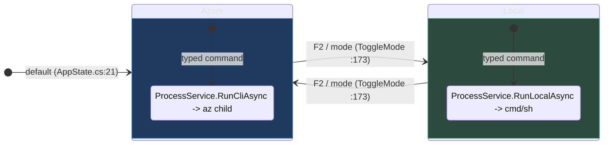
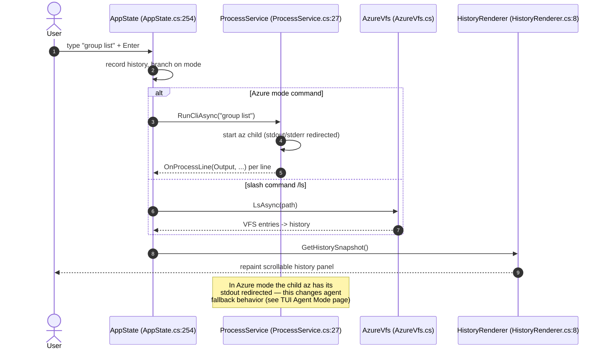

# Terminal UI Quickstart

## Why the Terminal UI exists

The `az` CLI is optimized for one-shot, scriptable commands. But interactive
exploration — "what subscriptions can I see, what's in this resource group, let
me run a few commands and watch the output scroll" — is painful when every
command is a fresh process with no shared context. The **Terminal UI** (project
`Core.Tui`, binary `Core.Tui`) solves that: it is a **full-screen, stateful
shell** that keeps a scrollback history, an always-visible prompt, live
autocomplete, and a navigable **Azure Virtual File System (VFS)** you can `cd`
and `ls` through as if subscriptions and resource groups were folders.

Critically, the TUI is a **separate client surface**, not a wrapper that embeds
the engine differently and **not** an AI agent host. It shares the same
dependency-injection composition root as the CLI but registers its own services
and initializes as `ClientType.TUI` (`TUI/Program.cs:40`). When you run a
command in **Azure mode**, the TUI shells out to the real `az` binary as a child
process (`TUI/services/ProcessService.cs:27`); in **Local mode** it runs your
system shell. It never loads `Core.Agent` — see
[TUI Agent Mode & Fallback Interplay](../02-deep-dive/tui-agent-mode.md) for the
subtle way the CLI's own agent fallback can still surface from inside the TUI.

## Launching it

The TUI builds as a standalone executable (`OutputType=Exe`,
`TUI/Core.Tui.csproj:4`). Run it from source during development or from the
build artifacts:

```powershell
# From source (dev loop)
dotnet run --project TUI/Core.Tui.csproj

# Or run the built binary (produced by dotnet build; path follows the
# OutputPath convention Shared.props:9 -> artifacts/<config>/Core.Tui/)
./artifacts/Debug/Core.Tui/Core.Tui
```

On start, `Program.Main` (`TUI/Program.cs:20`) customizes the DI container,
initializes it as `ClientType.TUI`, silently authenticates the Azure VFS
(`AppState.InitVfsAsync` → `AzureVfs.TryAuthenticateAsync`,
`TUI/AppState.cs:118`), then hands control to the Hex1b terminal loop whose
widget tree is assembled by `BuildUI` (`TUI/Program.cs:77`).

> The VFS uses your existing MSAL token cache silently — if you are already
> signed in through `az login`, the tree populates with no extra prompt
> (`TUI/Azure/AzureVfs.cs:41`). If not, the shell still runs; `login` from
> inside Azure mode triggers a re-authentication (`TUI/AppState.cs:298`).

## The two shell modes

The prompt operates in one of two modes, defined by the `ShellMode` enum
(`TUI/Models.cs:6`) and defaulting to `Azure` (`TUI/AppState.cs:21`):

| Mode | What a typed command does | Backed by |
|------|---------------------------|-----------|
| `ShellMode.Azure` (default) | Runs `az <your command>` as a child process | `ProcessService.RunCliAsync` (`TUI/services/ProcessService.cs:27`) |
| `ShellMode.Local` | Runs your system shell (`cmd.exe /c` or `/bin/sh -c`) | `ProcessService.RunLocalAsync` (`TUI/services/ProcessService.cs:74`) |

Toggle between them with the **F2** key (`TUI/Program.cs:213`) or the `/mode`
slash command (`TUI/commands/ModeCommand.cs:6`). Both routes call
`AppState.ToggleMode` (`TUI/AppState.cs:173`), which flips the mode, rebuilds the
prompt, and repaints:



## Your first session: what happens on Enter

When you press **Enter** (`TUI/Program.cs:251`), `AppState.ExecuteCommand`
(`TUI/AppState.cs:254`) runs. It records the command in the per-mode history,
then branches:

- A line starting with `/` is a **slash command** — dispatched through the
  `ISlashCommand` registry (`TUI/commands/ISlashCommand.cs:28`).
- In **Local mode**, the line goes to `RunLocalAsync` (`TUI/AppState.cs:292`).
- In **Azure mode**, the line is prefixed with `az` and sent to `RunCliAsync`
  (`TUI/AppState.cs:305`); a bare `login` is special-cased to re-auth the VFS
  afterward (`TUI/AppState.cs:298`).

Streamed stdout/stderr lines flow back through `OnProcessLine`
(`TUI/AppState.cs:368`) into the thread-safe history list, and
`HistoryRenderer.Render` (`TUI/Rendering/HistoryRenderer.cs:8`) paints each entry
with a style derived from its `HistoryItemType` (user, output, error, info,
success).



## Slash commands

Slash commands are registered in the `AppState` constructor
(`TUI/AppState.cs:99`) and dispatched by `TryHandleSlashCommand`
(`TUI/AppState.cs:397`). Each implements `ISlashCommand`
(`TUI/commands/ISlashCommand.cs:28`):

| Command | Purpose | Source |
|---------|---------|--------|
| `/cd <path>` | Navigate the Azure VFS (or local dirs in Local mode) | `TUI/commands/CdCommand.cs:8` |
| `/ls [path]` | List children of the current VFS node | `TUI/commands/LsCommand.cs` |
| `/pwd` | Print the current VFS path | `TUI/commands/PwdCommand.cs` |
| `/mode` | Toggle Azure ↔ Local mode | `TUI/commands/ModeCommand.cs:6` |
| `/refresh` | Invalidate cached VFS data and re-query | `TUI/commands/RefreshCommand.cs` |
| `/copy` | Copy recent output to the clipboard | `TUI/commands/CopyCommand.cs` |
| `/exit` | Quit the TUI | `TUI/commands/ExitCommand.cs` |

Typing `/` alone lists every registered verb (`TUI/AppState.cs:401`), and `/cd`
/`/ls` offer live path completions against the VFS
(`TUI/commands/CdCommand.cs:21`).

## Key bindings

Key bindings are wired in the `InputBindings` block of `BuildUI`
(`TUI/Program.cs:204`):

| Key | Action | Source |
|-----|--------|--------|
| `F1` | Toggle the help panel | `TUI/Program.cs:206` |
| `F2` | Toggle Azure/Local mode | `TUI/Program.cs:213` |
| `Enter` | Submit command / accept suggestion | `TUI/Program.cs:251` |
| `Ctrl+Enter` | Insert a newline (multi-line input) | `TUI/Program.cs:266` |
| `Up` / `Down` | Cycle suggestions or command history | `TUI/Program.cs:274` |
| `Tab` | Accept the selected suggestion | `TUI/Program.cs:302` |
| `Ctrl+L` | Clear the history panel | `TUI/Program.cs:310` |
| `Ctrl+C` | Cancel a running command, else clear the input line | `TUI/Program.cs:229` |
| `Esc` | Reset suggestion / close help / cancel / exit | `TUI/Program.cs:220` |

## Browsing Azure with the VFS

In Azure mode, `/cd` and `/ls` treat your cloud estate as a path tree —
`/<tenant>/<subscription>/<resourceGroup>/<resource>`
(`TUI/Azure/AzureVfs.cs:7`). Navigation resolves against **Azure Resource
Graph** through a lightweight `ArmClient` (`TUI/Azure/ArmClient.cs:12`) that
reuses the same MSAL token cache as the rest of Azclips
(`TUI/Azure/ArmClient.cs:50`). `CdAsync` (`TUI/Azure/AzureVfs.cs:106`) and
`LsAsync` (`TUI/Azure/AzureVfs.cs:123`) run in the background via
`AppState.RunVfsAsync` (`TUI/AppState.cs:436`) so the UI stays responsive while
queries are in flight. For the full mechanics see
[TUI Interactive Shell & Azure VFS](../02-deep-dive/tui-interactive-shell.md).

## Next steps

- [TUI Interactive Shell & Azure VFS](../02-deep-dive/tui-interactive-shell.md) — the coordinator, VFS internals, and completion/history services.
- [TUI Agent Mode & Fallback Interplay](../02-deep-dive/tui-agent-mode.md) — why the TUI does not host a chat agent, yet the CLI's one-shot fallback can still surface here.
- [AI Agent Fallback Quickstart](./agent-mode-quickstart.md) — opting into the standalone `azclips-agent.exe` fallback.

## References

- `TUI/Program.cs:20` — `Main`, the TUI entry point and DI customization.
- `TUI/Program.cs:77` — `BuildUI`, the Hex1b widget-tree assembly and key bindings.
- `TUI/AppState.cs:173` — `ToggleMode`, the Azure/Local switch.
- `TUI/AppState.cs:254` — `ExecuteCommand`, the per-keystroke command dispatch.
- `TUI/Models.cs:6` — the `ShellMode` enum.
- `TUI/services/ProcessService.cs:27` — `RunCliAsync`, the redirected `az` child process.
- `TUI/commands/ModeCommand.cs:6` — the `/mode` slash command.
- `TUI/Azure/AzureVfs.cs:106` — `CdAsync`, VFS navigation over Azure Resource Graph.
