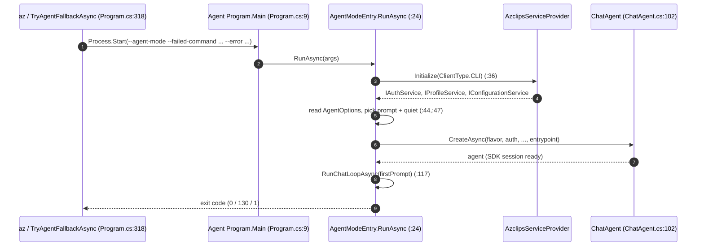
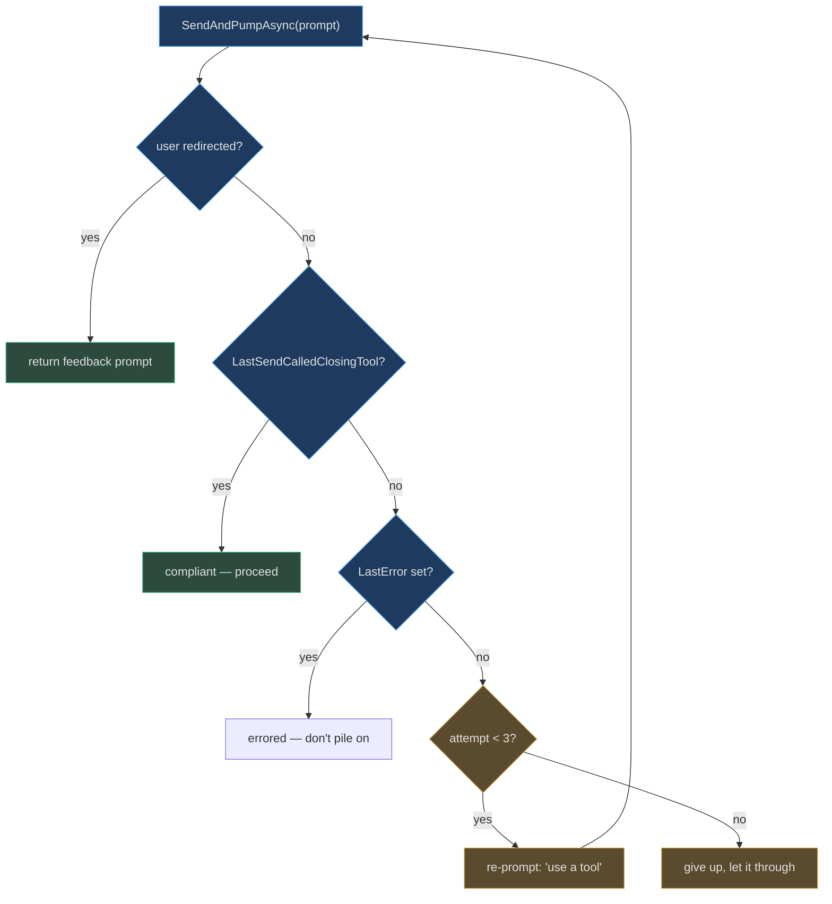
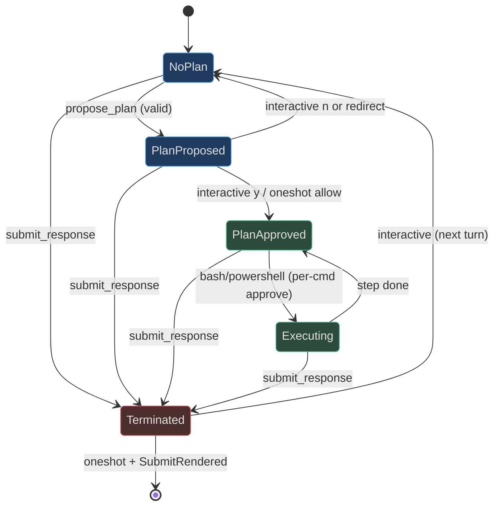

# Agent Architecture

## Why the agent is its own process

Azclips runs the AI agent as a **separate operating-system process**,
`azclips-agent.exe` (`Agent/Core.Agent.csproj:5` sets `OutputType=Exe`,
`:6` sets `AssemblyName=azclips-agent`). The classic `az` CLI spawns it on
demand when a command fails. Three forces drive that boundary:

- **Isolation of a heavy dependency.** The agent pulls in the GitHub Copilot
  SDK, `Microsoft.Extensions.AI`, `Azure.ResourceManager`, and `Spectre.Console`
  (`Agent/Core.Agent.csproj:47`). Keeping those out of the CLI's hot path keeps
  a normal `az group list` lean.
- **Crash / hang containment.** A stuck model turn or a daemon fault dies with
  the child process; the parent `az` just observes a non-zero exit code.
- **Clean stdio contract.** The child inherits the terminal (`src/CLI/Program.cs:369`),
  so streaming tokens, `y`/`n` prompts, and device-code links appear live —
  while the parent simply waits for it to exit.

This page traces the process from `main` to session close. It is the counterpart
to the older, now-incorrect claim that `Core.Tui` hosts agent mode; the agent
lives entirely under `Agent/` and only borrows the shared DI container.

## Entry: a one-branch dispatcher

`azclips-agent.exe`'s `Main` does exactly one thing — it dispatches
`--agent-mode` to `AgentModeEntry.RunAsync` and otherwise prints a hint and exits
(`Agent/Program.cs:9`):

```csharp
public static async Task<int> Main(string[] args)
{
    if (args.Length > 0 && args[0] == "--agent-mode")
        return await AgentModeEntry.RunAsync(args);
    Console.WriteLine("azclips-agent: run via `--agent-mode` ...");
    return 0;
}
```

The CLI always invokes it that way, passing the failed command and error text:
`--agent-mode --failed-command <cmd> [--error <text>]` (`src/CLI/Program.cs:396`).

## Session bootstrap

`AgentModeEntry.RunAsync` (`Agent/AgentMode/AgentModeEntry.cs:24`) owns the whole
session: it is the single owner of stdin, the banner, the renderer stack, and the
chat loop. Its bootstrap sequence:

1. **Force UTF-8 and wire Ctrl+C** to a `CancellationTokenSource`
   (`Agent/AgentMode/AgentModeEntry.cs:26`).
2. **Initialize its own DI container as `ClientType.CLI`**
   (`Agent/AgentMode/AgentModeEntry.cs:36`). The in-code comment is explicit:
   *"was TUI back when this entry lived inside Core.Tui"* — the agent reuses the
   CLI client type rather than defining a distinct agent client.
3. **Resolve services and read config** — `IAuthService`, `IProfileService`,
   `IConfigurationService`, then `GetConfiguration<AgentOptions>()`
   (`Agent/AgentMode/AgentModeEntry.cs:41`).
4. **Pick the prompt and quiet mode from the session style** — interactive uses
   `inline`, one-shot uses `oneshot`; one-shot is "quiet" (no banner, no event
   spam) (`Agent/AgentMode/AgentModeEntry.cs:47`).
5. **Build the renderer/spinner/approval/watcher stack** and the `ChatAgent`
   (`Agent/AgentMode/AgentModeEntry.cs:56`–`:104`), wiring prose suppression via
   `agent.SetOnFinalRendered(...)` (`Agent/AgentMode/AgentModeEntry.cs:108`).
6. **Synthesize the opening prompt** — *"I tried `<cmd>` but it failed…"*
   (`Agent/AgentMode/AgentModeEntry.cs:111`) — and enter `RunChatLoopAsync`.



## The chat loop: one-shot drain vs interactive prompt

`RunChatLoopAsync` (`Agent/AgentMode/AgentModeEntry.cs:136`) sends the opening
prompt with an "Analyzing error root cause using AI" spinner verb, then splits on
session style:

- **One-shot** (`Agent/AgentMode/AgentModeEntry.cs:158`): loop, draining any
  redirect, until the session closes — but never open a `> ` prompt. If the
  agent proposed a plan but never submitted it, a **fallback render** shows the
  plan on exit so one-shot never ends on a blank screen
  (`Agent/AgentMode/AgentModeEntry.cs:166`).
- **Interactive** (`Agent/AgentMode/AgentModeEntry.cs:173`): loop reading a `> `
  line each turn, honoring exit words (`exit`/`quit`/`/exit`/`/quit`/`:q`)
  (`Agent/AgentMode/AgentModeEntry.cs:195`), and applying the **interaction
  brake** — a soft reminder at `EscapeValveSoftTurns = 12` and a hard stop at
  `EscapeValveHardTurns = 20` (`Agent/AgentMode/AgentModeEntry.cs:21`, enforced
  at `:199`).

## The "always act through tools" contract

The agent's protocol requires every turn to end with a **closing tool** —
`propose_plan` or `submit_response`. A turn that only queries (`get_command`,
`find_*`) and then replies in prose is a violation. `ChatAgent` tracks this per
turn via `_sendCalledClosingTool` (`Agent/ChatAgent.cs:43`), exposed as
`LastSendCalledClosingTool` (`Agent/ChatAgent.cs:52`); it is set when the SDK
emits a `ToolStarted` for a closing tool (`Agent/ChatAgent.cs:180`, via
`PreToolUseHook.IsClosingTool`).

Because the SDK offers no way to *forbid* bare prose up front,
`SendWithToolEnforcementAsync` (`Agent/AgentMode/AgentModeEntry.cs:226`) is a
host-side backstop: if a turn produced only prose, it re-prompts the model up to
`MaxToolEnforcementRetries = 3` times with a correction message
(`Agent/AgentMode/AgentModeEntry.cs:216`, `:247`). An in-code comment notes the
durable fix (`tool_choice="required"`) is deferred to a separate effort.



## SessionState: the plan/submit gate machine

A single `SessionState` instance (`Agent/SessionState.cs:11`) is shared between
the chat loop and the `OnPreToolUse` hook. It is intentionally **not**
thread-safe — the SDK invokes the hook serially per session. Its fields form the
session's state machine:

| Field | Role | Source |
|-------|------|--------|
| `IsOneShot` | one-shot vs interactive behavior | `Agent/SessionState.cs:18` |
| `PlanApproved` | true once any plan is approved; gates `bash`/`powershell` | `Agent/SessionState.cs:14` |
| `PlanShown` | informational — a plan was rendered | `Agent/SessionState.cs:22` |
| `SubmittedThisTurn` | true once `submit_response` rendered this turn; denies further tools | `Agent/SessionState.cs:46` |
| `SubmitRendered` | true once a final outcome has rendered this session | `Agent/SessionState.cs:40` |
| `OnFinalRendered` | callback letting the renderer suppress trailing prose | `Agent/SessionState.cs:36` |

`ChatAgent.SessionClosed` derives from two of these: it is true only when the
session is **one-shot AND `SubmitRendered`** (`Agent/ChatAgent.cs:75`). One-shot
therefore exits on the first `submit_response`; interactive stays open until the
user types an exit word.



## The turn contract: SendAsync and AbortAsync

`ChatAgent` wraps the Copilot SDK's `CopilotClient`/`CopilotSession`
(`Agent/ChatAgent.cs:27`). Each turn goes through `SendAsync`
(`Agent/ChatAgent.cs:350`):

- Reset per-turn state (`LastError`, `_sendCalledClosingTool`, `SubmittedThisTurn`).
- Create a per-turn linked `CancellationTokenSource`, swapping the active one via
  `Interlocked.Exchange` (`Agent/ChatAgent.cs:356`).
- Call `SendAndWaitAsync` with a **10-minute `TurnTimeout`**
  (`Agent/ChatAgent.cs:29`, `:360`).

`AbortAsync` (`Agent/ChatAgent.cs:372`) cancels the active turn CTS and calls the
session's `AbortAsync` — used by both the Esc watcher and the free-text redirect
path. The host races the send `Task` against the approval pump so a `y`/`n`
prompt can interrupt a busy turn (`Agent/AgentMode/AgentModeEntry.cs:260`).

## Exit-code contract

The parent CLI interprets the child's exit code differently per style
(`src/CLI/Program.cs:427`): one-shot forces a non-zero code even if the agent
returns 0 (the original command still failed), while interactive passes the
agent's real code through. Inside the agent, a clean `OperationCanceledException`
maps to `130` (Ctrl+C) and any other exception to `1`
(`Agent/AgentMode/AgentModeEntry.cs:120`).

## Related pages

- [Copilot SDK Integration](./copilot-sdk-integration.md) — how `ChatAgent` builds the SDK client, daemon transport, and provider.
- [Prompts & Plan Mode](./prompts-and-plan-mode.md) — the `PreToolUseHook` gate that drives the state machine above.
- [Rendering & Terminal UX](./rendering-and-terminal-ux.md) — the renderer/spinner/approval stack.
- [AI Agent Fallback Quickstart](../01-getting-started/agent-mode-quickstart.md) — the user-facing opt-in.

## References

- `Agent/Program.cs:9` — `Main`, the `--agent-mode` dispatcher.
- `Agent/AgentMode/AgentModeEntry.cs:24` — `RunAsync`, session bootstrap.
- `Agent/AgentMode/AgentModeEntry.cs:136` — `RunChatLoopAsync`, one-shot vs interactive.
- `Agent/AgentMode/AgentModeEntry.cs:226` — `SendWithToolEnforcementAsync`, the tool backstop.
- `Agent/SessionState.cs:11` — the shared session state.
- `Agent/ChatAgent.cs:27` — `ChatAgent`, the SDK session wrapper and turn contract.
- `Agent/ChatAgent.cs:75` — `SessionClosed` semantics.
- `src/CLI/Program.cs:318` — `TryAgentFallbackAsync`, the child-process spawn.
- `Agent/Core.Agent.csproj:6` — `AssemblyName azclips-agent`, `OutputType=Exe`.
