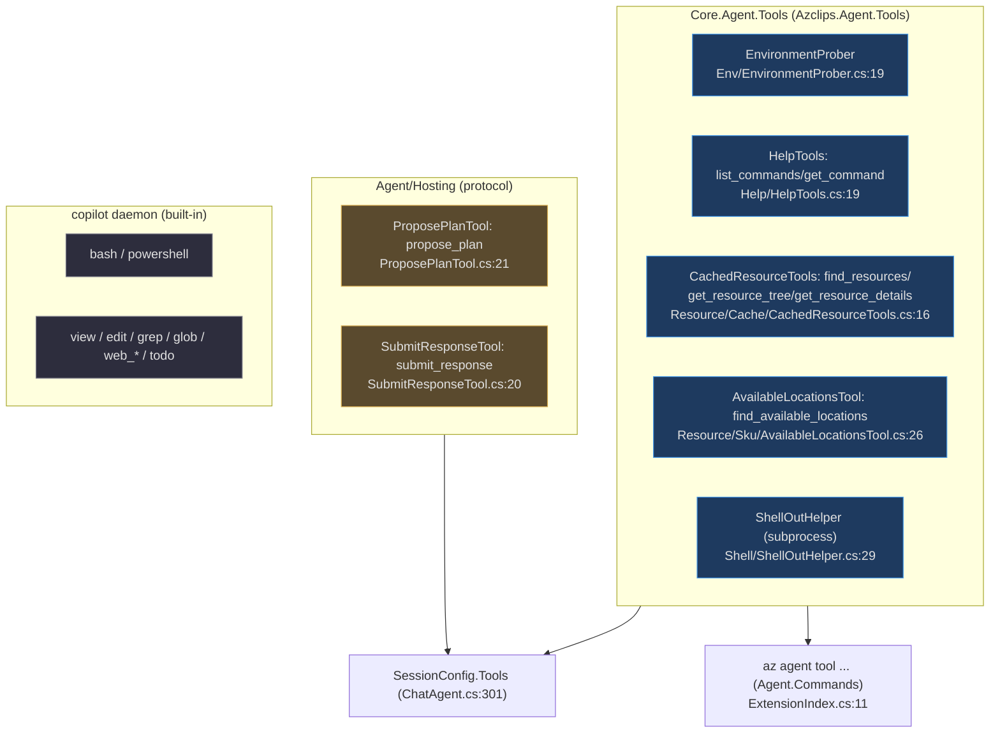
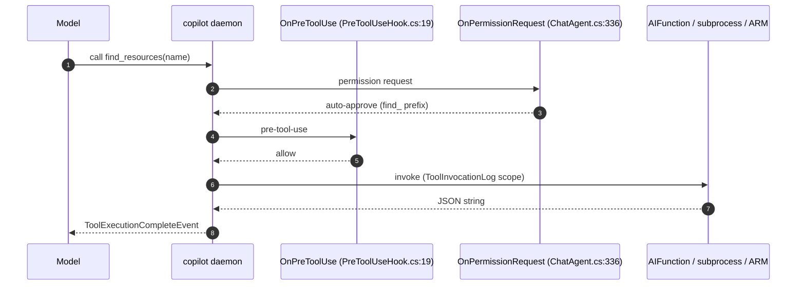

# Agent Tools

## Why tools are split across projects

The agent's capabilities come from three sources, deliberately kept in separate
assemblies so they can be reused without dragging in the whole agent:

1. **`Core.Agent.Tools`** (`Agent/Tools/Core.Agent.Tools.csproj`, `AssemblyName
   Azclips.Agent.Tools`, `:5`) — the Azure-specific custom tools (environment
   probe, help lookup, ARM resource cache, VM SKU availability). Both the agent
   `.exe` and the CLI extension consume this library.
2. **`Agent/Hosting/`** — the two turn-closing **protocol tools**
   (`propose_plan`, `submit_response`), which live next to the host because their
   real behavior is host-side rendering and validation, not the tool body.
3. **The daemon built-ins** — `bash`, `powershell`, `view`, `edit`, `grep`,
   `glob`, `web_fetch`, `web_search`, `todo` — owned by the bundled `copilot`
   daemon, enabled because `SessionConfig.AvailableTools = null`
   (`Agent/ChatAgent.cs:305`).

A fourth surface reuses the same `Core.Agent.Tools` code as first-class
`az agent tool ...` CLI commands via a **separate extension**, so external
programs (Copilot CLI, Claude Code Skills) can call them without a chat loop.

## Custom tools in Core.Agent.Tools

Every custom tool is a `Microsoft.Extensions.AI` `AIFunction` built with
`AIFunctionFactory.Create`, and every one honors the same contract: **always
return a JSON string, never throw to the model.**

### Environment probe

`EnvironmentProber.ProbeAsync` (`Agent/Tools/Env/EnvironmentProber.cs:19`) builds
an `EnvironmentSnapshot` of OS, shell, cwd (preferring `AZCLIPS_CALLER_CWD`,
`:33`), SSH/browser/stdin interactivity, and the active profile's sign-in state.
It is surfaced to the model per turn as an `<environment>` block — see
[Prompts & Plan Mode](./prompts-and-plan-mode.md).

### Help lookup

`HelpTools` (`Agent/Tools/Help/HelpTools.cs:19`) exposes two tools:
`list_commands` (the full catalog) and `get_command` (one command's parameters +
examples). Both shell out to `az agent tool help [--name <x>]`
(`Agent/Tools/Help/HelpTools.cs:73` and `:89`), so the CLI processor is the
single source of truth and adding an extension shows up on the next call with no
cache to invalidate. `LookupCommandAsync` (`:63`) is the host-side entry the
failed-command pre-fetch uses.

### ARM resource cache

`CachedResourceTools` (`Agent/Tools/Resource/Cache/CachedResourceTools.cs:16`)
exposes `find_resources`, `get_resource_tree`, and `get_resource_details`. They
read a **local on-disk ARM cache** — never writing to it — and push the active
profile's tenant into the cache on every call so a mid-session `az account set`
is honored (`SyncTenantAsync`, `Agent/Tools/Resource/Cache/CachedResourceTools.cs:91`).

The cache itself is a singleton `ResourceCache`
(`Agent/Tools/Resource/Cache/ResourceCache.cs:20`) reading per-tenant JSON under
`~/.azclips/arm-cache/<tenantId>/`. It is populated by a fire-and-forget
`ArmCacheRefresher` (`Agent/Tools/Resource/Cache/ArmCacheRefresher.cs:31`) that
queries **Azure Resource Graph** (KQL for subscriptions/resource groups/resources)
with a per-file TTL policy and cross-process `.lock` coalescing:

| Cache kind | Freshness policy | Source |
|------------|------------------|--------|
| tenants | presence check (never expires) | `ArmCacheRefresher.cs:34` |
| subscriptions | presence check (never expires) | `ArmCacheRefresher.cs:35` |
| resource groups | 1 day TTL | `ArmCacheRefresher.cs:36` |
| resources | 8 hour TTL | `ArmCacheRefresher.cs:37` |

The refresher enforces a 300-second budget per full sweep and pages ARG at 1000
rows (`Agent/Tools/Resource/Cache/ArmCacheRefresher.cs:46`, `:52`). Only
`get_resource_details(live=true)` reaches live ARM, via `ArmDetailsClient`.

### VM SKU / location availability

`AvailableLocationsTool` (`Agent/Tools/Resource/Sku/AvailableLocationsTool.cs:26`)
exposes `find_available_locations`. It queries ARM
`providers/Microsoft.Compute/skus` per candidate region in parallel (a default
set of ~8 common regions, `:43`) and reads `restrictions[]` to report whether a
SKU is blocked at Location or Zone level. It backs the `SkuNotAvailable`
auto-recovery flow.

### The subprocess bridge

Env and help tools do not reimplement business logic — they shell out to
`az agent tool ...` through `ShellOutHelper.InvokeAzAsync`
(`Agent/Tools/Shell/ShellOutHelper.cs:29`), which enforces a **30-second
timeout**, forces UTF-8, kills the process tree on timeout/cancel, and returns
**structured JSON errors** (`shell_out_spawn_failed`, `shell_out_timeout`,
`shell_out_cancelled`, `shell_out_nonzero_exit`) so the "always return JSON"
contract holds even on failure.

Every custom tool wraps its body in `ToolInvocationLog.Start(...)`
(`Agent/Tools/Resource/Cache/ToolInvocationLog.cs:20`), opening an `Activity`
named `tool.<name>` under the `Azclips.Agent` `ActivitySource` plus a drainable
timing queue.

## Protocol tools

The turn-closing tools live in `Agent/Hosting/` as `AIFunction`s whose bodies
**only log** — the real work happens in the pre-tool-use hook:

- `ProposePlanTool` (`Agent/Hosting/ProposePlanTool.cs:21`) defines `propose_plan`
  with structured fields (`issues`, `steps`, `placeholders`, `defaults`). Its
  body returns `"plan submitted for user review"` (`:58`).
- `SubmitResponseTool` (`Agent/Hosting/SubmitResponseTool.cs:20`) defines
  `submit_response` with `status` + optional `message`. Its body returns
  `"session terminated"` (`:49`).

Validation and rendering for both live in the hook so a bad call becomes a
deny + correction prompt, not a framework stack trace — see
[Prompts & Plan Mode](./prompts-and-plan-mode.md).

## The permission model (two layers)

Tool calls pass through two independent gates:

1. **SDK `OnPermissionRequest`** — read-only cache tools (any name with a
   `find_`/`get_`/`list_` prefix) are auto-approved; everything else is routed to
   the user (`Agent/ChatAgent.cs:336`, using
   `PreToolUseHook.IsReadOnlyCacheTool`, `Agent/Hooks/PreToolUseHook.cs:271`).
2. **`OnPreToolUse`** — the plan gate, terminator gate, placeholder guard, and
   `az`-path rewrite (covered on the plan-mode page).

## Tool catalog

| Tool | Owner | Class / Source | Permission | Backend |
|------|-------|----------------|------------|---------|
| `list_commands`, `get_command` | custom | `HelpTools.cs:19` | auto (`get_`/`list_`) | `az agent tool help` subprocess |
| `find_resources`, `get_resource_tree`, `get_resource_details` | custom | `CachedResourceTools.cs:16` | auto (`find_`/`get_`) | on-disk ARM cache (+ optional live ARM) |
| `find_available_locations` | custom | `AvailableLocationsTool.cs:26` | auto (`find_`) | ARM Compute SKUs (HTTP) |
| `propose_plan` | protocol | `ProposePlanTool.cs:21` | intercepted (plan gate) | host render |
| `submit_response` | protocol | `SubmitResponseTool.cs:20` | intercepted (terminator) | host render |
| `bash`, `powershell` | daemon | built-in | **plan-gated** + per-command approve | daemon |
| `view`/`edit`/`grep`/`glob`/`web_fetch`/`web_search`/`todo` | daemon | built-in | SDK `OnPermissionRequest` | daemon |

## The `az agent tool ...` command surface

The same tool logic is re-exposed as a first-class extension, `Agent.Commands`
(`[ExtensionVerb("agent")]`, `Agent/Commands/ExtensionIndex.cs:11`). Its CLI
dispatch table (`Agent/Commands/ExtensionIndex.cs:129`) maps:

| Command | Processor |
|---------|-----------|
| `az agent tool env` | `EnvProcessor` |
| `az agent tool help [--name <x>]` | `HelpProcessor` |
| `az agent tool resource find` | `ResourceFindProcessor` |
| `az agent tool resource sku` | `ResourceSkuProcessor` |
| `az agent tool resource tree` | `ResourceTreeProcessor` |
| `az agent tool resource show` | `ResourceShowProcessor` |
| `az agent tool resource refresh` | `ResourceRefreshProcessor` |

Each processor invokes the **same** `AIFunction` the agent uses. For example,
`ResourceFindProcessor.ProcessAsync` (`Agent/Commands/Processors/Resource/ResourceFindProcessor.cs:27`)
builds `AIFunctionArguments` and calls `tools.FindResources.InvokeAsync`
(`:50`) — guaranteeing the CLI command and the agent tool can never drift. This
is also why the agent's help/env tools can shell out to `az agent tool ...`: the
subprocess and the in-process tool share one implementation.

## Related pages

- [Copilot SDK Integration](./copilot-sdk-integration.md) — how tools are registered into `SessionConfig`.
- [Prompts & Plan Mode](./prompts-and-plan-mode.md) — the plan gate and the two protocol tools' validation.
- [Rendering & Terminal UX](./rendering-and-terminal-ux.md) — how tool events render.

## References

- `Agent/Tools/Env/EnvironmentProber.cs:19` — `ProbeAsync`, the environment snapshot.
- `Agent/Tools/Help/HelpTools.cs:19` — `list_commands` / `get_command`.
- `Agent/Tools/Resource/Cache/CachedResourceTools.cs:16` — the ARM cache read tools.
- `Agent/Tools/Resource/Cache/ArmCacheRefresher.cs:31` — the ARG-backed refresher + TTLs.
- `Agent/Tools/Resource/Sku/AvailableLocationsTool.cs:26` — VM SKU/region availability.
- `Agent/Tools/Shell/ShellOutHelper.cs:29` — `InvokeAzAsync`, the subprocess bridge.
- `Agent/Hosting/ProposePlanTool.cs:21` / `Agent/Hosting/SubmitResponseTool.cs:20` — protocol tools.
- `Agent/Commands/ExtensionIndex.cs:11` — the `az agent tool ...` extension.
