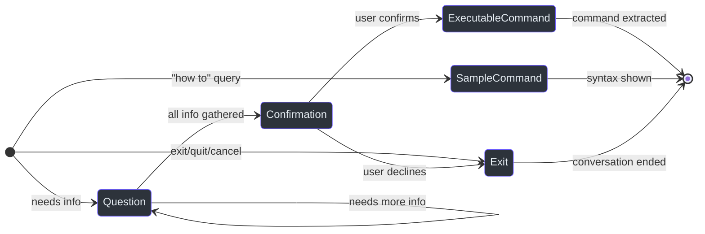

# AI Agent Integration

Cirrus's AI agent layer transforms natural language input into structured Azure commands. When a user types `"create a resource group called test in eastus"` and no structured command matches, the `OrchestratorEngine` falls back to the `AgentEngine`, which delegates to `CloudAgent` — an Azure OpenAI-powered conversational agent that gathers information, generates commands, and requests user confirmation before execution.

## Why AI Fallback Exists

The orchestration design (`src/Core/Core.Engine/OrchestratorEngine.cs:60-119`) treats the AI agent as a second-class citizen — structured commands always execute first. The agent only activates when:

1. **Unknown command** — `DefaultCommandEngine` throws because `CommandBinder` returns null (`src/Core/Core.Engine/DefaultCommandEngine.cs:42`)
2. **Typo correction** — user types `"gruop create"` instead of `"group create"`
3. **Natural language** — `"create a resource group for me"` has no structured match
4. **PowerShell bypass** — when `AZURECLI_FLAVOR == "azure powershell"`, all input routes directly to the agent (`src/Core/Core.Engine/OrchestratorEngine.cs:65-70`)

This design ensures zero latency penalty for known commands while providing a graceful degradation path for everything else.

## CloudAgent Architecture

`CloudAgent` (`src/Core/Core.Agent/CloudAgent.cs:13`) wraps the Microsoft.Agents.AI `AIAgent` with conversation management.

### Class Structure

```csharp
public class CloudAgent
{
    private readonly AIAgent _innerAgent;                           // line 15
    private readonly List<ChatMessage> _conversationHistory;        // line 16

    private CloudAgent(AIAgent innerAgent) { ... }                  // line 18 (private ctor)
    public static async Task<CloudAgent> CreateAsync(string flavor) // line 29 (factory)
}
```

The private constructor (line 18) and async factory pattern enforce that credential validation and prompt loading happen before the agent is usable.

### Factory Method: CreateAsync

`CreateAsync` (`src/Core/Core.Agent/CloudAgent.cs:29-78`) performs four steps:

**Step 1 — Load .env file** (lines 35-50): Searches four locations in order:
1. `{AppContext.BaseDirectory}/.env` — CLI binary directory
2. `{Directory.GetCurrentDirectory()}/.env` — current working directory
3. `{Assembly.Location}/.env` — module directory (for PowerShell)
4. `{Directory.GetCurrentDirectory()}/bin/.env` — development convenience

**Step 2 — Read credentials** (lines 53-58): Three required environment variables:
- `AZURE_OPENAI_ENDPOINT` — Azure OpenAI resource URL
- `AZURE_OPENAI_API_KEY` — API key for authentication
- `AZURE_OPENAI_DEPLOYMENT` — Deployment/model name

Each throws `InvalidOperationException` with a descriptive message if missing.

**Step 3 — Load and parameterize prompt** (lines 61-67):
```csharp
string promptPath = Path.Combine(AppContext.BaseDirectory, "prompt.md");
string instructions = File.Exists(promptPath)
    ? await File.ReadAllTextAsync(promptPath)
    : "You are a helpful assistant. Provide clear, concise answers.";
instructions = instructions.Replace("{{flavor}}", flavor);
```

The `{{flavor}}` placeholder is replaced with either `"azure cli"` or `"azure powershell"`.

**Step 4 — Create AIAgent** (lines 70-76):
```csharp
AIAgent innerAgent = new AzureOpenAIClient(
    new Uri(endpoint),
    new AzureKeyCredential(apiKey))
        .GetChatClient(deployment)
        .CreateAIAgent(
            instructions: instructions,
            name: "CLI Assistant");
```

### Streaming Responses

`RunStreamingAsync` (`src/Core/Core.Agent/CloudAgent.cs:84`) returns an `IAsyncEnumerable<AgentRunResponseUpdate>`:

1. Adds the user message to conversation history (lines 87-88)
2. Streams response updates from the inner agent (line 92)
3. Accumulates the full response with `StringBuilder` (line 94)
4. Adds the assistant's complete message to history (lines 99-100)

The conversation history is publicly readable via `ConversationHistory` (line 106) and clearable via `ClearHistory()` (line 111).

## The Prompt Template

The system prompt (`src/Core/Core.Agent/prompt.md`) defines the agent's behavior, response schema, and supported commands.

### JSON Response Schema

Every response must be valid JSON with exactly two fields (`src/Core/Core.Agent/prompt.md:13-17`):

```json
{
  "response": "your response text here",
  "type": "executable_command | sample_command | question | confirmation | exit"
}
```

### Response Types

| Type | When Used | Example | Line |
|---|---|---|---|
| `executable_command` | After user confirms, command has real values | `azv2 group create --name mygroup --location eastus` | 22 |
| `sample_command` | Syntax help with placeholders | `azv2 group create --name <name> --location <location>` | 23 |
| `question` | Gathering required information | `What name would you like for the resource group?` | 24 |
| `confirmation` | Asking approval before execution | Command + `Proceed with this command? (yes/no)` | 25 |
| `exit` | User says exit/quit/cancel/nevermind or declines | Goodbye message | 26 |



### Flavor-Specific Syntax Rules

The prompt instructs the AI to use different syntax based on flavor (`src/Core/Core.Agent/prompt.md:7-8`):
- **azure cli**: lowercase `azv2` commands (e.g., `azv2 group create`)
- **azure powershell**: PascalCase cmdlets without prefix (e.g., `New-ResourceGroup`)

### Critical Rules

The prompt enforces strict behavioral constraints (`src/Core/Core.Agent/prompt.md:72-85`):
- Always return valid JSON with no extra text (line 73)
- Always use `confirmation` before `executable_command` (line 74)
- Use `executable_command` only after user confirms with actual values (line 75)
- No markdown code blocks or formatting outside JSON (line 80)

### Supported Commands

The prompt explicitly lists the only truly executable commands (`src/Core/Core.Agent/prompt.md:89-94`):
- `azv2 login --TenantId <tenant-id> --SubscriptionId <subscription-id> --UseDeviceCode`
- `azv2 group create --SubscriptionId <subscription-id> --Name <name> --Location <location>`

All other commands are treated as `sample_command` with a note that they are not yet supported in Cirrus.

## AgentEngine: The Conversation Loop

`AgentEngine` (`src/Core/Core.Engine/AgentEngine.cs:32`) wraps `CloudAgent` with interactive UI, JSON parsing, and response routing.

### Inner Response Model

```csharp
private class AgentResponse                                    // line 47
{
    public string Response { get; set; } = string.Empty;       // line 49
    public string Type { get; set; } = string.Empty;           // line 50
}
```

### ExecuteCommandAsync: Full Flow

The main method (`src/Core/Core.Engine/AgentEngine.cs:53-230`) implements:

**1. Agent initialization** (line 59):
```csharp
_agent ??= await Core.Agent.CloudAgent.CreateAsync(_flavor);
```
The `??=` operator ensures the agent is reused across retry attempts in the `OrchestratorEngine` loop, preserving multi-turn conversation history.

**2. Input preparation** (line 64):
```csharp
string userInput = string.Join(" ", args);
```

**3. Spinner animation** (lines 72-92): For CLI mode only (skipped when `_flavor == "azure powershell"`, line 75):
```
Frames: ["⠋", "⠙", "⠹", "⠸", "⠼", "⠴", "⠦", "⠧", "⠇", "⠏"]
Update interval: 100ms
Display: "\r{frame} Thinking..."
```

**4. Streaming** (lines 98-113): Iterates `_agent.RunStreamingAsync(userInput)` and accumulates response chunks. The spinner is cancelled on the first streaming update (lines 100-110).

**5. JSON parsing** (lines 126-141):
```csharp
var agentResponse = JsonSerializer.Deserialize<AgentResponse>(
    cleanedResponse,
    new JsonSerializerOptions { PropertyNameCaseInsensitive = true });
```

**6. Response routing** (lines 151-222):

```mermaid
sequenceDiagram
    autonumber
    participant User
    participant AgentEngine
    participant CloudAgent
    participant AzureOpenAI as Azure OpenAI

    User->>AgentEngine: "create a resource group for me"
    AgentEngine->>AgentEngine: _agent ??= CloudAgent.CreateAsync(flavor)
    AgentEngine->>AgentEngine: Start spinner (CLI only)

    loop Conversation Loop
        AgentEngine->>CloudAgent: RunStreamingAsync(userInput)
        CloudAgent->>AzureOpenAI: Stream chat completion
        AzureOpenAI-->>CloudAgent: Response chunks
        CloudAgent-->>AgentEngine: IAsyncEnumerable updates

        AgentEngine->>AgentEngine: Stop spinner, parse JSON

        alt type == "question"
            AgentEngine->>User: Display question in cyan
            User->>AgentEngine: Provide answer
            Note over AgentEngine: userInput = user's answer, loop continues
        else type == "confirmation"
            AgentEngine->>User: Show command + "Proceed? (yes/no)"
            User->>AgentEngine: "yes"
            Note over AgentEngine: userInput = "yes", loop continues
        else type == "executable_command"
            AgentEngine->>AgentEngine: _extractedCommand = response
            AgentEngine->>User: Display command in cyan
            alt CLI mode
                Note over AgentEngine: Exit loop, return to OrchestratorEngine
            else PowerShell mode
                AgentEngine->>User: Output "__PSEXEC__" marker
            end
        else type == "sample_command"
            AgentEngine->>User: Display syntax in cyan
            AgentEngine->>AgentEngine: _extractedCommand = null
            Note over AgentEngine: Exit loop
        else type == "exit"
            AgentEngine->>User: Display goodbye
            Note over AgentEngine: Exit loop
        end
    end

    style User fill:#2d333b,stroke:#6d5dfc,color:#e6edf3
    style AgentEngine fill:#2d333b,stroke:#6d5dfc,color:#e6edf3
    style CloudAgent fill:#2d333b,stroke:#6d5dfc,color:#e6edf3
    style AzureOpenAI fill:#2d333b,stroke:#6d5dfc,color:#e6edf3
```

### Response Type Handling Details

**`executable_command`** (`src/Core/Core.Engine/AgentEngine.cs:153-168`):
- Stores the response in `_extractedCommand` (line 159)
- For PowerShell: outputs the `__PSEXEC__` marker string (lines 162-165), which PowerShell cmdlets detect to extract and execute the command
- Breaks out of the conversation loop (line 168)

**`sample_command`** (lines 170-177):
- Displays the syntax in cyan
- Sets `_extractedCommand = null` — no command to feed back to `DefaultCommandEngine`
- Exits the loop

**`confirmation` / `question`** (lines 188-215):
- Displays the message in cyan
- **PowerShell mode** (lines 196-200): exits immediately because PowerShell cmdlets cannot do interactive `Console.ReadLine()` — the conversation is one-shot
- **CLI mode** (lines 202-215): prompts for user input via `ReadLineAsync()`, then sets `userInput` to the response and continues the loop

**`exit`** (lines 179-186):
- Displays goodbye message
- Sets `_extractedCommand = null`
- Exits the loop

### Error Handling

All exceptions in `ExecuteCommandAsync` are caught silently (`src/Core/Core.Engine/AgentEngine.cs:225-229`), setting `_extractedCommand = null`. This is intentional — if the AI fails (network error, invalid JSON, API quota), the `OrchestratorEngine` sees no extracted command and exits gracefully rather than crashing.

## Bootstrapper Registration

The `AgentEngine` is registered in the Bootstrapper with a factory that reads the flavor environment variable (`src/Core/Core.Engine/Bootstrapper.cs:85-91`):

```csharp
services.AddSingleton<AgentEngine>(sp =>
{
    var flavor = Environment.GetEnvironmentVariable("AZURECLI_FLAVOR") ?? "azure cli";
    return new AgentEngine(
        sp.GetRequiredService<IOutputAdapter>(),
        flavor);
});
```

The `DIRegisterExtensions.RegisterAgentServices()` method (`src/Core/Core.Agent/DIRegisterExtensions.cs:10-13`) currently contains only a TODO comment — actual agent service registrations happen in the Bootstrapper rather than through the standard DI extension pattern.

## PowerShell Integration

When PowerShell cmdlets invoke the agent:

1. They set `AZURECLI_FLAVOR=azure powershell` before calling the CLI binary
2. `OrchestratorEngine` detects this and skips `DefaultCommandEngine` entirely (line 65-70)
3. `AgentEngine` uses `"azure powershell"` flavor in the prompt template
4. The AI generates PascalCase cmdlet syntax instead of `azv2` commands
5. For `executable_command` responses, the `__PSEXEC__` marker is emitted (line 162-165)
6. Interactive prompts are skipped — PowerShell cannot read from `Console` in a cmdlet context (line 196-200)

## .env Configuration

The `.env` file is loaded by `DotNetEnv.Env.Load()` (`src/Core/Core.Agent/CloudAgent.cs:47`). Required variables:

| Variable | Purpose | Required |
|---|---|---|
| `AZURE_OPENAI_ENDPOINT` | Azure OpenAI resource endpoint URL | Yes |
| `AZURE_OPENAI_API_KEY` | API key for authentication | Yes |
| `AZURE_OPENAI_DEPLOYMENT` | Model deployment name | Yes |

A `.env.example` file in `src/Core/Core.Agent/` provides a template. The search order (`src/Core/Core.Agent/CloudAgent.cs:35-41`) ensures the `.env` file is found whether running from the CLI binary directory, the current working directory, or a PowerShell module path.

## Conversation History Management

`CloudAgent` maintains a `List<ChatMessage>` (`src/Core/Core.Agent/CloudAgent.cs:16`) that accumulates user and assistant messages across turns:

- **User messages** are added before streaming (line 87-88)
- **Assistant messages** are added after the full response is accumulated (lines 99-100)
- The history is passed to every `RunStreamingAsync` call, giving the AI full context of the conversation
- `ClearHistory()` (line 111) resets the conversation

Because `AgentEngine` reuses the `CloudAgent` instance across `OrchestratorEngine` retries (`_agent ??=` on line 59), the AI retains context from failed attempts. For example, if the AI generates a command that fails validation, the error context from the previous turn informs the next attempt.

## Key Design Decisions

1. **One question at a time** — The prompt instructs the AI to ask one question per turn (`src/Core/Core.Agent/prompt.md:40`), creating a natural conversation flow rather than overwhelming users with parameter lists.

2. **Confirmation before execution** — The `confirmation` → `executable_command` flow is a hard rule in the prompt (`src/Core/Core.Agent/prompt.md:74`). The AI must show the command and get approval before producing an executable response.

3. **Silent failure** — Agent errors never bubble up to the user (`src/Core/Core.Engine/AgentEngine.cs:225-229`). If Azure OpenAI is unreachable, the CLI simply doesn't extract a command, and the orchestrator exits cleanly.

4. **Flavor as constructor parameter** — Rather than reading `AZURECLI_FLAVOR` on every call, the flavor is captured once at `AgentEngine` construction time (`src/Core/Core.Engine/Bootstrapper.cs:87`), preventing mid-session flavor changes.

## References

| Source File | Key Lines | Purpose |
|---|---|---|
| `src/Core/Core.Agent/CloudAgent.cs` | 13-111 | Azure OpenAI agent wrapper with conversation history |
| `src/Core/Core.Agent/DIRegisterExtensions.cs` | 5-13 | Agent DI registration (stub) |
| `src/Core/Core.Agent/prompt.md` | 1-96 | System prompt with JSON schema and rules |
| `src/Core/Core.Engine/AgentEngine.cs` | 32-230 | Conversation loop, JSON parsing, response routing |
| `src/Core/Core.Engine/OrchestratorEngine.cs` | 60-119 | AI fallback trigger and retry logic |
| `src/Core/Core.Engine/Bootstrapper.cs` | 85-91 | AgentEngine factory with flavor detection |
| `src/Core/Core.Engine/DefaultCommandEngine.cs` | 42 | Exception that triggers AI fallback |
