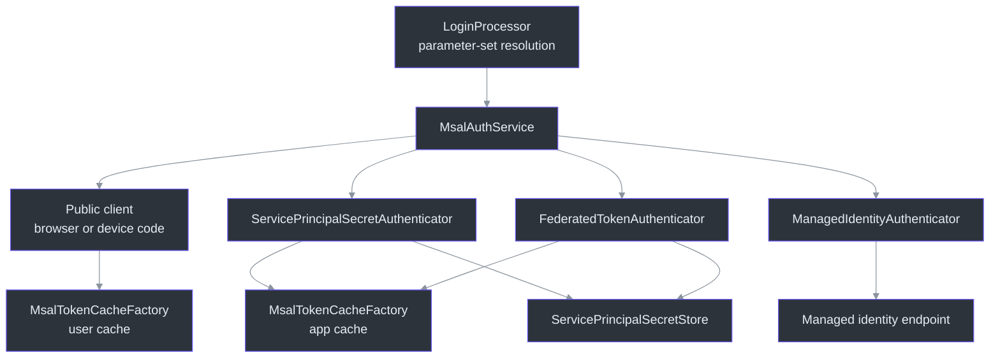
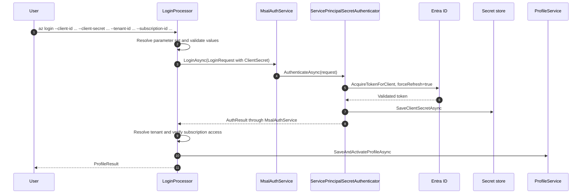

# Authentication (MSAL)

## Overview — why credentials and profiles are separate

A profile describes **which connection to use**, not the credential itself. Browser users,
service principals, and managed identities all reach the same HTTP auth handler, but obtaining
their bearer tokens requires different flows. `MsalAuthService` implements that dispatch behind
`IAuthService`, returning an MSAL-independent `AuthResult`
(`src/Core/Core.Authentication/MsalAuthService.cs:10`,
`src/Core/Core.Abstractions/IAuthService.cs:9`).

`LoginRequest` is a record containing a tenant, optional scopes, and an `AuthCredential`; there
is no `UseDeviceCodeFlow` property. The login processor resolves parameter sets before constructing
the credential (`src/Core/Core.Abstractions/Models/LoginRequest.cs:6`,
`src/Extensions/Accounts/Processors/LoginProcessor.cs:119`).

## Architecture

### The service contract

| Operation | Meaning | Source |
| --- | --- | --- |
| `LoginAsync(request, ct)` | Validate a supplied credential and acquire a token | `src/Core/Core.Abstractions/IAuthService.cs:17` |
| `LogoutAsync(profileName, ct)` | Resolve the profile and evict credentials appropriate to its auth method | `src/Core/Core.Abstractions/IAuthService.cs:29` |
| `AcquireTokenSilentlyAsync(scopes, tenantId, promptOnError, ct, profile)` | Acquire using the invocation's profile, falling back to the active profile for direct callers | `src/Core/Core.Abstractions/IAuthService.cs:42` |
| `CanAcquireTokenSilentlyAsync(tenantId, profile, ct)` | Return false for `MsalUiRequiredException`; propagate unrelated failures | `src/Core/Core.Authentication/MsalAuthService.cs:409` |

The default ARM scope is `https://management.core.windows.net//.default`. The public client
uses `ClientMetadata.FirstPartyApplicationId`, a localhost redirect, and the multi-organization
authority when no tenant is supplied — not a fixed corporate tenant
(`src/Core/Core.Authentication/MsalAuthService.cs:277`).

## Login flows

| Credential | CLI shape | Acquisition |
| --- | --- | --- |
| Browser | `az login --subscription-id ` | System browser with account selection |
| Device code | `az login --use-device-code --subscription-id ` | Verification URL and code printed to the console |
| System-assigned managed identity | `az login --identity --subscription-id ` | Platform credential endpoint |
| User-assigned managed identity | `az login --identity --client-id <client> --subscription-id ` | Platform endpoint with one identity selector; object ID or resource ID are alternatives |
| Federated service principal | `az login --service-principal --client-id <client> --federated-token <assertion> --tenant-id <tenant> --subscription-id ` | Confidential client with an OIDC assertion |
| Client-secret service principal | `az login --service-principal --client-id <client> --client-secret <secret> --tenant-id <tenant> --subscription-id ` | Confidential client with a secret |

The required combinations are defined by `LoginProcessor.DefineParameterSets`; managed identity,
browser, device-code, and new service-principal logins require an explicitly supplied subscription ID.
Login does not inherit argument defaults from the active profile. Managed identity accepts at most one user-assigned selector
(`src/Extensions/Accounts/Processors/LoginProcessor.cs:119`,
`src/Extensions/Accounts/Processors/LoginProcessor.cs:426`).

Treat the table as syntax, not copy-paste credentials. Never commit a real secret or assertion.

### Fresh service-principal login is not a cache hit

Both service-principal authenticators force a refresh during **login**, so Entra must accept the
newly supplied credential before it replaces a stored working credential. Silent acquisition
may then reuse the app token cache
(`src/Core/Core.Authentication/Authenticators/ServicePrincipalSecretAuthenticator.cs:17`,
`src/Core/Core.Authentication/Authenticators/FederatedTokenAuthenticator.cs:21`).

`ServicePrincipalSecretStore` stores secrets by client ID and assertions by client ID plus
tenant. These are separate from profile JSON. Client-secret profiles record the application ID
as `UserPrincipalName` for display; this is not a human account
(`src/Core/Core.Authentication/ServicePrincipalSecretStore.cs:52`,
`src/Core/Core.Authentication/Authenticators/ServicePrincipalSecretAuthenticator.cs:88`).

Profile naming remains independent of credential type: an initial login without a naming
option writes the reserved `default` profile, `--out-profile` writes a named profile, and
`--profile` re-authenticates an existing one. The latter cannot be combined with
`--out-profile`. Federated profile re-authentication requires a newly issued
`--federated-token`; it does not replay a saved assertion to prove a fresh login
(`src/Extensions/Accounts/Processors/LoginProcessor.cs:197`,
`src/Extensions/Accounts/Processors/LoginProcessor.cs:359`).

## Silent acquisition and HTTP requests

`AcquireTokenSilentlyAsync` dispatches using the resolved profile's `AuthMethod`
(`src/Core/Core.Authentication/MsalAuthService.cs:322`):

1. **ManagedIdentity:** reconstruct the selector from `ManagedIdentityId` and ask the platform
   for a token (`src/Core/Core.Authentication/Authenticators/ManagedIdentityAuthenticator.cs:42`).
2. **Federated:** load the stored assertion and use the confidential client. A missing assertion
   reports that the user must sign in again
   (`src/Core/Core.Authentication/Authenticators/FederatedTokenAuthenticator.cs:59`).
3. **ServicePrincipalSecret:** require a client ID and tenant, retrieve the stored secret, and
   call the secret authenticator. A missing secret is an explicit failure.
4. **User flows:** select the cached account with `MsalAccountSelector`, then call
   `AcquireTokenSilent`. Only `promptOnError=true` permits an interactive retry.

`AuthHandler.SendAsync` passes the invocation's **whole profile**, not just its tenant, to the
selected acquisition delegate. It attaches `Authorization: Bearer ...`, updates runtime-only
profile metadata, and publishes before/after acquisition events. Without a resolved profile it
does not acquire a token (`src/Core/Core.Runtime/Handler/AuthHandler.cs:27`). The runtime
metadata has `[JsonIgnore]` and is not persisted to `profiles.json`
(`src/Core/Core.Abstractions/Models/Profile.cs:47`).

## Token and credential storage

`MsalTokenCacheFactory` attempts OS protection and verifies persistence. If that verification
throws `MsalCachePersistenceException`, it falls back to an unprotected JSON file and
`MsalAuthService` warns during login. Plaintext is a **fallback**, not the unconditional
default (`src/Core/Core.Authentication/MsalTokenCacheFactory.cs:157`,
`src/Core/Core.Authentication/MsalAuthService.cs:78`).

| Storage | Windows | Linux / macOS | Unprotected fallback |
| --- | --- | --- | --- |
| User tokens | `msal.cache.user.bin` (DPAPI) | libsecret / Keychain, with `msal.cache.user.sig` change signal | `msal.cache.user.json` |
| App tokens | `msal.cache.app.bin` | libsecret / Keychain, with `msal.cache.app.sig` change signal | `msal.cache.app.json` |
| Service-principal credentials | `service.principal.entries` prefix with the same protection tiers | Separate secret-store record | Prefix with `.json` |

The filename rules are in `MsalTokenCacheFactory.GetCacheFileName`
(`src/Core/Core.Authentication/MsalTokenCacheFactory.cs:73`); the secret-store prefix is
defined in `ServicePrincipalSecretStore`
(`src/Core/Core.Authentication/ServicePrincipalSecretStore.cs:26`).
Defaults resolve under `{LocalApplicationData}/.azclips`; `AZCLIPS_HOME` overrides both the
home and local-app-data roots (`src/Core/Core.Abstractions/HomePaths.cs:19`).
Do not treat a `.sig` file as the token payload or assume classic Azure CLI caches are reused.

## Logout semantics and limitations

Logout is **profile-aware**, but app-token eviction is not per-profile:

| Profile method | Credential cleanup |
| --- | --- |
| Browser / device code | Remove matching UPN accounts from the shared user cache; profiles sharing that account can be affected |
| Federated / client secret | Empty the shared app token cache, then remove this profile's stored credential |
| Managed identity | No local token-cache cleanup; the platform issues tokens on demand |

MSAL app caches expose no account-based removal API. Clearing their shared cache therefore
evicts all service principals' cached tokens; other applications can mint tokens again from
their retained credentials. User-cache cleanup is best-effort with warning/debug diagnostics,
and does not clear unrelated accounts
(`src/Core/Core.Authentication/MsalAuthService.cs:90`,
`src/Core/Core.Authentication/MsalAuthService.cs:186`).

The enum includes `Broker`, but `LoginAsync` does not expose a distinct broker acquisition
branch. Do not equate an enum member with an implemented login surface
(`src/Core/Core.Abstractions/Models/AuthMethod.cs:6`,
`src/Core/Core.Authentication/MsalAuthService.cs:23`).

## References

- `src/Core/Core.Abstractions/IAuthService.cs:9` — authentication contract.
- `src/Core/Core.Abstractions/Models/LoginRequest.cs:6` — credential-carrying request.
- `src/Extensions/Accounts/Processors/LoginProcessor.cs:119` — parameter sets and profile persistence.
- `src/Core/Core.Authentication/MsalAuthService.cs:23` — login dispatch, silent acquisition, logout.
- `src/Core/Core.Authentication/MsalTokenCacheFactory.cs:18` — protection and cache partitions.
- `src/Core/Core.Authentication/ServicePrincipalSecretStore.cs:20` — stored credentials.
- `src/Core/Core.Runtime/Handler/AuthHandler.cs:27` — profile-aware HTTP authentication.
- [Configuration & Profiles](./configuration-profiles.md) — profile selection and persistence.
