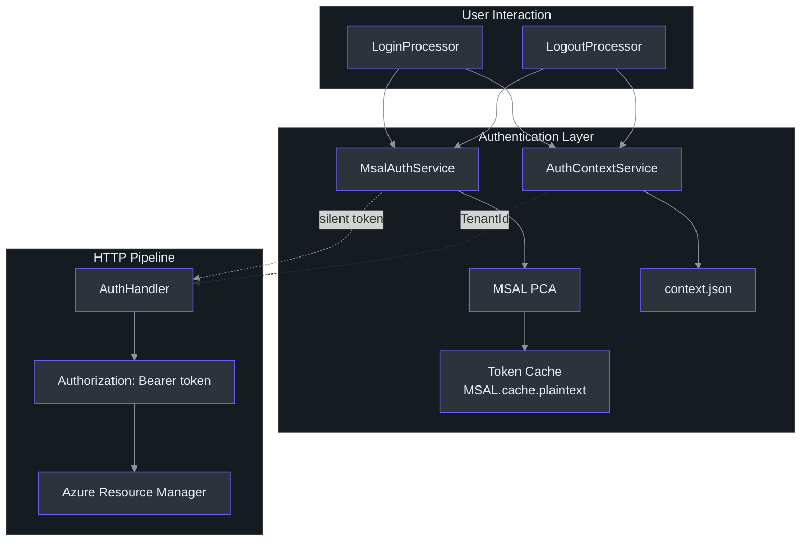

# Authentication & Authorization

Cirrus authenticates users against Microsoft Entra ID (Azure AD) using the Microsoft Authentication Library (MSAL). The authentication subsystem manages three concerns: **acquiring tokens** (interactive and device-code flows), **persisting auth state** (token cache and auth context on disk), and **injecting tokens** into outbound HTTP requests via a delegating handler pipeline.

## Authentication Architecture



## IAuthService Interface

The `IAuthService` contract (`src/Core/Core.Abstractions/IAuthService.cs:6`) defines three operations:

| Method | Returns | Purpose |
|---|---|---|
| `LoginAsync(LoginRequest request, CancellationToken)` | `Task<AuthResult>` | Interactive or device-code login (line 14) |
| `LogoutAsync(CancellationToken)` | `Task` | Clear tokens and cached credentials (line 21) |
| `AcquireTokenSilentlyAsync(string[]? scopes, string? tenantId, bool promptOnError, CancellationToken)` | `Task<AuthResult>` | Silent token acquisition with optional interactive fallback (line 31) |

## MsalAuthService Implementation

`MsalAuthService` (`src/Core/Core.Authentication/MsalAuthService.cs:7`) implements `IAuthService` using MSAL's `IPublicClientApplication`. It is registered as a singleton by the Bootstrapper (`src/Core/Core.Engine/Bootstrapper.cs:56`).

### Constants

```csharp
private const string ArmDefaultScope = "https://management.core.windows.net//.default";  // line 9
private const string ClientId = "1950a258-227b-4e31-a9cf-717495945fc2";                  // line 10
```

The `ClientId` is the well-known Azure CLI first-party application ID. The ARM scope covers all Azure Resource Manager operations.

### LoginAsync Flow

`LoginAsync` (`src/Core/Core.Authentication/MsalAuthService.cs:12-23`) branches based on `request.UseDeviceCodeFlow`:

- **Interactive** → `AcquireTokenInteractiveAsync` (line 21): Opens a browser via MSAL with embedded web view disabled (`WithUseEmbeddedWebView(false)`, line 55), using redirect URI `http://localhost:50000` (line 78).
- **Device code** → `AcquireTokenWithDeviceCodeAsync` (line 17): Logs the device code message for the user to enter at `https://microsoft.com/devicelogin` (lines 66-69).

Both methods call `BuildApp(tenantId)` → `RegisterTokenCacheAsync(app)` → `ExecuteAsync()` → `ToAuthResult()`.

### BuildApp

The `BuildApp` method (`src/Core/Core.Authentication/MsalAuthService.cs:77-81`) constructs an `IPublicClientApplication`:

```csharp
PublicClientApplicationBuilder.Create(ClientId)
    .WithRedirectUri("http://localhost:50000")
    .WithTenantId(tenantId ?? "72f988bf-86f1-41af-91ab-2d7cd011db47")
    .Build();
```

The fallback tenant ID `72f988bf-86f1-41af-91ab-2d7cd011db47` is the Microsoft corporate tenant.

### Token Cache Persistence

`RegisterTokenCacheAsync` (`src/Core/Core.Authentication/MsalAuthService.cs:83-111`) sets up platform-specific token cache persistence:

**Cache location** (line 85):
```
{Environment.SpecialFolder.LocalApplicationData}/.cirrus/MSAL.cache[.plaintext]
```

**Platform-specific encryption** (lines 94-104):
- **Linux** — `WithLinuxKeyring()` stores cache data in the GNOME Keyring with service `"Microsoft.Project.Cirrus"` (lines 96-101)
- **macOS** — `WithMacKeyChain()` with service name `"Microsoft Project Cirrus"` (lines 102-104)
- **Plaintext fallback** — `WithUnprotectedFile()` used when `plaintextUnsafe = true` (line 95)

Currently, all calls pass `plaintextUnsafe: true` (lines 34, 53, 64, 125), meaning the encrypted keyring/keychain paths are defined but not yet active.

### Silent Token Acquisition

`AcquireTokenSilentlyAsync` (`src/Core/Core.Authentication/MsalAuthService.cs:120-152`) is the method used by command execution to get tokens without user interaction:

1. Build the app and register cache (lines 124-125)
2. Get cached accounts (line 127-128)
3. If no account found, attempt silent acquisition with `null` account (lines 134-138)
4. If account found, use it for silent acquisition (line 142)
5. On `MsalUiRequiredException` when `promptOnError` is true, fall back to interactive (lines 145-148)

### AuthResult Mapping

`AuthResultExtensions.ToAuthResult()` (`src/Core/Core.Authentication/AuthResultExtensions.cs:8-18`) maps the MSAL `AuthenticationResult` to Cirrus's own `AuthResult` model:

```csharp
new AuthResult
{
    AccessToken = msalAuthResult.AccessToken,
    ExpiresOn = msalAuthResult.ExpiresOn,
    Scopes = msalAuthResult.Scopes.ToArray(),
    TenantId = msalAuthResult.TenantId,
    CorrelationId = msalAuthResult.CorrelationId
}
```

## Login Flow: Full Sequence

```mermaid
sequenceDiagram
    autonumber
    participant User
    participant LoginCmd as LoginProcessor
    participant AuthSvc as MsalAuthService
    participant MSAL as MSAL PCA
    participant Entra as Microsoft Entra ID
    participant CtxSvc as AuthContextService
    participant Disk as context.json

    User->>LoginCmd: az login --SubscriptionId sub1 --TenantId t1

    LoginCmd->>LoginCmd: Resolve IAuthService, IAuthContextService

    alt UseDeviceCode == true
        LoginCmd->>AuthSvc: LoginAsync(request)
        AuthSvc->>MSAL: AcquireTokenWithDeviceCode(scopes)
        MSAL->>User: Display device code message
        User->>Entra: Enter code at microsoft.com/devicelogin
        Entra-->>MSAL: AuthenticationResult
    else Interactive (default)
        LoginCmd->>AuthSvc: LoginAsync(request)
        AuthSvc->>MSAL: AcquireTokenInteractive(scopes)
        MSAL->>User: Open browser
        User->>Entra: Authenticate in browser
        Entra-->>MSAL: AuthenticationResult via redirect
    end

    MSAL-->>AuthSvc: AuthenticationResult
    AuthSvc->>AuthSvc: ToAuthResult() extension method
    AuthSvc-->>LoginCmd: AuthResult

    LoginCmd->>LoginCmd: Create AuthContext(SubscriptionId, TenantId)
    LoginCmd->>CtxSvc: SaveContextAsync(authContext)
    CtxSvc->>Disk: Serialize to JSON, write context.json
    CtxSvc-->>LoginCmd: done

    LoginCmd->>User: WriteOutput(authContext)

    style User fill:#2d333b,stroke:#6d5dfc,color:#e6edf3
    style LoginCmd fill:#2d333b,stroke:#6d5dfc,color:#e6edf3
    style AuthSvc fill:#2d333b,stroke:#6d5dfc,color:#e6edf3
    style MSAL fill:#2d333b,stroke:#6d5dfc,color:#e6edf3
    style Entra fill:#2d333b,stroke:#6d5dfc,color:#e6edf3
    style CtxSvc fill:#2d333b,stroke:#6d5dfc,color:#e6edf3
    style Disk fill:#2d333b,stroke:#6d5dfc,color:#e6edf3
```

## AuthContextService: Persisted Auth State

`AuthContextService` (`src/Core/Core.Authentication/AuthContextService.cs:6`) manages the `AuthContext` model, which tracks the active subscription and tenant across CLI invocations.

### Storage Paths

```csharp
private static readonly string ContextDirectory =
    Path.Combine(Environment.GetFolderPath(
        Environment.SpecialFolder.LocalApplicationData), ".cirrus");        // line 8
private static readonly string ContextFilePath =
    Path.Combine(ContextDirectory, "context.json");                         // line 9
```

### IAuthContextService Interface

The contract (`src/Core/Core.Abstractions/IAuthContextService.cs:6`) defines:

| Method | Purpose | Line |
|---|---|---|
| `GetCurrentContextAsync()` | Returns the current `AuthContext?`, loading from disk if needed | 13 |
| `SaveContextAsync(AuthContext)` | Serializes to JSON and writes to `context.json` | 21 |
| `ClearContextAsync()` | Deletes `context.json` and nulls the in-memory reference | 28 |

### Save Flow

`SaveContextAsync` (`src/Core/Core.Authentication/AuthContextService.cs:12-27`):
1. Create directory if missing (line 17)
2. Serialize `authContext` with `WriteIndented = true` (line 18)
3. Write to `ContextFilePath` (line 20)
4. Update `_currentContext` in-memory cache (line 21)

### Load Flow

`GetCurrentContextAsync` (line 29-34) calls `LoadContextAsync` which reads from `ContextFilePath` if it exists (line 40), deserializing with `PropertyNameCaseInsensitive = true` (line 44). The result is cached in `_currentContext` (line 32).

### Clear Flow

`ClearContextAsync` (`src/Core/Core.Authentication/AuthContextService.cs:58-68`) nulls the in-memory reference (line 61) and deletes the file (line 65).

## AuthHandler: Bearer Token Injection

`AuthHandler` (`src/Core/Core.Runtime/Handler/AuthHandler.cs:11-36`) implements `IAuthHandler` and sits in the HTTP pipeline of every authenticated request.

### Properties

| Property | Type | Purpose | Line |
|---|---|---|---|
| `AuthContext` | `AuthContext` | Current tenant/subscription context | 13 |
| `AcquireTokenAsyncDefault` | `AcquireTokenAsyncDelegate` | Default token acquisition function | 16 |
| `AcquireTokenAsyncOverride` | `AcquireTokenAsyncDelegate?` | Optional override for custom token logic | 19 |
| `ApplyOverride` | `bool` | Whether to use the override delegate | 22 |

### SendAsync Pipeline Step

The `SendAsync` property (lines 25-35) returns a lambda that:

1. Starts a telemetry activity (line 27)
2. Selects the token acquirer — override if `ApplyOverride && AcquireTokenAsyncOverride != null`, otherwise default (lines 29-31)
3. Calls the acquirer with `(null, AuthContext.TenantId, false)` to get an `AuthResult`
4. Sets the `Authorization` header to `"Bearer {AccessToken}"` (line 32)
5. Calls the next handler in the pipeline (line 34)

### Integration in CLIEngine

`CLIEngine.CreateProcessorContext()` (`src/Core/Core.Engine/CLIEngine.cs:129-162`) wires the handler:

```csharp
var authHandler = new AuthHandler
{
    AuthContext = authContext,                      // from AuthContextService
    AcquireTokenAsyncDefault = AcquireTokenAsync    // from IAuthService
};
```

The `ProcessorContext` assembles `AuthHandler`, `OutputHandler`, and `TelemetryHandler` into an `HttpPipeline` that processors use for all ARM calls.

### Integration in PSEngine

`PSEngine.CreateProcessorContext()` (`src/Core/Core.Engine/PSEngine.cs:94-127`) follows the same pattern but sources delegates from its constructor-injected functions (`GetAuthContext`, `AcquireTokenSilentlyAsync`, `StartActivity`). The channel-based output handler writes to a `ChannelWriter<object>` instead of `Console`.

## Login Command Implementation

`LoginProcessor` (`src/Extensions/Login/Processors/Login.cs:6`) extends `LoginProcessorBase` and exposes three properties:

| Property | Type | Required | Default | Line |
|---|---|---|---|---|
| `SubscriptionId` | `string` | Yes | `""` | 8-12 |
| `TenantId` | `string` | No | `""` | 14-18 |
| `UseDeviceCode` | `bool` | No | `false` | 20-24 |

The `ProcessAsync` method (lines 26-48):
1. Resolves `IAuthService` and `IAuthContextService` from `CirrusServiceProvider` (lines 29-31)
2. Creates a `LoginRequest` with `TenantId`, `SubscriptionId`, and `UseDeviceCodeFlow` (lines 33-38)
3. Calls `authService.LoginAsync(loginRequest).GetAwaiter().GetResult()` — note the synchronous blocking (line 40)
4. Creates an `AuthContext` with the subscription and tenant from the result (lines 41-45)
5. Saves the context via `authContextService.SaveContextAsync()` (line 46)
6. Writes output (line 47)

## Logout Command Implementation

`LogoutProcessor` (`src/Extensions/Login/Processors/Logout.cs:6`) is simpler, with `ProcessAsync` (lines 8-17):

1. Resolve services (lines 11-13)
2. Call `authService.LogoutAsync()` — clears the MSAL token cache (line 14)
3. Call `authContextService.ClearContextAsync()` — deletes `context.json` (line 15)
4. Write `true` as output (line 16)

The `LogoutAsync` method in `MsalAuthService` (`src/Core/Core.Authentication/MsalAuthService.cs:25-47`) iterates through all cached accounts and removes them one by one (lines 39-44).

## DI Registration

`DIRegisterExtensions.RegisterAuthenticationServices()` (`src/Core/Core.Authentication/DIRegisterExtensions.cs:11-16`) provides a clean extension method:

```csharp
services.AddSingleton<IAuthService, MsalAuthService>();        // line 13
services.AddSingleton<IAuthContextService, AuthContextService>(); // line 14
```

Both are singletons because the token cache and auth context should be shared across all commands in a session.

## Authenticated API Call: Full Sequence

```mermaid
sequenceDiagram
    autonumber
    participant Cmd as ResourceProcessor
    participant Engine as CLIEngine
    participant AuthCtx as AuthContextService
    participant AuthHdlr as AuthHandler
    participant AuthSvc as MsalAuthService
    participant MSAL as MSAL PCA
    participant Cache as Token Cache
    participant ARM as Azure ARM

    Cmd->>Engine: ProcessAsync()
    Engine->>AuthCtx: GetCurrentContextAsync()
    AuthCtx-->>Engine: AuthContext (TenantId, SubscriptionId)

    Engine->>Engine: CreateProcessorContext()
    Engine->>AuthHdlr: Set AuthContext, AcquireTokenAsyncDefault

    Cmd->>ARM: HTTP GET /subscriptions/...
    Note over Cmd,ARM: Request enters HTTP pipeline

    AuthHdlr->>AuthHdlr: Select token acquirer
    AuthHdlr->>AuthSvc: AcquireTokenSilentlyAsync(null, tenantId, false)
    AuthSvc->>MSAL: AcquireTokenSilent(scopes, account)
    MSAL->>Cache: Check for cached token
    
    alt Token in cache and valid
        Cache-->>MSAL: Cached token
    else Token expired or missing
        MSAL->>MSAL: Refresh token flow
    end

    MSAL-->>AuthSvc: AuthenticationResult
    AuthSvc-->>AuthHdlr: AuthResult

    AuthHdlr->>AuthHdlr: Set Authorization: Bearer {token}
    AuthHdlr->>ARM: Forward authenticated request
    ARM-->>Cmd: HTTP response

    style Cmd fill:#2d333b,stroke:#6d5dfc,color:#e6edf3
    style Engine fill:#2d333b,stroke:#6d5dfc,color:#e6edf3
    style AuthCtx fill:#2d333b,stroke:#6d5dfc,color:#e6edf3
    style AuthHdlr fill:#2d333b,stroke:#6d5dfc,color:#e6edf3
    style AuthSvc fill:#2d333b,stroke:#6d5dfc,color:#e6edf3
    style MSAL fill:#2d333b,stroke:#6d5dfc,color:#e6edf3
    style Cache fill:#2d333b,stroke:#6d5dfc,color:#e6edf3
    style ARM fill:#2d333b,stroke:#6d5dfc,color:#e6edf3
```

## Security Considerations

1. **Plaintext cache** — All current code paths use `plaintextUnsafe: true` (`src/Core/Core.Authentication/MsalAuthService.cs:34,53,64,125`). The keyring/keychain integration is implemented but not activated. This is acceptable for development but should be hardened for production.

2. **Hardcoded tenant fallback** — The Microsoft corporate tenant `72f988bf-86f1-41af-91ab-2d7cd011db47` is used when no tenant is specified (`src/Core/Core.Authentication/MsalAuthService.cs:80`). Users must pass `--TenantId` explicitly for non-Microsoft tenants.

3. **Synchronous blocking in processors** — `LoginProcessor` uses `.GetAwaiter().GetResult()` (line 40) instead of `await`. This is a deliberate choice because the processor's `ProcessAsync` runs in a `Task.Run` wrapper within the engine, avoiding deadlocks.

4. **Token in memory only** — `AuthHandler` never persists the bearer token. It calls `AcquireTokenSilentlyAsync` on every request, relying on MSAL's in-memory + disk cache for performance.

## References

| Source File | Key Lines | Purpose |
|---|---|---|
| `src/Core/Core.Authentication/MsalAuthService.cs` | 7-161 | MSAL token acquisition, cache registration |
| `src/Core/Core.Authentication/AuthContextService.cs` | 6-69 | Auth context persistence to `context.json` |
| `src/Core/Core.Authentication/AuthResultExtensions.cs` | 6-18 | MSAL → Cirrus auth result mapping |
| `src/Core/Core.Authentication/DIRegisterExtensions.cs` | 6-16 | DI registration extension method |
| `src/Core/Core.Abstractions/IAuthService.cs` | 6-31 | Auth service contract |
| `src/Core/Core.Abstractions/IAuthContextService.cs` | 6-28 | Auth context service contract |
| `src/Core/Core.Runtime/Handler/AuthHandler.cs` | 11-36 | Bearer token injection handler |
| `src/Extensions/Login/Processors/Login.cs` | 6-48 | Login processor implementation |
| `src/Extensions/Login/Processors/Logout.cs` | 6-17 | Logout processor implementation |
| `src/Core/Core.Engine/CLIEngine.cs` | 129-162 | CLI command context creation |
| `src/Core/Core.Engine/PSEngine.cs` | 94-127 | PowerShell command context creation |
