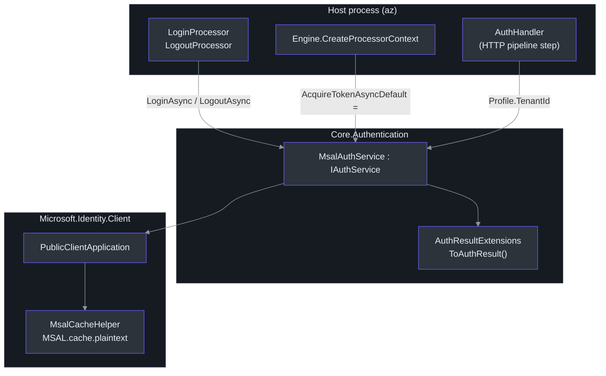
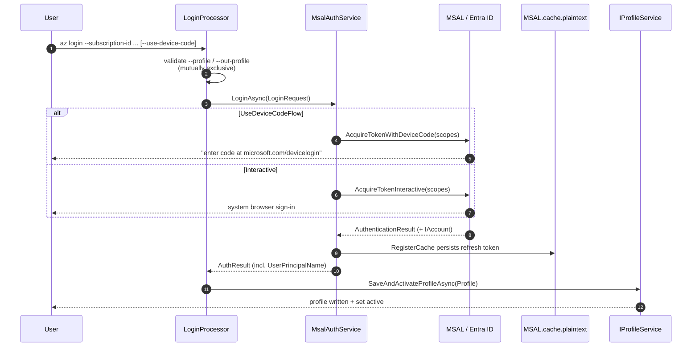
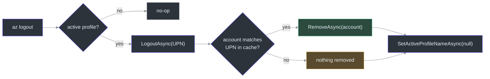

# Authentication (MSAL)

## Overview — why this design

Azclips is a CLI that calls Azure Resource Manager (ARM) on the user's behalf. Every
authenticated call needs a valid bearer token, and users expect to sign in once and have
subsequent commands "just work" without re-prompting. To achieve this, the authentication
subsystem is built on **Microsoft.Identity.Client (MSAL)** and is deliberately split into two
concerns:

1. **Token acquisition & cache management** — owned by `MsalAuthService`
   (`src/Core/Core.Authentication/MsalAuthService.cs:11`), which implements the MSAL-agnostic
   `IAuthService` contract (`src/Core/Core.Abstractions/IAuthService.cs:9`).
2. **Token *usage*** — owned by the engine's `AuthHandler`
   (`src/Core/Core.Runtime/Handler/AuthHandler.cs:14`), a step in the HTTP pipeline that attaches
   a `Bearer` header to each outgoing request.

The key architectural decision is that **`IAuthService` returns a simplified, MSAL-independent
`AuthResult`** (`src/Core/Core.Abstractions/Models/AuthResult.cs:11`) rather than leaking MSAL's
`AuthenticationResult` type across the whole codebase. This keeps the rest of Azclips free of a
hard MSAL dependency, so the auth provider could be swapped without touching every processor.

> **Naming note.** Product code, cache keyrings and the `~/.azclips` home directory all use the
> **Azclips** codename. The target framework is **net10.0**.

## Component map



## The `IAuthService` contract

`IAuthService` exposes exactly three operations, deliberately narrow
(`src/Core/Core.Abstractions/IAuthService.cs:17`):

| Method | Purpose | Source |
| --- | --- | --- |
| `LoginAsync(LoginRequest, ct)` | Interactive/device-code sign-in; returns a fresh `AuthResult` | `IAuthService.cs:17` |
| `LogoutAsync(string? userPrincipalName, ct)` | Remove **one** account (by UPN) from the shared cache | `IAuthService.cs:27` |
| `AcquireTokenSilentlyAsync(scopes, tenantId, promptOnError, ct)` | Silent (cache-backed) token acquisition used by the engine | `IAuthService.cs:37` |

The single concrete implementation is `MsalAuthService`, constructed with an `ILoggingService`
and an `ITelemetryService` (`src/Core/Core.Authentication/MsalAuthService.cs:10`). Every public
method opens a telemetry activity named `MsalAuthService.<Method>` so sign-in latency is traceable
(`MsalAuthService.cs:17`).

### Fixed constants: scope and client id

Two constants define *what* Azclips asks for and *as whom*
(`src/Core/Core.Authentication/MsalAuthService.cs:12`):

```csharp
private const string ArmDefaultScope = "https://management.core.windows.net//.default";
private const string ClientId        = "1950a258-227b-4e31-a9cf-717495945fc2";
```

- **`ArmDefaultScope`** — the ARM `.default` scope. The double slash (`windows.net//.default`) is
  intentional: `.default` is appended to the resource URI `https://management.core.windows.net/`,
  which itself ends in a slash. This tells Entra ID to issue a token carrying every ARM permission
  already consented for the app.
- **`ClientId`** — a well-known Microsoft public-client application id (the same first-party id used
  by other Azure command-line tools). Because it is a *public* client, no secret is embedded in the
  binary; MSAL uses the redirect URI + PKCE flow instead.

When no explicit scope is passed, every acquisition falls back to `[ArmDefaultScope]`
(`MsalAuthService.cs:65`, `:76`, `:146`).

## Login: device-code vs interactive

`LoginAsync` is a thin branch over the `LoginRequest.UseDeviceCodeFlow` flag
(`src/Core/Core.Authentication/MsalAuthService.cs:15`):

```csharp
public async Task<AuthResult> LoginAsync(LoginRequest request, CancellationToken ct = default)
{
    if (request.UseDeviceCodeFlow)
        return await AcquireTokenWithDeviceCodeAsync(request.Scopes, request.TenantId, ct);
    else
        return await AcquireTokenInteractiveAsync(request.Scopes, request.TenantId, ct);
}
```

| Flow | MSAL call | User experience | Source |
| --- | --- | --- | --- |
| **Interactive** (default) | `AcquireTokenInteractive(...).WithUseEmbeddedWebView(false)` | Opens the system browser via the `http://localhost` redirect | `MsalAuthService.cs:65` |
| **Device code** | `AcquireTokenWithDeviceCode(...)` with a callback that logs the code | Prints "go to microsoft.com/devicelogin and enter code…" — used on headless/SSH hosts | `MsalAuthService.cs:76` |

Both flows are constructed by the shared `BuildApp(tenantId)` helper, which sets the redirect URI
to `http://localhost` and defaults to the Microsoft corporate tenant when no tenant is supplied
(`MsalAuthService.cs:87`). After acquisition, `LogTokenMetadataDebug` records the username, token
source and cache-refresh reason at debug level (`MsalAuthService.cs:164`), and the MSAL result is
converted to an `AuthResult` via `ToAuthResult()`.

### The `az login` end-to-end sequence



`LoginProcessor` builds a `LoginRequest` from its bound arguments, calls `LoginAsync`, then
projects the returned `AuthResult` into a `Profile` (carrying `TenantId`, `SubscriptionId`,
`AuthMethod` and `UserPrincipalName`) and persists it with a single
`SaveAndActivateProfileAsync` call (`src/Extensions/Accounts/Processors/LoginProcessor.cs:90`). Note
that `--profile` **re-authenticates** an existing profile while `--out-profile` **creates** one;
supplying both fails fast before any network call (`LoginProcessor.cs:46`).

## Silent acquisition — the engine's default token source

Everyday commands never call `LoginAsync`. Instead the engine wires
`AcquireTokenSilentlyAsync` as the default token acquirer (see below). This method:

1. Builds a `PublicClientApplication` for the tenant and registers the cache
   (`MsalAuthService.cs:134`).
2. Reads the first cached account; if none, it still attempts a silent call with a `null` account so
   MSAL can use a login hint from the cache (`MsalAuthService.cs:137`).
3. On `MsalUiRequiredException`, it *only* falls back to interactive sign-in when
   `promptOnError` is `true` (`MsalAuthService.cs:155`); otherwise the exception propagates so the
   caller can surface a "please run `az login`" message.

```csharp
catch (MsalUiRequiredException) when (promptOnError)
{
    result = await app.AcquireTokenInteractive(scopes ?? [ArmDefaultScope])
                      .WithUseEmbeddedWebView(false)
                      .ExecuteAsync(cancellationToken);
}
```

## The token cache — shared and cross-platform

`RegisterTokenCacheAsync` hooks MSAL's user token cache into a persistent, cross-platform store
using `Microsoft.Identity.Client.Extensions.Msal` (`src/Core/Core.Authentication/MsalAuthService.cs:93`).
Its behaviour depends on the `plaintextUnsafe` flag:

| Mode | Storage backend | Notes |
| --- | --- | --- |
| `plaintextUnsafe: true` (currently used everywhere) | Unprotected file `MSAL.cache.plaintext` | `builder.WithUnprotectedFile()` — `MsalAuthService.cs:104` |
| `plaintextUnsafe: false` (future) | Linux keyring / macOS keychain | Keyring labelled `Microsoft.Azclips` / `Microsoft Azclips` — `MsalAuthService.cs:106` |

The cache directory is resolved by `HomePaths.GetDefaultLocalAppDataRoot()`
(`src/Core/Core.Abstractions/HomePaths.cs:47`), which places `MSAL.cache[.plaintext]` under the
per-user local-app-data `.azclips` folder (`HomePaths.cs:12`). Crucially, **this one cache file is
shared across all profiles** — a fact that shapes how logout works.

## Logout — remove *only* the active profile's account

Because the MSAL cache is shared, a naïve "clear the cache" logout would sign out accounts that
belong to *other* profiles. The design therefore narrows logout to a single account. Per
**Decision 6** of the profile-management design
(`openspec/changes/profile-management/design.md:70`), `az logout`:

1. Removes only the account whose `IAccount.Username` matches the active profile's
   `UserPrincipalName` from the shared cache.
2. Clears the active-profile pointer (the profile definition itself is retained).

`LogoutAsync(userPrincipalName)` implements step 1 (`src/Core/Core.Authentication/MsalAuthService.cs:28`):

```csharp
if (string.IsNullOrWhiteSpace(userPrincipalName)) return;      // nothing to remove
var app = PublicClientApplicationBuilder.Create(ClientId).Build();
await RegisterTokenCacheAsync(app, plaintextUnsafe: true);

var matching = (await app.GetAccountsAsync())
    .Where(a => string.Equals(a.Username, userPrincipalName, StringComparison.OrdinalIgnoreCase));
foreach (var account in matching)
    await app.RemoveAsync(account);                            // targeted removal
```

The orchestration lives in `LogoutProcessor`, which reads the active profile, calls
`LogoutAsync(activeProfile.UserPrincipalName)`, then unsets the active pointer via
`SetActiveProfileNameAsync(null)` (`src/Extensions/Accounts/Processors/LogoutProcessor.cs:21`). When no
profile is active, logout is a safe no-op.



## `AuthResult` and `AuthResultExtensions`

`AuthResult` is a `record` that mirrors the useful fields of MSAL's `AuthenticationResult` while
staying MSAL-free (`src/Core/Core.Abstractions/Models/AuthResult.cs:11`). It carries `AccessToken`,
`ExpiresOn`, `Scopes`, `TenantId`, `CorrelationId`, and a **nullable `UserPrincipalName`**
(`AuthResult.cs:51`).

That `UserPrincipalName` field was added specifically so logout can later identify the account: the
mapping happens in `AuthResultExtensions.ToAuthResult()`, which copies `Account?.Username` into it
(`src/Core/Core.Authentication/AuthResultExtensions.cs:20`):

```csharp
UserPrincipalName = msalAuthResult.Account?.Username,
```

The extension also copies the scopes into a fresh array rather than referencing MSAL's internal
array, keeping the returned record fully decoupled (`AuthResultExtensions.cs:17`).

## From `AuthContext`/`context.json` to `Profile` on `ProcessorContext`

Historically the signed-in session was represented by an `AuthContext` object persisted to
`context.json` (still described by the now-stale spec `eng-docs/spec/auth-context.md`). That model was
**removed**. Per **Decision 5** of the profile-management design, `AuthContext`,
`IAuthContextService`/`AuthContextService`, and `context.json` were deleted, and the resolved
**`Profile`** became the single connection-state object flowing through the runtime
(`openspec/changes/profile-management/design.md:70`).

Today, per invocation:

1. `Engine.CreateProcessorContext` resolves the profile (explicit `--profile`, else the active
   profile, else `null`) and constructs an `AuthHandler`, binding
   `AcquireTokenAsyncDefault = authService.AcquireTokenSilentlyAsync`
   (`src/Core/Core.Engine/Engine.cs:101`).
2. The resolved `Profile?` is placed both on the `AuthHandler` and on the `ProcessorContext` record
   (`src/Core/Core.Abstractions/Models/ProcessorContext.cs:9`).
3. On each outgoing request, `AuthHandler.SendAsync` acquires a token **only when a profile is
   present**, reading `Profile.TenantId` for the acquisition and attaching the `Bearer` header
   (`src/Core/Core.Runtime/Handler/AuthHandler.cs:38`):

```csharp
if (this.Profile is not null)
{
    var token = await tokenAcquirer(null, this.Profile.TenantId, false);
    request.Headers.Authorization = new AuthenticationHeaderValue("Bearer", token.AccessToken);
}
```

When no profile is resolved, no token is attached; commands that genuinely require auth fail at the
point of use with a clear error rather than sending an anonymous request
(`AuthHandler.cs:30`). The token acquirer is the `AcquireTokenAsyncDelegate` whose signature
deliberately matches `AcquireTokenSilentlyAsync`
(`src/Core/Core.Abstractions/Runtime/delegates.cs:28`), and an override slot
(`AcquireTokenAsyncOverride`) lets tests inject mock tokens without touching MSAL.

> **See also:** [Configuration & Profile Management](./configuration-profiles.md) for how profiles
> are stored, activated, and resolved, and how `--profile`/`-Profile` pre-binding feeds
> `CreateProcessorContext`.

## Threat model & current limitations

| Concern | Current state | Source |
| --- | --- | --- |
| Token-at-rest protection | Cache written **unencrypted** (`MSAL.cache.plaintext`); keyring/keychain code exists but is not the active path | `MsalAuthService.cs:104` |
| Multi-tenant | `BuildApp` falls back to a hard-coded corporate tenant when none supplied | `MsalAuthService.cs:90` |
| Client id | Single hard-coded first-party public-client id (marked `todo: 1P or 3P?`) | `MsalAuthService.cs:13` |
| App reuse | A new `PublicClientApplication` is built per call (`todo` notes reuse when tenant is stable) | `MsalAuthService.cs:86` |

These are tracked as inline `todo`s in `MsalAuthService` and represent the main hardening backlog for
the auth subsystem.

## References

- `src/Core/Core.Authentication/MsalAuthService.cs:11` — MSAL implementation of `IAuthService`
- `src/Core/Core.Authentication/MsalAuthService.cs:28` — profile-scoped `LogoutAsync`
- `src/Core/Core.Authentication/AuthResultExtensions.cs:20` — surfaces `UserPrincipalName`
- `src/Core/Core.Abstractions/IAuthService.cs:9` — the auth contract
- `src/Core/Core.Abstractions/Models/AuthResult.cs:11` — MSAL-independent result record
- `src/Core/Core.Abstractions/HomePaths.cs:47` — token-cache location under `.azclips`
- `src/Core/Core.Runtime/Handler/AuthHandler.cs:38` — HTTP pipeline token attachment
- `src/Core/Core.Engine/Engine.cs:101` — wires `AcquireTokenSilentlyAsync` + resolves `Profile`
- `src/Extensions/Accounts/Processors/LoginProcessor.cs:90` — login → profile save + activate
- `src/Extensions/Accounts/Processors/LogoutProcessor.cs:21` — active-profile logout orchestration
- `openspec/changes/profile-management/design.md:70` — Decisions 5 & 6 (Profile replaces AuthContext; scoped logout)
- `eng-docs/spec/auth-context.md` — **stale** legacy spec; the `AuthContext`/`context.json` model it describes was removed
