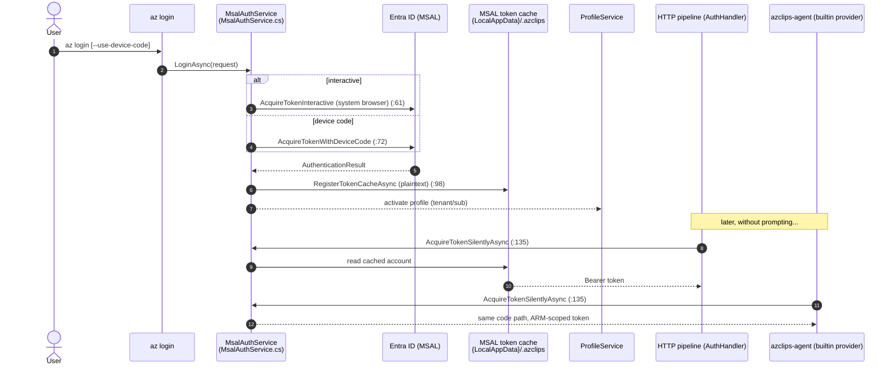
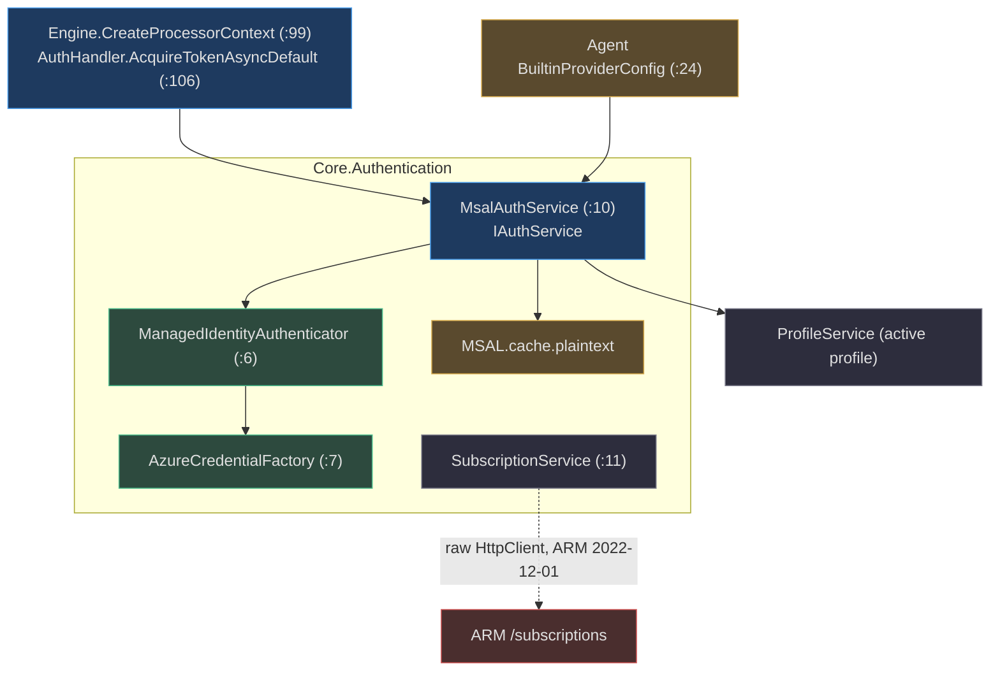

# Authentication (MSAL)

## Why There Is One Auth Service

Authentication in Azclips is deliberately centralized in a single service, `MsalAuthService`, for a reason that shows up everywhere else in the architecture: **the HTTP pipeline and the AI agent must acquire tokens through the exact same code path.** There is no parallel credential flow for the agent, no second cache, no separate app registration. When a CLI command needs a bearer token it calls `IAuthService.AcquireTokenSilentlyAsync`; when the agent's built-in Copilot provider needs an ARM-scoped token, it calls the *same* method. That single-source-of-truth design is what this page traces.

The code is in `Azure/cirrus` under the `Azclips` identity, built on `Microsoft.Identity.Client` (MSAL).

## The Service and Its Contract

`MsalAuthService` (`src/Core/Core.Authentication/MsalAuthService.cs:10`) implements `IAuthService` (`src/Core/Core.Abstractions/IAuthService.cs`). It is registered as a singleton alongside the credential factory, the managed-identity authenticator, and the subscription service (`src/Core/Core.Authentication/DIRegisterExtensions.cs:14-20`).

| Method | Purpose | Source |
| --- | --- | --- |
| `LoginAsync` | Branches on `AuthMethod`: managed identity, device code, or interactive | `src/Core/Core.Authentication/MsalAuthService.cs:19` |
| `LogoutAsync` | Removes **only** the account matching a user principal name from the token cache | `src/Core/Core.Authentication/MsalAuthService.cs:30` |
| `AcquireTokenSilentlyAsync` | Silent token acquisition (used by the HTTP pipeline **and** the agent) | `src/Core/Core.Authentication/MsalAuthService.cs:135` |
| `CanAcquireTokenSilentlyAsync` | Probe: returns `true`/`false` for whether interactive sign-in is required | `src/Core/Core.Authentication/MsalAuthService.cs:178` |

The public-client app id is the classic first-party Azure CLI GUID `1950a258-227b-4e31-a9cf-717495945fc2` (`src/Core/Core.Authentication/MsalAuthService.cs:17`), and the default ARM scope is `https://management.core.windows.net//.default` (`src/Core/Core.Authentication/AuthConstants.cs:10`).

## Login Flows

`LoginAsync` (`src/Core/Core.Authentication/MsalAuthService.cs:19`) is a switch over the requested `AuthMethod`:

| Method | Path | Source |
| --- | --- | --- |
| `ManagedIdentity` | Delegates to `ManagedIdentityAuthenticator.AuthenticateAsync` | `src/Core/Core.Authentication/MsalAuthService.cs:24` |
| `DeviceCode` | `AcquireTokenWithDeviceCode` — prints the code + URL to the console | `src/Core/Core.Authentication/MsalAuthService.cs:72` |
| Interactive (default) | `AcquireTokenInteractive` with the system browser (`WithUseEmbeddedWebView(false)`) | `src/Core/Core.Authentication/MsalAuthService.cs:61` |

Managed identity is handled by a dedicated `ManagedIdentityAuthenticator` (`src/Core/Core.Authentication/ManagedIdentityAuthenticator.cs:6`), which builds a `TokenCredential` from the `AzureCredentialFactory` (`src/Core/Core.Authentication/AzureCredentialFactory.cs:7`) — system- or user-assigned depending on the id encoded on the profile.

## The Token Cache (and a Security Note)

`RegisterTokenCacheAsync` (`src/Core/Core.Authentication/MsalAuthService.cs:98`) wires MSAL to a cross-platform file cache under `GetDefaultLocalAppDataRoot()` → `{LocalAppData}/.azclips` (`src/Core/Core.Authentication/MsalAuthService.cs:100`).

Every caller today passes `plaintextUnsafe: true` (`src/Core/Core.Authentication/MsalAuthService.cs:46,65,76,149`), so the cache file is `MSAL.cache.plaintext` written with `WithUnprotectedFile()`. The Linux keyring / macOS keychain branch exists in the code (`src/Core/Core.Authentication/MsalAuthService.cs:111-119`) but is **currently unused**.

> **Security-relevant [FACT]:** the MSAL token cache is stored unencrypted in preview. The OS-keyring/keychain code path is dormant. This is flagged for security review; treat `MSAL.cache.plaintext` as sensitive on shared machines.

## Silent Reuse: The Shared Seam

The important architectural fact is *who calls `AcquireTokenSilentlyAsync`*:

1. **The HTTP pipeline.** The engine wires the `AuthHandler`'s token source to `authService.AcquireTokenSilentlyAsync` (`src/Core/Core.Engine/Engine.cs:106`). The handler injects a bearer header **only when a `Profile` is resolved** (`src/Core/Core.Runtime/Handler/AuthHandler.cs:28-40`).
2. **The AI agent.** `BuiltinProviderConfig.BuildAsync` acquires an ARM-scoped token via the same `IAuthService.AcquireTokenSilentlyAsync` before constructing the Copilot provider config (`Agent/Providers/BuiltinProviderConfig.cs:24`).

`AcquireTokenSilentlyAsync` (`src/Core/Core.Authentication/MsalAuthService.cs:135`) itself: resolves the active profile if none is passed (`:141`), short-circuits to managed identity when the profile says so (`:142-145`), otherwise loads the cached account and calls `AcquireTokenSilent`, optionally falling back to interactive on `MsalUiRequiredException` when `promptOnError` is set (`:160-172`).

## Profiles Are the Source of Truth

Auth state flows through the resolved **`Profile`**, not a standalone auth context. The engine resolves the active (or `--profile`-overridden) profile in `ResolveProfileAsync` (`src/Core/Core.Engine/Engine.cs:151`) and threads it into `ProcessorContext`, so a command's tenant, subscription, and auth method all come from one place. The agent forwards the caller's real working directory via `AZCLIPS_CALLER_CWD` (`src/CLI/Program.cs:30`) but authenticates through the *same* `IAuthService`, not a parallel path.

## Subscription & Tenant Resolution

`SubscriptionService` (`src/Core/Core.Authentication/SubscriptionService.cs:11`) enumerates subscriptions **outside** the normal pipeline, using a raw `HttpClient` against ARM API `2022-12-01`:

- `ListSubscriptionsAsync` (`src/Core/Core.Authentication/SubscriptionService.cs:21`) pages through `/subscriptions`, guarding against a cyclic `nextLink`.
- `ResolveSubscriptionTenantAsync` (`src/Core/Core.Authentication/SubscriptionService.cs:61`) resolves a subscription's tenant, using the `WWW-Authenticate` challenge for cross-tenant cases.

It takes a bearer token as a parameter rather than composing the auth handler, which is why it is intentionally simpler than a command's ARM call.

## Component Reference

| Component | Responsibility | Source |
| --- | --- | --- |
| `MsalAuthService` | All login/logout/silent-token flows | `src/Core/Core.Authentication/MsalAuthService.cs:10` |
| `ManagedIdentityAuthenticator` | MI login + token refresh | `src/Core/Core.Authentication/ManagedIdentityAuthenticator.cs:6` |
| `AzureCredentialFactory` | Builds `TokenCredential`s (stubbable in tests) | `src/Core/Core.Authentication/AzureCredentialFactory.cs:7` |
| `SubscriptionService` | Subscription/tenant enumeration, raw ARM | `src/Core/Core.Authentication/SubscriptionService.cs:11` |
| `AuthConstants` | Default ARM scope | `src/Core/Core.Authentication/AuthConstants.cs:10` |

## References

- `src/Core/Core.Authentication/MsalAuthService.cs:10,19,30,98,135,178` — the MSAL service and flows
- `src/Core/Core.Abstractions/IAuthService.cs` — the auth contract
- `src/Core/Core.Authentication/AzureCredentialFactory.cs:7` — credential factory
- `src/Core/Core.Authentication/ManagedIdentityAuthenticator.cs:6` — managed identity
- `src/Core/Core.Authentication/SubscriptionService.cs:11,21,61` — subscription/tenant resolution
- `src/Core/Core.Authentication/AuthConstants.cs:10` — default ARM scope
- `src/Core/Core.Authentication/DIRegisterExtensions.cs:14` — service registration
- `src/Core/Core.Engine/Engine.cs:106` — pipeline wires `AcquireTokenSilentlyAsync`
- `src/Core/Core.Runtime/Handler/AuthHandler.cs:28` — bearer injection gated on a profile
- `Agent/Providers/BuiltinProviderConfig.cs:24` — the agent reuses the same auth service
