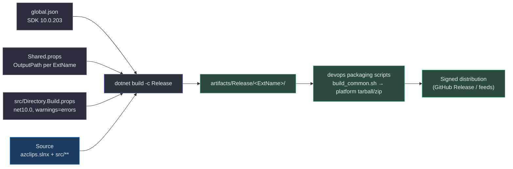

# Build & CI/CD

## Overview

Azclips is a multi-surface product — a `dotnet`-hosted CLI (`az`), several PowerShell modules, and a set of dynamically-loaded extensions — all built from one solution, `azclips.slnx`. The build toolchain has to satisfy three constraints at once:

- **One reproducible SDK everywhere.** A pinned SDK (`global.json`) means a contributor's laptop, a GitHub runner, and an Azure DevOps release agent all compile against the same compiler and analyzers.
- **A predictable artifact layout.** Because extensions are discovered at runtime from a directory, MSBuild must drop every project's output into a stable, per-extension folder under `artifacts/`. This is centralized in `Shared.props` rather than duplicated per project.
- **Design before code.** Significant changes go through the `openspec/` change-proposal workflow (proposal → design → tasks → specs) before implementation, so the repo captures *why* a change exists, not just the diff.

> **Naming:** the project codename is **Azclips**; the shipping products are **Azure CLI** and **Azure PowerShell**. Dedicated CI jobs fail any PR that introduces disallowed legacy naming references, keeping the codebase consistent (`.github/workflows/disallow-azclips-references.yml:1-28`).

## Local build

The canonical build command produces the `az` binary and all extension assemblies:

```bash
dotnet build -c Release azclips.slnx
# CLI binary → artifacts/Release/Core.Cli/az
```

The output path is **not** configured per project. Every project imports `Shared.props`, which sets a single templated `OutputPath` keyed on the build configuration and the project's `ExtName`, with the target-framework suffix disabled so paths stay flat (`Shared.props:8-10`):

```xml
<AppendTargetFrameworkToOutputPath>false</AppendTargetFrameworkToOutputPath>
<OutputPath>$(RepoArtifacts)$(Configuration)/$(ExtName)/</OutputPath>
<PublishDir>$(OutputPath)</PublishDir>
```

So the Accounts extension lands in `artifacts/Release/Microsoft.Azure.Azclips.Extensions.Accounts/` (`README.md:138`) and the CLI in `artifacts/Release/Core.Cli/`. `RepoArtifacts` itself resolves to `<repo>/artifacts/` (`Shared.props:6`).

Compiler behavior for product code is centralized in `src/Directory.Build.props`: `net10.0`, nullable + implicit usings, .NET analyzers at `latest`, `EnforceCodeStyleInBuild`, and — critically — **`TreatWarningsAsErrors=true`** with only NuGet-audit warnings (`NU1901`–`NU1904`) demoted to non-blocking (`src/Directory.Build.props:6-11`). Test projects deliberately relax this to `TreatWarningsAsErrors=false` (`tests/Directory.Build.props`), so an in-progress test can't be blocked by an analyzer nit while product code stays strict.

### SDK pin

The SDK is pinned so the toolchain is deterministic (`global.json:1-6`):

```json
{ "sdk": { "version": "10.0.203", "rollForward": "latestMinor" } }
```

`latestMinor` roll-forward means an agent with `10.0.203` or any later `10.0.x`/`10.x` minor works, but a `9.x`-only machine fails fast with a clear SDK error. Every CI job feeds this file to `actions/setup-dotnet` via `global-json-file: global.json` (`.github/workflows/build-and-test.yml:20-22`).



## Build & help scripts (`build/`)

The `build/` folder holds PowerShell tooling that wraps `dotnet build` with PowerShell-module and help-artifact concerns:

| Script | Role |
| --- | --- |
| `build.ps1` | Orchestrates `dotnet build azclips.slnx`, fixes up `.psd1` module manifests, and (with `-GenerateHelpArtifacts`) runs the help pipeline |
| `Install-BuildDependencies.ps1` | Idempotently installs `Microsoft.PowerShell.PlatyPS` **1.0.1** (CurrentUser scope) — the only build-time PS dependency |
| `New-PSHelpMarkdown.ps1` | Scaffolds `src/PS/<Module>/help/<Cmdlet>.md` for every cmdlet via PlatyPS and post-processes its <code v-pre>{{ Fill in … }}</code> placeholders |
| `Set-ModuleConfiguration.ps1` | Rewrites `.psd1` manifests to point at the correct `artifacts/<Configuration>/…` paths |

`build.ps1 -GenerateHelpArtifacts` is the help entrypoint: it first calls `Install-BuildDependencies.ps1` to guarantee PlatyPS 1.0.1 is present, then runs the help validation tool and publishes help artifacts, propagating the tool's exit code so CI fails on invalid help (`build/build.ps1:256-274`). PlatyPS is pinned to 1.0.1 because the scripts contain targeted work-arounds for that version's quirks — e.g. `New-PSHelpMarkdown.ps1` forces `en-US` locale and repairs unfenced example blocks emitted by schema `2024-05-01` (`build/New-PSHelpMarkdown.ps1:23,38,51`).

## The help-docs pipeline

CLI help is authored as Markdown under `src/CLI/Help/Docs/<ext>/*.md` and parsed at runtime — there is no code-gen step for CLI help text. Two runtime parsers do the work:

1. **`FrontmatterParser`** — a hand-rolled parser for a YAML-subset frontmatter block (`---`-delimited, flat `key: value` pairs plus one `relatedLinks:` list). It returns a `FrontmatterDoc` (`Summary`, `Status`, `Schema`, `OnlineVersion`, `RelatedLinks`) and the remaining body. It is deliberately **lenient**: unterminated or missing frontmatter degrades to `FrontmatterDoc.Empty` rather than throwing (`src/CLI/Help/FrontmatterParser.cs:27-59`).
2. **`MarkdownCommandHelpProvider`** — resolves `src/CLI/Help/Docs/<ext>/<command>.md`, reads it, and calls `FrontmatterParser` to split summary (from frontmatter) from the `Description:` body line and ordered fenced example blocks, producing a `MarkdownCommandHelp` record. Missing/malformed input returns `MarkdownCommandHelp.Empty` — "strict checks live in the build-time help tool" (`src/CLI/Help/MarkdownCommandHelpProvider.cs:22-53`).

The strictness split is intentional: **runtime is lenient** (a bad help file must never crash `az --help`), while **build time is strict** (bad help must fail CI). That build-time strictness is the help tool.

### `tools/Help` — the help validation tool

`tools/Help/Azclips.Help.Tool` is a console app that loads the built extension/cmdlet assemblies from `artifacts/<Configuration>` (resolving them via `AssemblyLoadContext.Default.Resolving`) and runs a battery of validators — `MarkdownStructureValidator`, `HelpCompletenessValidator`, `PsCompletenessValidator`, `ExampleSyntaxValidator`, `PowerShellExampleSyntaxValidator`, `PlaceholderDetector` — merging results into a `ValidationReport` (`tools/Help/Azclips.Help.Tool/Program.cs:22-36`). It resolves the `Microsoft.Azure.Azclips.*` assembly names (`tools/Help/Azclips.Help.Tool/Program.cs:24-32`). Its own behavior is pinned by `Azclips.Help.Tool.Tests` (e.g. `FrontmatterParserTests`, `HelpCompletenessValidatorTests`), which CI runs as a dedicated job.

```mermaid
sequenceDiagram
    autonumber
    participant DEV as Author
    participant MD as src/CLI/Help/Docs/**.md
    participant TOOL as Azclips.Help.Tool
    participant ART as artifacts/&lt;cfg&gt; assemblies
    participant RT as az (runtime)
    DEV->>MD: write frontmatter + Description + examples
    Note over TOOL: build-time (STRICT)
    TOOL->>ART: load extension/cmdlet DLLs
    TOOL->>MD: MarkdownStructureValidator + completeness/example checks
    TOOL-->>DEV: ValidationReport (nonzero exit fails CI)
    Note over RT: runtime (LENIENT)
    RT->>MD: MarkdownCommandHelpProvider.Get(ext, cmd)
    MD->>RT: FrontmatterParser → MarkdownCommandHelp (Empty on error)
    RT-->>DEV: rendered az --help
    style DEV fill:#1e3a5f,stroke:#4a9eed,color:#e6edf3
    style MD fill:#2d333b,stroke:#6d5dfc,color:#e6edf3
    style TOOL fill:#5a4a2e,stroke:#d4a84b,color:#e6edf3
    style ART fill:#2d4a3e,stroke:#4aba8a,color:#e6edf3
    style RT fill:#2d333b,stroke:#6d5dfc,color:#e6edf3
```

## Packaging & distribution

There is no single `scripts/deploy.sh`; distribution is a layered set of shell/PowerShell scripts under `devops/scripts/packaging/` driven by the Azure DevOps pipelines. The shared stage, `build_common.sh`, restores the solution, publishes the framework-dependent CLI, and builds + `dotnet pack`s every discovered `src/Extensions/**/Extensions.*.csproj` into an extensions pack (`devops/scripts/packaging/common/build_common.sh:12-49`). Platform scripts then produce self-contained bundles — e.g. `build_linux_tarball.sh` publishes a `linux-x64` self-contained CLI, injects built-in extensions, and emits a `.tar.gz`, choosing an `az` vs `az-lean` prefix from the package profile (`devops/scripts/packaging/linux/tarball/build_linux_tarball.sh:5-25`). Equivalent scripts exist for macOS tarballs and Windows zips.

## Continuous integration

PowerShell package validation runs shared install and uninstall phases across a
generated distribution matrix. Install checks that every packaged module imports at
its exact packaged version, exports its manifest cmdlets, and has help examples;
unsupported canary combinations remain nonblocking.
See the [PowerShell package validation guide](https://github.com/Azure/azclips/blob/main/devops/scripts/packaging/powershell/README.md)
for phase contracts, limited alpha coverage, local invocation, cleanup behavior,
and offline regression fixtures.

CI spans two systems. **GitHub Actions** gate PRs into `main`; **Azure DevOps** produces signed, distributable releases.

| Workflow | System | Trigger | Purpose |
| --- | --- | --- | --- |
| `build-and-test.yml` | GitHub | PR to `main`, dispatch | Restore/build/test `azclips.slnx`, CLI + PowerShell E2E smoke, help validation, help-tool tests |
| `build.yml` | GitHub | push/PR `main` | Windows Debug+Release matrix build & package |
| `benchmark.yml` / `benchmark-comment.yml` | GitHub | push/PR touching `src/**`, `tests/Benchmark/**`, `global.json`, `azclips.slnx` | Run CLI+PS benchmarks, gate at 115% of baseline, publish dashboard |
| `disallow-azclips-references.yml` / `disallow-azv2-references.yml` | GitHub | push/PR `main` | Fail PRs that add disallowed legacy naming references |
| `build-wiki.yml` | GitHub | — | Build/publish this wiki |
| `azclips-alpha-build.yml` | Azure DevOps | any PR (`pr-alpha` channel) | Unsigned per-PR distribution build |
| `azclips-beta-build.yml` | Azure DevOps | beta channel | Unsigned beta distribution |
| `azclips-stable-{build,sign,publish,release}.yml` | Azure DevOps | `v*.*.*` tags | Versioned, signed, published stable release |

The GitHub gate is intentionally pragmatic: `build-and-test.yml` builds and tests in **Debug**, not Release, with an inline comment noting Release currently has extension-DLL-location and `RequiredAssemblies` issues (`.github/workflows/build-and-test.yml:28-32`). E2E is a smoke test — run `az --help` and assert exit 0, and import the `Accounts` PS module and assert commands exist (`.github/workflows/build-and-test.yml:34-52`) — mirroring the criteria in `eng-docs/spec/ci.md:5-15` ("the code builds; all tests pass; E2E tests pass").

The Azure DevOps side is template-driven. `azclips-stable-build.yml` triggers on SemVer `v*.*.*` tags, runs a preflight that ensures it's in the `release` project, then delegates to the shared `templates/dist/stages/build-unsigned-distribution.yml` stage (`.azure-pipelines/azclips-stable-build.yml:3-42`). The alpha pipeline reuses the same distribution stage with `release_channel: pr-alpha` on every PR (`.azure-pipelines/azclips-alpha-build.yml:14-20`), so alpha, beta, and stable share one build definition parameterized by channel.

## The `openspec/` design-doc workflow

Non-trivial changes are proposed as an **openspec change** before code is written. Each change is a folder under `openspec/changes/<name>/` containing four artifacts (`openspec/changes/profile-management/`):

| Artifact | Content |
| --- | --- |
| `proposal.md` | *Why* (motivating pain points) and *What Changes* (concrete deltas) |
| `design.md` | Detailed technical design |
| `tasks.md` | Ordered, checkbox implementation tasks |
| `specs/` | Capability spec deltas (new/modified capabilities) |

The `profile-management` change is a worked example: its proposal opens with a "Why" grounded in Azure CLI/PowerShell/AWS profile pain points and a "What Changes" list introducing the `Profile` model and `IProfileService` (`openspec/changes/profile-management/proposal.md:1-24`), while `tasks.md` decomposes it into checkbox-tracked steps grouped by area (Core model, service impl, engine integration) that get ticked off as implementation lands (`openspec/changes/profile-management/tasks.md:1-18`). The workflow schema is declared in `openspec/config.yaml` (`schema: spec-driven`), and the repo ships `.github/prompts/opsx-*.prompt.md` and `.github/skills/openspec-*` to drive the propose/apply/verify/archive loop.

## Quick reference

| Task | Command |
| --- | --- |
| Build everything (Release) | `dotnet build -c Release azclips.slnx` |
| Run the CLI | `./artifacts/Release/Core.Cli/az --help` |
| Build + generate help artifacts | `pwsh build/build.ps1 -Configuration Release -GenerateHelpArtifacts` |
| Install build-time PS deps (PlatyPS) | `pwsh build/Install-BuildDependencies.ps1` |
| Validate help content | `dotnet run --project tools/Help/Azclips.Help.Tool/Azclips.Help.Tool.csproj -- --artifacts-root artifacts/Release --output-root artifacts/help` |
| Build a Linux tarball | `devops/scripts/packaging/linux/tarball/build_linux_tarball.sh` |

## References

- `Shared.props:6,8-10` — `RepoArtifacts` and the per-`ExtName` `OutputPath` template
- `src/Directory.Build.props:6-11` — net10.0, analyzers, `TreatWarningsAsErrors`
- `global.json:1-6` — SDK pin `10.0.203`, `rollForward: latestMinor`
- `build/build.ps1:256-274` — `-GenerateHelpArtifacts` orchestration
- `build/Install-BuildDependencies.ps1:8-30` — pinned PlatyPS 1.0.1 install
- `build/New-PSHelpMarkdown.ps1:23,38,51` — PlatyPS scaffolding & version work-arounds
- `src/CLI/Help/FrontmatterParser.cs:27-59` — lenient frontmatter parsing
- `src/CLI/Help/MarkdownCommandHelpProvider.cs:22-53` — runtime help-markdown parsing
- `tools/Help/Azclips.Help.Tool/Program.cs:22-36` — build-time help validators
- `devops/scripts/packaging/common/build_common.sh:12-49` — shared publish/pack step
- `devops/scripts/packaging/linux/tarball/build_linux_tarball.sh:5-25` — platform bundle
- `.github/workflows/build-and-test.yml:20-52` — PR build/test/E2E gate
- `.github/workflows/disallow-azclips-references.yml:1-28` — legacy-name guard
- `.azure-pipelines/azclips-stable-build.yml:3-42` — signed stable release build
- `.azure-pipelines/azclips-alpha-build.yml:14-20` — per-PR unsigned build
- `eng-docs/spec/ci.md:5-15` — CI acceptance criteria
- `openspec/changes/profile-management/proposal.md:1-24` & `tasks.md:1-18` — change-proposal workflow example
