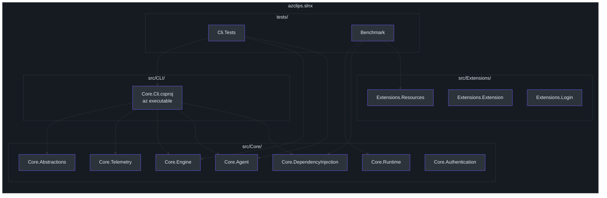

# Build System & CI/CD Pipeline

Cirrus uses a layered build system with MSBuild property inheritance, two GitHub Actions workflows, dynamic discovery of extensions and PowerShell modules, MSIX packaging with code signing, and a dev container configuration featuring Zipkin for distributed tracing. Over 50 code quality rules are enforced at build time.

## Solution Structure

The solution file `azclips.slnx` (`azclips.slnx:1`) organizes the repo projects into logical folders:



The CLI project (`src/CLI/Core.Cli.csproj:2`) produces the `az` executable:

```xml
<OutputType>Exe</OutputType>
<AssemblyName>az</AssemblyName>              <!-- line 4 -->
<RootNamespace>Core.Cli</RootNamespace>         <!-- line 5 -->
<StartupObject>Core.Cli.Program</StartupObject> <!-- line 13 -->
```

It imports `Shared.props` (`src/CLI/Core.Cli.csproj:16`) and references five core projects: Abstractions, Telemetry, Engine, Agent, and DependencyInjection (`src/CLI/Core.Cli.csproj:18`).

## Directory.Build.props Hierarchy

Three levels of MSBuild properties form an inheritance chain:

### Level 1: Shared.props (Repository Root)

`Shared.props` (`Shared.props:1`) defines repository-wide path variables and output conventions:

| Property | Value | Line |
|---|---|---|
| `RepoRoot` | `$(MSBuildThisFileDirectory)` | 3 |
| `RepoSrc` | `$(RepoRoot)src/` | 4 |
| `RepoArtifacts` | `$(RepoRoot)artifacts/` | 5 |
| `AppendTargetFrameworkToOutputPath` | `false` | 7 |
| `OutputPath` | `$(RepoArtifacts)$(Configuration)/$(ExtName)/` | 8 |
| `PublishDir` | `$(OutputPath)` | 9 |

PowerShell module manifests (`.psd1`) are copied to output via `<None Update="*.psd1" CopyToOutputDirectory="PreserveNewest" />` (`Shared.props:15`).

### Level 2: src/Directory.Build.props

`src/Directory.Build.props` (`src/Directory.Build.props:1`) sets source project defaults:

| Property | Value | Line |
|---|---|---|
| `TargetFramework` | `net9` | 4 |
| `ImplicitUsings` | `enable` | 5 |
| `Nullable` | `enable` | 6 |
| `EnableNETAnalyzers` | `true` | 7 |
| `AnalysisLevel` | `latest` | 8 |
| `EnforceCodeStyleInBuild` | `true` | 9 |
| `TreatWarningsAsErrors` | `true` | 10 |

Source projects treat warnings as errors (`src/Directory.Build.props:10`), enforcing zero-warning builds.

### Level 3: tests/Directory.Build.props

`tests/Directory.Build.props` (`tests/Directory.Build.props:1`) overrides for test projects:

- Sets `IsPackable` to `false` (`tests/Directory.Build.props:7`)
- Sets `TreatWarningsAsErrors` to `false` (`tests/Directory.Build.props:11`)
- Suppresses `CA1707` for underscore-based test naming (`tests/Directory.Build.props:13`)
- Adds a global `<Using Include="Xunit" />` directive (`tests/Directory.Build.props:24`)

### .NET SDK Version

`global.json` (`global.json:1`) pins the SDK:

```json
{
  "sdk": {
    "version": "10.0.203",
    "rollForward": "latestMinor"
  }
}
```

The `rollForward: "latestMinor"` policy allows minor version updates within .NET 10.x.

## Code Quality Rules

### EditorConfig

The `.editorconfig` (`.editorconfig:1`) enforces comprehensive C# coding standards:

**Naming Conventions**:
- Constants use PascalCase (`.editorconfig:59`)
- Static private fields use `s_` prefix with camelCase (`.editorconfig:67`)
- Private/internal fields use `_` prefix with camelCase (`.editorconfig:77`)

**Code Style** (`.editorconfig:85`):
- `using` directives outside namespace (`.editorconfig:86`)
- System directives sorted first (`.editorconfig:87`)
- Prefer braces (`.editorconfig:88`)
- Prefer static local functions (`.editorconfig:91`)
- All expression-bodied member styles set to `silent` (`.editorconfig:114`)
- Pattern matching preferred over `is`/`as` checks (`.editorconfig:124`)

**License Header**: All C# files must include the .NET Foundation MIT license header (`.editorconfig:165`).

### Analyzer Rules (50+)

The `.editorconfig` configures over 50 diagnostic rules across categories:

**Code Analysis (CA) rules** — 40+ rules covering:

| Category | Example Rules | Severity |
|---|---|---|
| Design | CA1018 (AttributeUsage), CA1044 (write-only props), CA1050 (types in namespaces) | warning |
| Performance | CA1821 (empty finalizers), CA1828 (no Count when Any works), CA1836 (IsEmpty over Count) | warning |
| Security | CA5351 (broken crypto), CA5359 (certificate validation), CA5364 (deprecated protocols) | warning |
| XML Security | CA3061 (schema by URL), CA3075 (DTD processing), CA3077 (API design) | warning |
| Reliability | CA2011 (infinite recursion), CA2242 (NaN testing), CA2245 (self-assignment) | warning |

**IDE rules**:
- IDE0040: Accessibility modifiers required (`warning`) (`.editorconfig:321`)
- IDE0041: Use `is null` check (`warning`) (`.editorconfig:270`)
- IDE0043: Validate format strings (`warning`) (`.editorconfig:272`)
- IDE0062: Make local function static (`warning`) (`.editorconfig:274`)
- IDE0082: Convert typeof to nameof (`warning`) (`.editorconfig:276`)
- IDE0200: Remove unnecessary lambda (`none`) (`.editorconfig:278`)
- IDE0240: Remove redundant nullable directive (`warning`) (`.editorconfig:280`)

## CI/CD Pipeline Architecture

```mermaid
flowchart TB
    subgraph Triggers["Triggers"]
        Push["push to main"]
        PR["pull_request to main"]
        Manual["workflow_dispatch"]
    end

    subgraph BuildTest["build-and-test.yml (PR Gate)"]
        direction TB
        BT_Restore["dotnet restore"]
        BT_Build["dotnet build (Debug)"]
        BT_Test["dotnet test"]
        BT_E2E_CLI["E2E: az --help"]
        BT_E2E_PS["E2E: Import-Module Login"]
        BT_Restore --> BT_Build --> BT_Test --> BT_E2E_CLI --> BT_E2E_PS
    end

    subgraph BuildYml["build.yml (Full Build)"]
        direction TB
        subgraph BuildCli["build-cli<br>matrix: Debug/Release × win-x64"]
            BC_Restore["Restore"]
            BC_Build["Build Solution"]
            BC_Test["Unit Tests"]
            BC_Publish["Publish CLI + Extensions"]
            BC_MSIX["Create MSIX Package"]
            BC_Sign["Sign with PFX Certificate"]
            BC_Upload["Upload Artifacts"]
            BC_Restore --> BC_Build --> BC_Test --> BC_Publish --> BC_MSIX --> BC_Sign --> BC_Upload
        end

        subgraph DiscExt["discover-extensions"]
            DE_Find["find src/Extensions -name *.csproj"]
        end

        subgraph BuildExt["build-extension<br>matrix: extensions × configs"]
            BE_Meta["Extract Metadata"]
            BE_Build["Build Extension"]
            BE_Upload["Upload Artifacts"]
            BE_Meta --> BE_Build --> BE_Upload
        end

        subgraph DiscPS["discover-powershell-modules"]
            DP_Find["find src/PS -name *.psm1"]
        end

        subgraph BuildPS["build-powershell-module<br>matrix: modules"]
            BP_Build["Build Extension DLL"]
            BP_Import["Test Module Import"]
            BP_Build --> BP_Import
        end

        subgraph Release["create-release<br>main only"]
            CR_Version["v1.0.YYMMDD.RUN"]
            CR_Notes["Release Notes"]
            CR_Download["Download Artifacts"]
            CR_Publish["GitHub Release"]
            CR_Version --> CR_Notes --> CR_Download --> CR_Publish
        end
    end

    Push --> BuildYml
    PR --> BuildTest
    PR --> BuildYml
    Manual --> BuildTest

    DiscExt --> BuildExt
    DiscPS --> BuildPS
    BuildCli --> Release
    BuildExt --> Release

    style Triggers fill:#161b22,stroke:#30363d,color:#e6edf3
    style BuildTest fill:#161b22,stroke:#30363d,color:#e6edf3
    style BuildYml fill:#161b22,stroke:#30363d,color:#e6edf3
    style BuildCli fill:#161b22,stroke:#30363d,color:#e6edf3
    style DiscExt fill:#161b22,stroke:#30363d,color:#e6edf3
    style BuildExt fill:#161b22,stroke:#30363d,color:#e6edf3
    style DiscPS fill:#161b22,stroke:#30363d,color:#e6edf3
    style BuildPS fill:#161b22,stroke:#30363d,color:#e6edf3
    style Release fill:#161b22,stroke:#30363d,color:#e6edf3
    style BT_Restore fill:#2d333b,stroke:#6d5dfc,color:#e6edf3
    style BT_Build fill:#2d333b,stroke:#6d5dfc,color:#e6edf3
    style BT_Test fill:#2d333b,stroke:#6d5dfc,color:#e6edf3
    style BT_E2E_CLI fill:#2d333b,stroke:#6d5dfc,color:#e6edf3
    style BT_E2E_PS fill:#2d333b,stroke:#6d5dfc,color:#e6edf3
    style BC_Restore fill:#2d333b,stroke:#6d5dfc,color:#e6edf3
    style BC_Build fill:#2d333b,stroke:#6d5dfc,color:#e6edf3
    style BC_Test fill:#2d333b,stroke:#6d5dfc,color:#e6edf3
    style BC_Publish fill:#2d333b,stroke:#6d5dfc,color:#e6edf3
    style BC_MSIX fill:#2d333b,stroke:#6d5dfc,color:#e6edf3
    style BC_Sign fill:#2d333b,stroke:#6d5dfc,color:#e6edf3
    style BC_Upload fill:#2d333b,stroke:#6d5dfc,color:#e6edf3
    style DE_Find fill:#2d333b,stroke:#6d5dfc,color:#e6edf3
    style BE_Meta fill:#2d333b,stroke:#6d5dfc,color:#e6edf3
    style BE_Build fill:#2d333b,stroke:#6d5dfc,color:#e6edf3
    style BE_Upload fill:#2d333b,stroke:#6d5dfc,color:#e6edf3
    style DP_Find fill:#2d333b,stroke:#6d5dfc,color:#e6edf3
    style BP_Build fill:#2d333b,stroke:#6d5dfc,color:#e6edf3
    style BP_Import fill:#2d333b,stroke:#6d5dfc,color:#e6edf3
    style CR_Version fill:#2d333b,stroke:#6d5dfc,color:#e6edf3
    style CR_Notes fill:#2d333b,stroke:#6d5dfc,color:#e6edf3
    style CR_Download fill:#2d333b,stroke:#6d5dfc,color:#e6edf3
    style CR_Publish fill:#2d333b,stroke:#6d5dfc,color:#e6edf3
    style Push fill:#2d333b,stroke:#6d5dfc,color:#e6edf3
    style PR fill:#2d333b,stroke:#6d5dfc,color:#e6edf3
    style Manual fill:#2d333b,stroke:#6d5dfc,color:#e6edf3
```



## build-and-test.yml (PR Gate)

The lightweight PR gate pipeline (`.github/workflows/build-and-test.yml:1`) runs on `pull_request` and `workflow_dispatch`. It executes on `ubuntu-latest` with five steps:

1. **Restore** — `dotnet restore azclips.slnx` (`.github/workflows/build-and-test.yml:22`)
2. **Build** — Debug configuration with `--no-restore` (`.github/workflows/build-and-test.yml:25`)
3. **Test** — `dotnet test` with normal verbosity (`.github/workflows/build-and-test.yml:29`)
4. **E2E CLI** — Runs `./artifacts/Debug/Core.Cli/az --help` to validate the binary (`.github/workflows/build-and-test.yml:33`)
5. **E2E PowerShell** — Imports the Login module and verifies command count > 0 (`.github/workflows/build-and-test.yml:44`)

## build.yml (Full Build)

The comprehensive build pipeline (`.github/workflows/build.yml:6`) triggers on push and PR to `main` and runs seven jobs.

### Job 1: build-cli

Runs a matrix of `[Debug, Release] × [win-x64]` on `windows-latest` (`.github/workflows/build.yml:18`):

- Restores and builds the full solution (`.github/workflows/build.yml:45`)
- Executes unit tests (`.github/workflows/build.yml:56`)
- Publishes the CLI as self-contained: `dotnet publish src/CLI/Core.Cli.csproj -r win-x64 --self-contained` (`.github/workflows/build.yml:76`)
- Publishes the Extension project to a subdirectory (`.github/workflows/build.yml:81`)

### MSIX Packaging and Signing

The pipeline creates MSIX packages using the Windows SDK:

1. **Copy manifest**: `Core.Cli.appxmanifest` → `AppxManifest.xml` (`.github/workflows/build.yml:87`)
2. **Copy assets**: Logo and icon assets to the `Assets/` folder (`.github/workflows/build.yml:91`)
3. **Create MSIX**: Uses `MakeAppx.exe` from the latest Windows SDK bin directory (`.github/workflows/build.yml:100`)
4. **Sign MSIX**: Uses `signtool.exe` with a PFX certificate from GitHub Secrets (`.github/workflows/build.yml:116`)
5. **Cleanup**: Removes the PFX file (`.github/workflows/build.yml:132`)

The SDK tools path is discovered dynamically by scanning `${env:ProgramFiles(x86)}/Windows Kits/10/bin/` for version-numbered directories (`.github/workflows/build.yml:102`).

### Job 2-3: discover-extensions + build-extension

**discover-extensions** (`.github/workflows/build.yml:141`) uses `find` to locate all `.csproj` files under `src/Extensions/`, converting paths to a JSON array for matrix input.

**build-extension** (`.github/workflows/build.yml:155`) runs a matrix over discovered extensions × `[Debug, Release]`:

1. Extracts `AssemblyName` and `ExtName` from the `.csproj` XML (`.github/workflows/build.yml:170`)
2. Builds each extension independently
3. Uploads artifacts named `Extension - {ExtName} ({Configuration})`

### Job 4-5: discover-powershell-modules + build-powershell-module

**discover-powershell-modules** (`.github/workflows/build.yml:209`) finds all `.psm1` files under `src/PS/`.

**build-powershell-module** (`.github/workflows/build.yml:223`) for each module:

1. Extracts the module name from the `.psm1` path (`.github/workflows/build.yml:241`)
2. Installs latest PowerShell via `winget` (`.github/workflows/build.yml:236`)
3. Builds the corresponding .NET extension DLL in Debug configuration (`.github/workflows/build.yml:264`)
4. Tests module import: `Import-Module`, then verifies `Get-Command` returns > 0 commands (`.github/workflows/build.yml:299`)

### Job 6: create-release

Runs only on push to `main` (`.github/workflows/build.yml:330`), depending on `build-cli` and `build-extension`:

**Version generation** (`.github/workflows/build.yml:342`):
```bash
VERSION="v1.0.$(date +'%y%m%d').${{ github.run_number }}"
```

This produces versions like `v1.0.250115.42`, encoding the date and CI run number.

**Release notes** are generated from git history (`.github/workflows/build.yml:350`):
- Commits since the last tag (or last 10 if no tags exist)
- Format: `- {subject} ({short hash})`

**Artifact collection** (`.github/workflows/build.yml:374`):
- Release MSIX packages matching `Release-` pattern
- Extension DLLs matching `(Release)` pattern

The GitHub Release is created via `softprops/action-gh-release@v2` (`.github/workflows/build.yml:422`).

## Build Script

The PowerShell build script (`build/build.ps1:1`) is a single-line wrapper:

```powershell
dotnet build "$PSScriptRoot/../azclips.slnx"
```

## Dev Container Configuration

### devcontainer.json

The dev container (`.devcontainer/devcontainer.json:1`) uses Docker Compose with two services:

**Features installed**:
- GitHub CLI (`latest`) (`.devcontainer/devcontainer.json:28`)
- Node.js (`lts`) (`.devcontainer/devcontainer.json:31`)
- PowerShell (`7.5.4`) (`.devcontainer/devcontainer.json:34`)

**Port forwarding** (`.devcontainer/devcontainer.json:40`):
- Ports 50000-50009: MSAL authentication redirect (auto-open browser)
- Port 9411: Zipkin UI (notify on forward)

**Environment variables** (`.devcontainer/devcontainer.json:60`):
- `PATH` includes both Debug and Release CLI artifact directories
- `ZIPKIN_ENDPOINT` points to the Zipkin container: `http://zipkin:9411/api/v2/spans`

**VS Code extensions**: C# (`ms-dotnettools.csharp`) and C# Dev Kit (`ms-dotnettools.csdevkit`) (`.devcontainer/devcontainer.json:70`).

### docker-compose.yml

The Docker Compose file (`.devcontainer/docker-compose.yml:1`) defines two services:

**app** — the development container:
- Mounts the repo as a volume
- Sets `ZIPKIN_ENDPOINT` and `BROWSER` environment variables
- Depends on Zipkin being healthy

**zipkin** — the `openzipkin/zipkin` image:
- Exposes port 9411 (`.devcontainer/docker-compose.yml:20`)
- Health check via HTTP: `wget --spider http://localhost:9411/health` (`.devcontainer/docker-compose.yml:25`)
- Check interval: 5s, timeout: 3s, 5 retries, 10s start period
- Restart policy: `unless-stopped` (`.devcontainer/docker-compose.yml:23`)

## Artifact Structure

The build produces artifacts organized by configuration:

```
artifacts/
├── Debug/
│   ├── Core.Cli/
│   │   └── az          # CLI executable
│   └── Extensions.Resources/
│       └── *.dll          # Extension assemblies
├── Release/
│   └── (same structure)
publish/
├── Debug/win-x64/         # Self-contained publish
│   ├── az.exe
│   ├── Extensions/Extension/
│   └── AppxManifest.xml
bin/
├── Debug/
│   └── az-win-x64.msix  # Signed MSIX package
└── Release/
    └── az-win-x64.msix
```

## References

| Source File | Key Elements |
|---|---|
| `azclips.slnx` | Solution structure, 12 projects in 4 folders |
| `Shared.props` | Repository paths, output directory, PowerShell manifest copying |
| `src/Directory.Build.props` | net9 target, analyzers, warnings-as-errors |
| `tests/Directory.Build.props` | xUnit/Coverlet packages, CA1707 suppression |
| `global.json` | .NET SDK 10.0.203, `latestMinor` roll-forward |
| `.editorconfig` | 50+ analyzer rules, naming conventions, license header |
| `.github/workflows/build.yml` | Full build: CLI, extensions, PS modules, MSIX, release |
| `.github/workflows/build-and-test.yml` | PR gate: build, test, E2E validation |
| `.devcontainer/devcontainer.json` | Features, ports, environment, VS Code extensions |
| `.devcontainer/docker-compose.yml` | App + Zipkin services with health checks |
| `build/build.ps1` | Single-line solution build script |
| `src/CLI/Core.Cli.csproj` | az executable, Shared.props import, project references |
