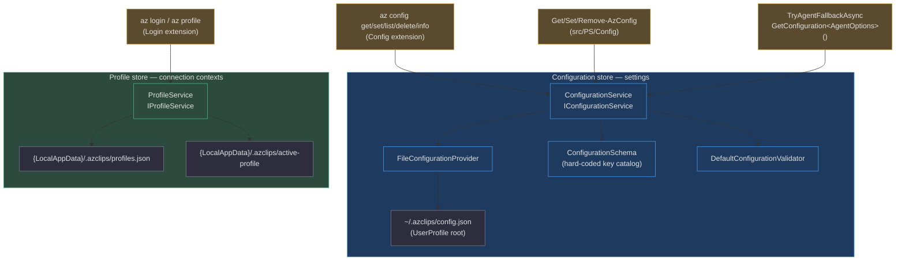
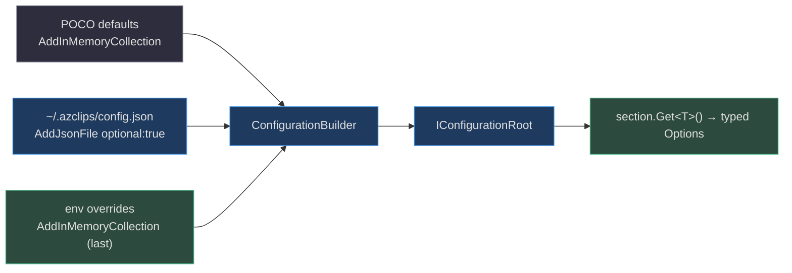

# Configuration Management & Profiles

## Why this exists

A CLI that spans four client surfaces (the `az` binary, PowerShell cmdlets, the TUI, and the agent process) needs **one** answer to "what are my settings?" and "which cloud context am I talking to?" — and it must give the same answer regardless of who is asking. Azclips solves this with **two deliberately separate stores**:

1. **Configuration** — user-scoped *settings* (`telemetry.enabled`, `agent.enabled`, `defaults.location`, HTTP retry counts) held as layered key/value in `~/.azclips/config.json`, governed by a hard-coded schema. This is a shared singleton behind `IConfigurationService`.
2. **Profiles** — named *connection contexts* (tenant, subscription, auth method, defaults) held in `{LocalApplicationData}/.azclips/profiles.json` with a separate active-profile pointer.

They are separate **on purpose**: settings are portable machine preferences, whereas profiles carry per-account connection state that lives with local app data and supersedes the former single `AuthContext` (`src/Core/Core.Abstractions/Models/Profile.cs:4`). They do not share a file, a root directory, or a service — a distinction worth internalizing before you go looking for "where is my state."

> Both stores are registered as singletons at the DI composition root: `RegisterConfigurationServices()` wires the config chain (`src/Core/Core.Configuration/DIRegisterExtensions.cs:14`), invoked as the *first* group in `RegisterAzclipsServices()` (`src/Core/Core.DependencyInjection/AzclipsServiceProvider.cs:53`), while `ProfileService` is registered by the runtime group.

## The two stores at a glance



## Configuration resolution precedence

`ConfigurationService.GetConfiguration<T>()` does not read the file directly — it composes a fresh `Microsoft.Extensions.Configuration` root every call from three ordered sources, then binds the requested section to a typed POCO (`src/Core/Core.Configuration/Implementation/ConfigurationService.cs:57`):

1. **POCO defaults** — the default instance is serialized and flattened into an in-memory collection (`ConfigurationService.cs:60`).
2. **The JSON file** — `~/.azclips/config.json`, added `optional: true` (`ConfigurationService.cs:66`).
3. **Environment overrides** — added **last**, so they win (`ConfigurationService.cs:68`).

Because `AddInMemoryCollection` for environment variables is appended after the file, the effective precedence for a typed read is **environment > file > POCO default** (`ConfigurationService.cs:60-72`). Invalid JSON in the file is caught and rethrown as an actionable error rather than a raw parser exception (`ConfigurationService.cs:79`).



> **Doc-drift note.** `docs/howto/config.md:5` advertises the precedence as *"command args > environment variables > global config > defaults."* The "command args" tier is real but lives **outside** `ConfigurationService` — the CLI host applies per-invocation flags such as `--debug` (`src/CLI/Program.cs:192`) through `CliLoggingPolicy.ResolveEffectiveLevel`, which prefers the flag over the configured `core.logging.level` (`src/CLI/CliLoggingPolicy.cs:27`). The store itself only knows the three tiers above.

## The configuration schema (authoritative key catalog)

`ConfigurationSchema.cs` is the single source of truth for valid keys, defaults, types, allowed values, and numeric ranges (`src/Core/Core.Configuration/Schema/ConfigurationSchema.cs:10`). Every key below is validated on write; unknown keys are rejected unless `--force` is passed.

| Key | Type / Allowed | Default | Line |
|---|---|---|---|
| `core.logging.level` | `debug`/`info`/`warn`/`error` | `error` | `ConfigurationSchema.cs:12` |
| `core.engine.extensionIndexCacheSize` | int 1–10000 | `512` | `:13` |
| `core.http.maxRetries` | int 0–50 | `3` | `:14` |
| `core.http.maxRetriesFor429` | int 0–50 | `5` | `:15` |
| `assemblyLoading.builtinInstallationDir` | string | (computed) | `:16` |
| `assemblyLoading.versionedInstallationDir` | string | (computed) | `:17` |
| `assemblyLoading.extensionFolderPrefix` | string | (computed) | `:18` |
| `assemblyLoading.bypassExtensionCache` | bool | `false` | `:19` |
| `telemetry.enabled` | bool | `true` | `:20` |
| `telemetry.zipkinEndpoint` | string (URI) | — | `:21` |
| `telemetry.appInsightsInstrumentationKey` | string | — | `:22` |
| `agent.enabled` | bool | `false` | `:23` |
| `agent.sessionStyle` | `oneshot`/`interactive` | `oneshot` | `:24` |
| `agent.interactive.verbose` | bool | `false` | `:25` |
| `agent.trace.enabled` | bool | `false` | `:26` |
| `agent.trace.path` | string | `~/.azclips/trace` | `:27` |
| `agent.provider` | `builtin`/`github` | `builtin` | `:28` |
| `agent.builtin.endpoint` | string (URI) | `https://azclis-copilot-apim-beta-eus.azure-api.net/azclips/openai/` | `:29` |
| `agent.builtin.scope` | string | `https://management.core.windows.net//.default` | `:30` |
| `agent.builtin.modelId` | string | `gpt-5.4` | `:31` |
| `agent.builtin.apiVersion` | string | `2025-04-01-preview` | `:32` |
| `completion.enabled` | bool | `true` | `:33` |
| `extensions.resources.arm.apiVersionOverride` | string | — | `:34` |
| `clients.cli.output.format` | `json`/`table`/`tsv`/`yaml` | `table` | `:35` |
| `clients.powershell.output.format` | `object`/`json`/`table` | `object` | `:36` |
| `defaults.group` / `location` / `web` / `vm` / `vmss` / `acr` | string | — | `:37-42` |

> **Doc-drift note.** The published catalog in `docs/howto/config.md:9-36` is missing the four `agent.builtin.*` keys (`endpoint`, `scope`, `modelId`, `apiVersion`) that the schema defines at `ConfigurationSchema.cs:29-32`. Treat `ConfigurationSchema.cs` as authoritative and the how-to as a convenience view.

### Typed binding: sections → Options POCOs

`GetConfiguration<T>()` maps a POCO type to a config section name via a fixed dictionary (`ConfigurationService.cs:30`). Each section binds to a strongly-typed Options class:

| Section | POCO type | Source |
|---|---|---|
| `core` | `CoreOptions` | `src/Core/Core.Abstractions/CoreOptions.cs` |
| `assemblyLoading` | `AssemblyLoadingOptions` | `src/Core/Core.Configuration/Options/AssemblyLoadingOptions.cs:8` |
| `telemetry` | `TelemetryOptions` | `src/Core/Core.Abstractions/TelemetryOptions.cs:6` |
| `agent` | `AgentOptions` | `src/Core/Core.Abstractions/AgentOptions.cs:6` |
| `completion` | `CompletionOptions` | `src/Core/Core.Abstractions/CompletionOptions.cs` |
| `extensions` | `ExtensionsOptions` | `src/Core/Core.Configuration/Options/ExtensionsOptions.cs` |
| `clients` | `ClientsOptions` | `src/Core/Core.Configuration/Options/ClientsOptions.cs` |
| `defaults` | `DefaultsOptions` | `src/Core/Core.Configuration/Options/DefaultsOptions.cs` |
| `benchmark` | `BenchmarkOptions` | `src/Core/Core.Abstractions/BenchmarkOptions.cs` |

`AgentOptions` is the highest-traffic consumer: it exposes `Enabled` (default `false`), `Provider`, `SessionStyle`, and the nested `Builtin.{Endpoint,Scope,ModelId,ApiVersion}` (`src/Core/Core.Abstractions/AgentOptions.cs:11-27`, `:54`). Note that `AssemblyLoadingOptions` defaults are **build-configuration dependent** — a DEBUG build probes `BaseDirectory/..` with prefix `Microsoft.Azure.Azclips.Extensions.`, while Release probes `BaseDirectory/Extensions` with an empty prefix (`AssemblyLoadingOptions.cs:24-47`).

## Environment-variable overrides

A centralized registry maps environment variables to config keys, keeping `ConfigurationService` and CLI commands consistent (`src/Core/Core.Configuration/Abstractions/EnvironmentVariableMappings.cs:17`):

| Environment variable | Config key |
|---|---|
| `AZCLIPS_LOG_LEVEL` | `core.logging.level` |
| `ZIPKIN_ENDPOINT` | `telemetry.zipkinEndpoint` |
| `PS_HTTP_MAX_RETRIES` / `AZURE_PS_HTTP_MAX_RETRIES` | `core.http.maxRetries` |
| `PS_HTTP_MAX_RETRIES_FOR_429` / `AZURE_PS_HTTP_MAX_RETRIES_FOR_429` | `core.http.maxRetriesFor429` |
| `AZCLIPS_NO_EXTENSION_CACHE` | `assemblyLoading.bypassExtensionCache` |
| `AZCLIPS_BENCH_RESOLVE_ONLY` | `benchmark.resolveOnly` (internal) |

The CLI's `--no-cache` flag is sugar for the last row: it sets `AZCLIPS_NO_EXTENSION_CACHE=true` in-process before dispatch (`src/CLI/Program.cs:283`).

## The `az config` command surface

The Config extension declares the `config` verb (`src/Extensions/Config/ExtensionIndex.cs:8`). All five commands inherit `ConfigCommandBase`, which owns key normalization and the layered read used by `list` (`src/Extensions/Config/Commands/ConfigCommandBase.cs:15`):

| Command | Processor | Key arguments | Source |
|---|---|---|---|
| `az config set` | `SetConfigCommand` | `--key` (req), `--value` (req), `--force` | `src/Extensions/Config/Commands/SetConfigCommand.cs:20` |
| `az config get` | `GetConfigCommand` | `--key` (req), `--json` | `src/Extensions/Config/Commands/GetConfigCommand.cs:9` |
| `az config list` | `ListConfigCommand` | `--all` (include defaults), `--json` | `src/Extensions/Config/Commands/ListConfigCommand.cs:10` |
| `az config delete` | `DeleteConfigCommand` | `--key` (req), `--force` | `src/Extensions/Config/Commands/DeleteConfigCommand.cs:9` |
| `az config info` | `InfoConfigCommand` | `--keys-only` | `src/Extensions/Config/Commands/InfoConfigCommand.cs:9` |

The same processors back the PowerShell cmdlets `Get-AzConfig`, `Set-AzConfig`, `Get-AzConfigList`, `Get-AzConfigInfo`, and `Remove-AzConfig` (`src/PS/Config/Cmdlets/`), mapped through the extension index's `InvocationName` values (`src/Extensions/Config/ExtensionIndex.cs:14`).

**Key normalization.** Users type keys in dot or colon notation and mixed case; `NormalizeKey` collapses `:` to `.`, trims empties, and `CanonicalizeKnownKey` snaps the result to the schema's canonical casing (`ConfigCommandBase.cs:42`, `ConfigurationService.cs:240`). `list` merges three tiers with a `Source` label so you can see where each value came from — `default`, `global config`, or `environment` (`ConfigCommandBase.cs:61-77`).

**Validation & the `--force` escape hatch.** Writes validate the key against the schema and the value against its type/allowed-values/range/URI constraints (`src/Core/Core.Configuration/Implementation/DefaultConfigurationValidator.cs:14`, `:29`). Unknown keys are rejected unless `--force` is set, which is how experimental keys are stored (`DefaultConfigurationValidator.cs:21`).

## Write path: atomic, lock-guarded

`SetConfigurationAsync` never partially updates the file. It validates, takes a cross-process file lock (`config.json.lock`, polled up to 10 s), reads the current JSON tree, mutates the addressed node, and hands the tree to the provider (`ConfigurationService.cs:99`, `:176`). `FileConfigurationProvider.WriteAsync` then writes to a GUID-named temp file and `File.Move`s it over the target — an atomic replace that can't leave a half-written config (`src/Core/Core.Configuration/Implementation/FileConfigurationProvider.cs:50`).

```mermaid
sequenceDiagram
    autonumber
    actor U as User
    participant SC as SetConfigCommand
    participant CS as ConfigurationService
    participant V as DefaultConfigurationValidator
    participant FP as FileConfigurationProvider
    participant D as Disk (~/.azclips)

    U->>SC: az config set --key agent.enabled --value true
    SC->>CS: SetConfigurationAsync("agent.enabled", true, force=false)
    CS->>V: ValidateKey + ValidateValue
    V-->>CS: OK (known key, bool)
    CS->>D: open config.json.lock (FileShare.None, ≤10s)
    CS->>FP: ReadAsync() → JsonObject
    FP-->>CS: current tree
    CS->>CS: SetValue(tree, "agent.enabled", true)
    CS->>FP: WriteAsync(tree)
    FP->>D: write config.{guid}.tmp then File.Move over config.json
    FP-->>CS: done
    CS-->>SC: complete (lock released)
    SC-->>U: "Set agent.enabled = true"

    Note over CS,D: Later, on a failed command, TryAgentFallbackAsync<br>calls GetConfiguration&lt;AgentOptions&gt;() and reads Enabled=true
```

That last note closes the loop: the agent fallback in the CLI reads the very value written above via `GetConfiguration<AgentOptions>()` and only spawns the agent when `Enabled` is true (`src/CLI/Program.cs:318`, `:328`).

## The profile store

Profiles are the connection-context half of this page. A `Profile` is an immutable record capturing `Name`, `TenantId`, `SubscriptionId`, `CloudName` (stored-only, no behavior), `AuthMethod`, optional defaults, `UserPrincipalName`, `ClientId`, and `ManagedIdentityId` (`src/Core/Core.Abstractions/Models/Profile.cs:10`).

`ProfileService` persists them as a case-insensitive JSON dictionary keyed by name in `{LocalApplicationData}/.azclips/profiles.json`, with the active name held separately in `{LocalApplicationData}/.azclips/active-profile` (`src/Core/Core.Runtime/ProfileService.cs:13`, `:15-27`). Key properties:

- **In-process serialization** — a `SemaphoreSlim` gate serializes read-modify-write sequences to avoid lost updates (`ProfileService.cs:38`).
- **Atomic writes** — every save goes through a temp-file-plus-rename helper, mirroring the config provider (`ProfileService.cs:240`).
- **Active-pointer hygiene** — removing the active profile clears the pointer file (`ProfileService.cs:118-122`).
- **Name rules** — 1–100 chars of `[a-zA-Z0-9._-]`, with `temp` reserved for bare login (`src/Core/Core.Abstractions/ProfileNameValidator.cs:16`, `:44`).

The profile model and service were introduced by the `profile-management` OpenSpec change, which documents the design rationale (clear `--profile` → active → error resolution, atomic persistence, retirement of the single `context.json` `AuthContext`) — see `openspec/changes/profile-management/proposal.md:20`.

## Runtime file layout (config vs profiles)

A recurring point of confusion is that these two stores live under **different roots** — on Windows they are genuinely different directories:

| Purpose | Path | Special folder | Root API |
|---|---|---|---|
| Config file | `~/.azclips/config.json` | UserProfile | `HomePaths.GetDefaultConfigFilePath` (`src/Core/Core.Abstractions/HomePaths.cs:35`) |
| Profiles store | `{LocalAppData}/.azclips/profiles.json` | LocalApplicationData | `ProfileService` (`src/Core/Core.Runtime/ProfileService.cs:15`) |
| Active-profile pointer | `{LocalAppData}/.azclips/active-profile` | LocalApplicationData | `ProfileService` (`ProfileService.cs:27`) |
| Agent JSONL trace | `~/.azclips/trace/` | UserProfile | `HomePaths.GetDefaultTraceDirectory` (`HomePaths.cs:38`) |

The `.azclips` directory name and file names are centralized as constants in `HomePaths` (`src/Core/Core.Abstractions/HomePaths.cs:12`), while the split between UserProfile and LocalApplicationData is intentional: portable preferences vs. machine-local account state.

## References

- `src/Core/Core.Configuration/Implementation/ConfigurationService.cs` — layered read, section mapping, mutation lock, key normalization
- `src/Core/Core.Configuration/Implementation/FileConfigurationProvider.cs` — atomic temp-file-plus-rename persistence to `config.json`
- `src/Core/Core.Configuration/Schema/ConfigurationSchema.cs` — authoritative key catalog (defaults, types, ranges, allowed values)
- `src/Core/Core.Configuration/Implementation/DefaultConfigurationValidator.cs` — key/value validation and the `--force` unknown-key path
- `src/Core/Core.Configuration/Abstractions/EnvironmentVariableMappings.cs` — env-var → config-key registry
- `src/Core/Core.Configuration/Options/AssemblyLoadingOptions.cs` — build-configuration-dependent option defaults
- `src/Core/Core.Configuration/DIRegisterExtensions.cs` — config service registration order
- `src/Core/Core.Abstractions/AgentOptions.cs` / `TelemetryOptions.cs` — typed option consumers
- `src/Core/Core.Runtime/ProfileService.cs` — profile CRUD, active pointer, atomic writes
- `src/Core/Core.Abstractions/Models/Profile.cs` / `ProfileNameValidator.cs` — profile record and name rules
- `src/Extensions/Config/Commands/ConfigCommandBase.cs` (+ `SetConfigCommand.cs`, `GetConfigCommand.cs`, `ListConfigCommand.cs`, `DeleteConfigCommand.cs`, `InfoConfigCommand.cs`) — `az config` surface
- `src/CLI/Program.cs` — `--no-cache`/`--debug` flag handling and `GetConfiguration<AgentOptions>()` fallback gate
- `docs/howto/config.md`, `docs/spec/config-implementation.md` — documented key catalog (cross-check against the schema)
- `openspec/changes/profile-management/proposal.md` — design rationale for the profile store
