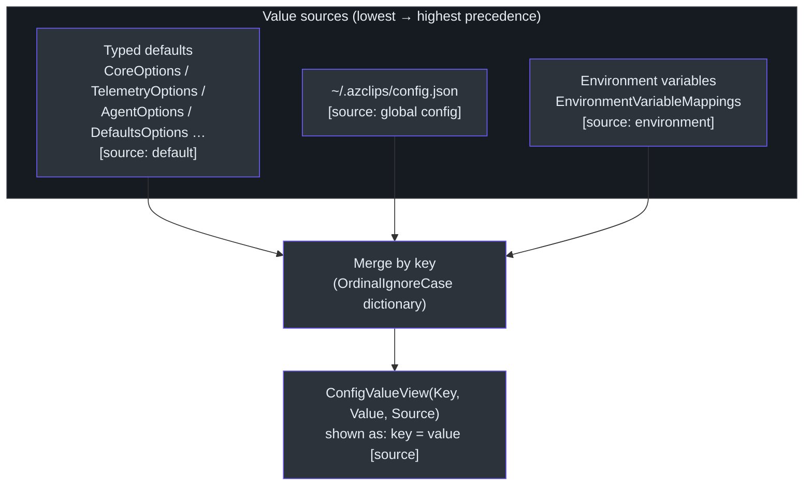
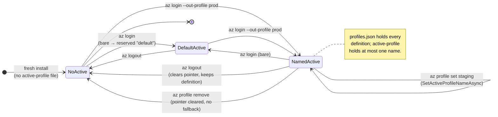
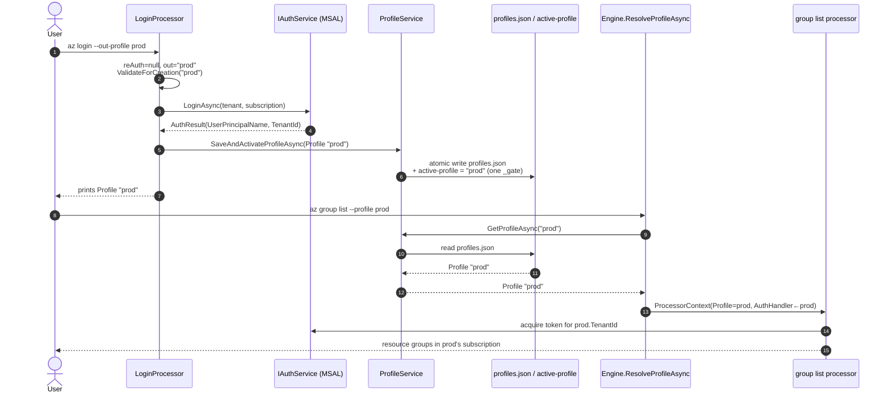

# Configuration & Profile Management

## Overview — why these two systems exist

Azclips needs to remember two very different kinds of state between invocations:

1. **Configuration** — user- and machine-scoped _settings_ such as "is telemetry on?",
   "is the agent enabled?", "what logging level should the engine use?". These are typed,
   validated, schema-driven key/value pairs persisted to `~/.azclips/config.json`.
2. **Connection profiles** — named _identities_ describing **how** Azclips talks to Azure
   (tenant, subscription, cloud, auth method, signed-in user). A `Profile` is the single
   source of truth for connection state; it **replaced** the old single `AuthContext` /
   `context.json` (feature #345).

Although both are "state on disk", they are deliberately separate subsystems with different
storage roots, different owners, and different lifetimes. Configuration lives under the
**user profile** root (`~/.azclips`), while profiles live under the **LocalApplicationData**
root (`{LocalAppData}/.azclips`) alongside the MSAL token cache. This page traces both from
the command surface down to the bytes on disk.

> **Terminology note.** The project codename is **Azclips**. All user data lives under `.azclips` (`~/.azclips` for
> config, `{LocalApplicationData}/.azclips` for profiles). The target framework is `net10.0`.

---

## Part A — The Config extension

### Command surface

The `Config` extension (`src/Extensions/Config/`) registers five verbs under the `config`
group (`src/Extensions/Config/ExtensionIndex.cs:8`). Each has a CLI invocation name and a
mirror PowerShell cmdlet:

| CLI command        | Processor             | PowerShell cmdlet  | Purpose                                       |
| ------------------ | --------------------- | ------------------ | --------------------------------------------- |
| `az config get`    | `GetConfigCommand`    | `Get-AzConfig`     | Read a key or a whole section (with defaults) |
| `az config set`    | `SetConfigCommand`    | `Set-AzConfig`     | Write a key; `--force` allows unknown keys    |
| `az config delete` | `DeleteConfigCommand` | `Remove-AzConfig`  | Remove a key                                  |
| `az config list`   | `ListConfigCommand`   | `Get-AzConfigList` | Enumerate effective values with their source  |
| `az config info`   | `InfoConfigCommand`   | `Get-AzConfigInfo` | Describe the schema (keys, types, validation) |

All five processors derive from `ConfigCommandBase` (`src/Extensions/Config/Commands/ConfigCommandBase.cs:15`),
which implements `IProcessor` and centralizes key normalization, value parsing, output
formatting, and schema access. The PowerShell mirror lives in `src/PS/Config` (`Cmdlets.Config.csproj`)
and shares the exact same processors, so behavior cannot drift between the two shells.

### Key normalization — one canonical form for two shells

Users type keys in different notations (`telemetry.enabled`, `telemetry:enabled`,
`Telemetry.Enabled`). `NormalizeKey` collapses all of them to a single dot-delimited,
trimmed form (`src/Extensions/Config/Commands/ConfigCommandBase.cs:42`):

```csharp
protected static string NormalizeKey(string key)
{
    ArgumentException.ThrowIfNullOrWhiteSpace(key);
    return string.Join(
        '.',
        key.Replace(':', '.')
            .Split('.', StringSplitOptions.RemoveEmptyEntries | StringSplitOptions.TrimEntries));
}
```

The service layer applies the **same** normalization and then _canonicalizes_ against the
schema so that a known key always persists with its schema-declared casing
(`CanonicalizeKnownKey`, `src/Core/Core.Configuration/Implementation/ConfigurationService.cs:238`).
Internally the .NET configuration path uses `:` separators, so the service converts back and
forth via `NormalizeConfigurationPath` (`ConfigurationService.cs:253`).

### The three-layer resolution model

`config get`/`config list` do not just echo the file — they present the **effective** value
and its origin. `GetResolvedEntriesAsync` merges three layers in precedence order
(`ConfigCommandBase.cs:55`):



Because the dictionary is keyed case-insensitively and rewritten in order, an environment
override wins over the file, which wins over the built-in default. Each surviving entry keeps
its `Source` label so `az config list` can print `telemetry.enabled = true [global config]`.

### Known keys come from typed options, not a hand-written list

There is no literal list of valid keys. The schema is _derived_ from the typed options
records. `BuildDefaultEntries` seeds a section map and walks the schema's declared keys,
reflecting the default value out of each options object (`ConfigCommandBase.cs:244`):

| Section prefix    | Options type             | Example keys                                             |
| ----------------- | ------------------------ | -------------------------------------------------------- |
| `core`            | `CoreOptions`            | `core.logging.level`, `core.http.maxRetries`             |
| `telemetry`       | `TelemetryOptions`       | `telemetry.enabled`                                      |
| `agent`           | `AgentOptions`           | `agent.enabled`, `agent.provider`, `agent.trace.enabled` |
| `assemblyLoading` | `AssemblyLoadingOptions` | —                                                        |
| `extensions`      | `ExtensionsOptions`      | —                                                        |
| `clients`         | `ClientsOptions`         | —                                                        |
| `defaults`        | `DefaultsOptions`        | per-parameter default values                             |

For example `telemetry.enabled` defaults to `true` (`src/Core/Core.Abstractions/TelemetryOptions.cs:8`)
and `agent.enabled` defaults to `false` (`src/Core/Core.Abstractions/AgentOptions.cs:11`) —
both discovered by reflection, never typed out in the command layer.

### When a config change takes effect

`IConfigurationService.GetConfiguration<T>()` re-parses `~/.azclips/config.json` on every
call, so most keys are effectively **live** — a `Set-AzConfig` / `az config set` write is
picked up by the very next command in the same session. This is true for `telemetry.enabled`,
`core.logging.level`, `core.http.maxRetries*`, and any `defaults.*` value that the engine
resolves per invocation.

A small number of values are read **once at container init** and cached inside a singleton,
so they only change after a session restart (in practice: closing PowerShell or the TUI, or
running `Remove-Module` followed by `Import-Module`). The current example is
`core.engine.extensionIndexCacheSize`, which sizes an LFU cache built lazily on first
extension resolve inside `Engine` (`src/Core/Core.Engine/Engine.cs:83`). Correctness is
unaffected — the cache just keeps whatever capacity it was created with — but if you want a
new size to take effect you'll need to restart the host.

If you add a new options-derived setting and it needs to react to `az config set` mid-session,
read it inside the code path that consumes it (or via a small helper like
`TelemetryService.IsTelemetryEnabled`), not once in a singleton constructor.

### Writing a value

`SetConfigCommand` is the smallest illustration of the flow: parse → validate → persist
(`src/Extensions/Config/Commands/SetConfigCommand.cs:9`):

```csharp
var parsedValue = ParseValue(Value);
await GetConfigurationService()
    .SetConfigurationAsync(Key, parsedValue, Force, CancellationToken)
    .ConfigureAwait(false);
await WriteOutput($"Set {Key} = {FormatValue(parsedValue)}", CancellationToken);
```

`ParseValue` tries JSON first (so `true`, `42`, `"eastus"` land as the right CLR type) and
falls back to the raw string on a JSON error (`ConfigCommandBase.cs:93`). Inside the service,
`SetConfigurationAsync` (`ConfigurationService.cs:97`):

1. Canonicalizes the key and **validates the key** — an unknown key is rejected unless
   `--force` is set (`Force` flag → `validator.ValidateKey(normalizedKey, force)`).
2. Validates the value against the schema (`ValidateValue`).
3. Acquires a **file lock** (`{configPath}.lock`, `FileShare.None`, up to a 10s spin —
   `AcquireMutationLockAsync`, `ConfigurationService.cs:174`).
4. Reads the JSON root, sets the nested value, and writes it back through the provider.

`--force` on `set`/`delete` therefore does exactly one thing: it relaxes the _key existence_
check so you can stash keys the schema doesn't know about (e.g. experimental extension keys).

### Persistence path

The config file path is centralized in `HomePaths` so no path literal is scattered across the
codebase (`src/Core/Core.Abstractions/HomePaths.cs:15`):

```csharp
public const string DefaultHomeDirectoryName = ".azclips";
public const string ConfigFileName = "config.json";

public static string GetDefaultConfigFilePath(string? userProfilePath = null)
    => Path.Combine(GetDefaultHomeRoot(userProfilePath), ConfigFileName);
```

So configuration always resolves to `~/.azclips/config.json` (the user-profile root),
distinct from the profile store described next.

---

## Part B — Profiles

### Why a Profile replaced AuthContext

Before #345, Azclips stored a single `AuthContext(TenantId, SubscriptionId)` in
`~/.azclips/context.json`, loaded once per processor execution. There was no way to keep
multiple connections or switch between them (`openspec/changes/profile-management/design.md:1`).
The profile change makes a **named `Profile`** the single source of truth for connection
state and deletes `AuthContext`, `IAuthContextService`/`AuthContextService`, and `context.json`
entirely (Decision 5, `design.md`).

The `Profile` record is a superset of the old context (`src/Core/Core.Abstractions/Models/Profile.cs:10`):

| Field                  | Meaning                                                                            |
| ---------------------- | ---------------------------------------------------------------------------------- |
| `Name`                 | Unique profile name (also the map key)                                             |
| `TenantId`             | Azure tenant (directory) ID                                                        |
| `SubscriptionId`       | Azure subscription ID                                                              |
| `CloudName`            | Cloud environment; **stored only**, no behavioral impact yet                       |
| `AuthMethod`           | `Browser` (default), `Broker`, `DeviceCode`, `ServicePrincipal`, `ManagedIdentity` |
| `DefaultLocation`      | Optional default region for commands that accept one                               |
| `DefaultResourceGroup` | Optional default resource group                                                    |
| `UserPrincipalName`    | Signed-in account (maps to MSAL `IAccount.Username`)                               |
| `ClientId`             | Optional client ID                                                                 |

### Storage layout and atomicity

`ProfileService` (`src/Core/Core.Runtime/ProfileService.cs:14`) implements `IProfileService`
(`src/Core/Core.Abstractions/IProfileService.cs`). Per Decision 2 of the design, all profiles
live in a single JSON object keyed by profile name, and the **active** profile name is stored
in a _separate_ pointer file (`design.md:38`):

| Artifact       | Path                                             | Contents                                |
| -------------- | ------------------------------------------------ | --------------------------------------- |
| Profile store  | `{LocalApplicationData}/.azclips/profiles.json`  | `Dictionary<string, Profile>` (JSON)    |
| Active pointer | `{LocalApplicationData}/.azclips/active-profile` | plain text: the active name (or absent) |

Two properties make this safe under concurrency:

- **In-process serialization.** A `SemaphoreSlim _gate = new(1, 1)` wraps every
  read-modify-write so concurrent calls in one process can't lose updates
  (`ProfileService.cs:38`).
- **Atomic cross-process writes.** `WriteFileAtomicAsync` writes to a
  `{path}.{guid}.tmp` file and then `File.Move(..., overwrite: true)` renames it over the
  destination — a reader never observes a half-written file (`ProfileService.cs:240`).

`SaveAndActivateProfileAsync` persists the profile **and** flips the active pointer under a
single `_gate` acquisition (`ProfileService.cs:86`), matching Decision 8's requirement that
save-and-activate is one native, single-lock operation rather than two independent writes.

### Profile state model



### Profile management commands (in the Login extension)

The CRUD/switch verbs are **not** in a separate extension — they live in the Login extension
under `src/Extensions/Login/Processors/`, all deriving from `ProfileProcessorBase`
(`src/Extensions/Login/Processors/ProfileProcessorBase.cs:10`), which deliberately does **not**
require a resolved `Profile` on the context:

| Command             | Processor                | Behavior                                                                                     |
| ------------------- | ------------------------ | -------------------------------------------------------------------------------------------- |
| `az profile list`   | `ProfileListProcessor`   | Lists all profiles, flagging the active one via a `ProfileSummary` projection                |
| `az profile show`   | `ProfileShowProcessor`   | Shows one profile by name **or** the active one (`--active`); the two are mutually exclusive |
| `az profile set`    | `ProfileSetProcessor`    | Sets the active pointer; **validates existence, no re-auth**                                 |
| `az profile remove` | `ProfileRemoveProcessor` | Deletes a definition; if it was active, clears the pointer (**no fallback to default**)      |

`ProfileSetProcessor` is the switch primitive — it resolves the named profile and only writes
the pointer, never re-authenticating (`src/Extensions/Login/Processors/ProfileSetProcessor.cs:16`):

```csharp
Profile profile = await profileService.GetProfileAsync(Name)
    ?? throw new ArgumentException($"Profile '{Name}' does not exist.");
await profileService.SetActiveProfileNameAsync(profile.Name);
```

`profile create` is intentionally **not** offered — profiles are created only as a side effect
of `login` (design Non-Goals). User-facing creation would go through
`ProfileNameValidator.ValidateForCreation`, which additionally rejects the reserved name
`"default"` (`src/Core/Core.Abstractions/ProfileNameValidator.cs:44`).

### Login semantics

`LoginProcessor` was repurposed to build and return a `Profile` (Decision 7). It reconciles
two mutually-exclusive flags before any authentication runs
(`src/Extensions/Login/Processors/LoginProcessor.cs:36`):

- **Bare `az login`** → saves the connection to the reserved profile named `"default"`,
  overwriting any previous default (`ReservedDefaultName`, `ProfileNameValidator.cs:14`).
- **`az login --out-profile <name>`** → validates the name for creation (rejecting `"default"`)
  and writes a new named profile.
- **`az login --profile <name>`** → **re-authenticates** an existing profile, sourcing tenant
  / subscription / cloud from that stored profile.
- **`--profile` + `--out-profile` together** → rejected with a fail-fast `ArgumentException`
  (`LoginProcessor.cs:46`) — one re-authenticates, the other creates; they can't be combined.

In all cases the result is persisted and activated in a single call:

```csharp
await profileService.SaveAndActivateProfileAsync(resultProfile);
await WriteOutput(resultProfile);
```

`az logout` signs out the active profile: it removes the matching MSAL account (identified by
`UserPrincipalName`) and clears the active pointer, but **retains** the profile definition
(Decision 6, `design.md`).

### The global `--profile` override

`--profile` also works as a _per-invocation override_ on regular commands (e.g.
`az group list --profile prod`). Until a general global-parameter framework exists, the value
is resolved by a pre-binding pass and threaded into the processor context by
`Engine.ResolveProfileAsync` (`src/Core/Core.Engine/Engine.cs:143`):

```csharp
private async Task<Profile?> ResolveProfileAsync(string? profileNameOverride)
{
    bool explicitOverride = !string.IsNullOrWhiteSpace(profileNameOverride);
    string? name = explicitOverride
        ? profileNameOverride?.Trim()
        : await profileService.GetActiveProfileNameAsync();

    if (string.IsNullOrWhiteSpace(name))
        return null;

    Profile? profile = await profileService.GetProfileAsync(name);
    if (profile is null && explicitOverride)
        throw new ArgumentException($"Profile '{profileNameOverride?.Trim()}' does not exist.");
    return profile;
}
```

The precedence is explicit-override → active profile → `null`. An **explicit** `--profile`
naming a missing profile is a hard error; a **stale active pointer** simply resolves to `null`
(the command runs unauthenticated and fails at point of use). The resolved `Profile` is placed
on both the `AuthHandler` and the `ProcessorContext`, and the HTTP auth pipeline reads
`Profile.TenantId`/`SubscriptionId` directly for token acquisition — there is no intermediate
`AuthContext` projection anymore (`Engine.cs:101`–`130`).

### Sequence: `az login --out-profile prod` then `az group list --profile prod`



Note that the second command used `--profile prod` explicitly, so it did **not** consult the
active pointer — even though `prod` happens to be active after the login.

---

## How the two systems relate

| Aspect            | Configuration                               | Profiles                                             |
| ----------------- | ------------------------------------------- | ---------------------------------------------------- |
| Root              | `~/.azclips` (UserProfile)                  | `{LocalApplicationData}/.azclips`                    |
| File(s)           | `config.json`                               | `profiles.json` + `active-profile`                   |
| Abstraction       | `IConfigurationService`                     | `IProfileService`                                    |
| Impl              | `ConfigurationService` (Core.Configuration) | `ProfileService` (Core.Runtime)                      |
| Concurrency       | `{path}.lock` file (cross-process spin)     | `SemaphoreSlim _gate` + atomic temp+rename           |
| Command home      | `Config` extension                          | `Login` extension                                    |
| Schema/validation | Typed options + `IConfigurationSchema`      | `ProfileNameValidator` (name rules, reserved `default`) |

The one place they touch: `agent.enabled` / `agent.provider` (configuration) gate the AI agent,
and the agent's environment prober reads the **active profile** to tell the model whether the
user is signed in — see the [AI Agent](./ai-agent.md) page.

---

## References

- `src/Extensions/Config/Commands/ConfigCommandBase.cs` — key normalization, three-layer resolution, formatting
- `src/Extensions/Config/Commands/SetConfigCommand.cs`, `GetConfigCommand.cs`, `ListConfigCommand.cs`, `DeleteConfigCommand.cs`, `InfoConfigCommand.cs`
- `src/Core/Core.Configuration/Implementation/ConfigurationService.cs` — validation, file lock, nested set/delete
- `src/Core/Core.Abstractions/IConfigurationService.cs`, `HomePaths.cs`
- `src/Core/Core.Abstractions/CoreOptions.cs`, `TelemetryOptions.cs`, `AgentOptions.cs` — typed known keys
- `src/Core/Core.Runtime/ProfileService.cs` — file-backed store, `_gate`, atomic writes
- `src/Core/Core.Abstractions/IProfileService.cs`, `Models/Profile.cs`, `ProfileNameValidator.cs`
- `src/Extensions/Login/Processors/LoginProcessor.cs`, `ProfileSetProcessor.cs`, `ProfileListProcessor.cs`, `ProfileShowProcessor.cs`, `ProfileRemoveProcessor.cs`, `ProfileProcessorBase.cs`
- `src/Core/Core.Engine/Engine.cs` — `ResolveProfileAsync` and context wiring
- `openspec/changes/profile-management/design.md` — Decisions 1–8 (storage, temp login, global `--profile`, AuthContext removal, logout, login output)
- `docs/azure-cli/docs-conceptual/config.md`, `eng-docs/spec/config-implementation.md`
