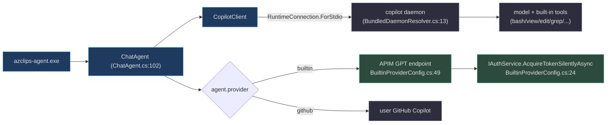
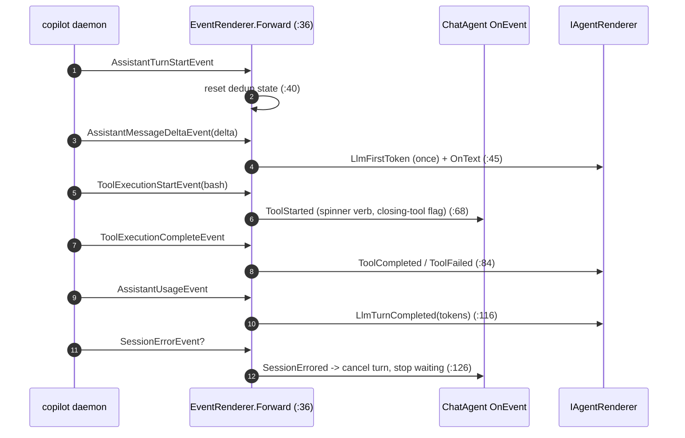

# Copilot SDK Integration

## Why the Copilot SDK (and a bundled daemon)

The agent does not call a model API directly. Instead it builds on the **GitHub
Copilot SDK 1.0.0** (`Agent/Core.Agent.csproj:49`), which speaks over stdio to a
**bundled `copilot` daemon** that owns the actual model calls and a rich set of
built-in tools (`bash`, `powershell`, `view`, `edit`, `grep`, `glob`,
`web_fetch`, `web_search`, `todo`). This buys azclips a maintained agent runtime
— streaming, tool-calling, permission hooks, session lifecycle — while azclips
supplies only what is Azure-specific: a system prompt, custom ARM/help tools, two
protocol tools, and the human-in-the-loop hooks.

The trade-off is a transport and a packaging problem: the daemon is a native
executable that must be located per-platform, and the model endpoint must be
authenticated. Both are solved inside `ChatAgent.CreateAsync`.

## Package dependencies

| Package | Version | Role | Source |
|---------|---------|------|--------|
| `GitHub.Copilot.SDK` | 1.0.0 | Agent runtime + daemon transport | `Agent/Core.Agent.csproj:49` |
| `Microsoft.Extensions.AI` | 9.10.0 | `AIFunction` tool abstractions | `Agent/Core.Agent.csproj:50` |
| `Azure.ResourceManager` | 1.13.1 | Live ARM reads for resource tools | `Agent/Core.Agent.csproj:47` |
| `Spectre.Console` | 0.57.2 | Rich console tool rendering | `Agent/Core.Agent.csproj:51` |

## Building the client and connecting to the daemon

`ChatAgent.CreateAsync` (`Agent/ChatAgent.cs:102`) constructs a `CopilotClient`
whose connection is `RuntimeConnection.ForStdio` pointed at the daemon path
resolved by `BundledDaemonResolver.Resolve()` (`Agent/ChatAgent.cs:118`):

```csharp
var client = new CopilotClient(new CopilotClientOptions
{
    Logger = sdkLogger,
    Connection = RuntimeConnection.ForStdio(path: BundledDaemonResolver.Resolve()),
});
```

`BundledDaemonResolver` (`Agent/BundledDaemonResolver.cs:13`) picks
`copilot.exe` on Windows or `copilot` elsewhere, computes a portable RID
(`win-x64`, `linux-arm64`, …), and joins it onto the native directory reported by
`AgentInstallLayout.SdkNativeDir(rid)` (`Agent/BundledDaemonResolver.cs:31`).

That base directory is decided at **compile time**, not by probing the disk.
`AgentInstallLayout` (`Agent/AgentInstallLayout.cs:22`) reads a constant baked in
by the `.csproj`: packaging scripts publish with `/p:IsPackagedBuild=true`; dev
builds define `AGENT_DEV_BUILD` instead (`Agent/Core.Agent.csproj:22`). Each DLL
therefore only ever looks at its own layout — an MSI-installed daemon and a
locally built one can coexist without confusion
(`Agent/AgentInstallLayout.cs:24`):

| Flavor | Prompts dir | Daemon native dir |
|--------|-------------|-------------------|
| Packaged (`IsPackaged=true`) | `Extensions/…Agent/prompts/` | `Extensions/…Agent/deps/runtimes/<rid>/native/` |
| Dev (`AGENT_DEV_BUILD`) | `<baseDir>/prompts/` | `<baseDir>/runtimes/<rid>/native/` |

Both paths are defined at `Agent/AgentInstallLayout.cs:35` (prompts) and `:43`
(daemon native).

## Choosing a provider

After building the base session config, `CreateCoreAsync` resolves the model and
provider from `agent.provider` (`Agent/ChatAgent.cs:212`):

- **`builtin`** (default) — sets the model to `agent.builtin.modelId` (default
  `gpt-5.4`) and builds the provider via `BuiltinProviderConfig.BuildAsync`
  (`Agent/ChatAgent.cs:216`).
- **`github`** — leaves the model empty and lets the daemon use the user's own
  GitHub Copilot subscription defaults (`Agent/ChatAgent.cs:221`).
- **anything else** — throws an `ArgumentException` naming the valid options
  (`Agent/ChatAgent.cs:225`).

`BuiltinProviderConfig.BuildAsync` (`Agent/Providers/BuiltinProviderConfig.cs:16`)
is where the "builtin" provider authenticates against Azure: it acquires an
ARM-scoped token silently through `IAuthService.AcquireTokenSilentlyAsync`
(`Agent/Providers/BuiltinProviderConfig.cs:24`) and returns an **Azure-type**
`ProviderConfig` pointed at the APIM-fronted GPT endpoint
(`Agent/Providers/BuiltinProviderConfig.cs:49`):

| `ProviderConfig` field | Value | Source |
|------------------------|-------|--------|
| `Type` | `"azure"` | `BuiltinProviderConfig.cs:51` |
| `WireApi` | `"responses"` | `BuiltinProviderConfig.cs:52` |
| `BaseUrl` | `agent.builtin.endpoint` (APIM URL) | `BuiltinProviderConfig.cs:53` |
| `BearerToken` | MSAL access token | `BuiltinProviderConfig.cs:54` |
| `ModelId` / `WireModel` | `agent.builtin.modelId` (`gpt-5.4`) | `BuiltinProviderConfig.cs:55` |
| `Azure.ApiVersion` | `agent.builtin.apiVersion` (`2025-04-01-preview`) | `BuiltinProviderConfig.cs:57` |

The endpoint, scope, model id, and API version defaults live in
`BuiltinProviderOptions` (`src/Core/Core.Abstractions/AgentOptions.cs:54`). So
while the SDK abstracts the model, the *builtin* provider still authenticates via
Azure/MSAL — the agent is **not** wired to Azure OpenAI directly, and it is **not**
its own credential path; it reuses the exact same `IAuthService` the CLI uses.



## Shaping the SDK system message

Rather than send a raw prompt, azclips **customizes** the SDK's default system
message through `SystemMessageMode.Customize` and a dictionary of
`SectionOverride`s (`Agent/ChatAgent.cs:278`). This lets azclips replace only the
identity and strip the sections that don't fit an Azure error-recovery agent:

| SDK section | Action | Why | Applies to |
|-------------|--------|-----|------------|
| `Identity` | Replace with `oneshot.md`/`inline.md` | Lead with the azclips agent identity | all modes |
| `Tone` | Remove | Drop the generic code-assistant voice | all modes |
| `CodeChangeRules` | Remove | azclips doesn't edit code | all modes |
| `CustomInstructions` | Remove | Prevent repo `CLAUDE.md`/commit rules leaking in | all modes |
| `ToolInstructions` | Remove | A single-shot plan needs no per-tool guides | **oneshot only** |
| `RuntimeInstructions` | Remove | No multi-turn scaffolding in one-shot | **oneshot only** |

Kept in all modes: `ToolEfficiency`, `EnvironmentContext`, `Guidelines`,
`Safety` (per the in-code comment at `Agent/ChatAgent.cs:266`). One-shot's extra
removals are applied at `Agent/ChatAgent.cs:285`.

## Registering tools and hooks

`BuildBaseSessionConfig` (`Agent/ChatAgent.cs:251`) assembles the `SessionConfig`:

- **Custom tools** are concatenated from the cache, help, SKU, submit, and plan
  tool sets and cast to `AIFunctionDeclaration`
  (`Agent/ChatAgent.cs:301`). Setting `AvailableTools = null`
  (`Agent/ChatAgent.cs:305`) leaves **all** daemon built-ins enabled alongside
  the custom set.
- **Hooks** wire azclips's logic into the SDK's lifecycle
  (`Agent/ChatAgent.cs:306`):

| Hook | azclips handler | Source |
|------|-----------------|--------|
| `OnPreToolUse` | `PreToolUseHook.HandleAsync` (plan gate, terminator, rewrite) | `Agent/Hooks/PreToolUseHook.cs:19` |
| `OnSessionStart` | inject `<environment>` + boundary reminder + pre-fetched help | `Agent/ChatAgent.cs:309` |
| `OnUserPromptSubmitted` | refresh the `<environment>` snapshot each turn | `Agent/ChatAgent.cs:330` |
| `OnPermissionRequest` | auto-approve read-only cache tools, else route to approval | `Agent/ChatAgent.cs:336` |
| `OnEvent` | `EventRenderer.Forward` (SDK → AgentEvent) | `Agent/ChatAgent.cs:347` |

## Translating the SDK event stream

The SDK emits `SessionEvent`s; azclips renders through a host-agnostic
`AgentEvent` hierarchy (`Agent/AgentEvents.cs:18`). `EventRenderer.Forward`
(`Agent/EventRenderer.cs:36`) is the translator, with two notable patterns baked
in: **streaming dedup** (render the aggregate `AssistantMessageEvent` only if no
`AssistantMessageDeltaEvent` streamed this turn) and a **side channel** from
`ToolCallId` to name/timestamp (the SDK's complete-event carries neither)
(`Agent/EventRenderer.cs:27`).

| SDK `SessionEvent` | Emitted `AgentEvent` | Source |
|--------------------|----------------------|--------|
| `AssistantTurnStartEvent` | resets per-turn dedup state | `Agent/EventRenderer.cs:40` |
| `AssistantMessageDeltaEvent` | `LlmFirstToken` (once) + streamed `OnText` | `Agent/EventRenderer.cs:45` |
| `AssistantMessageEvent` | `OnText` — only if nothing streamed | `Agent/EventRenderer.cs:59` |
| `ToolExecutionStartEvent` | `ToolStarted` | `Agent/EventRenderer.cs:68` |
| `ToolExecutionCompleteEvent` | `ToolCompleted` / `ToolFailed` | `Agent/EventRenderer.cs:84` |
| `AssistantUsageEvent` | `LlmTurnCompleted` (in/out/cached tokens) | `Agent/EventRenderer.cs:116` |
| `SessionErrorEvent` | `SessionErrored` | `Agent/EventRenderer.cs:126` |

`SessionErrored` matters for liveness: surfacing it lets the host render the
error and stop waiting; without it the host would hang until the 10-minute
`TurnTimeout` (`Agent/EventRenderer.cs:126`).



> **Latent surface.** The `SubAgentInvoke*` events
> (`Agent/AgentEvents.cs:77`) and `ParentCallId` linkage exist in the event
> model for a future diagnose sub-agent, but no current producer emits them —
> `EventRenderer` always sets `ParentCallId` to `null`
> (`Agent/EventRenderer.cs:80`). Treat them as forward-looking.

## Related pages

- [Agent Architecture](./agent-architecture.md) — the process and session lifecycle around this client.
- [Agent Tools](./agent-tools.md) — the custom tools registered into `SessionConfig.Tools`.
- [Prompts & Plan Mode](./prompts-and-plan-mode.md) — the `OnPreToolUse` hook and prompt assets.
- [Authentication (MSAL)](./authentication.md) — the `IAuthService` the builtin provider reuses.

## References

- `Agent/ChatAgent.cs:102` — `CreateAsync`, building the `CopilotClient` + stdio connection.
- `Agent/BundledDaemonResolver.cs:13` — resolving the platform `copilot` binary.
- `Agent/AgentInstallLayout.cs:22` — the compile-time packaged/dev asset layout.
- `Agent/Providers/BuiltinProviderConfig.cs:16` — the APIM/MSAL provider config.
- `Agent/EventRenderer.cs:36` — `Forward`, SDK-event to `AgentEvent` translation.
- `Agent/AgentEvents.cs:18` — the host-agnostic event model.
- `Agent/Core.Agent.csproj:49` — the `GitHub.Copilot.SDK` package reference.
- `src/Core/Core.Abstractions/AgentOptions.cs:54` — builtin provider defaults.
