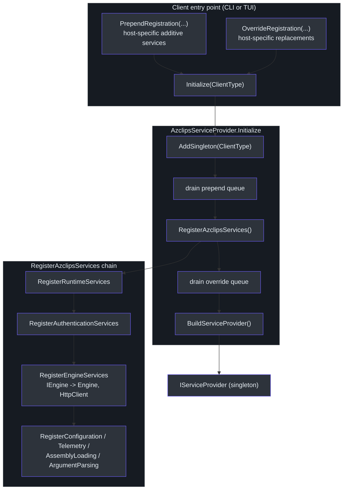
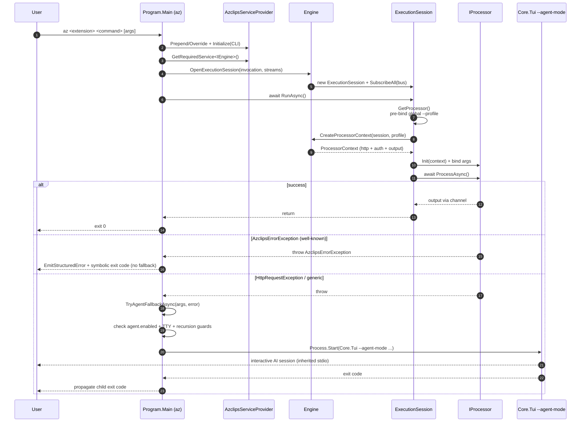

# Core Engine & Orchestration

## Overview

Everything the `az` binary does for a single command flows through three collaborating pieces: a **composition root** that builds the dependency-injection (DI) container exactly once (`AzclipsServiceProvider`), a **mediator** that owns per-invocation state and wiring (`Engine`), and a short-lived **session** that actually resolves the target processor and pumps its output (`ExecutionSession`). Around all of that sits the CLI's `Program.Main`, whose job is to _try_ to execute the command, _classify_ any failure, and — only for the right class of failure — _fall back_ to an AI agent.

This page traces the real code path end to end. It matters because the orchestration model changed: older internal docs describe an in-process `OrchestratorEngine` that "tries `DefaultCommandEngine`, then falls back to `AgentEngine`." **That is no longer how it works.** The current fallback spawns a _separate out-of-process TUI process_ in `--agent-mode`. We call this out explicitly below as **fact vs. stale doc**, because getting it wrong will send you looking for classes that do not exist in the tree.

> Terminology: the product is internally named **Azclips** (the composition root is `AzclipsServiceProvider`), while the user-facing brand and older docs say **Azclips**. Both names refer to the same system. The target framework is **net10.0**.

---

## 1. The composition root: `AzclipsServiceProvider`

`AzclipsServiceProvider` is a _static_ class — there is no `Bootstrapper` type. It holds a single process-wide `IServiceProvider` behind a double-checked lock, plus two queues of registration callbacks that clients enqueue _before_ the container is built (`src/Core/Core.DependencyInjection/AzclipsServiceProvider.cs:17`).

| Member                    | Purpose                                                                                                   | Citation                        |
| ------------------------- | --------------------------------------------------------------------------------------------------------- | ------------------------------- |
| `PrependRegistration`     | Queue a callback that runs **before** the default registrations. Throws if the provider is already built. | `AzclipsServiceProvider.cs:29`  |
| `OverrideRegistration`    | Queue a callback that runs **after** the defaults; DI last-wins means these win ties.                     | `AzclipsServiceProvider.cs:44`  |
| `RegisterAzclipsServices` | Chains every module's `Register…Services` extension into one call.                                        | `AzclipsServiceProvider.cs:53`  |
| `Initialize(ClientType)`  | Idempotent build: first caller wins, later calls no-op.                                                   | `AzclipsServiceProvider.cs:67`  |
| `GetRequiredService<T>`   | Resolve from the built container (throws if not initialized).                                             | `AzclipsServiceProvider.cs:96`  |
| `Dispose`                 | Dispose the container and clear both queues.                                                              | `AzclipsServiceProvider.cs:119` |

### Why prepend _and_ override?

Microsoft.Extensions.DependencyInjection uses **last-registration-wins** semantics for a given service type. The two queues give clients two distinct levers:

- **Prepend** runs first, so it can seed _additive_ services (e.g. multiple `IExtensionLoader` implementations) that the defaults may then consume.
- **Override** runs last, so it can _replace_ a default singleton (e.g. swap the default logging service for a host-specific one).

`Initialize` executes them in that exact order: seed `ClientType`, drain prepend queue, register defaults, drain override queue, then `BuildServiceProvider()` (`AzclipsServiceProvider.cs:77-89`). The `_serviceProvider is not null` fast-path plus the `lock` make it safe to call from multiple entry points (`AzclipsServiceProvider.cs:69-75`).

`RegisterAzclipsServices` is the canonical dependency graph — each module contributes its own `Register…Services` extension, chained fluently (`AzclipsServiceProvider.cs:53-61`):

```csharp
services
    .RegisterConfigurationServices()
    .RegisterTelemetryServices()
    .RegisterRuntimeServices()
    .RegisterAuthenticationServices()
    .RegisterEngineServices()
    .RegisterAssemblyLoadingServices()
    .RegisterArgumentParsingServices();
```

`RegisterEngineServices` is what binds `IEngine` to the concrete `Engine` and registers the shared `HttpClient` singleton (`src/Core/Core.Engine/DIRegisterExtensions.cs`).

### Each client customizes registrations before `Initialize`

Two hosts drive the same container differently:

- **CLI** (`src/CLI/Program.cs:56-70`) prepends the extension loaders (`BundledExtensionLoader`, `InstalledExtensionLoader`), `PropertyParser`, and the CLI dispatch services, then _overrides_ the assembly-loading, argument-parsing, and telemetry providers with CLI implementations, then calls `Initialize(ClientType.CLI)`.
- **TUI** (`TUI/Program.cs:23-41`) prepends its Azure/VFS/state services, then _overrides_ `ILoggingService` with a silent `TuiLoggingService` (so log lines can't corrupt the rendered UI) and swaps the telemetry provider, then calls `Initialize(ClientType.TUI)`.

The `ClientType` singleton seeded at the top of `Initialize` (`AzclipsServiceProvider.cs:79`) is how downstream services (and the `Engine`) know which host they are running under.

### The DI composition graph



---

## 2. The `Engine`: a partial mediator

`Engine` is declared as a `partial class` implementing `IEngine` (`src/Core/Core.Engine/Engine.cs:22`; interface at `src/Core/Core.Abstractions/IEngine.cs:8`). It uses a primary constructor that receives every collaborating service — profile, auth, telemetry, logging, assembly loading, argument parsing, configuration, and the HTTP pipeline service — plus the shared `HttpClient` and the `ClientType` (`Engine.cs:22-32`).

The mediator's contract is deliberately small — `IEngine` exposes only two methods (`IEngine.cs:8`):

| Method                 | Returns    | Role                                                     |
| ---------------------- | ---------- | -------------------------------------------------------- |
| `OpenExecutionSession` | `ISession` | Run one concrete command invocation.                     |
| `OpenDiscoverySession` | `ISession` | Enumerate extension/command metadata (help, completion). |

### What `OpenExecutionSession` wires up

`OpenExecutionSession` constructs an `ExecutionSession`, subscribes all of the engine's event handlers to that session's event bus, publishes a `SessionCreated` event, and then injects a bundle of delegates into the session (`Engine.cs:39-60`). The session is intentionally passive — it holds no service references; instead the engine hands it _function pointers_ into itself:

| Delegate on the session  | Backed by                                              |
| ------------------------ | ------------------------------------------------------ |
| `LoadAssembly`           | `assemblyLoadingService.LoadExtension`                 |
| `BindProcessor`          | `argumentParsingService.BindArgumentsToProcessor`      |
| `CreateProcessorContext` | `Engine.CreateProcessorContext`                        |
| `CacheGetOrAdd`          | `Engine.CacheGetOrAdd`                                 |
| `Option`                 | `configurationService.GetConfiguration<CoreOptions>()` |

`SubscribeAll` (in the sibling partial `Engine.Subscriptions.cs:15`) attaches three families of handlers to the bus — message logging, telemetry activities, and metrics — so that every event the session publishes is observed centrally (`Engine.Subscriptions.cs:26-224`).

### Extension-index caching

Loading an extension assembly and reflecting its command index is expensive, so the engine caches indices in an `LFUCache<Lazy<IExtensionIndex>>` (`Engine.cs:36`). `CacheGetOrAdd` lazily creates the cache sized from `CoreOptions.Engine.ExtensionIndexCacheSize` and keys entries by `name` or `name-version` (`Engine.cs:81-89`). Wrapping the value in `Lazy<T>` guarantees the factory runs **exactly once per key** even under concurrent access — critical because sessions run on the thread pool. Transient invocations bypass the cache entirely (`ExecutionSession.cs:50-54`).

### Building the per-invocation `ProcessorContext`

`CreateProcessorContext` (`src/Core/Core.Engine/Engine.cs:99`) is where a single invocation's runtime is assembled. In order, it:

1. Resolves the effective `Profile` via `ResolveProfileAsync` (`Engine.cs:143`).
2. Builds an `AuthHandler` seeded with that profile and the silent token-acquisition delegate (`Engine.cs:102-107`).
3. Builds an `OutputHandler` bound to the session's per-invocation output writer (`Engine.cs:110-113`).
4. Builds a fresh `HttpPipeline` sized by `CoreOptions.Http.MaxRetries` / `MaxRetriesFor429` (`Engine.cs:115-118`).
5. **Prepends `authHandler.SendAsync`** onto the pipeline and packs everything into the `ProcessorContext` record (`Engine.cs:123-130`).
6. Prepends a passthrough terminating step and appends a request-tracing step (`Engine.cs:132-134`).

Steps 4–6 are covered in depth on the [HTTP Pipeline & Runtime](./http-pipeline.md) page.

`ResolveProfileAsync` encodes an important rule: an _explicit_ `--profile X` that names a non-existent profile is a hard error, whereas a _stale active pointer_ simply resolves to `null` (`Engine.cs:143-161`). A null profile means no token is acquired, and commands that require auth fail later at point of use with a clear message.

---

## 3. `ExecutionSession`: isolated output + pre-binding

`ExecutionSession` is an `internal` class implementing `ISession` (`src/Core/Core.Engine/ExecutionSession.cs:12`). Each session owns its own `RuntimeEventBus` and a channel-based output path so that concurrent invocations never cross output streams (`ExecutionSession.cs:34-44`).

### `RunAsync` — the async CLI path

The CLI uses the async entry point (`ExecutionSession.cs:57`):

```csharp
public async Task RunAsync()
{
    ObjectDisposedException.ThrowIf(_disposed, this);
    EventBus.Token.ThrowIfCancellationRequested();
    ProcessorOutputWriter = sessionOutputWriter;
    await (await GetProcessor()).ProcessAsync();
}
```

`GetProcessor` (`ExecutionSession.cs:213`) is the heart of the session:

1. Look up `CommandMetadata` from the (possibly cached) extension index (`ExecutionSession.cs:215`).
2. **Global `--profile` pre-binding pass**: extract and normalize the global `--profile`/`-Profile` value from the _raw_ invocation parameters _before_ the processor context is created (`ExecutionSession.cs:221`, `ExtractGlobalProfileParameter` at `:243`). This must happen first because the resolved `Profile?` is injected via `Init()` _ahead of_ the command-specific argument binding. This ordering is the concrete implementation of Decision 4 in `openspec/changes/profile-management/design.md`.
3. Create the `ProcessorContext` for that profile (`ExecutionSession.cs:224`).
4. `Init(context)` the processor instance, then bind the remaining CLI arguments onto it (`ExecutionSession.cs:226-234`).

The parallel synchronous `Run()` method (`ExecutionSession.cs:76`) exists for PowerShell hosts: it pumps a `Channel<object>` on the caller's runspace thread while the processor runs on the thread pool, because `$PSCmdlet.WriteObject` has strict thread affinity (`ExecutionSession.cs:114-149`). The CLI does not use this path.

Every processor implements the tiny `IProcessor` contract — `Init(ProcessorContext)` then `ProcessAsync()` (`src/Core/Core.Abstractions/CLIContracts.cs:11-14`).

---

## 4. Orchestration & fallback in `Program.Main`

The CLI `Main` (`src/CLI/Program.cs`) is the outer orchestrator. `GlobalArgParser.Parse` classifies the invocation into a `GlobalArgs` record; version and help are dispatched from that record before `ExtensionDispatcher.Parse` runs (no more control-flow-via-exceptions on the cold path). The inner `try`'s `catch` blocks _classify_ real failures. The classification is the whole point: not every failure deserves an AI fallback.

| Caught exception        | Handling                                                   | Fallback? |
| ----------------------- | ---------------------------------------------------------- | --------- |
| _(success)_             | `RunAsync()` returns, exit `0`                             | —         |
| `HttpRequestException`  | Network failure → try agent                                | **Yes**   |
| `AzclipsErrorException` | Structured, well-known error → render + symbolic exit code | **No**    |
| `Exception` (generic)   | Unknown failure → try agent                                | **Yes**   |

Help and version return before this ladder runs — they read from `globalArgs.Help` / `globalArgs.Version` and dispatch through [`RuntimeHelpDispatcher`](../../src/CLI/Help/RuntimeHelpDispatcher.cs) / [`RuntimeVersionDispatcher`](../../src/CLI/Version/RuntimeVersionDispatcher.cs) directly.

The design intent is explicit in the source: a structured `AzclipsErrorException` means "the failure is well-known and the user's intent is unambiguous", so there is **no AI fallback**. Only network faults and _unclassified_ exceptions route into `TryAgentFallbackAsync`.

### ⚠️ Fact vs. stale doc: the fallback is out-of-process

**Stale doc** — `AGENTS.md:16` states:

> "**Orchestrator**: `OrchestratorEngine` tries `DefaultCommandEngine` first, falls back to `AgentEngine` (AI) on failure"

and `eng-docs/spec/ARCHITECTURE.md` repeats an in-process `OrchestratorEngine → DefaultCommandEngine → AgentEngine` routing model.

**Fact** — no `OrchestratorEngine`, `DefaultCommandEngine`, or `AgentEngine` type exists in `src/` today. The real fallback, `TryAgentFallbackAsync` (`src/CLI/Program.cs:281`), **spawns a separate process** — the TUI binary (`Core.Tui`) with `--agent-mode` — and waits for it to exit:

1. **Opt-in gate** — returns `1` unless config `agent.enabled` is `true`; if config can't be read, it fails safe to disabled (`Program.cs:287-299`).
2. **Non-interactive guard** — if stdin or stdout is redirected (CI, pipes), it surfaces the original error instead of hanging on prompts (`Program.cs:308-311`).
3. **Recursion guard** — if `AZCLIPS_IN_AGENT_MODE == "1"`, it refuses to spawn another agent (`Program.cs:315-318`).
4. **Locate binary** — `FindTuiExe()` probes for `Core.Tui[.exe]` next to `az` (`Program.cs:390-404`).
5. **Spawn** — starts `Core.Tui --agent-mode --failed-command <args> [--error <text>]` with inherited stdio and `AZCLIPS_IN_AGENT_MODE=1` set on the child, then `await proc.WaitForExitAsync()` and returns the child's exit code (`Program.cs:329-361`).

On the receiving side, `TUI/Program.cs:21` short-circuits into `AgentModeEntry.RunAsync(args)` when its first argument is `--agent-mode`, _before_ any TUI DI setup — the agent runs as a first-class alternate entry point of a different executable, not an engine swapped in-process.

### End-to-end sequence (with fallback)



---

## Key takeaways

- The composition root is the **static** `AzclipsServiceProvider`; there is no `Bootstrapper`. Clients customize the container only through `PrependRegistration` / `OverrideRegistration` _before_ the idempotent `Initialize` (`AzclipsServiceProvider.cs:17,29,44,67`).
- `Engine` is a **partial mediator** that owns caching, event subscription, and per-invocation `ProcessorContext` construction, but delegates the actual work into passive `ExecutionSession` delegates (`Engine.cs:22,39,99`).
- `ExecutionSession.GetProcessor` performs a **global `--profile` pre-binding pass** before context creation so the resolved profile is available at `Init()` time (`ExecutionSession.cs:213-224`).
- The CLI **classifies** failures: structured `AzclipsErrorException` never falls back; only `HttpRequestException`/generic exceptions do (`Program.cs:121-144`).
- The fallback is an **out-of-process `Core.Tui --agent-mode` spawn**, not an in-process `OrchestratorEngine`/`AgentEngine` — the AGENTS.md / ARCHITECTURE.md description is stale (`Program.cs:281`, `TUI/Program.cs:21`).

## References

- `src/Core/Core.DependencyInjection/AzclipsServiceProvider.cs` — composition root (`:17`, `:29`, `:44`, `:53`, `:67`)
- `src/Core/Core.Engine/Engine.cs` — mediator, caching, `CreateProcessorContext` (`:22`, `:36`, `:81`, `:99`, `:143`)
- `src/Core/Core.Engine/Engine.Subscriptions.cs` — event subscriptions (`:15`)
- `src/Core/Core.Engine/ExecutionSession.cs` — session, `RunAsync`, `GetProcessor`, profile pre-bind (`:12`, `:57`, `:213`, `:243`)
- `src/Core/Core.Abstractions/IEngine.cs` — engine contract (`:8`)
- `src/Core/Core.Abstractions/CLIContracts.cs` — `IProcessor` contract (`:11`)
- `src/CLI/Program.cs` — orchestration & fallback (`:40`, `:65`, `:121`, `:128`, `:281`)
- `TUI/Program.cs` — TUI registrations & `--agent-mode` entry (`:21`, `:23`)
- `AGENTS.md:16`, `eng-docs/spec/ARCHITECTURE.md` — **stale** OrchestratorEngine model
- `openspec/changes/profile-management/design.md` — Decision 4 (global `--profile` pre-binding)
